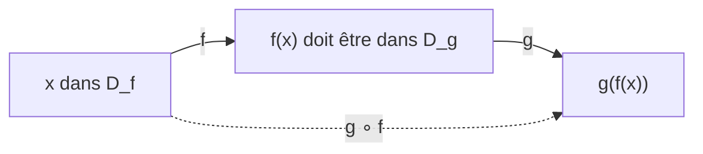

# Composée de deux fonctions

!!! info "Objectifs pédagogiques et compétences"
    - Définir $g\circ f$ et **déterminer son domaine**.
    - Décomposer une fonction en composée de fonctions de référence.
    - Déduire parité et variations d'une composée ; connaître le rôle de la condition $f(I)\subset J$.
    - Savoir que $g\circ f\neq f\circ g$ en général.

!!! note "Prérequis"
    Domaine, variations, parité, fonctions de référence (carré, inverse, racine, valeur absolue), inéquations.

## 1. Définition

!!! definition "Définition : Composée de deux fonctions"
    Soient $f$ définie sur $D_f$ et $g$ définie sur $D_g$. La **composée** de $f$ suivie de $g$, notée $g\circ f$ (« $g$ rond $f$ »), est la fonction
    $$(g\circ f)(x)=g\bigl(f(x)\bigr),\qquad D_{g\circ f}=\{x\in D_f\;:\;f(x)\in D_g\}.$$

!!! attention "Attention : L'ordre compte : $g\circ f\neq f\circ g$"
    Avec $f(x)=x+1$ et $g(x)=x^2$ : $(g\circ f)(x)=(x+1)^2$ et $(f\circ g)(x)=x^2+1$.

    Avec $f(x)=\sqrt x$ et $g(x)=x-2$ : $g\circ f=\sqrt x-2$ sur $[0;+\infty[$ ; $f\circ g=\sqrt{x-2}$ sur $[2;+\infty[$. Les **domaines** diffèrent aussi.

## 2. Parité

!!! propriete "Propriété : Parité d'une composée"
    Soit $f$ de domaine symétrique.

    - $f$ paire $\Rightarrow$ $g\circ f$ paire (quelle que soit $g$).
    - $f$ impaire et $g$ impaire $\Rightarrow$ $g\circ f$ impaire.
    - $f$ impaire et $g$ paire $\Rightarrow$ $g\circ f$ paire.

??? abstract "Démonstration"
    $f$ paire : $(g\circ f)(-x)=g(f(-x))=g(f(x))$. $f$ impaire, $g$ impaire : $g(f(-x))=g(-f(x))=-g(f(x))$. $f$ impaire, $g$ paire : $g(-f(x))=g(f(x))$.

!!! attention "Attention : L'hypothèse porte sur $f$ (la première)"
    $f(x)=x^2$ (paire) et $g(x)=x+1$ : $f\circ g=(x+1)^2$ n'est **pas** paire ($g$ est la première fonction appliquée, et elle n'est ni paire ni impaire).

## 3. Variations

!!! propriete "Propriété : Variations d'une composée"
    Soit $f$ monotone sur $I$ et $g$ monotone sur $J$ avec $f(I)\subset J$. Alors $g\circ f$ est monotone sur $I$ :

    | $f$ sur $I$ | $g$ sur $J$ | $g\circ f$ sur $I$ |
    |:---:|:---:|:---:|
    | croissante | croissante | croissante |
    | décroissante | décroissante | **croissante** |
    | croissante | décroissante | décroissante |
    | décroissante | croissante | décroissante |

??? abstract "Démonstration"
    Soit $a<b$ dans $I$, $f$ croissante et $g$ décroissante sur $J$. Alors $f(a)\le f(b)$, avec $f(a),f(b)\in J$, donc $g(f(a))\ge g(f(b))$ : $g\circ f$ décroissante. Les autres cas sont analogues. **La condition $f(I)\subset J$ sert à pouvoir appliquer la monotonie de $g$ aux deux images.**

!!! attention "Attention : Découper $I$ pour que $f(I)\subset J$"
    $h(x)=(2x-1)^2$ : $f(x)=2x-1$ est croissante sur $\mathbb{R}$ ; $g(x)=x^2$ est décroissante sur $]-\infty;0]$ et croissante sur $[0;+\infty[$. On découpe selon $f(x)\le0\iff x\le\frac12$ :

    - sur $]-\infty;\frac12]$, $f(I)\subset]-\infty;0]$ : $h$ décroissante ;
    - sur $[\frac12;+\infty[$, $f(I)\subset[0;+\infty[$ : $h$ croissante.

!!! methode "Méthode : Étudier une fonction composée"
    1. Repérer $h(x)=g(f(x))$ : « la dernière opération » est $g$, « la première » est $f$.
    2. Donner $D_h$.
    3. Découper en intervalles $I$ où $f$ est monotone **et** $f(I)$ est dans un intervalle où $g$ est monotone.
    4. Appliquer le tableau, compléter par la parité.
    5. Calculer les valeurs aux bornes.

## 4. Exemples corrigés

!!! example "Exemple : Décomposer"
    $h(x)=\sqrt{x^2+1}$ : $f(x)=x^2+1$, $g(x)=\sqrt x$, $h=g\circ f$. $h$ est définie sur $\mathbb{R}$, paire (car $f$ paire). Sur $[0;+\infty[$ : $f$ croissante, $f([0;+\infty[)=[1;+\infty[\subset[0;+\infty[$ où $g$ est croissante : $h$ croissante. Minimum $h(0)=1$.

!!! example "Exemple : $h(x)=\sqrt{4-x^2}$"
    $D=[-2;2]$. $f(x)=4-x^2$, $g=\sqrt{\ }$. $h$ paire. Sur $[0;2]$ : $f$ décroissante, $f([0;2])=[0;4]\subset[0;+\infty[$, $g$ croissante : $h$ décroissante. Par parité, $h$ croissante sur $[-2;0]$. Maximum $h(0)=2$ (demi-cercle de rayon 2).

## 5. Exercices progressifs

!!! question "Exercice 1 – Calculs"
    $f(x)=2x-3$ et $g(x)=x^2+1$. Calculer $g\circ f$, $f\circ g$, $(g\circ f)(2)$, $(f\circ g)(2)$. Résoudre $(g\circ f)(x)=(f\circ g)(x)$.

    ??? success "Corrigé"
        $(g\circ f)(x)=(2x-3)^2+1=4x^2-12x+10$ ; $(f\circ g)(x)=2(x^2+1)-3=2x^2-1$. $(g\circ f)(2)=g(1)=2$ ; $(f\circ g)(2)=f(5)=7$.

        Égalité : $4x^2-12x+10=2x^2-1\iff2x^2-12x+11=0$ ; $\Delta=144-88=56$, $x=\dfrac{12\pm2\sqrt{14}}{4}=3\pm\dfrac{\sqrt{14}}2$.

!!! question "Exercice 2 – Domaines"
    $f(x)=\sqrt{x-1}$ et $g(x)=\dfrac1{x-3}$. Donner $D_{g\circ f}$ et $D_{f\circ g}$.

    ??? success "Corrigé"
        $g\circ f$ : $x\ge1$ et $\sqrt{x-1}\neq3\iff x\neq10$ : $D=[1;10[\,\cup\,]10;+\infty[$.

        $f\circ g$ : $x\neq3$ et $g(x)\ge1$. Pour $x<3$, $g(x)<0$ : exclu. Pour $x>3$ : $\frac1{x-3}\ge1\iff x-3\le1\iff x\le4$. $D=]3;4]$.

!!! question "Exercice 3 – $h(x)=\sqrt{x^2-2x}$"
    Domaine, variations (justifier avec le théorème), valeurs prises.

    ??? success "Corrigé"
        $x^2-2x\ge0\iff x\le0$ ou $x\ge2$ : $D=]-\infty;0]\cup[2;+\infty[$. $f(x)=x^2-2x$ est décroissante sur $]-\infty;0]$ (sommet en $1$) et croissante sur $[2;+\infty[$ ; $f(I)\subset[0;+\infty[$ où $\sqrt{\ }$ est croissante. $h$ décroissante sur $]-\infty;0]$, croissante sur $[2;+\infty[$ ; $h(0)=h(2)=0$ ; $h$ prend toutes les valeurs de $[0;+\infty[$.

## 6. Exercices type contrôle

!!! question "Exercice C1 – $h(x)=\dfrac1{1+|x|}$ (12 min)"
    a) Décomposer. b) Parité. c) Variations. d) Encadrer $h$. e) Résoudre $h(x)=\frac13$.

    ??? success "Corrigé"
        a) $h=g\circ f$ avec $f(x)=1+|x|$ et $g(x)=\frac1x$. $D=\mathbb{R}$.

        b) $f$ paire donc $h$ paire.

        c) Sur $[0;+\infty[$ : $f$ croissante et $f(I)\subset[1;+\infty[\subset]0;+\infty[$ où $g$ est décroissante : $h$ décroissante. Par parité, $h$ croissante sur $]-\infty;0]$. Maximum $h(0)=1$.

        d) $1+|x|\ge1$, donc $0<h(x)\le1$.

        e) $1+|x|=3\iff|x|=2\iff x=\pm2$.

!!! question "Exercice C2 – Parité et composition (12 min)"
    a) Démontrer que si $f$ et $g$ sont impaires, $g\circ f$ est impaire. b) Que dire si $f$ est impaire et $g$ paire ? c) Donner un contre-exemple à « $f$ paire $\Rightarrow$ $f\circ g$ paire ».

    ??? success "Corrigé"
        a) $(g\circ f)(-x)=g(-f(x))=-g(f(x))$. b) $g\circ f$ est paire. c) $f(x)=x^2$, $g(x)=x+1$ : $(f\circ g)(x)=(x+1)^2$, et $(f\circ g)(1)=4\neq0=(f\circ g)(-1)$.

!!! question "Exercice C3 – Une involution (20 min)"
    Soit $f(x)=\dfrac{1-x}{1+x}$. a) Domaine. b) Domaine de $f\circ f$. c) Montrer que $(f\circ f)(x)=x$. d) Que cela dit-il de $\mathcal{C}_f$ ? e) $f\circ f$ est-elle la fonction $x\mapsto x$ sur $\mathbb{R}$ ?

    ??? success "Corrigé"
        a) $D_f=\mathbb{R}\setminus\{-1\}$.

        b) $x\neq-1$ et $f(x)\neq-1$. $f(x)=-1\iff1-x=-1-x\iff1=-1$ : impossible. Donc $D_{f\circ f}=\mathbb{R}\setminus\{-1\}$.

        c) $f(f(x))=\dfrac{1-\frac{1-x}{1+x}}{1+\frac{1-x}{1+x}}=\dfrac{\frac{(1+x)-(1-x)}{1+x}}{\frac{(1+x)+(1-x)}{1+x}}=\dfrac{2x}{2}=x$.

        d) $f$ est sa propre « réciproque » : si $M(x;y)\in\mathcal{C}_f$, alors $y=f(x)$ et $x=f(y)$, donc $M'(y;x)\in\mathcal{C}_f$ : $\mathcal{C}_f$ est symétrique par rapport à la droite $y=x$.

        e) **Non** : $f\circ f$ et $x\mapsto x$ coïncident sur $\mathbb{R}\setminus\{-1\}$, mais $f\circ f$ n'est pas définie en $-1$.

!!! tip "Fiche de révision"
    - $(g\circ f)(x)=g(f(x))$ ; $D=\{x\in D_f:f(x)\in D_g\}$.
    - $g\circ f\neq f\circ g$.
    - $f$ paire $\Rightarrow g\circ f$ paire ; impaire∘impaire = impaire ; paire∘impaire = paire.
    - Variations : même sens $\Rightarrow$ croissante ; sens contraires $\Rightarrow$ décroissante, **à condition** que $f(I)\subset J$.
