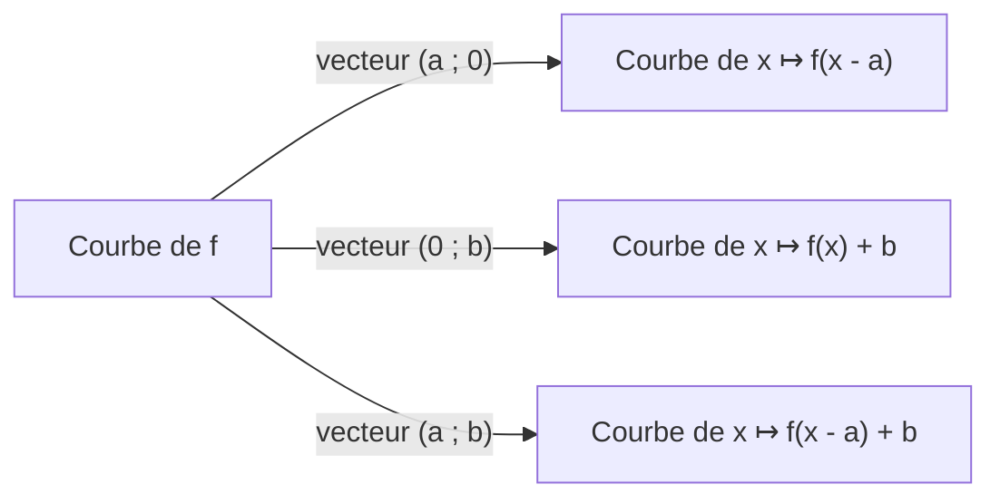

# Translation de courbe : $g(x)=f(x-a)$

!!! info "Objectifs pédagogiques et compétences"
    - Démontrer et utiliser : la courbe de $x\mapsto f(x-a)$ est l'image de $\mathcal{C}_f$ par la translation de vecteur $a\,\vec\imath$.
    - Combiner translations horizontale et verticale.
    - Démontrer qu'une courbe admet un **axe** ou un **centre** de symétrie à l'aide d'une translation.

!!! note "Prérequis"
    Courbe représentative, vecteurs et coordonnées, translations, parité, fonctions de référence.

## 1. Propriété fondamentale

!!! propriete "Propriété : Translation horizontale"
    Soit $a\in\mathbb{R}$, $f$ une fonction et $g(x)=f(x-a)$. Dans un repère $(O;\vec\imath,\vec\jmath)$ :

    - $D_g=\{x:\;x-a\in D_f\}=D_f+a$ ;
    - la courbe $\mathcal{C}_g$ est l'image de $\mathcal{C}_f$ par la translation de vecteur $a\,\vec\imath$ (vecteur de coordonnées $(a\,;0)$).

??? abstract "Démonstration"
    Soit $M(x\,;y)$ un point du plan et $M'(x+a\,;y)$ son image par la translation de vecteur $a\vec\imath$. Alors
    $$M\in\mathcal{C}_f\iff y=f(x)\iff y=g(x+a)\iff M'\in\mathcal{C}_g,$$
    car $g(x+a)=f\bigl((x+a)-a\bigr)=f(x)$. Ainsi $\mathcal{C}_g$ est exactement l'image de $\mathcal{C}_f$.

!!! attention "Attention : Le signe est contre-intuitif"
    $f(x-2)$ décale $\mathcal{C}_f$ vers la **droite** de $2$ ; $f(x+3)$ vers la **gauche** de $3$. Pour s'en convaincre : $g(x)=f(x-2)$ prend en $x=2$ la valeur que $f$ prenait en $0$.

!!! propriete "Propriété : Translation verticale et combinée"
    $x\mapsto f(x)+b$ : translation de vecteur $b\,\vec\jmath$. $x\mapsto f(x-a)+b$ : translation de vecteur $a\vec\imath+b\vec\jmath$, de coordonnées $(a\,;b)$.

!!! propriete "Propriété : Conséquences"
    Si $f$ est croissante (resp. décroissante) sur $I$, alors $g(x)=f(x-a)$ est croissante (resp. décroissante) sur $I+a$. Un extremum de $f$ en $x_0$ devient un extremum de $g$ en $x_0+a$, de même valeur.

## 2. Axes et centres de symétrie

!!! propriete "Propriété : Axe de symétrie $x=a$"
    La courbe $\mathcal{C}_f$ admet pour axe de symétrie la droite d'équation $x=a$ si et seulement si, pour tout $h$ tel que $a+h\in D_f$ : $a-h\in D_f$ et
    $$f(a+h)=f(a-h).$$
    Cela revient à dire que $x\mapsto f(a+x)$ est **paire**.

!!! propriete "Propriété : Centre de symétrie $\Omega(a\,;b)$"
    $\mathcal{C}_f$ admet $\Omega(a\,;b)$ pour centre de symétrie si et seulement si, pour tout $h$ tel que $a+h\in D_f$ : $a-h\in D_f$ et
    $$f(a+h)+f(a-h)=2b.$$
    Cela revient à dire que $x\mapsto f(a+x)-b$ est **impaire**.

??? abstract "Démonstration"
    La translation de vecteur $-a\vec\imath-b\vec\jmath$ envoie $\Omega$ sur $O$ et $\mathcal{C}_f$ sur la courbe de $x\mapsto f(a+x)-b$. Or $\mathcal{C}_f$ est symétrique par rapport à $\Omega$ si et seulement si cette courbe est symétrique par rapport à $O$, c'est-à-dire (propriété du chapitre *Parité*) si $x\mapsto f(a+x)-b$ est impaire. Même argument pour l'axe $x=a$ avec la parité.

!!! attention "Attention : Ne pas vérifier un seul point"
    Il faut établir l'égalité **pour tout** $h$ (calcul littéral), pas seulement pour une ou deux valeurs.

!!! methode "Méthode : Prouver une symétrie"
    1. Poser $x=a+h$ et calculer $f(a+h)$, puis $f(a-h)$. 2. Simplifier : le résultat doit **ne dépendre que de $h^2$** (axe) ou donner $2b$ en somme (centre). 3. Vérifier que les domaines sont symétriques autour de $a$.

## 3. Exemples corrigés

!!! example "Exemple : Parabole"
    $f(x)=x^2-6x+5$. $f(3+h)=9+6h+h^2-18-6h+5=h^2-4$ et $f(3-h)=h^2-4$. Donc $x=3$ est axe de symétrie (c'est aussi la forme canonique $(x-3)^2-4$ : translation de $x^2$ de vecteur $(3;-4)$).

!!! example "Exemple : Cubique"
    $f(x)=x^3-3x^2+3x=(x-1)^3+1$ : $f(1+h)=h^3+1$ et $f(1-h)=-h^3+1$, somme $=2$. $\Omega(1;1)$ est centre de symétrie.

!!! example "Exemple : Hyperbole translatée"
    $f(x)=\dfrac1{x-1}+2$ : $f(1+h)=\frac1h+2$, $f(1-h)=-\frac1h+2$, somme $=4=2\times2$. Centre $\Omega(1;2)$. $D_f=\mathbb{R}\setminus\{1\}$ est bien symétrique autour de $1$.

## 4. Exercices progressifs

!!! question "Exercice 1 – Lecture de transformations"
    Décrire la transformation de $\mathcal{C}_{|x|}$ donnant $x\mapsto|x-3|+2$, puis $x\mapsto|x+1|-2$. Donner sommet, axe, zéros.

    ??? success "Corrigé"
        $|x-3|+2$ : translation de vecteur $(3;2)$ ; sommet $(3;2)$ ; axe $x=3$ ; pas de zéro (minimum $2>0$). $|x+1|-2$ : vecteur $(-1;-2)$ ; sommet $(-1;-2)$ ; axe $x=-1$ ; zéros $x=1$ et $x=-3$.

!!! question "Exercice 2 – Domaine et variations"
    $g(x)=\sqrt{x+3}-1$. Domaine, variations, tableau, image de $\mathcal{C}_{\sqrt{\ }}$.

    ??? success "Corrigé"
        $D_g=[-3;+\infty[$. $g(x)=f(x+3)-1$ avec $f=\sqrt{\ }$ : translation de vecteur $(-3;-1)$. Croissante sur $[-3;+\infty[$, minimum $g(-3)=-1$. Zéro : $\sqrt{x+3}=1\iff x=-2$.

!!! question "Exercice 3 – Axe de symétrie d'une fonction racine"
    Montrer que la courbe de $f(x)=\sqrt{5+4x-x^2}$ admet pour axe la droite $x=2$ et donner son domaine.

    ??? success "Corrigé"
        $5+4x-x^2=9-(x-2)^2\ge0\iff|x-2|\le3\iff x\in[-1;5]$, symétrique autour de $2$. $f(2+h)=\sqrt{9-h^2}=f(2-h)$. Axe $x=2$ ; c'est un demi-cercle de centre $(2;0)$ et de rayon $3$.

## 5. Exercices type contrôle

!!! question "Exercice C1 – Fonction non paire mais symétrique (12 min)"
    $f(x)=|x-1|+|x-3|$. a) Axe de symétrie ? b) $g(x)=f(x+2)$ : expression et parité. c) Lien entre a) et b).

    ??? success "Corrigé"
        a) $f(2+h)=|h+1|+|h-1|$, $f(2-h)=|-h+1|+|-h-1|=|h-1|+|h+1|$ : égalité, axe $x=2$.

        b) $g(x)=|x+1|+|x-1|$, paire car $g(-x)=|-x+1|+|-x-1|=|x-1|+|x+1|=g(x)$.

        c) $\mathcal{C}_g$ est $\mathcal{C}_f$ translatée de $-2\vec\imath$ : l'axe $x=2$ devient l'axe $(Oy)$ : $g$ est paire.

!!! question "Exercice C2 – Centre de symétrie d'une homographique (15 min)"
    $f(x)=\dfrac{2x+1}{x-1}$. a) Montrer $f(x)=2+\dfrac3{x-1}$. b) Montrer que $\Omega(1;2)$ est centre de symétrie. c) Variations sur chaque intervalle du domaine.

    ??? success "Corrigé"
        a) $2+\dfrac3{x-1}=\dfrac{2(x-1)+3}{x-1}=\dfrac{2x+1}{x-1}$ ✓.

        b) $f(1+h)=2+\frac3h$ et $f(1-h)=2-\frac3h$ ; somme $=4$. $D=\mathbb{R}\setminus\{1\}$ symétrique autour de $1$.

        c) $\frac1{x-1}$ décroît sur $]-\infty;1[$ et sur $]1;+\infty[$ ; multiplier par $3>0$ conserve ; ajouter $2$ conserve. $f$ décroissante sur chacun de ces intervalles.

!!! question "Exercice C3 – Le piège du signe (8 min)"
    Un élève affirme que la courbe de $x\mapsto(x+4)^2$ s'obtient en décalant celle de $x^2$ de $4$ vers la droite. A-t-il raison ? Où est le sommet ?

    ??? success "Corrigé"
        Non, vers la **gauche** : $(x+4)^2=f(x-(-4))$, vecteur $(-4;0)$, sommet $(-4;0)$.

!!! tip "Fiche de révision"
    - $\mathcal{C}_{f(x-a)}$ : translation de vecteur $(a;0)$ ; $f(x)+b$ : vecteur $(0;b)$ ; $f(x-a)+b$ : vecteur $(a;b)$.
    - Axe $x=a$ : $f(a+h)=f(a-h)$ ; centre $(a;b)$ : $f(a+h)+f(a-h)=2b$.
    - Domaine translaté : $D_f+a$ ; variations conservées, extrema translatés.
