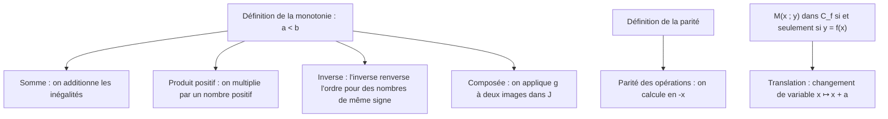

# Comprendre, utiliser, démontrer : opérations sur les fonctions

## 1. Pourquoi ces résultats sont vrais

!!! propriete "Propriété : Trois idées qui expliquent presque tout"
    1. **Une fonction est une machine** : composer, c'est brancher la sortie de $f$ sur l'entrée de $g$ ; d'où l'ordre et la condition $f(x)\in D_g$.
    2. **Une opération arithmétique se fait point par point** : $f+g$, $fg$, $\frac fg$ n'existent qu'aux points où tout est défini.
    3. **Les inégalités se comparent point à point** : démontrer une variation, c'est comparer deux images pour $a<b$.

## 2. Savoir quand l'utiliser

| Question | Réflexe |
|---|---|
| Domaine d'une expression | liste des conditions : racines $\ge0$, dénominateurs $\neq0$, intersection |
| Variations d'une somme | même sens $\Rightarrow$ somme de même sens ; sinon $h(b)-h(a)$ |
| Variations d'un produit | croissantes **et positives** ; sinon factoriser $h(b)-h(a)$ |
| Variations de $\frac1f$ | signe constant, variations contraires |
| Variations de $g\circ f$ | découper pour que $f(I)\subset J$ |
| Parité d'une opération | tableau de parité ; $f^2$ paire |
| Courbe de $f(x-a)+b$ | translation de vecteur $(a;b)$ |
| Preuve de symétrie | $f(a\pm h)$ |

## 3. Savoir démontrer

!!! attention "Attention : Les sept pièges de ce thème"
    1. Domaine oublié ($f\circ g$, $f+g$, $f/g$).
    2. $\sqrt u\sqrt v=\sqrt{uv}$ sans vérifier les signes.
    3. Produit de deux fonctions croissantes non positives.
    4. Somme de variations contraires : pas de théorème.
    5. Inverse sur un intervalle contenant un zéro ou changeant de signe.
    6. $g\circ f=f\circ g$ ?
    7. $f(x-a)$ : décalage vers la **droite**.

!!! question "Exercice Auto-évaluation"
    Sans le cours : démontrer que $\frac1f$ a des variations contraires ; donner un contre-exemple pour le produit de deux fonctions croissantes ; démontrer la propriété de translation ; prouver que $\Omega(1;2)$ est centre de symétrie de $x\mapsto\frac{2x+1}{x-1}$.

    ??? success "Corrigé"
        Ces quatre éléments sont dans les chapitres 01, 02, 04. Chronométrez-vous : 5 minutes par démonstration.
