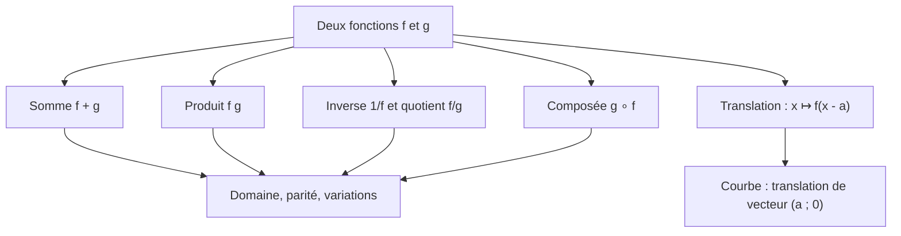

# Opérations sur les fonctions

| Chapitre | Contenu |
|---|---|
| [01 – Somme et produit](01-somme-produit.md) | Définitions, domaine, parité, variations |
| [02 – Inverse et quotient](02-inverse-quotient.md) | Domaine, variations, parité |
| [03 – Composée](03-composee.md) | $g\circ f$, domaine, parité, variations |
| [04 – Translation](04-translation.md) | $x\mapsto f(x-a)$, axes et centres de symétrie |
| [05 – Comprendre et démontrer](05-comprendre-et-demontrer.md) | Synthèse du thème |
