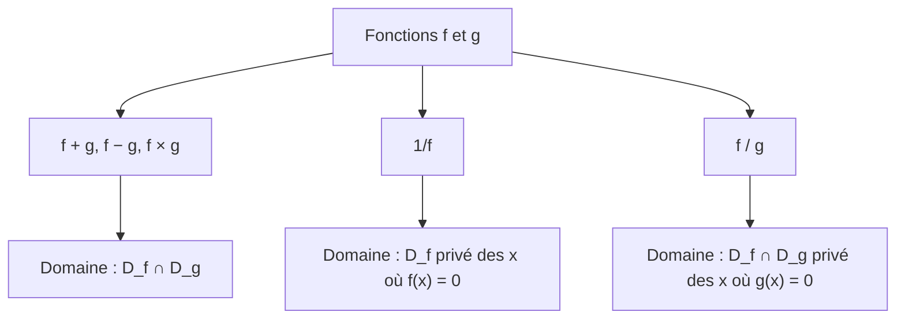

# Opérations sur les fonctions : somme, produit, inverse, quotient

## Objectifs pédagogiques et compétences

À la fin de ce chapitre, tu dois savoir :

- définir la **somme**, le **produit**, l'**inverse** et le **quotient** de fonctions, et déterminer **leur ensemble de définition** ;
- distinguer une **fonction** (par exemple $f+g$) d'un **nombre** (par exemple $f(x)+g(x)$) ;
- énoncer et **démontrer** les résultats sur les variations d'une somme, d'un produit de fonctions positives, d'un inverse ;
- savoir quand **aucune règle générale** ne s'applique, et conclure par le calcul de $f(y)-f(x)$ ;
- reconnaître une fonction comme **combinaison** de fonctions de référence ;
- étudier le **signe** d'un produit ou d'un quotient de fonctions.

## Prérequis

- ensemble de définition, image, antécédent ;
- variations d'une fonction (croissante, décroissante, extremum) ;
- fonctions de référence : $x\mapsto x$, $x^2$, $x^3$, $\sqrt x$, $\dfrac1x$, $|x|$ ;
- tableaux de signes (chapitre 3 du second degré) ;
- parité (chapitre `01-parite`).

---

## 1. Définitions

!!! info "Définition : somme, différence, multiple"
    Soient $f$ et $g$ deux fonctions définies sur $D_f$ et $D_g$, et $k$ un réel.

    - La **somme** $f+g$ est la fonction définie sur $D_f\cap D_g$ par $(f+g)(x)=f(x)+g(x)$.
    - La **différence** $f-g$ est définie sur $D_f\cap D_g$ par $(f-g)(x)=f(x)-g(x)$.
    - Le **multiple** $kf$ est défini sur $D_f$ par $(kf)(x)=k\,f(x)$.

!!! info "Définition : produit"
    Le **produit** $fg$ (ou $f\times g$) est la fonction définie sur $D_f\cap D_g$ par $(fg)(x)=f(x)\,g(x)$.

!!! info "Définition : inverse"
    Si $f$ est définie sur $D_f$, l'**inverse** $\dfrac1f$ est la fonction définie sur $\{x\in D_f\ ;\ f(x)\neq0\}$ par $\left(\dfrac1f\right)(x)=\dfrac1{f(x)}$.

!!! info "Définition : quotient"
    Le **quotient** $\dfrac fg$ est la fonction définie sur $\{x\in D_f\cap D_g\ ;\ g(x)\neq0\}$ par $\left(\dfrac fg\right)(x)=\dfrac{f(x)}{g(x)}$.

!!! warning "Points d'attention : domaines et notations"
    - **Le domaine se détermine avant de simplifier.** Avec $f(x)=x^2-1$ et $g(x)=x+1$, la fonction $\dfrac fg$ est définie sur $\mathbb R\setminus\{-1\}$. Elle coïncide avec $x\mapsto x-1$ **sur ce domaine seulement** : ce ne sont pas la même fonction (domaines différents).
    - **$f+g$ est une fonction ; $f(x)+g(x)$ est un nombre.** L'écriture $f+g(x)$ est incorrecte : on écrit $(f+g)(x)$.
    - **$\dfrac1f\neq f^{-1}$** : $f^{-1}$ désigne la **fonction réciproque** (hors programme ici) ; $\dfrac1f$ est l'inverse **pour la multiplication**.
    - **L'inverse exclut les zéros de $f$**, le quotient exclut les zéros de $g$ (au dénominateur).
    - **$fg$ n'est pas $f\circ g$** (produit et composition sont deux opérations différentes ; la composition est vue dans le chapitre suivant).

!!! example "Exemple de domaines"
    Soit $f(x)=\sqrt x$ ($D_f=[0\,;+\infty[$) et $g(x)=x-2$ ($D_g=\mathbb R$).

    | Fonction | Ensemble de définition |
    |---|---|
    | $f+g$ et $fg$ | $[0\,;+\infty[$ |
    | $\dfrac1g$ | $\mathbb R\setminus\{2\}$ |
    | $\dfrac1f$ | $]0\,;+\infty[$ ($f(0)=0$ est exclu) |
    | $\dfrac fg$ | $[0\,;+\infty[\setminus\{2\}$ |
    | $\dfrac gf$ | $]0\,;+\infty[$ |

---

## 2. Variations et opérations

!!! abstract "Propriété : somme"
    Soient $f$ et $g$ définies sur un intervalle $I$.

    - Si $f$ et $g$ sont **croissantes** sur $I$, alors $f+g$ est **croissante** sur $I$.
    - Si $f$ et $g$ sont **décroissantes** sur $I$, alors $f+g$ est **décroissante** sur $I$.
    - Si $f$ est croissante et $g$ décroissante : **on ne peut rien dire en général**.

!!! abstract "Démonstration"
    Soient $x<y$ dans $I$, $f$ et $g$ croissantes : $f(x)\le f(y)$ et $g(x)\le g(y)$. En additionnant membre à membre : $f(x)+g(x)\le f(y)+g(y)$, c'est-à-dire $(f+g)(x)\le(f+g)(y)$. Le cas décroissant est identique avec les inégalités renversées. $\blacksquare$

!!! abstract "Propriété : multiple"
    Si $f$ est croissante sur $I$ : $kf$ est croissante si $k>0$ et **décroissante si $k<0$**. Si $k=0$, $kf$ est la fonction nulle (constante).

!!! abstract "Propriété : produit de fonctions positives"
    Si $f$ et $g$ sont **croissantes** et **positives** sur $I$, alors $fg$ est **croissante** sur $I$.

!!! abstract "Démonstration"
    Soit $x<y$ dans $I$ : $0\le f(x)\le f(y)$ et $0\le g(x)\le g(y)$. Alors
    $f(x)g(x)\le f(y)g(x)$ (on multiplie $f(x)\le f(y)$ par $g(x)\ge0$) puis $f(y)g(x)\le f(y)g(y)$ (on multiplie $g(x)\le g(y)$ par $f(y)\ge0$).
    Donc $(fg)(x)\le(fg)(y)$. $\blacksquare$

!!! abstract "Propriété : inverse"
    Soit $f$ une fonction qui **ne s'annule pas** sur un intervalle $I$ (et garde donc un signe constant, en vertu du théorème des valeurs intermédiaires admis, ou par hypothèse). Si $f$ est **monotone** sur $I$, alors $\dfrac1f$ est monotone sur $I$ avec le **sens de variation contraire** :

    - $f$ croissante sur $I$ $\Rightarrow$ $\dfrac1f$ **décroissante** sur $I$ ;
    - $f$ décroissante sur $I$ $\Rightarrow$ $\dfrac1f$ **croissante** sur $I$.

    Cela vaut pour $f>0$ sur $I$ **comme pour** $f<0$ sur $I$.

!!! abstract "Démonstration"
    Soient $x<y$ dans $I$. Alors
    $$\frac1{f(x)}-\frac1{f(y)}=\frac{f(y)-f(x)}{f(x)\,f(y)}.$$
    Le produit $f(x)f(y)$ est **strictement positif** (même signe sur tout $I$). Si $f$ est croissante, $f(y)-f(x)\ge0$, donc $\frac1{f(x)}\ge\frac1{f(y)}$ : $\frac1f$ est décroissante. Si $f$ est décroissante, $f(y)-f(x)\le0$ et l'on obtient l'inverse. $\blacksquare$

!!! warning "Points d'attention : erreurs fréquentes"
    - **« Croissante + décroissante »** : aucune conclusion générale ($x+(-x)$ est constante, $x+(-2x)$ est décroissante, $2x+(-x)$ est croissante).
    - **Le produit de deux fonctions croissantes n'est pas toujours croissant** : $x\mapsto x$ est croissante sur $\mathbb R$ mais $x\times x=x^2$ ne l'est pas. Il faut la **positivité**.
    - **L'inverse ne change pas les variations sur un domaine qui contient un zéro de $f$** : $\frac1x$ est décroissante sur $]-\infty\,;0[$ et sur $]0\,;+\infty[$, mais **pas** sur $\mathbb R^*$ ($\frac1{-1}=-1<1=\frac11$).
    - **Une fonction constante** est à la fois croissante et décroissante : à traiter à part dans les conclusions.
    - **Un produit par un réel négatif** inverse les variations.

---

## 3. Signe et parité

!!! abstract "Propriété : signe d'un produit et d'un quotient"
    En chaque réel $x$, $(fg)(x)$ et $\left(\frac fg\right)(x)$ ont le **signe du produit** $f(x)\times g(x)$ (règle des signes). Pour étudier leur signe, on construit un **tableau de signes** avec une ligne par fonction, et on place une **double barre** pour les valeurs interdites du quotient.

!!! abstract "Propriété : parité (rappel du chapitre précédent)"
    Pour $f$ et $g$ définies sur un même ensemble symétrique par rapport à $0$ : paire $\times$ paire = paire ; impaire $\times$ impaire = **paire** ; paire $\times$ impaire = **impaire** ; l'inverse d'une fonction paire (resp. impaire) est paire (resp. impaire).

---

## 4. Méthodes à maîtriser

!!! tip "Méthode 1 : domaine d'une combinaison"
    1. Écrire le domaine de **chaque** fonction.
    2. Prendre l'**intersection**.
    3. Retirer les $x$ pour lesquels un **dénominateur** s'annule (résoudre $g(x)=0$ dans $D_g$).
    4. Donner le domaine **avant** toute simplification.

!!! tip "Méthode 2 : variations d'une combinaison"
    1. **Décomposer** la fonction en opérations de fonctions de référence.
    2. Appliquer les propriétés **sur un intervalle où les hypothèses sont vérifiées** (signe constant, positivité).
    3. Si aucune règle ne s'applique, étudier le **signe de $f(y)-f(x)$** pour $x<y$ (méthode de la différence).

!!! tip "Méthode 3 : méthode de la différence (cas général)"
    Pour $x<y$ dans $I$, calculer $f(y)-f(x)$, **factoriser** pour faire apparaître $(y-x)>0$, puis étudier le signe du facteur restant selon la position de $x,y$.

!!! example "Exemples corrigés"
    **Exemple 1 : somme.** $h(x)=x^2+\sqrt x$ sur $[0\,;+\infty[$ : $x^2$ et $\sqrt x$ sont croissantes sur $[0\,;+\infty[$, donc $h$ est **croissante** sur $[0\,;+\infty[$.

    **Exemple 2 : produit.** $p(x)=x\sqrt x$ sur $[0\,;+\infty[$ : $x\mapsto x$ et $\sqrt x$ sont croissantes **et positives** sur cet intervalle, donc $p$ est croissante.

    **Exemple 3 : inverse.** $q(x)=\dfrac1{x^2+1}$. Sur $\mathbb R$, $x^2+1\ge1>0$, donc $D_q=\mathbb R$. La fonction $x\mapsto x^2+1$ est croissante sur $[0\,;+\infty[$ et strictement positive : $q$ est **décroissante** sur $[0\,;+\infty[$. Elle est paire, donc **croissante** sur $]-\infty\,;0]$. Maximum $q(0)=1$.

    **Exemple 4 : méthode de la différence.** $r(x)=x+\dfrac1x$ sur $]0\,;+\infty[$. Pour $0<x<y$ :
    $$r(y)-r(x)=(y-x)+\frac1y-\frac1x=(y-x)-\frac{y-x}{xy}=(y-x)\,\frac{xy-1}{xy}.$$
    Comme $y-x>0$ et $xy>0$, le signe est celui de $xy-1$.
    - Si $0<x<y\le1$ : $xy<1$, donc $r(y)<r(x)$ : $r$ est **décroissante** sur $]0\,;1]$.
    - Si $1\le x<y$ : $xy>1$, donc $r(y)>r(x)$ : $r$ est **croissante** sur $[1\,;+\infty[$.

    Minimum $r(1)=2$ sur $]0\,;+\infty[$. On retrouve que $x+\frac1x\ge2$ pour $x>0$ : en effet $x+\frac1x-2=\frac{(x-1)^2}{x}\ge0$.

---

## 5. Exercices progressifs

### Exercice 1 : ensembles de définition

Soit $f(x)=\sqrt{x+1}$ et $g(x)=\dfrac1{x-2}$. Donner les ensembles de définition de $f+g$, $fg$, $\dfrac fg$, $\dfrac gf$ et $\dfrac1f$.

??? success "Corrigé"
    $D_f=[-1\,;+\infty[$ et $D_g=\mathbb R\setminus\{2\}$.

    - $f+g$ et $fg$ : $D_f\cap D_g=[-1\,;+\infty[\setminus\{2\}$.
    - $\dfrac fg$ : il faut $g(x)\neq0$. Or $\frac1{x-2}$ ne s'annule **jamais** : $[-1\,;+\infty[\setminus\{2\}$. On a $\dfrac fg(x)=\sqrt{x+1}\,(x-2)$ sur ce domaine.
    - $\dfrac gf$ : $f(x)\neq0\iff x\neq-1$ : $]-1\,;+\infty[\setminus\{2\}$.
    - $\dfrac1f$ : $]-1\,;+\infty[$.

    **Piège** : $\frac fg=\sqrt{x+1}(x-2)$ semble définie en $2$, mais la valeur $2$ **reste exclue** car $g(2)$ n'existe pas.

### Exercice 2 : simplifier sans changer de domaine

Soit $f(x)=x^2-1$ et $g(x)=x+1$. Donner $\dfrac fg$ et $\dfrac gf$ avec leurs domaines. Les fonctions $\dfrac fg$ et $x\mapsto x-1$ sont-elles égales ?

??? success "Corrigé"
    - $\dfrac fg$ : $x\neq-1$ ; $\dfrac fg(x)=\dfrac{(x-1)(x+1)}{x+1}=x-1$ sur $\mathbb R\setminus\{-1\}$.
    - $\dfrac gf$ : $x^2-1\neq0\iff x\neq\pm1$ ; $\dfrac gf(x)=\dfrac1{x-1}$ sur $\mathbb R\setminus\{-1\,;1\}$.
    - $\dfrac fg$ et $x\mapsto x-1$ ont des **ensembles de définition différents** : elles ne sont pas égales (la première n'est pas définie en $-1$).

### Exercice 3 : variations de sommes

Étudier les variations de : (a) $x^3+x$ sur $\mathbb R$ ; (b) $x^2-x$ sur $]-\infty\,;0]$ ; (c) $\sqrt x-x$ sur $[0\,;+\infty[$.

??? success "Corrigé"
    - (a) $x^3$ et $x$ sont croissantes sur $\mathbb R$ : la somme est **croissante** sur $\mathbb R$.
    - (b) Sur $]-\infty\,;0]$ : $x^2$ est décroissante et $-x$ aussi (multiple négatif d'une croissante). La somme est **décroissante**.
    - (c) $\sqrt x$ croissante et $-x$ décroissante : **aucune règle**. On étudie $\sqrt x-x=-(\sqrt x-\frac12)^2+\frac14$ : en posant $u=\sqrt x\ge0$, la fonction $-u^2+u$ est croissante pour $u\le\frac12$ et décroissante ensuite. Elle est donc croissante sur $\left[0\,;\frac14\right]$ et décroissante sur $\left[\frac14\,;+\infty\right[$, maximum $\frac14$ en $x=\frac14$.

### Exercice 4 : variations d'inverses

Étudier : (a) $f(x)=\dfrac1{x^2-4x+5}$ ; (b) $g(x)=\dfrac1{2x-4}$ sur $]2\,;+\infty[$ et sur $]-\infty\,;2[$. $g$ est-elle décroissante sur $\mathbb R\setminus\{2\}$ ?

??? success "Corrigé"
    - (a) $x^2-4x+5=(x-2)^2+1\ge1>0$ : $D_f=\mathbb R$. Cette expression est décroissante sur $]-\infty\,;2]$ puis croissante sur $[2\,;+\infty[$. Donc $f$ est **croissante** sur $]-\infty\,;2]$, **décroissante** sur $[2\,;+\infty[$, maximum $f(2)=1$.
    - (b) $2x-4$ est croissante sur $\mathbb R$, positive sur $]2\,;+\infty[$, négative sur $]-\infty\,;2[$. $g$ est **décroissante sur chacun** des deux intervalles.
      Mais $g(1)=-\frac12<\frac12=g(3)$ avec $1<3$ : $g$ **n'est pas décroissante** sur $\mathbb R\setminus\{2\}$.

### Exercice 5 : produit

(a) Montrer que $p(x)=(x+1)\sqrt x$ est croissante sur $[0\,;+\infty[$. (b) Donner un exemple de deux fonctions croissantes dont le produit n'est pas croissant.

??? success "Corrigé"
    - (a) Sur $[0\,;+\infty[$, $x+1$ et $\sqrt x$ sont croissantes et positives : le produit est croissant.
    - (b) $f(x)=g(x)=x$ sur $\mathbb R$ : $fg(x)=x^2$ n'est pas croissante sur $\mathbb R$ (par exemple $fg(-2)=4>1=fg(-1)$). La positivité manque pour $x<0$.

### Exercice 6 : signe d'un quotient

Étudier le signe de $h(x)=\dfrac{(x-1)\sqrt x}{x-4}$ et donner son ensemble de définition.

??? success "Corrigé"
    $D_h=[0\,;4[\cup]4\,;+\infty[$ (il faut $x\ge0$ et $x\neq4$).

    | $x$ | $0$ | | $1$ | | $4$ | | $+\infty$ |
    |---|---|---|---|---|---|---|---|
    | $x-1$ | $-$ | $-$ | $0$ | $+$ | $+$ | $+$ | |
    | $\sqrt x$ | $0$ | $+$ | $+$ | $+$ | $+$ | $+$ | |
    | $x-4$ | $-$ | $-$ | $-$ | $-$ | $0$ | $+$ | |
    | $h(x)$ | $0$ | $+$ | $0$ | $-$ | $\|\|$ | $+$ | |

    $h(x)>0$ sur $]0\,;1[\cup]4\,;+\infty[$ ; $h(x)<0$ sur $]1\,;4[$ ; $h(0)=h(1)=0$.
    Test : $h(2)=\frac{1\times1{,}414}{-2}<0$ ✔.

---

## 6. Exercices type contrôle

### Exercice A : étude complète

Soit $f(x)=x+\dfrac4x$ définie sur $\mathbb R^*$.

1. Étudier la parité de $f$.
2. Pour $0<x<y$, montrer que $f(y)-f(x)=\dfrac{(y-x)(xy-4)}{xy}$ et en déduire les variations sur $]0\,;+\infty[$.
3. En déduire le tableau de variations sur $\mathbb R^*$.
4. Résoudre $f(x)=5$, puis montrer que $f(x)\ge4$ pour tout $x>0$.

??? success "Corrigé"
    1. $D=\mathbb R^*$ est symétrique et $f(-x)=-x-\frac4x=-f(x)$ : **impaire**.
    2. $f(y)-f(x)=(y-x)+4\left(\frac1y-\frac1x\right)=(y-x)-\frac{4(y-x)}{xy}=\frac{(y-x)(xy-4)}{xy}$.
       Signe de $xy-4$ :
       - $0<x<y\le2$ : $xy<4$, donc $f(y)<f(x)$ : **décroissante** sur $]0\,;2]$ ;
       - $2\le x<y$ : $xy>4$, donc $f(y)>f(x)$ : **croissante** sur $[2\,;+\infty[$.

       Minimum $f(2)=2+2=4$.
    3. Par imparité (variations **conservées**) :

       | $x$ | $-\infty$ | | $-2$ | | $0$ | | $2$ | | $+\infty$ |
       |---|---|---|---|---|---|---|---|---|---|
       | $f(x)$ | | $\nearrow$ | $-4$ | $\searrow$ | $\|\|$ | $\searrow$ | $4$ | $\nearrow$ | |

       (Sur $]-\infty\,;-2]$, $f$ croît jusqu'au maximum local $f(-2)=-4$, puis décroît sur $[-2\,;0[$.)
    4. $f(x)=5\iff x^2-5x+4=0$ (en multipliant par $x\ne0$) $\iff x=1$ ou $x=4$. Vérification : $f(1)=5$ ✔, $f(4)=4+1=5$ ✔.
       Pour $x>0$ : $f(x)\ge f(2)=4$ (minimum). Autre voie : $f(x)-4=\frac{x^2-4x+4}{x}=\frac{(x-2)^2}{x}\ge0$.

    **Pièges** : le tableau d'une fonction impaire se **prolonge sans inverser** les variations ; $f$ n'est pas définie en $0$ (double barre) ; $4$ est un **minimum local** pour $x>0$ et $-4$ un **maximum local** pour $x<0$, ce ne sont pas des extremums globaux de $f$ sur $\mathbb R^*$ (les valeurs de $f$ ne sont pas bornées).

### Exercice B : trouver les erreurs

Un élève écrit : (1) « $f$ et $g$ croissantes sur $\mathbb R$, donc $fg$ croissante sur $\mathbb R$ » ; (2) « $\dfrac{x^2-9}{x-3}=x+3$ pour tout réel $x$ » ; (3) « $f(x)=x$ est croissante, donc $\dfrac1f$ est décroissante sur $\mathbb R^*$ ». Corriger.

??? success "Corrigé"
    1. Faux sans positivité : $f(x)=g(x)=x$ donne $fg=x^2$, décroissante sur $]-\infty\,;0]$. Il faut $f$ et $g$ croissantes **et positives** sur l'intervalle.
    2. Vrai **seulement pour $x\neq3$**. La fraction n'est pas définie en $3$ (le domaine est $\mathbb R\setminus\{3\}$).
    3. Faux : $\frac1x$ est décroissante sur $]-\infty\,;0[$ **et** sur $]0\,;+\infty[$, mais pas sur $\mathbb R^*$ ($\frac1{-1}=-1<1=\frac11$). Le signe de $f$ doit être constant sur l'intervalle.

### Exercice C : démonstration

Soit $f$ croissante et strictement négative sur un intervalle $I$. Montrer que $\dfrac1f$ est décroissante sur $I$.

??? success "Corrigé"
    Soient $x<y$ dans $I$. On a $\frac1{f(x)}-\frac1{f(y)}=\frac{f(y)-f(x)}{f(x)f(y)}$. Comme $f(x)<0$ et $f(y)<0$, le produit $f(x)f(y)$ est **strictement positif**. Comme $f$ est croissante, $f(y)-f(x)\ge0$. Donc $\frac1{f(x)}-\frac1{f(y)}\ge0$ : $\frac1f$ est décroissante sur $I$. $\blacksquare$
    **Exemple** : $f(x)=x$ sur $]-\infty\,;0[$ : $\frac1x$ est décroissante (de $-\frac1{10}$ à $-10$ quand $x$ passe de $-10$ à $-0{,}1$).

### Exercice D : haut niveau

Soit $f(x)=\dfrac{x}{x^2+1}$, définie sur $\mathbb R$.

1. Montrer que $f$ est impaire.
2. Pour $x>0$, écrire $f(x)=\dfrac1{x+\frac1x}$ et en déduire les variations de $f$ sur $]0\,;+\infty[$ à partir de l'étude de $x+\frac1x$ (exemple 4).
3. Dresser le tableau de variations de $f$ sur $\mathbb R$.
4. Montrer que $|f(x)|\le\frac12$ pour tout réel $x$.
5. Discuter, selon le réel $m$, le nombre de solutions de $f(x)=m$.

??? success "Corrigé"
    1. $D=\mathbb R$ ; $f(-x)=\dfrac{-x}{x^2+1}=-f(x)$.
    2. Pour $x>0$ : $\dfrac x{x^2+1}=\dfrac1{x+\frac1x}$ (diviser numérateur et dénominateur par $x$). La fonction $r(x)=x+\frac1x$ est **strictement positive**, décroissante sur $]0\,;1]$ et croissante sur $[1\,;+\infty[$. Donc $f=\frac1r$ est **croissante** sur $]0\,;1]$, **décroissante** sur $[1\,;+\infty[$. Maximum $f(1)=\frac12$.
    3. $f(0)=0$ ; par imparité (variations **conservées**) :

       | $x$ | $-\infty$ | | $-1$ | | $1$ | | $+\infty$ |
       |---|---|---|---|---|---|---|---|
       | $f(x)$ | | $\searrow$ | $-\frac12$ | $\nearrow$ | $\frac12$ | $\searrow$ | |

       (avec $f(x)\to0$ aux deux extrémités, sans que cela soit exigible ici ; $f(0)=0$ sur la branche croissante.)
    4. $\frac12-f(x)=\frac{x^2+1-2x}{2(x^2+1)}=\frac{(x-1)^2}{2(x^2+1)}\ge0$ et $\frac12+f(x)=\frac{(x+1)^2}{2(x^2+1)}\ge0$. Donc $-\frac12\le f(x)\le\frac12$, soit $|f(x)|\le\frac12$.
    5. - $m=0$ : $x=0$ : **1** solution.
       - $m\neq0$ : $f(x)=m\iff mx^2-x+m=0$, avec $\Delta=1-4m^2$ et produit des racines $1$.
         - $|m|>\frac12$ : $\Delta<0$, **0** solution ;
         - $|m|=\frac12$ : $\Delta=0$, **1** solution ($x=1$ si $m=\frac12$ ; $x=-1$ si $m=-\frac12$) ;
         - $0<|m|<\frac12$ : $\Delta>0$, **2** solutions, inverses l'une de l'autre ($x$ et $\frac1x$), de même signe que $m$.

    **Pièges** : l'étape 2 exige $x>0$ (division par $x$) ; ne pas oublier le cas $m=0$ (l'équation $mx^2-x+m=0$ devient du premier degré) ; les inégalités de l'étape 4 se démontrent par une **identité remarquable**, pas par les variations.

---

## 7. Synthèse et fiche de révision

!!! abstract "Fiche de révision"
    | Opération | Définition | Ensemble de définition |
    |---|---|---|
    | $f+g$, $f-g$, $fg$ | $f(x)\pm g(x)$, $f(x)g(x)$ | $D_f\cap D_g$ |
    | $kf$ | $k\,f(x)$ | $D_f$ |
    | $\dfrac1f$ | $\dfrac1{f(x)}$ | $D_f$ privé des $x$ tels que $f(x)=0$ |
    | $\dfrac fg$ | $\dfrac{f(x)}{g(x)}$ | $D_f\cap D_g$ privé des $x$ tels que $g(x)=0$ |

    | Variations | Résultat |
    |---|---|
    | croissante + croissante | croissante |
    | croissante + décroissante | **aucune règle** |
    | $kf$, $k<0$ | variations inversées |
    | produit de croissantes **positives** | croissant |
    | $\frac1f$, $f$ monotone de signe constant | variations **contraires** |
    | cas général | $f(y)-f(x)$ factorisé |

    **Réflexes** : domaine **avant** simplification ; positivité pour le produit ; signe constant pour l'inverse ; factoriser par $(y-x)$.

---

## 8. Comprendre, savoir quand l'utiliser, savoir démontrer

!!! tip "Pourquoi les résultats sont vrais"
    Une somme de deux fonctions qui montent monte : on additionne des inégalités de même sens, ce qui ne pose aucun problème. Pour un produit, on **multiplie** des inégalités, et c'est là que le **signe** compte : multiplier par un nombre négatif retourne l'inégalité. Pour l'inverse, la formule $\frac1a-\frac1b=\frac{b-a}{ab}$ montre que le sens est **inversé** tant que $ab>0$, c'est-à-dire tant que $a$ et $b$ ont le **même signe** : c'est pour cela qu'on exige un intervalle sur lequel $f$ garde un signe constant.

!!! tip "Quand l'utiliser"
    - **Étudier une fonction compliquée** en la décomposant en fonctions de référence.
    - **Domaine de définition** de toute fraction ou racine combinée.
    - **Signe** d'un produit ou d'un quotient pour résoudre des inéquations.
    - **Extremums** : encadrer par des inégalités ou par la méthode de la différence.
    - À éviter dès que la règle générale manque (somme de variations contraires, produit sans positivité) : calculer $f(y)-f(x)$.

!!! tip "Savoir le démontrer (checklist)"
    1. Somme : additionner $f(x)\le f(y)$ et $g(x)\le g(y)$.
    2. Produit : deux multiplications successives par des facteurs **positifs**.
    3. Inverse : $\frac1{f(x)}-\frac1{f(y)}=\frac{f(y)-f(x)}{f(x)f(y)}$, signe du dénominateur constant.
    4. Cas général : factoriser $f(y)-f(x)$ par $(y-x)$ et étudier le signe du facteur restant selon la zone de $x,y$.