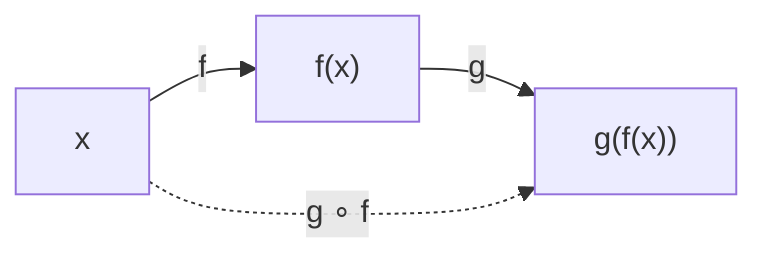
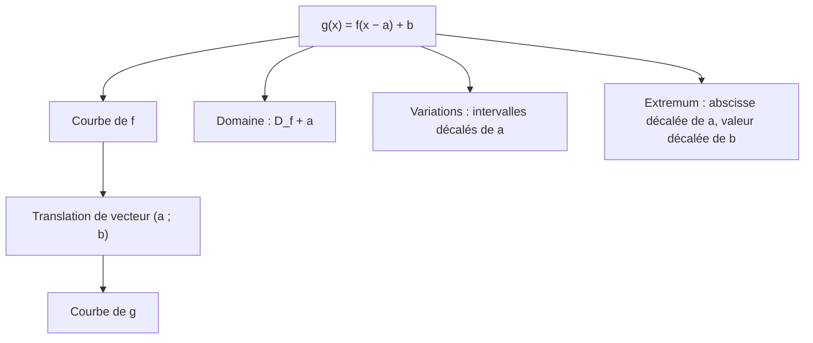

# Composition de fonctions et translation de courbes

## Objectifs pédagogiques et compétences

À la fin de ce chapitre, tu dois savoir :

- définir la **composée** $g\circ f$ de deux fonctions et déterminer **son ensemble de définition** ;
- **décomposer** une fonction en composée de fonctions plus simples ;
- déterminer les **variations** et la **parité** d'une composée, et le **démontrer** ;
- énoncer et **démontrer** que la courbe de $g(x)=f(x-a)$ est l'image de celle de $f$ par une **translation** ;
- utiliser les translations pour tracer une courbe, lire les variations et les extremums, et interpréter la forme canonique ;
- savoir quand une règle générale **ne s'applique pas** et conclure par un calcul direct.

## Prérequis

- ensemble de définition, image, antécédent ;
- variations d'une fonction, extremum ;
- fonctions de référence : $x^2$, $x^3$, $\sqrt x$, $\dfrac1x$, $|x|$ ;
- parité (chapitre `01-parite`) ;
- opérations sur les fonctions (chapitre précédent) ;
- forme canonique d'un trinôme (chapitre 1 du second degré).

---

## 1. Composition de fonctions

### 1.1 Définition

!!! info "Définition : fonction composée"
    Soient $f$ une fonction définie sur $D_f$ et $g$ une fonction définie sur $D_g$. La **composée** de $f$ suivie de $g$, notée $g\circ f$ (« $g$ rond $f$ »), est la fonction définie par
    $$(g\circ f)(x)=g\big(f(x)\big),$$
    pour tout $x$ de l'ensemble
    $$D_{g\circ f}=\{x\in D_f\ ;\ f(x)\in D_g\}.$$

!!! warning "Points d'attention : composition"
    - **On applique d'abord $f$, puis $g$** : $g\circ f$ se lit de **droite à gauche**.
    - **La composition n'est pas commutative** : en général $g\circ f\neq f\circ g$.
    - **Le domaine se détermine avec la condition** « $f(x)\in D_g$ », pas seulement avec l'expression finale.
    - **$g\circ f$ n'est ni le produit $fg$ ni $g(x)f(x)$.**
    - **Associativité** : $h\circ(g\circ f)=(h\circ g)\circ f$, on écrit simplement $h\circ g\circ f$.

!!! example "Exemples"
    **Exemple 1 (non commutativité).** $f(x)=2x-1$ et $g(x)=x^2$, toutes deux définies sur $\mathbb R$.
    $(g\circ f)(x)=(2x-1)^2$ et $(f\circ g)(x)=2x^2-1$. Par exemple en $x=1$ : $(g\circ f)(1)=1$ et $(f\circ g)(1)=1$, mais en $x=2$ : $9\neq7$.

    **Exemple 2 (domaine).** $f(x)=\sqrt x$ ($D_f=[0\,;+\infty[$) et $g(x)=\dfrac1{x-1}$ ($D_g=\mathbb R\setminus\{1\}$).
    - $g\circ f(x)=\dfrac1{\sqrt x-1}$ : il faut $x\ge0$ **et** $\sqrt x\neq1$, donc $D_{g\circ f}=[0\,;+\infty[\setminus\{1\}$.
    - $f\circ g(x)=\sqrt{\dfrac1{x-1}}$ : il faut $x\neq1$ **et** $\dfrac1{x-1}\ge0$, donc $D_{f\circ g}=]1\,;+\infty[$.

### 1.2 Variations d'une composée

!!! abstract "Propriété : sens de variation de $v\circ u$"
    Soient $u$ définie sur un intervalle $I$, $v$ définie sur un intervalle $J$, avec $u(I)\subset J$. Alors $v\circ u$ est définie sur $I$ et :

    | $u$ sur $I$ | $v$ sur $J$ | $v\circ u$ sur $I$ |
    |---|---|---|
    | croissante | croissante | **croissante** |
    | décroissante | décroissante | **croissante** |
    | croissante | décroissante | **décroissante** |
    | décroissante | croissante | **décroissante** |

    Règle mnémotechnique : c'est la **règle des signes** (deux changements de sens s'annulent).

!!! abstract "Démonstration"
    Soient $x<y$ dans $I$. Les images $u(x)$ et $u(y)$ sont dans $J$.

    - *$u$ croissante, $v$ croissante* : $u(x)\le u(y)$ puis $v(u(x))\le v(u(y))$.
    - *$u$ décroissante, $v$ décroissante* : $u(x)\ge u(y)$ ; $v$ décroissante **renverse** : $v(u(x))\le v(u(y))$ : croissante.
    - *$u$ croissante, $v$ décroissante* : $u(x)\le u(y)$ ; $v$ renverse : $v(u(x))\ge v(u(y))$ : décroissante.
    - *$u$ décroissante, $v$ croissante* : $u(x)\ge u(y)$ ; $v$ conserve : $v(u(x))\ge v(u(y))$ : décroissante. $\blacksquare$

!!! warning "Points d'attention : variations d'une composée"
    - **Condition $u(I)\subset J$** : $v$ doit être monotone sur un intervalle **qui contient toutes les valeurs prises par $u$**. Exemple : $v(t)=t^2$ n'est pas monotone sur $\mathbb R$, donc on ne peut pas appliquer la règle à $u(x)=x-1$ sur $\mathbb R$ ; on découpe en $I$ où $u\ge0$ ou $u\le0$.
    - **Une composée peut changer de variation** : on étudie sur **chaque intervalle de monotonie** de $u$.
    - **Si $u$ n'est pas monotone sur $I$**, on subdivise $I$.

!!! example "Exemples de variations"
    **Exemple 3.** $h(x)=\sqrt{4-x^2}$. Domaine : $4-x^2\ge0$, soit $D=[-2\,;2]$. On pose $u(x)=4-x^2$ (décroissante sur $[0\,;2]$, croissante sur $[-2\,;0]$, à valeurs dans $[0\,;4]$) et $v(t)=\sqrt t$ (croissante).
    Sur $[0\,;2]$ : $u$ décroissante, $v$ croissante, donc $h$ **décroissante**. Sur $[-2\,;0]$ : $h$ **croissante**. Maximum $h(0)=2$.

    | $x$ | $-2$ | | $0$ | | $2$ |
    |---|---|---|---|---|---|
    | $h(x)$ | $0$ | $\nearrow$ | $2$ | $\searrow$ | $0$ |

    **Exemple 4.** $k(x)=\dfrac1{x^2+1}$, composée de $u(x)=x^2+1$ (croissante sur $[0\,;+\infty[$, à valeurs dans $[1\,;+\infty[$) et $v(t)=\dfrac1t$ (décroissante sur $]0\,;+\infty[$) : $k$ est **décroissante** sur $[0\,;+\infty[$.

### 1.3 Parité d'une composée

!!! abstract "Propriété : parité de $v\circ u$"
    On suppose $u$ et $v\circ u$ définies sur un ensemble $D$ symétrique par rapport à $0$.

    - Si $u$ est **paire**, alors $v\circ u$ est **paire** (quelle que soit $v$).
    - Si $u$ est **impaire** et $v$ **impaire**, alors $v\circ u$ est **impaire**.
    - Si $u$ est **impaire** et $v$ **paire**, alors $v\circ u$ est **paire**.

!!! abstract "Démonstration"
    - $u$ paire : $(v\circ u)(-x)=v(u(-x))=v(u(x))=(v\circ u)(x)$.
    - $u$ impaire et $v$ impaire : $v(u(-x))=v(-u(x))=-v(u(x))$.
    - $u$ impaire et $v$ paire : $v(u(-x))=v(-u(x))=v(u(x))$. $\blacksquare$

!!! warning "Point d'attention"
    Si $u$ **n'est pas** paire ou impaire, aucune conclusion ne vient de $v$. Par exemple $v(t)=t^2$ est paire mais $v\circ u(x)=(x-1)^2$ n'est pas paire. **C'est $u$, la fonction intérieure, qui compte en premier.**

---

## 2. Translation de courbes : $g(x)=f(x-a)$

### 2.1 Propriété

!!! abstract "Propriété : translation horizontale"
    Soit $f$ une fonction définie sur $D_f$, de courbe $\mathcal C_f$, et $a$ un réel. La fonction $g$ définie par $g(x)=f(x-a)$ est définie sur $D_g=\{x+a\ ;\ x\in D_f\}$ (notée $D_f+a$) et sa courbe $\mathcal C_g$ est **l'image de $\mathcal C_f$ par la translation de vecteur $\vec u(a\,;0)$**.

    - Si $a>0$ : la courbe est décalée de $a$ unités **vers la droite**.
    - Si $a<0$ : la courbe est décalée de $|a|$ unités **vers la gauche**.

!!! abstract "Démonstration"
    Soit $M(x\,;y)$ un point du plan. La translation de vecteur $\vec u(a\,;0)$ envoie $M$ sur $M'(x+a\,;y)$.

    $M\in\mathcal C_f\iff x\in D_f\text{ et }y=f(x)$. Posons $X=x+a$ : alors $x=X-a$ et $y=f(X-a)=g(X)$, avec $X\in D_f+a$. Donc
    $$M(x\,;y)\in\mathcal C_f\iff M'(X\,;y)\in\mathcal C_g\quad\text{où }X=x+a.$$
    Ainsi, $\mathcal C_g$ est exactement l'ensemble des images des points de $\mathcal C_f$ par la translation de vecteur $\vec u(a\,;0)$. $\blacksquare$

!!! abstract "Propriété (complément) : translation verticale et générale"
    - $g(x)=f(x)+b$ : $\mathcal C_g$ est l'image de $\mathcal C_f$ par la translation de vecteur $(0\,;b)$.
    - $g(x)=f(x-a)+b$ : translation de vecteur $\vec u(a\,;b)$.

    **Démonstration** : $M(x\,;y)\in\mathcal C_f\iff y=f(x)\iff y+b=f(x)+b$ : le point $M'(x\,;y+b)$ vérifie la relation de $\mathcal C_g$. On combine avec le cas horizontal. $\blacksquare$

!!! warning "Points d'attention : sens de la translation"
    - **Le signe est « contre-intuitif »** : $f(x-3)$ décale **vers la droite** de $3$, et $f(x+3)=f(x-(-3))$ décale **vers la gauche** de $3$. Pour retrouver le sens : le point de $\mathcal C_f$ d'abscisse $x_0$ devient, sur $\mathcal C_g$, le point d'abscisse $x_0+a$ (car $g(x_0+a)=f(x_0)$).
    - **Ne pas confondre** $f(x-a)$ (translation de la courbe) et $f(x)-a$ (translation verticale vers le bas).
    - **Le domaine se translate aussi** : si $D_f=[0\,;+\infty[$, alors $D_g=[a\,;+\infty[$.

### 2.2 Conséquences

!!! abstract "Propriété : variations, extremums, symétries"
    Soit $g(x)=f(x-a)$.

    1. Si $f$ est **croissante** (resp. **décroissante**) sur un intervalle $I$, alors $g$ est croissante (resp. décroissante) sur $I+a=\{x+a\ ;\ x\in I\}$.
    2. Si $f$ admet un extremum $m$ en $x_0$, alors $g$ admet **le même** extremum $m$ en $x_0+a$.
    3. Si $f$ est **paire**, la courbe de $g$ est symétrique par rapport à la **droite d'équation $x=a$**, c'est-à-dire $g(a+h)=g(a-h)$ pour tout $h$.
    4. Si $f$ est **impaire**, $\mathcal C_g$ est symétrique par rapport au point $A(a\,;0)$ ; pour $g(x)=f(x-a)+b$, par rapport au point $A(a\,;b)$.

!!! abstract "Démonstration"
    1. Soient $x<y$ dans $I+a$ : alors $x-a<y-a$ dans $I$ et, si $f$ est croissante, $f(x-a)\le f(y-a)$, c'est-à-dire $g(x)\le g(y)$.
    2. Pour tout $x$ avec $x-a\in D_f$ : $g(x)=f(x-a)\ge m=f(x_0)=g(x_0+a)$ (cas d'un minimum).
    3. $g(a+h)=f(h)$ et $g(a-h)=f(-h)=f(h)$.
    4. $g(a+h)=f(h)+b$ et $g(a-h)=f(-h)+b=-f(h)+b$. La somme vaut $2b$ : le milieu des deux points $(a+h\,;g(a+h))$ et $(a-h\,;g(a-h))$ est $(a\,;b)$. $\blacksquare$

!!! tip "Application : la forme canonique du trinôme"
    $f(x)=a(x-\alpha)^2+\beta$ est obtenue à partir de $x\mapsto ax^2$ par la translation de vecteur $\vec u(\alpha\,;\beta)$. C'est exactement la propriété du chapitre 6 du second degré. De même, $x\mapsto|x-a|$ est un « V » de sommet $(a\,;0)$ et $x\mapsto\dfrac1{x-a}$ est la courbe de l'inverse décalée de $a$, définie sur $\mathbb R\setminus\{a\}$.

---

## 3. Méthodes à maîtriser

!!! tip "Méthode 1 : domaine d'une composée"
    1. Écrire $D_f$ et $D_g$.
    2. Résoudre la condition « $f(x)\in D_g$ ».
    3. Intersecter avec $D_f$.
    4. Donner le domaine **avant** toute simplification.

!!! tip "Méthode 2 : décomposer"
    1. Repérer la **dernière opération** effectuée lors du calcul de $h(x)$ : c'est la fonction extérieure $v$.
    2. Ce qui est « à l'intérieur » est $u$. Itérer si $u$ est elle-même composée.
    3. La décomposition n'est **pas unique** : choisir des fonctions dont on connaît les variations.

!!! tip "Méthode 3 : variations d'une composée"
    1. Décomposer $h=v\circ u$.
    2. Étudier $u$ sur $I$ et vérifier que $u(I)$ est dans un intervalle $J$ où $v$ est monotone.
    3. Appliquer la règle du tableau. Subdiviser $I$ si besoin.
    4. Contrôler avec **deux valeurs numériques**.

!!! tip "Méthode 4 : reconnaître une translation"
    1. Identifier une fonction $f$ de référence telle que $g(x)=f(x-a)+b$.
    2. Lire le vecteur $\vec u(a\,;b)$ avec le **bon signe**.
    3. En déduire le domaine, les variations (intervalles décalés), l'extremum ou le centre de symétrie.

!!! warning "Points d'attention : erreurs fréquentes"
    - **Inverser l'ordre** : $g\circ f(x)=g(f(x))$ et pas $f(g(x))$.
    - **Oublier la condition $f(x)\in D_g$** : $\sqrt{1-x^2}$ n'est définie que si $1-x^2\ge0$, mais $1-x^2$ est définie partout.
    - **Appliquer « croissante $\circ$ croissante » sans vérifier $u(I)\subset J$.**
    - **Mauvais signe de la translation** ($f(x+2)$ décale vers la **gauche**).
    - **Écrire $f(x-a)=f(x)-f(a)$** : faux en général. On ne « distribue » pas $f$.
    - **Parité d'une translation** : $f(x-a)$ n'est plus paire, même si $f$ l'est ($|x-2|$ n'est pas paire).

---

## 4. Exemples corrigés

!!! example "Exemple 5 : composition et domaine"
    Soit $f(x)=x-2$ et $g(x)=\sqrt x$. $g\circ f(x)=\sqrt{x-2}$ avec $D=[2\,;+\infty[$. $f\circ g(x)=\sqrt x-2$ avec $D=[0\,;+\infty[$. Les deux fonctions sont **différentes**.

!!! example "Exemple 6 : décomposition"
    $h(x)=\dfrac1{\sqrt{x^2+1}}$ : $u(x)=x^2+1$, $v_1(t)=\sqrt t$, $v_2(s)=\dfrac1s$ et $h=v_2\circ v_1\circ u$. Pour $x\ge0$ : $u$ croissante, $v_1$ croissante, $v_2$ décroissante : $h$ est **décroissante** sur $[0\,;+\infty[$. $h$ est paire (car $u$ l'est). Maximum $h(0)=1$.

!!! example "Exemple 7 : translation d'une courbe"
    $g(x)=(x-2)^2+1$ est l'image de la parabole $y=x^2$ par la translation de vecteur $\vec u(2\,;1)$. Sommet $(2\,;1)$, axe de symétrie $x=2$, minimum $1$ en $x=2$, décroissante sur $]-\infty\,;2]$, croissante sur $[2\,;+\infty[$.

!!! example "Exemple 8 : translation de $\sqrt x$"
    $g(x)=\sqrt{x+3}$ : $a=-3$ donc translation de vecteur $(-3\,;0)$. $D_g=[-3\,;+\infty[$. $g$ est croissante sur $[-3\,;+\infty[$, de minimum $0$ en $-3$.

!!! example "Exemple 9 : fonction inverse"
    $g(x)=\dfrac1{x-1}+2$ : translation de vecteur $(1\,;2)$ de la courbe de l'inverse. $D_g=\mathbb R\setminus\{1\}$, décroissante sur $]-\infty\,;1[$ et sur $]1\,;+\infty[$. Centre de symétrie $(1\,;2)$ (la fonction inverse est impaire).

---

## 5. Exercices progressifs

### Exercice 1 : calculer des composées

Déterminer $g\circ f$, $f\circ g$ et leurs ensembles de définition pour : (a) $f(x)=x+3$, $g(x)=x^2$ ; (b) $f(x)=\sqrt x$, $g(x)=x-4$ ; (c) $f(x)=\dfrac1x$, $g(x)=x^2-1$.

??? success "Corrigé"
    - (a) $g\circ f(x)=(x+3)^2$ et $f\circ g(x)=x^2+3$, toutes deux sur $\mathbb R$.
    - (b) $g\circ f(x)=\sqrt x-4$ sur $[0\,;+\infty[$ ; $f\circ g(x)=\sqrt{x-4}$ sur $[4\,;+\infty[$.
    - (c) $g\circ f(x)=\dfrac1{x^2}-1$ sur $\mathbb R^*$ ; $f\circ g(x)=\dfrac1{x^2-1}$ sur $\mathbb R\setminus\{-1\,;1\}$.

    **Piège** : le domaine de $f\circ g$ en (c) tient à la valeur interdite de $f$, qui devient une condition sur $g(x)$.

### Exercice 2 : décomposer

Écrire comme composée de deux fonctions simples : (a) $h(x)=\sqrt{2x-1}$ ; (b) $k(x)=\dfrac1{x^2+1}$ ; (c) $m(x)=|x-3|$ ; (d) $n(x)=(3x+1)^5$. Donner le domaine de $h$.

??? success "Corrigé"
    - (a) $u(x)=2x-1$, $v(t)=\sqrt t$ ; $2x-1\ge0\iff x\ge\frac12$, $D_h=\left[\frac12\,;+\infty\right[$.
    - (b) $u(x)=x^2+1$, $v(t)=\dfrac1t$.
    - (c) $u(x)=x-3$, $v(t)=|t|$.
    - (d) $u(x)=3x+1$, $v(t)=t^5$.

    Les décompositions ne sont pas uniques : on choisit celles qui rendent l'étude des variations facile.

### Exercice 3 : variations de composées

Étudier les variations de : (a) $h(x)=\sqrt{x^2-4x+5}$ ; (b) $f(x)=\dfrac1{\sqrt x+1}$ ; (c) $g(x)=(1-2x)^3$.

??? success "Corrigé"
    - (a) $x^2-4x+5=(x-2)^2+1\ge1$ : $D=\mathbb R$. $u$ est décroissante sur $]-\infty\,;2]$ puis croissante sur $[2\,;+\infty[$ ; $\sqrt{\ }$ est croissante sur $[1\,;+\infty[$. Donc $h$ est **décroissante** sur $]-\infty\,;2]$, **croissante** sur $[2\,;+\infty[$, minimum $h(2)=1$.
    - (b) $D=[0\,;+\infty[$. $u(x)=\sqrt x+1\ge1>0$ est croissante ; $\dfrac1t$ est décroissante sur $]0\,;+\infty[$ : $f$ est **décroissante**, maximum $f(0)=1$, et $0<f(x)\le1$.
    - (c) $u(x)=1-2x$ est décroissante sur $\mathbb R$ ; $t\mapsto t^3$ est croissante sur $\mathbb R$ : $g$ est **décroissante** sur $\mathbb R$. Contrôle : $g(0)=1>g(1)=-1$ ✔.

### Exercice 4 : translations

Décrire la courbe de chaque fonction comme image d'une courbe de référence par une translation, puis donner son domaine et ses variations :
(a) $g(x)=(x-3)^2$ ; (b) $h(x)=|x+2|$ ; (c) $k(x)=\dfrac1{x-1}$ ; (d) $l(x)=\dfrac1{x+2}-3$.

??? success "Corrigé"
    - (a) Translation de vecteur $(3\,;0)$ de la parabole $y=x^2$ ; $D=\mathbb R$ ; décroissante sur $]-\infty\,;3]$, croissante sur $[3\,;+\infty[$ ; sommet $(3\,;0)$.
    - (b) $|x+2|=|x-(-2)|$ : translation de vecteur $(-2\,;0)$ ; « V » de sommet $(-2\,;0)$ ; décroissante sur $]-\infty\,;-2]$, croissante sur $[-2\,;+\infty[$.
    - (c) Translation de vecteur $(1\,;0)$ de la courbe de $\frac1x$ ; $D=\mathbb R\setminus\{1\}$ ; décroissante sur $]-\infty\,;1[$ et sur $]1\,;+\infty[$.
    - (d) $\dfrac1{x-(-2)}+(-3)$ : translation de vecteur $(-2\,;-3)$ ; $D=\mathbb R\setminus\{-2\}$ ; décroissante sur $]-\infty\,;-2[$ et sur $]-2\,;+\infty[$ ; centre de symétrie $(-2\,;-3)$.

### Exercice 5 : lecture graphique et tableau

On donne $f$ décroissante sur $]-\infty\,;1]$, croissante sur $[1\,;+\infty[$, de minimum $f(1)=-2$, et $f(2)=5$. Soit $g(x)=f(x-4)$ et $h(x)=f(x+3)$.

1. Donner les variations de $g$ et de $h$ et leur minimum.
2. Donner un point de $\mathcal C_g$ et un point de $\mathcal C_h$ déduits de $f(2)=5$.

??? success "Corrigé"
    1. $g$ : $a=4$. Décroissante sur $]-\infty\,;5]$, croissante sur $[5\,;+\infty[$, minimum $-2$ en $x=5$.
       $h$ : $a=-3$. Décroissante sur $]-\infty\,;-2]$, croissante sur $[-2\,;+\infty[$, minimum $-2$ en $x=-2$.
    2. $g(6)=f(2)=5$ : point $(6\,;5)$ de $\mathcal C_g$. $h(-1)=f(2)=5$ : point $(-1\,;5)$ de $\mathcal C_h$.

    **Piège** : l'abscisse se décale de **$+a$** : $2\to2+4=6$ pour $g$, et $2\to2+(-3)=-1$ pour $h$.

### Exercice 6 : forme canonique et translation

Écrire comme translation d'une courbe de référence : (a) $f(x)=x^2-6x+10$ ; (b) $g(x)=-2x^2+4x+1$.

??? success "Corrigé"
    - (a) $f(x)=(x-3)^2+1$ : translation de vecteur $(3\,;1)$ de $y=x^2$.
    - (b) $g(x)=-2(x-1)^2+3$ : translation de vecteur $(1\,;3)$ de $y=-2x^2$. Maximum $3$ en $x=1$.

### Exercice 7 : parité d'une composée

Étudier la parité de : (a) $f(x)=\sqrt{4-x^2}$ ; (b) $g(x)=\dfrac1{x^3}$ ; (c) $h(x)=(x-1)^2$ ; (d) $k(x)=\left|\dfrac1x\right|$.

??? success "Corrigé"
    - (a) $D=[-2\,;2]$ symétrique ; $u(x)=4-x^2$ paire : $f$ **paire**.
    - (b) $u(x)=x^3$ impaire, $v(t)=\frac1t$ impaire : $g$ **impaire** sur $\mathbb R^*$.
    - (c) $h(1)=0$ et $h(-1)=4$ : ni égal à $0$ ni à $-0$. **Ni paire ni impaire** (la parité de $v(t)=t^2$ ne suffit pas, l'intérieure $x-1$ n'est pas paire).
    - (d) $u(x)=\frac1x$ impaire, $v(t)=|t|$ paire : $k$ **paire** sur $\mathbb R^*$.

---

## 6. Exercices type contrôle

### Exercice A : étude complète

Soit $f(x)=\sqrt{x^2-4x+3}$.

1. Déterminer l'ensemble de définition de $f$.
2. Montrer que $f(x)=g(x-2)$ avec $g(t)=\sqrt{t^2-1}$, et que $\mathcal C_f$ est symétrique par rapport à la droite $x=2$.
3. Étudier les variations de $g$ sur $[1\,;+\infty[$, puis de $f$.
4. Résoudre $f(x)=\sqrt3$ puis $f(x)\le\sqrt3$.

??? success "Corrigé"
    1. $x^2-4x+3=(x-1)(x-3)\ge0\iff x\le1$ ou $x\ge3$ : $D_f=]-\infty\,;1]\cup[3\,;+\infty[$.
    2. $(x-2)^2-1=x^2-4x+3$ donc $f(x)=g(x-2)$. $g$ est paire (définie sur $]-\infty\,;-1]\cup[1\,;+\infty[$, symétrique) : par la propriété 3, $\mathcal C_f$ est symétrique par rapport à $x=2$.
    3. Sur $[1\,;+\infty[$, $t^2-1$ est croissante, positive ou nulle, et $\sqrt{\ }$ est croissante : $g$ **croissante**, de minimum $g(1)=0$. Par parité, $g$ est décroissante sur $]-\infty\,;-1]$.
       Par translation de $2$ : $f$ est **décroissante** sur $]-\infty\,;1]$ et **croissante** sur $[3\,;+\infty[$, minimum $0$ atteint en $x=1$ et en $x=3$.

       | $x$ | $-\infty$ | | $1$ | $]1\,;3[$ | $3$ | | $+\infty$ |
       |---|---|---|---|---|---|---|---|
       | $f(x)$ | | $\searrow$ | $0$ | non défini | $0$ | $\nearrow$ | |

    4. $f(x)=\sqrt3\iff x^2-4x+3=3\iff x(x-4)=0$ : $x=0$ ou $x=4$, dans $D_f$ ✔. Vérification : $f(0)=\sqrt3$, $f(4)=\sqrt{16-16+3}=\sqrt3$ ✔.
       $f(x)\le\sqrt3\iff x^2-4x+3\le3\iff0\le x\le4$ (la racine est croissante), à intersecter avec $D_f$ : $S=[0\,;1]\cup[3\,;4]$.

    **Pièges** : ne pas oublier de restreindre à $D_f$ ; la symétrie par rapport à $x=2$ se voit aussi sur les solutions $0$ et $4$ ($\frac{0+4}2=2$).

### Exercice B : trouver les erreurs

Un élève écrit : (1) « $g\circ f=f\circ g$ pour toutes fonctions » ; (2) « la courbe de $x\mapsto(x+3)^2$ est celle de $x^2$ décalée de $3$ vers la droite » ; (3) « $u$ décroissante et $v$ décroissante, donc $v\circ u$ décroissante ». Corriger.

??? success "Corrigé"
    1. Faux : $f(x)=x+1$, $g(x)=x^2$ donnent $g\circ f(1)=4$ et $f\circ g(1)=2$.
    2. Faux : $(x+3)^2=(x-(-3))^2$ : décalage de $3$ vers la **gauche** (le sommet est en $(-3\,;0)$).
    3. Faux : deux changements de sens s'annulent, donc $v\circ u$ est **croissante**. Exemple : $u(x)=-x$, $v(t)=-t$ donnent $v\circ u(x)=x$.

### Exercice C : démonstration

Soit $f$ paire et $g(x)=f(x-a)$. Démontrer que $\mathcal C_g$ est symétrique par rapport à la droite $x=a$ et que $\mathcal C_g$ est l'image de $\mathcal C_f$ par la translation de vecteur $(a\,;0)$.

??? success "Corrigé"
    *Symétrie* : $g(a+h)=f(h)$ et $g(a-h)=f(-h)=f(h)$. Les points $(a+h\,;f(h))$ et $(a-h\,;f(h))$ sont donc tous deux sur $\mathcal C_g$ et sont symétriques par rapport à $x=a$ (même ordonnée, milieu des abscisses $a$).
    *Translation* : $M(x\,;y)\in\mathcal C_f\iff y=f(x)=g(x+a)\iff M'(x+a\,;y)\in\mathcal C_g$, avec $M'$ image de $M$ par la translation de vecteur $(a\,;0)$. $\blacksquare$

### Exercice D : haut niveau, itérée d'une fonction

Soit $f(x)=x^2-2x$ et $g=f\circ f$.

1. Développer $g(x)$ et factoriser $g(x)$ ; en déduire les solutions de $g(x)=0$.
2. Montrer que $f(2-x)=f(x)$ pour tout $x$, puis que $g(2-x)=g(x)$. Que peut-on dire de $\mathcal C_g$ ?
3. Résoudre $f(x)=x$, puis $g(x)=x$.
4. Interpréter les solutions de $g(x)=x$ qui ne sont pas des solutions de $f(x)=x$.

??? success "Corrigé"
    1. $g(x)=(x^2-2x)^2-2(x^2-2x)=x^4-4x^3+4x^2-2x^2+4x=x^4-4x^3+2x^2+4x$.
       Avec $t=x^2-2x$ : $g(x)=t(t-2)=(x^2-2x)(x^2-2x-2)$.
       $g(x)=0\iff x^2-2x=0$ ($x=0$ ou $x=2$) ou $x^2-2x-2=0$ ($\Delta=12$, $x=1\pm\sqrt3$).
       $S=\{0\,;2\,;1-\sqrt3\,;1+\sqrt3\}$.
    2. $f(2-x)=(2-x)^2-2(2-x)=4-4x+x^2-4+2x=x^2-2x=f(x)$. Donc $g(2-x)=f(f(2-x))=f(f(x))=g(x)$ : $\mathcal C_g$ est symétrique par rapport à la droite $x=1$ (le milieu de $x$ et $2-x$ est $1$).
       *Remarque* : $f(x)=(x-1)^2-1$ est la parabole $x^2$ translatée de $(1\,;-1)$, d'axe $x=1$ ; la symétrie de $f$ se transmet à $g$ puisque la fonction **intérieure** est symétrique.
    3. $f(x)=x\iff x^2-3x=0\iff x=0$ ou $x=3$.
       $g(x)-x=x^4-4x^3+2x^2+3x=x(x^3-4x^2+2x+3)$. Comme $3$ est racine ($27-36+6+3=0$) :
       $x^3-4x^2+2x+3=(x-3)(x^2-x-1)$ (développement : $x^3-x^2-x-3x^2+3x+3$ ✔).
       Donc $g(x)=x\iff x(x-3)(x^2-x-1)=0$ : $S=\left\{0\,;3\,;\dfrac{1-\sqrt5}2\,;\dfrac{1+\sqrt5}2\right\}$.
    4. Si $f(x)=x$ alors $f(f(x))=f(x)=x$ : les solutions $0$ et $3$ de $f(x)=x$ sont automatiquement solutions de $g(x)=x$ (**points fixes** de $f$).
       Les deux autres, $\varphi=\frac{1+\sqrt5}2$ et $\varphi'=\frac{1-\sqrt5}2$, ne sont pas des points fixes (car $\varphi^2-3\varphi\ne0$) ; elles forment un **cycle de longueur 2** : $f(\varphi)=\varphi^2-2\varphi=(\varphi+1)-2\varphi=1-\varphi=\varphi'$ et $f(\varphi')=\varphi$.

    **Pièges** : $g=f\circ f$ n'est pas $f^2$ (le carré de $f$) ; la composition est utilisée ici deux fois avec la **même** fonction.

---

## 7. Synthèse et fiche de révision

!!! abstract "Fiche de révision"
    | À retenir | Résultat |
    |---|---|
    | Composée | $(g\circ f)(x)=g(f(x))$ ; on applique $f$ **d'abord** |
    | Domaine | $\{x\in D_f\ ;\ f(x)\in D_g\}$ |
    | Commutativité | **non** : $g\circ f\neq f\circ g$ en général |
    | Variations de $v\circ u$ | même sens : croissante ; sens contraires : décroissante |
    | Condition | $u(I)\subset J$, $v$ monotone sur $J$ |
    | Parité | $u$ paire $\Rightarrow v\circ u$ paire ; $u$, $v$ impaires $\Rightarrow$ impaire |
    | $g(x)=f(x-a)$ | translation de vecteur $(a\,;0)$ ; $f(x-3)$ : vers la **droite** |
    | $g(x)=f(x)+b$ | translation de vecteur $(0\,;b)$ |
    | Variations de $g$ | intervalles de $f$ **décalés de $a$** |
    | $f$ paire | $\mathcal C_g$ symétrique par rapport à $x=a$ |
    | Forme canonique | $a(x-\alpha)^2+\beta$ : translation $(\alpha\,;\beta)$ de $ax^2$ |

    **Réflexes** : domaine avec la condition intérieure ; bon sens de la translation ; vérification par deux valeurs numériques ; décomposer en fonctions de référence.

---

## 8. Comprendre, savoir quand l'utiliser, savoir démontrer

!!! tip "Pourquoi les résultats sont vrais"
    Composer, c'est **enchaîner deux machines** : la sortie de la première est l'entrée de la seconde. Si chaque machine conserve l'ordre, l'enchaînement le conserve ; si l'une le renverse, l'enchaînement le renverse ; si les deux le renversent, l'ordre est rétabli. Pour la translation, $g(x)=f(x-a)$ **réutilise** la valeur $f(x_0)$ non plus en $x_0$ mais en $x_0+a$ : on a changé la position horizontale de chaque point sans toucher à sa hauteur. Le signe « moins » vient de ce que $g$ « attend » que $x$ atteigne $x_0+a$ pour afficher ce que $f$ affichait en $x_0$.

!!! tip "Quand l'utiliser"
    - **Étudier une fonction complexe** en la décomposant en briques connues.
    - **Domaine** d'expressions imbriquées (racine d'une fraction, fraction d'une racine).
    - **Tracer rapidement** une courbe à partir d'une courbe de référence.
    - **Lire** variations, extremums et symétries d'une fonction translatée sans recalcul.
    - **Résoudre** des équations à fonctions itérées ($f\circ f(x)=x$).

!!! tip "Savoir le démontrer (checklist)"
    1. Variations d'une composée : prendre $x<y$, appliquer $u$, puis $v$, en notant à chaque étape si l'inégalité est conservée ou renversée.
    2. Parité : calculer $v(u(-x))$ en utilisant la parité de $u$ **en premier**.
    3. Translation : poser $X=x+a$, exprimer $y=f(X-a)=g(X)$, conclure que $M(x\,;y)\in\mathcal C_f\iff M'(x+a\,;y)\in\mathcal C_g$.
    4. Symétries : calculer $g(a+h)$ et $g(a-h)$ et comparer.