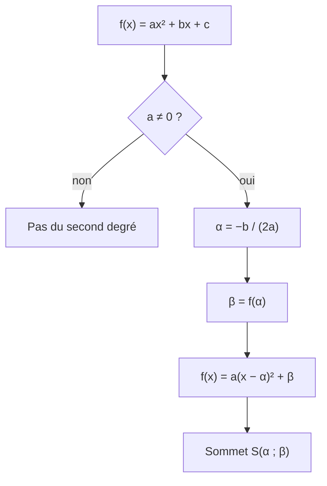

# Fonctions polynômes du second degré : définition et forme canonique

## Objectifs pédagogiques et compétences

À la fin de ce chapitre, tu dois savoir :

- reconnaître si une expression définit une fonction polynôme du second degré et identifier ses coefficients ;
- déterminer la forme canonique d'un trinôme, par les formules **et** par complétion du carré ;
- démontrer la propriété de la forme canonique ;
- exploiter la forme canonique pour résoudre, minorer ou majorer, trouver un extremum ;
- retrouver les coefficients d'un trinôme à partir d'informations sur sa forme canonique.

## Prérequis

- développer et factoriser (identités remarquables $(u\pm v)^2$, $u^2-v^2$) ;
- résoudre une équation du premier degré ;
- la fonction carré $x\mapsto x^2$ : toujours positive ou nulle, nulle uniquement en $0$ ;
- savoir que $X^2 = k$ avec $k>0$ a deux solutions $\pm\sqrt{k}$.

---

## 1. Définitions

!!! info "Définition : fonction polynôme du second degré"
    Une **fonction polynôme du second degré** (ou **trinôme**) est une fonction $f$ définie sur $\mathbb{R}$ par
    $$f(x) = ax^2 + bx + c$$
    où $a$, $b$, $c$ sont trois **réels** avec $\boldsymbol{a \neq 0}$.

    - $a$ est le **coefficient dominant** (coefficient de $x^2$) ;
    - $b$ est le coefficient de $x$ ;
    - $c$ est le **terme constant**.

    L'écriture $ax^2+bx+c$ s'appelle la **forme développée (réduite)** de $f(x)$.

!!! warning "Point d'attention : la condition $a \neq 0$"
    Si $a=0$, alors $f(x)=bx+c$ est une fonction affine : ce n'est **pas** du second degré.
    Une expression peut sembler être du second degré sans l'être : il faut **toujours développer et réduire** avant de conclure.

!!! example "Exemples et contre-exemples"
    | Expression | Forme développée | Second degré ? | $(a\,;b\,;c)$ |
    |---|---|---|---|
    | $3x^2-5x+2$ | déjà développée | Oui | $(3\,;-5\,;2)$ |
    | $x^2-9$ | $1\cdot x^2+0\cdot x-9$ | Oui | $(1\,;0\,;-9)$ |
    | $-4x^2+x$ | $-4x^2+x+0$ | Oui | $(-4\,;1\,;0)$ |
    | $(x+1)^2-x^2$ | $2x+1$ | **Non** (le $x^2$ disparaît) | |
    | $\dfrac{1}{x^2+1}$ | | **Non** (ce n'est pas un polynôme) | |

---

## 2. Forme canonique

### 2.1 Idée

Le graphe de $x\mapsto x^2$ est la parabole « de base ». La forme canonique montre qu'**toute** parabole d'un trinôme s'obtient à partir de celle-ci par une translation et un étirement (et éventuellement un retournement si $a<0$). Elle fait apparaître le **sommet**.

!!! abstract "Propriété : forme canonique"
    Soit $f(x)=ax^2+bx+c$ avec $a\neq 0$. Pour tout réel $x$ :
    $$f(x) = a\,(x-\alpha)^2 + \beta
    \qquad\text{avec}\qquad
    \alpha = -\frac{b}{2a}
    \quad\text{et}\quad
    \beta = f(\alpha) = -\frac{b^2-4ac}{4a}.$$

    L'écriture $a(x-\alpha)^2+\beta$ est la **forme canonique** de $f(x)$. Elle est **unique**.

!!! info "Définition : discriminant (aperçu)"
    Le réel $\Delta = b^2-4ac$ s'appelle le **discriminant** de $f$. On a donc $\beta = -\dfrac{\Delta}{4a}$. Son rôle sera étudié au chapitre suivant.

### 2.2 Démonstration

!!! abstract "Démonstration de la forme canonique"
    Soit $a\neq0$. On **factorise $a$** devant les termes en $x^2$ et $x$ :
    $$ax^2+bx+c = a\left(x^2+\frac{b}{a}x\right)+c.$$
    On reconnaît le début du développement de $\left(x+\frac{b}{2a}\right)^2 = x^2+\frac{b}{a}x+\frac{b^2}{4a^2}$. Donc
    $$x^2+\frac{b}{a}x = \left(x+\frac{b}{2a}\right)^2-\frac{b^2}{4a^2}.$$
    On remplace :
    $$ax^2+bx+c = a\left[\left(x+\frac{b}{2a}\right)^2-\frac{b^2}{4a^2}\right]+c
    = a\left(x+\frac{b}{2a}\right)^2-\frac{b^2}{4a}+c.$$
    Or $-\dfrac{b^2}{4a}+c = \dfrac{-b^2+4ac}{4a} = -\dfrac{b^2-4ac}{4a}$. Ainsi
    $$f(x)=a\left(x-\left(-\frac{b}{2a}\right)\right)^2-\frac{b^2-4ac}{4a}=a(x-\alpha)^2+\beta.$$
    Enfin $f(\alpha)=a\cdot 0^2+\beta=\beta$, donc $\beta=f(\alpha)$. $\blacksquare$

!!! abstract "Démonstration de l'unicité"
    Supposons que pour tout réel $x$ : $a(x-\alpha)^2+\beta = a(x-\alpha')^2+\beta'$.
    En développant : $-2a\alpha\,x + a\alpha^2+\beta = -2a\alpha'\,x + a\alpha'^2+\beta'$ pour tout $x$.
    Deux fonctions affines égales en tout réel ont les mêmes coefficients : $-2a\alpha=-2a\alpha'$, donc $\alpha=\alpha'$ (car $a\neq0$), puis $\beta=\beta'$. $\blacksquare$

### 2.3 Lecture géométrique

!!! abstract "Propriété : sommet et axe de symétrie"
    La courbe de $f$ est une **parabole** de **sommet** $S(\alpha\,;\beta)$, symétrique par rapport à la droite d'équation $x=\alpha$.

    - si $a>0$ : la parabole est « tournée vers le haut » et $\beta$ est le **minimum** de $f$ ;
    - si $a<0$ : elle est « tournée vers le bas » et $\beta$ est le **maximum** de $f$.

!!! abstract "Démonstration : extremum"
    Pour tout $x$, $(x-\alpha)^2\ge 0$ avec égalité si et seulement si $x=\alpha$.
    Si $a>0$ : $a(x-\alpha)^2\ge0$ donc $f(x)\ge\beta$, avec égalité en $x=\alpha$ seulement : $\beta$ est le minimum.
    Si $a<0$ : $a(x-\alpha)^2\le0$ donc $f(x)\le\beta$ : $\beta$ est le maximum. $\blacksquare$

---

## 3. Méthodes à maîtriser

!!! tip "Méthode 1 : par les formules (la plus rapide)"
    1. Identifier $a$, $b$, $c$.
    2. Calculer $\alpha=-\dfrac{b}{2a}$.
    3. Calculer $\beta=f(\alpha)$ (**en remplaçant $x$ par $\alpha$ dans l'expression de départ**, c'est plus fiable que la formule avec $\Delta$).
    4. Écrire $f(x)=a(x-\alpha)^2+\beta$.
    5. **Vérifier** en redéveloppant, ou en testant en $x=0$ : on doit retrouver $c$.

!!! tip "Méthode 2 : par complétion du carré (celle de la démonstration)"
    1. Factoriser $a$ : $a\left(x^2+\frac{b}{a}x\right)+c$.
    2. Écrire $x^2+\frac{b}{a}x=\left(x+\frac{b}{2a}\right)^2-\left(\frac{b}{2a}\right)^2$.
    3. Distribuer $a$ sur le terme soustrait et regrouper avec $c$.

!!! warning "Points d'attention : erreurs fréquentes"
    - **Le signe de $\alpha$** : on écrit $(x-\alpha)$. Si $\alpha=-3$, on écrit $(x+3)^2$, pas $(x-3)^2$.
    - **$\beta$ n'est pas $c$** : $\beta=f(\alpha)$, sauf si $\alpha=0$ (cas $b=0$), où $\beta=c$.
    - **Oublier de compenser** : écrire $2x^2+8x+3=2(x+2)^2+3$ est faux. $2(x+2)^2=2x^2+8x+8$, il faut donc retirer $8$.
    - **Facteur $a$ oublié** devant la parenthèse (ou mis au carré par erreur).
    - **Cas particuliers** : si $b=0$, $\alpha=0$ et la forme canonique est déjà $ax^2+c$. Si $\beta=0$, le trinôme est un carré parfait : $f(x)=a(x-\alpha)^2$.

---

## 4. Exemples corrigés

!!! example "Exemple 1 : $f(x)=2x^2-12x+13$"
    $a=2$, $b=-12$, $c=13$. Donc $\alpha=-\dfrac{-12}{4}=3$ et $\beta=f(3)=18-36+13=-5$.
    $$f(x)=2(x-3)^2-5.$$
    Vérification : $2(x^2-6x+9)-5=2x^2-12x+13$. ✔
    Comme $a>0$, $f$ admet un minimum $-5$, atteint en $x=3$.

!!! example "Exemple 2 : $g(x)=-x^2+4x+1$ (cas $a<0$)"
    $\alpha=-\dfrac{4}{-2}=2$ et $\beta=g(2)=-4+8+1=5$.
    $$g(x)=-(x-2)^2+5.$$
    Comme $a<0$, $g$ admet un maximum $5$ en $x=2$.

!!! example "Exemple 3 : $h(x)=3x^2+5x$ (cas $c=0$ et fractions)"
    $\alpha=-\dfrac{5}{6}$ et $\beta=h\!\left(-\tfrac56\right)=3\cdot\tfrac{25}{36}-\tfrac{25}{6}=\tfrac{25}{12}-\tfrac{50}{12}=-\tfrac{25}{12}$.
    $$h(x)=3\left(x+\frac56\right)^2-\frac{25}{12}.$$
    Vérification : $3\left(x^2+\tfrac53x+\tfrac{25}{36}\right)-\tfrac{25}{12}=3x^2+5x+\tfrac{25}{12}-\tfrac{25}{12}$. ✔

---

## 5. Exercices progressifs

### Exercice 1 : reconnaître un trinôme

Parmi les fonctions suivantes, lesquelles sont des polynômes du second degré ? Donner alors $a$, $b$, $c$.

$A(x)=(x+1)^2-x^2$ ; $B(x)=(x-2)(3x+1)$ ; $C(x)=x^3-x(x^2-2x+1)$ ; $D(x)=(2x-1)^2-4x^2$.

??? success "Corrigé"
    On développe chacune.

    - $A(x)=x^2+2x+1-x^2=2x+1$ : degré 1, **non**.
    - $B(x)=3x^2+x-6x-2=3x^2-5x-2$ : **oui**, $(a,b,c)=(3,-5,-2)$.
    - $C(x)=x^3-x^3+2x^2-x=2x^2-x$ : **oui**, $(2,-1,0)$. Le terme en $x^3$ disparaît.
    - $D(x)=4x^2-4x+1-4x^2=-4x+1$ : **non**.

    **Piège** : ne jamais juger sur la forme non développée.

### Exercice 2 : formes canoniques

Déterminer la forme canonique de : $f(x)=x^2-4x+7$ ; $g(x)=-2x^2+8x-3$ ; $h(x)=\tfrac12x^2+3x+1$.

??? success "Corrigé"
    - $f$ : $\alpha=2$, $\beta=f(2)=4-8+7=3$. $f(x)=(x-2)^2+3$.
    - $g$ : $\alpha=-\frac{8}{-4}=2$, $\beta=g(2)=-8+16-3=5$. $g(x)=-2(x-2)^2+5$.
    - $h$ : $\alpha=-\frac{3}{1}=-3$, $\beta=h(-3)=\frac92-9+1=-\frac72$. $h(x)=\frac12(x+3)^2-\frac72$.

    Vérification pour $h$ : $\frac12(x^2+6x+9)-\frac72=\frac12x^2+3x+\frac92-\frac72$, soit $\frac12x^2+3x+1$. ✔

### Exercice 3 : retrouver un trinôme

Déterminer le trinôme $f$ dont la parabole a pour sommet $S(2\,;-3)$ et passe par le point $A(0\,;1)$.

??? success "Corrigé"
    Le sommet donne la forme canonique : $f(x)=a(x-2)^2-3$.
    Le point $A$ donne : $f(0)=4a-3=1$, donc $a=1$.
    $f(x)=(x-2)^2-3=x^2-4x+1$.

    **Piège** : ne pas écrire $f(x)=a(x+2)^2-3$ (signe de $\alpha$).

### Exercice 4 : signe sans résoudre

Montrer que pour tout réel $x$, $x^2+x+1>0$. Plus généralement, quel est son minimum ?

??? success "Corrigé"
    $\alpha=-\frac12$, $\beta=\frac14-\frac12+1=\frac34$. Donc $x^2+x+1=\left(x+\frac12\right)^2+\frac34$.
    Un carré est positif ou nul, donc pour tout $x$ : $x^2+x+1\ge\frac34>0$.
    Le minimum est $\frac34$, atteint en $x=-\frac12$.

    **Point d'attention** : une expression peut être toujours strictement positive sans jamais s'annuler. Ici, l'équation $x^2+x+1=0$ n'a aucune solution réelle.

### Exercice 5 : résoudre avec la forme canonique

Résoudre $2x^2-12x+10=0$ en passant par la forme canonique.

??? success "Corrigé"
    $\alpha=3$, $\beta=18-36+10=-8$ : $2x^2-12x+10=2(x-3)^2-8$.
    $$2(x-3)^2-8=0\iff(x-3)^2=4\iff x-3=2\ \text{ou}\ x-3=-2\iff x=5\ \text{ou}\ x=1.$$
    Vérification : $2\cdot25-60+10=0$ ✔ ; $2-12+10=0$ ✔.

    **Cas particulier à retenir** : si on tombait sur $(x-3)^2=-4$, il n'y aurait **aucune** solution (un carré n'est jamais négatif). Si on tombait sur $(x-3)^2=0$, il y aurait une solution double.

### Exercice 6 : optimisation

Un rectangle a un périmètre de $40$ cm. Quelle est son aire maximale ? Pour quelles dimensions ?

??? success "Corrigé"
    Soit $x$ la longueur d'un côté, avec $0<x<20$. L'autre côté vaut $20-x$. L'aire est $A(x)=x(20-x)=-x^2+20x$.
    $a=-1<0$, $\alpha=10$, $\beta=A(10)=100$ : $A(x)=-(x-10)^2+100\le100$.
    L'aire maximale est $100\ \text{cm}^2$, atteinte pour $x=10$ : c'est un **carré** de côté $10$ cm.

    **Piège** : toujours vérifier que $\alpha$ appartient bien à l'intervalle du problème ($10\in\,]0\,;20[$ ✔).

---

## 6. Exercices type contrôle

### Exercice A : étude complète

Soit $f(x)=-3x^2+12x-5$.

1. Déterminer la forme canonique de $f$.
2. En déduire que $f$ admet un maximum, et préciser sa valeur et où il est atteint.
3. Résoudre $f(x)=7$, puis $f(x)=-5$.

??? success "Corrigé"
    1. $\alpha=-\frac{12}{-6}=2$, $\beta=f(2)=-12+24-5=7$. $f(x)=-3(x-2)^2+7$.
    2. $(x-2)^2\ge0$ et $-3<0$, donc $-3(x-2)^2\le0$ et $f(x)\le7$. Le maximum est $7$, atteint **uniquement** en $x=2$.
    3. $f(x)=7\iff-3(x-2)^2=0\iff x=2$ : **une seule** solution (double).
       $f(x)=-5\iff-3(x-2)^2=-12\iff(x-2)^2=4\iff x=0$ ou $x=4$.
       Vérification : $f(0)=-5$ ✔ ; $f(4)=-48+48-5=-5$ ✔.

    **Remarque** : les deux solutions $0$ et $4$ sont symétriques par rapport à $\alpha=2$ : c'est la symétrie de la parabole.

### Exercice B : trouver l'erreur

Un élève écrit : « $2x^2+8x+3=2(x+2)^2+3$ ». Identifier l'erreur, donner la bonne forme canonique et proposer un test de vérification rapide.

??? success "Corrigé"
    En développant, $2(x+2)^2+3=2x^2+8x+8+3=2x^2+8x+11\ne2x^2+8x+3$ : l'élève a oublié de **compenser** le terme $a\alpha^2=8$.
    Bonne méthode : $\alpha=-2$, $\beta=f(-2)=8-16+3=-5$, donc $f(x)=2(x+2)^2-5$.

    **Test rapide** : en $x=0$, la forme canonique doit donner $c$. Ici $2\cdot4+3=11\ne3$ : l'erreur apparaît immédiatement. Avec la bonne forme : $8-5=3$ ✔.

### Exercice C : démonstration

Soit $f(x)=ax^2+bx+c=a(x-\alpha)^2+\beta$ pour tout réel $x$. Démontrer que $b=-2a\alpha$ et $c=a\alpha^2+\beta$.

??? success "Corrigé"
    On développe : $a(x-\alpha)^2+\beta=ax^2-2a\alpha x+a\alpha^2+\beta$.
    Deux polynômes égaux pour tout $x$ ont les mêmes coefficients (comme dans la preuve d'unicité) : en identifiant, $b=-2a\alpha$ et $c=a\alpha^2+\beta$.
    On retrouve $\alpha=-\dfrac{b}{2a}$.

### Exercice D : avec paramètre (haut niveau)

Pour $m$ réel, on pose $f_m(x)=x^2-2mx+3$.

1. Donner la forme canonique de $f_m$ et les coordonnées de son sommet $S_m$.
2. Montrer que, quand $m$ varie, tous les sommets $S_m$ sont sur une même parabole dont on donnera l'équation.
3. Déterminer les valeurs de $m$ pour lesquelles $f_m(x)\ge0$ pour tout réel $x$.

??? success "Corrigé"
    1. $\alpha=-\frac{-2m}{2}=m$, $\beta=f_m(m)=m^2-2m^2+3=3-m^2$. $f_m(x)=(x-m)^2+3-m^2$ et $S_m(m\,;3-m^2)$.
    2. Les coordonnées de $S_m$ sont $x=m$ et $y=3-m^2$, donc $y=3-x^2$ : tous les sommets sont sur la parabole d'équation $y=3-x^2$.
    3. $f_m(x)\ge0$ pour tout $x$ $\iff$ le minimum $3-m^2$ est positif ou nul (le minimum existe car $a=1>0$) $\iff m^2\le3\iff-\sqrt3\le m\le\sqrt3$ (résolution de $m^2\le3$ détaillée au chapitre sur le signe du trinôme).

    **Piège** : ne pas confondre la variable $x$ et le paramètre $m$ : $m$ est une constante pour chaque fonction $f_m$.

---

## 7. Synthèse et fiche de révision

!!! abstract "Fiche de révision"
    | À retenir | Formule / idée |
    |---|---|
    | Trinôme | $f(x)=ax^2+bx+c$, $a\neq0$ |
    | Forme canonique | $f(x)=a(x-\alpha)^2+\beta$ |
    | $\alpha$ | $-\dfrac{b}{2a}$ |
    | $\beta$ | $f(\alpha)=-\dfrac{\Delta}{4a}$, avec $\Delta=b^2-4ac$ |
    | Sommet | $S(\alpha\,;\beta)$, axe de symétrie $x=\alpha$ |
    | $a>0$ | minimum $\beta$ en $\alpha$ |
    | $a<0$ | maximum $\beta$ en $\alpha$ |
    | Vérification | $x=0$ doit redonner $c$ |

    **Réflexes** : développer avant de conclure sur le degré ; signe de $\alpha$ ; compenser en complétant le carré ; un carré est toujours $\ge0$.

---

## 8. Comprendre, savoir quand l'utiliser, savoir démontrer

!!! tip "Pourquoi la forme canonique est vraie"
    Tout repose sur l'identité remarquable $(x+u)^2=x^2+2ux+u^2$ lue « à l'envers » : pour absorber le terme en $x$, on choisit $u=\frac{b}{2a}$ (après factorisation de $a$), ce qui fait apparaître un carré. Le terme $u^2$ ajouté artificiellement est aussitôt retranché : on ne change pas la valeur, seulement l'écriture. Le résultat sert ensuite à tout le reste, car dans $a(x-\alpha)^2+\beta$, la variable $x$ n'apparaît **qu'une seule fois**.

!!! tip "Quand l'utiliser"
    - **Extremum / sommet / variations** : lecture directe de $\alpha$ et $\beta$.
    - **Résolution** : si $\beta$ et $a$ sont de signes opposés, on isole $(x-\alpha)^2$ (chapitre suivant).
    - **Signe d'un trinôme** et **inéquations**.
    - **Problèmes d'optimisation** (aire maximale, bénéfice maximal...).
    - **Utiliser les formules** si l'on veut aller vite ; **compléter le carré** si les formules sont oubliées, ou si on cherche à démontrer.

!!! tip "Savoir le démontrer (checklist)"
    1. Factoriser $a$ devant $x^2+\frac{b}{a}x$.
    2. Reconnaître $\left(x+\frac{b}{2a}\right)^2-\frac{b^2}{4a^2}$.
    3. Redistribuer $a$ et regrouper avec $c$.
    4. Identifier $\alpha=-\frac{b}{2a}$ et $\beta=-\frac{b^2-4ac}{4a}$.
    5. Conclure $\beta=f(\alpha)$.