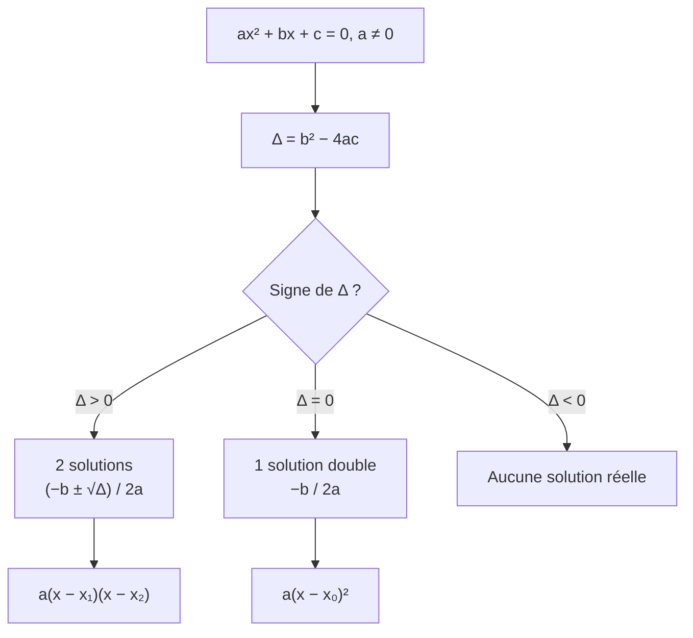

# Équation du second degré : discriminant, solutions, factorisation

## Objectifs pédagogiques et compétences

À la fin de ce chapitre, tu dois savoir :

- calculer le discriminant d'un trinôme et en déduire le nombre de solutions réelles de $ax^2+bx+c=0$ ;
- donner les solutions et **factoriser** le trinôme lorsque c'est possible ;
- **démontrer** le théorème à partir de la forme canonique ;
- résoudre efficacement les cas particuliers (équations incomplètes, racine évidente) ;
- ramener une équation (bicarrée, fractionnaire) à une équation du second degré, sans perdre ni inventer de solutions.

## Prérequis

- forme canonique $a(x-\alpha)^2+\beta$ (chapitre 1) ;
- $X^2=k$ : si $k>0$, deux solutions $\pm\sqrt k$ ; si $k=0$, une solution $0$ ; si $k<0$, aucune ;
- équation produit nul : $AB=0\iff A=0$ ou $B=0$ ;
- identités remarquables.

---

## 1. Définitions

!!! info "Définition : racine et équation du second degré"
    Une **équation du second degré** est une équation de la forme $ax^2+bx+c=0$ avec $a,b,c$ réels et $a\neq0$.
    Une **racine** (ou **zéro**) du trinôme $f(x)=ax^2+bx+c$ est un réel $x_0$ tel que $f(x_0)=0$. Résoudre l'équation, c'est trouver toutes les racines de $f$.

!!! info "Définition : discriminant"
    Le **discriminant** du trinôme $ax^2+bx+c$ est le réel
    $$\Delta=b^2-4ac.$$

!!! warning "Point d'attention"
    $\Delta$ est un **nombre** calculé à partir de $a$, $b$, $c$. Il peut être négatif, mais $\sqrt\Delta$ n'existe (dans $\mathbb R$) que si $\Delta\ge0$.

---

## 2. Le théorème

!!! abstract "Propriété : solutions de $ax^2+bx+c=0$ (avec $a\neq0$)"
    | Signe de $\Delta$ | Solutions réelles | Factorisation de $ax^2+bx+c$ |
    |---|---|---|
    | $\Delta>0$ | **deux** racines distinctes $x_1=\dfrac{-b-\sqrt\Delta}{2a}$ et $x_2=\dfrac{-b+\sqrt\Delta}{2a}$ | $a(x-x_1)(x-x_2)$ |
    | $\Delta=0$ | **une** racine double $x_0=-\dfrac{b}{2a}$ | $a(x-x_0)^2$ |
    | $\Delta<0$ | **aucune** | impossible dans $\mathbb R$ (trinôme irréductible) |

### 2.1 Démonstration

!!! abstract "Démonstration"
    D'après le chapitre 1, pour tout réel $x$ :
    $$ax^2+bx+c=a\left[\left(x+\frac{b}{2a}\right)^2-\frac{b^2-4ac}{4a^2}\right]=a\left[\left(x+\frac{b}{2a}\right)^2-\frac{\Delta}{4a^2}\right].$$
    Comme $a\neq0$ : $ax^2+bx+c=0\iff\left(x+\dfrac{b}{2a}\right)^2=\dfrac{\Delta}{4a^2}$. Le dénominateur $4a^2$ est strictement positif, donc $\dfrac{\Delta}{4a^2}$ a le **signe de $\Delta$**.

    - **Si $\Delta<0$** : un carré ne peut pas être égal à un nombre strictement négatif. Aucune solution.
    - **Si $\Delta=0$** : $\left(x+\frac{b}{2a}\right)^2=0\iff x=-\frac{b}{2a}$. Une solution. De plus $ax^2+bx+c=a\left(x+\frac{b}{2a}\right)^2$.
    - **Si $\Delta>0$** : $\dfrac{\Delta}{4a^2}=\left(\dfrac{\sqrt\Delta}{2|a|}\right)^2$, d'où $x+\dfrac{b}{2a}=\pm\dfrac{\sqrt\Delta}{2a}$ (le signe de $a$ n'a pas d'importance puisqu'on prend les deux signes). Donc $x=\dfrac{-b\pm\sqrt\Delta}{2a}$.
      Pour la factorisation, on utilise $u^2-v^2=(u-v)(u+v)$ avec $u=x+\frac{b}{2a}$ et $v=\frac{\sqrt\Delta}{2a}$ :
      $$ax^2+bx+c=a\left(x+\frac{b}{2a}-\frac{\sqrt\Delta}{2a}\right)\left(x+\frac{b}{2a}+\frac{\sqrt\Delta}{2a}\right)=a(x-x_2)(x-x_1).\ \blacksquare$$

---

## 3. Méthodes à maîtriser

!!! tip "Méthode 1 : résolution par le discriminant"
    1. Vérifier que l'équation est bien sous la forme $ax^2+bx+c=0$ (**tout passer dans un membre**).
    2. Identifier $a$, $b$, $c$ **avec leurs signes**.
    3. Calculer $\Delta=b^2-4ac$.
    4. Conclure selon le signe de $\Delta$ et écrire l'ensemble des solutions $S$.
    5. **Vérifier** une solution dans l'équation de départ, ou avec la somme et le produit (chapitre 4).

!!! tip "Méthode 2 : cas particuliers à traiter sans $\Delta$"
    - **$c=0$** : $ax^2+bx=x(ax+b)=0\iff x=0$ ou $x=-\frac{b}{a}$.
    - **$b=0$** : $ax^2+c=0\iff x^2=-\frac{c}{a}$ (deux solutions, une, ou aucune selon le signe de $-\frac ca$).
    - **Racine évidente** : si $a+b+c=0$, alors $1$ est racine ; si $a-b+c=0$, alors $-1$ est racine. (Pour la seconde racine, voir le chapitre 4 : on la déduit du produit $\frac ca$.)
    - **Identité remarquable reconnue** : $x^2-6x+9=(x-3)^2$.

!!! tip "Méthode 3 : se ramener au second degré"
    - **Équation bicarrée** $ax^4+bx^2+c=0$ : poser $X=x^2$ (avec $X\ge0$), résoudre en $X$, puis revenir à $x$.
    - **Équation fractionnaire** : donner les **valeurs interdites**, réduire au même dénominateur, résoudre le numérateur, puis **écarter** les valeurs interdites.

!!! warning "Points d'attention : erreurs fréquentes"
    - **Diviser par $x$** dans $x^2=3x$ : on **perd** la solution $x=0$. On factorise : $x(x-3)=0$.
    - **Signes dans $\Delta$** : $-4ac$ avec $c<0$ ou $a<0$ donne un **plus**. Écrire d'abord $b^2-4\times a\times c$ avec les valeurs entre parenthèses.
    - **Oublier le $2a$ entier** au dénominateur (et non juste $a$), ou oublier le signe de $-b$ quand $b<0$ (on obtient $-(-5)=+5$).
    - **$\Delta<0$ ne signifie pas « pas de solution » partout** : seulement pas de solution **réelle**. Il faut écrire $S=\varnothing$.
    - **$\Delta=0$** : une seule solution, mais le trinôme a une racine **double** (et non « pas de factorisation »).
    - **Équation bicarrée** : une valeur $X<0$ ne donne **aucune** valeur de $x$ ; ne pas écrire $x=\pm\sqrt{X}$ avec $X<0$.
    - **Valeurs interdites** oubliées dans une équation fractionnaire.

---

## 4. Exemples corrigés

!!! example "Exemple 1 : $\Delta>0$ : $2x^2-5x-3=0$"
    $a=2$, $b=-5$, $c=-3$.
    $\Delta=(-5)^2-4\times2\times(-3)=25+24=49=7^2>0$.
    $x_1=\dfrac{5-7}{4}=-\dfrac12$ et $x_2=\dfrac{5+7}{4}=3$. $S=\left\{-\frac12\,;3\right\}$.
    Factorisation : $2x^2-5x-3=2\left(x+\frac12\right)(x-3)=(2x+1)(x-3)$.

!!! example "Exemple 2 : $\Delta=0$ : $4x^2-12x+9=0$"
    $\Delta=144-144=0$. Racine double $x_0=\dfrac{12}{8}=\dfrac32$. $S=\left\{\frac32\right\}$.
    Factorisation : $4\left(x-\frac32\right)^2=(2x-3)^2$ : on reconnaît $(2x)^2-2\times2x\times3+3^2$.

!!! example "Exemple 3 : $\Delta<0$ : $x^2+x+1=0$"
    $\Delta=1-4=-3<0$. $S=\varnothing$ (cohérent avec le chapitre 1 : le minimum de $x^2+x+1$ est $\frac34>0$).

!!! example "Exemple 4 : solutions irrationnelles : $x^2-2x-1=0$"
    $\Delta=4+4=8=4\times2$, donc $\sqrt\Delta=2\sqrt2$.
    $x=\dfrac{2\pm2\sqrt2}{2}=1\pm\sqrt2$. $S=\{1-\sqrt2\,;1+\sqrt2\}$.
    **Réflexe** : simplifier $\sqrt\Delta$ et **simplifier la fraction** par $2$.

---

## 5. Exercices progressifs

### Exercice 1 : applications directes

Résoudre dans $\mathbb R$ : (a) $x^2-5x+6=0$ ; (b) $-x^2+2x+3=0$ ; (c) $3x^2-x+2=0$ ; (d) $x^2-2\sqrt2\,x+2=0$.

??? success "Corrigé"
    - (a) $\Delta=25-24=1$ : $x=\frac{5\pm1}{2}$, $S=\{2\,;3\}$.
    - (b) $a=-1,b=2,c=3$ : $\Delta=4+12=16$. $x=\frac{-2\pm4}{-2}$ : $x=-1$ ou $x=3$. $S=\{-1\,;3\}$. Factorisation : $-(x+1)(x-3)$.
    - (c) $\Delta=1-24=-23<0$ : $S=\varnothing$.
    - (d) $\Delta=8-8=0$ : $x_0=\frac{2\sqrt2}{2}=\sqrt2$. $S=\{\sqrt2\}$ ; $x^2-2\sqrt2x+2=(x-\sqrt2)^2$.

    **Piège (b)** : $a<0$ ; le $-4ac$ devient $+12$. Les deux racines sortent quand même sans erreur de signe si on garde le $2a=-2$ au dénominateur.

### Exercice 2 : équations incomplètes

Résoudre : (a) $x^2-7x=0$ ; (b) $3x^2-12=0$ ; (c) $x^2+4=0$ ; (d) $x^2=5x$.

??? success "Corrigé"
    - (a) $x(x-7)=0$ : $S=\{0\,;7\}$.
    - (b) $x^2=4$ : $S=\{-2\,;2\}$.
    - (c) $x^2=-4<0$ : $S=\varnothing$.
    - (d) $x^2-5x=0\iff x(x-5)=0$ : $S=\{0\,;5\}$.

    **Piège (d)** : diviser par $x$ fait perdre $x=0$. On ne divise **jamais** par une expression pouvant s'annuler.

### Exercice 3 : racine évidente

Résoudre $5x^2-7x+2=0$ puis $3x^2+5x+2=0$ en repérant une racine évidente. Vérifier avec $\Delta$.

??? success "Corrigé"
    - $5-7+2=0$ : $1$ est racine. Par $\Delta=49-40=9$ : $x=\frac{7\pm3}{10}$, soit $\frac25$ et $1$. $S=\left\{\frac25\,;1\right\}$.
    - $3-5+2=0$ : $-1$ est racine. $\Delta=25-24=1$ : $x=\frac{-5\pm1}{6}$, soit $-1$ et $-\frac23$. $S=\left\{-1\,;-\frac23\right\}$.

    **À retenir** : pour $a+b+c=0$ on teste $f(1)=a+b+c$ ; pour $a-b+c=0$ on teste $f(-1)=a-b+c$.

### Exercice 4 : équation bicarrée

Résoudre : (a) $x^4-5x^2+4=0$ ; (b) $x^4+x^2-6=0$.

??? success "Corrigé"
    - (a) $X=x^2\ge0$ : $X^2-5X+4=0$, $\Delta=9$, $X=1$ ou $X=4$. Les deux sont positifs : $x^2=1$ ou $x^2=4$, $S=\{-2\,;-1\,;1\,;2\}$.
    - (b) $X^2+X-6=0$, $\Delta=25$, $X=2$ ou $X=-3$. $X=-3<0$ est **rejeté** (aucun $x$ tel que $x^2=-3$). Reste $x^2=2$ : $S=\{-\sqrt2\,;\sqrt2\}$.

    **Piège** : ne pas oublier la condition $X\ge0$, et ne pas s'arrêter à la valeur de $X$ (il faut revenir à $x$).

### Exercice 5 : équation fractionnaire

Résoudre : (a) $\dfrac{x^2-3x+2}{x-1}=0$ ; (b) $\dfrac{2x}{x-1}=x+2$.

??? success "Corrigé"
    - (a) Valeur interdite : $x=1$. Numérateur nul : $\Delta=1$, $x=1$ ou $x=2$. Or $1$ est interdit : $S=\{2\}$. (Autre voie : pour $x\neq1$, la fraction vaut $x-2$.)
    - (b) Valeur interdite $x=1$. On multiplie : $2x=(x+2)(x-1)=x^2+x-2$, soit $x^2-x-2=0$. $\Delta=9$, $x=-1$ ou $x=2$. Aucune n'est $1$ : $S=\{-1\,;2\}$.

    **Piège** : une solution trouvée par le calcul doit toujours être **comparée aux valeurs interdites**.

### Exercice 6 : factoriser et simplifier

Simplifier $\dfrac{2x^2-5x-3}{x^2-9}$ en précisant les valeurs interdites.

??? success "Corrigé"
    Dénominateur : $x^2-9=(x-3)(x+3)$, valeurs interdites $\pm3$.
    Numérateur (exemple 1) : $2x^2-5x-3=(2x+1)(x-3)$.
    Pour $x\neq\pm3$ : $\dfrac{(2x+1)(x-3)}{(x-3)(x+3)}=\dfrac{2x+1}{x+3}$.

    **Piège** : l'égalité n'est valable que pour $x\neq3$ **et** $x\neq-3$. La simplification ne rend pas $3$ autorisé.

---

## 6. Exercices type contrôle

### Exercice A : problème géométrique

Un rectangle a un périmètre de $28$ cm et une aire de $48$ cm². Déterminer ses dimensions.

??? success "Corrigé"
    Soit $x$ une dimension, $0<x<14$. L'autre vaut $14-x$ (demi-périmètre $14$).
    Aire : $x(14-x)=48\iff x^2-14x+48=0$.
    $\Delta=196-192=4$. $x=\frac{14\pm2}{2}$ : $x=6$ ou $x=8$.
    Les deux solutions donnent **le même** rectangle : $6\times8$ (longueur $8$, largeur $6$). Vérification : $2(6+8)=28$ ✔, $6\times8=48$ ✔.

    **Point d'attention** : $x=6$ et $x=8$ ne sont pas deux rectangles différents ; ils correspondent à la dimension choisie. Penser à vérifier la contrainte $0<x<14$.

### Exercice B : trouver les erreurs

Deux élèves proposent :
(1) « $x^2=3x$, donc $x=3$ » ;
(2) « Pour $x^2+3x-4=0$ : $\Delta=3^2-4\times1\times4=-7<0$, donc pas de solution ».
Corriger.

??? success "Corrigé"
    1. En divisant par $x$, l'élève perd $x=0$. Correct : $x(x-3)=0$, $S=\{0\,;3\}$.
    2. Il a oublié que $c=-4$ : $\Delta=9-4\times1\times(-4)=9+16=25$. $x=\frac{-3\pm5}{2}$ : $S=\{-4\,;1\}$. Test rapide : $a+b+c=1+3-4=0$, donc $1$ est racine, ce qui contredit « pas de solution ».

### Exercice C : démonstration

Soit $ax^2+bx+c$ avec $\Delta>0$ et $x_1,x_2$ ses racines. Démontrer que $ax^2+bx+c=a(x-x_1)(x-x_2)$.

??? success "Corrigé"
    Voir la démonstration du §2.1 : on part de $a\left[\left(x+\frac b{2a}\right)^2-\left(\frac{\sqrt\Delta}{2a}\right)^2\right]$, on applique $u^2-v^2=(u-v)(u+v)$ et on reconnaît $x-x_2$ et $x-x_1$ (avec $x_{1,2}=\frac{-b\mp\sqrt\Delta}{2a}$). Il faut bien écrire que $\left(\frac{\sqrt\Delta}{2a}\right)^2=\frac{\Delta}{4a^2}$, vrai même si $a<0$.

### Exercice D : haut niveau avec paramètre

Soit $m$ un réel. On considère $x^2-(m+1)x+m=0$.

1. Calculer $\Delta$ en fonction de $m$ et le factoriser.
2. Résoudre l'équation selon les valeurs de $m$.
3. Pour quelle(s) valeur(s) de $m$ y a-t-il une racine double ?

??? success "Corrigé"
    1. $\Delta=(m+1)^2-4m=m^2-2m+1=(m-1)^2$.
    2. $\Delta\ge0$ pour tout $m$, donc il y a toujours une solution réelle. $\sqrt\Delta=|m-1|$ et
       $x=\dfrac{(m+1)\pm|m-1|}{2}$ : ces deux valeurs sont $m$ et $1$ (quel que soit le signe de $m-1$).
       Vérification directe : $x^2-(m+1)x+m=(x-1)(x-m)$. $S=\{1\,;m\}$.
    3. Racine double si et seulement si $\Delta=0\iff m=1$. Alors $S=\{1\}$.

    **Pièges** : $\sqrt{(m-1)^2}=|m-1|$ et non $m-1$ ; mais comme on prend les deux signes $\pm$, le résultat final ne dépend pas du cas. Et si $m=1$, les deux valeurs $m$ et $1$ coïncident : on écrit $S=\{1\}$, pas $\{1\,;1\}$.

---

## 7. Synthèse et fiche de révision

!!! abstract "Fiche de révision"
    | À retenir | Formule / idée |
    |---|---|
    | Discriminant | $\Delta=b^2-4ac$ |
    | $\Delta>0$ | $x_{1,2}=\dfrac{-b\mp\sqrt\Delta}{2a}$ ; $a(x-x_1)(x-x_2)$ |
    | $\Delta=0$ | $x_0=-\dfrac b{2a}$ ; $a(x-x_0)^2$ |
    | $\Delta<0$ | aucune solution réelle, pas de factorisation |
    | $c=0$ | $x(ax+b)=0$ |
    | $b=0$ | $x^2=-c/a$ |
    | $a+b+c=0$ | $1$ est racine |
    | $a-b+c=0$ | $-1$ est racine |
    | Bicarrée | $X=x^2\ge0$ |
    | Fractionnaire | valeurs interdites, puis tri des solutions |

    **Réflexes** : tout dans un membre, signes de $a,b,c$, ne jamais diviser par $x$, vérifier une solution.

---

## 8. Comprendre, savoir quand l'utiliser, savoir démontrer

!!! tip "Pourquoi le théorème est vrai"
    On a vu au chapitre 1 que $ax^2+bx+c$ s'écrit $a\left[(x-\alpha)^2-\frac{\Delta}{4a^2}\right]$. La seule chose qui varie est le terme $\frac{\Delta}{4a^2}$ que l'on compare à un carré. Un carré est toujours $\ge0$, donc :
    si ce terme est négatif, on ne peut jamais annuler l'expression ; s'il est nul, on l'annule en un seul point (le sommet de la parabole touche l'axe des abscisses) ; s'il est positif, on l'annule en deux points symétriques par rapport à $\alpha$. Le discriminant **ne fait que mesurer si le sommet est du bon côté de l'axe**.

!!! tip "Quand l'utiliser"
    - **Équation du second degré** sans astuce évidente.
    - **Existence de solutions** : le signe de $\Delta$ répond sans calculer les racines (utile avec un paramètre).
    - **Factorisation** pour simplifier une fraction ou résoudre une équation produit.
    - **Mais d'abord** : chercher le cas simple (incomplet, racine évidente, identité remarquable), c'est plus rapide.

!!! tip "Savoir le démontrer (checklist)"
    1. Partir de la forme canonique $a\left[\left(x+\frac b{2a}\right)^2-\frac\Delta{4a^2}\right]$.
    2. Remarquer que $4a^2>0$, donc $\frac\Delta{4a^2}$ a le signe de $\Delta$.
    3. Traiter les trois cas : carré égal à un négatif, à zéro, à un positif.
    4. Pour $\Delta>0$, factoriser avec $u^2-v^2$.