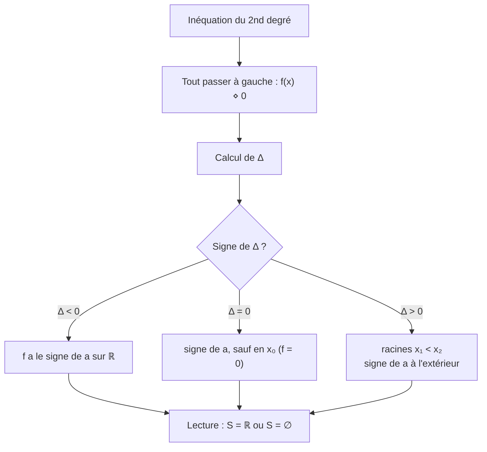

# Signe d'un trinôme et inéquations du second degré

## Objectifs pédagogiques et compétences

À la fin de ce chapitre, tu dois savoir :

- résoudre $x^2=k$, $x^2\le k$, $x^2\ge k$ (avec $k>0$) et leurs versions strictes ;
- dresser le **tableau de signes** d'un trinôme selon le signe de $\Delta$ et de $a$ ;
- résoudre une inéquation du second degré et écrire l'ensemble solution avec des intervalles ;
- résoudre une inéquation avec quotient ou une condition d'existence (racine carrée, dénominateur) ;
- **démontrer** les propriétés sur le signe du trinôme.

## Prérequis

- forme canonique et discriminant (chapitres 1 et 2) ;
- factorisation $a(x-x_1)(x-x_2)$ lorsque $\Delta>0$ ;
- règle des signes d'un produit ;
- intervalles, réunion $\cup$, notation $]\,;[$ (ouvert) et $[\,;]$ (fermé).

!!! note "Notation"
    Dans l'énoncé du cours, la constante positive des équations $x^2=\dots$ est notée $a$. Pour ne pas la confondre avec le coefficient $a$ du trinôme, on la note ici $\boldsymbol{k}$.

---

## 1. Les inéquations $x^2\le k$ et $x^2\ge k$

!!! abstract "Propriété : résolution avec $k>0$"
    Pour tout réel $k>0$ :

    | Inéquation | Ensemble des solutions |
    |---|---|
    | $x^2=k$ | $\{-\sqrt k\,;\sqrt k\}$ |
    | $x^2<k$ | $]-\sqrt k\,;\sqrt k[$ |
    | $x^2\le k$ | $[-\sqrt k\,;\sqrt k]$ |
    | $x^2>k$ | $]-\infty\,;-\sqrt k[\ \cup\ ]\sqrt k\,;+\infty[$ |
    | $x^2\ge k$ | $]-\infty\,;-\sqrt k]\ \cup\ [\sqrt k\,;+\infty[$ |

!!! abstract "Démonstration"
    Pour tout $x$ : $x^2-k=(x-\sqrt k)(x+\sqrt k)$ car $k=(\sqrt k)^2$. Les deux facteurs s'annulent en $-\sqrt k$ et $\sqrt k$, avec $-\sqrt k<\sqrt k$.

    | $x$ | $-\infty$ | | $-\sqrt k$ | | $\sqrt k$ | | $+\infty$ |
    |---|---|---|---|---|---|---|---|
    | $x-\sqrt k$ | | $-$ | | $-$ | $0$ | $+$ | |
    | $x+\sqrt k$ | | $-$ | $0$ | $+$ | | $+$ | |
    | $x^2-k$ | | $+$ | $0$ | $-$ | $0$ | $+$ | |

    On lit : $x^2-k<0$ exactement pour $-\sqrt k<x<\sqrt k$, etc. $\blacksquare$

!!! warning "Points d'attention"
    - $x^2\le 9$ donne $-3\le x\le3$, **pas** $x\le\pm3$ ni $x\le3$.
    - $x^2\ge9$ donne **deux** intervalles : $x\le-3$ **ou** $x\ge3$. Ce n'est pas un seul intervalle.
    - **Cas $k\le0$** : $x^2\ge k$ est toujours vrai ($S=\mathbb R$) ; $x^2<k$ est impossible si $k\le0$ ($S=\varnothing$) ; $x^2\le0\iff x=0$ ; $x^2=-2$ n'a aucune solution.
    - On écrit « ou » (réunion) pour l'extérieur, « et » (intersection) pour l'intérieur.

---

## 2. Signe d'un trinôme

### 2.1 Le théorème

!!! abstract "Propriété : signe de $f(x)=ax^2+bx+c$, $a\neq0$"
    **Cas $\Delta>0$** : soient $x_1<x_2$ les deux racines.

    | $x$ | $-\infty$ | | $x_1$ | | $x_2$ | | $+\infty$ |
    |---|---|---|---|---|---|---|---|
    | signe de $f(x)$ | | signe de $a$ | $0$ | signe de $-a$ | $0$ | signe de $a$ | |

    **Cas $\Delta=0$** : racine double $x_0=-\frac{b}{2a}$.

    | $x$ | $-\infty$ | | $x_0$ | | $+\infty$ |
    |---|---|---|---|---|---|
    | signe de $f(x)$ | | signe de $a$ | $0$ | signe de $a$ | |

    **Cas $\Delta<0$** : $f(x)$ est du **signe de $a$** pour tout réel $x$ (et ne s'annule jamais).

    **Mémo** : le trinôme est du **signe de $a$ à l'extérieur des racines** et du **signe contraire de $a$ entre les racines**.

### 2.2 Démonstration

!!! abstract "Démonstration"
    On part de la forme canonique : $f(x)=a\left[\left(x+\frac b{2a}\right)^2-\frac{\Delta}{4a^2}\right]$.

    - **$\Delta<0$** : $\left(x+\frac b{2a}\right)^2\ge0$ et $-\frac\Delta{4a^2}>0$, donc le crochet est strictement positif. $f(x)$ est donc du signe de $a$ pour tout $x$.
    - **$\Delta=0$** : $f(x)=a\left(x-x_0\right)^2$, et $(x-x_0)^2>0$ pour $x\neq x_0$ : signe de $a$, sauf en $x_0$ où $f$ s'annule.
    - **$\Delta>0$** : $f(x)=a(x-x_1)(x-x_2)$ avec $x_1<x_2$.

      | $x$ | $-\infty$ | | $x_1$ | | $x_2$ | | $+\infty$ |
      |---|---|---|---|---|---|---|---|
      | $x-x_1$ | | $-$ | $0$ | $+$ | | $+$ | |
      | $x-x_2$ | | $-$ | | $-$ | $0$ | $+$ | |
      | $(x-x_1)(x-x_2)$ | | $+$ | $0$ | $-$ | $0$ | $+$ | |

      On multiplie par $a$ : le signe est celui de $a$ à l'extérieur et de $-a$ entre les racines. $\blacksquare$

### 2.3 Lien avec la parabole

!!! tip "Lecture graphique"
    Le signe de $f$ correspond à la position de la parabole par rapport à l'axe des abscisses :

    - $a>0$, $\Delta>0$ : parabole « en U » qui coupe l'axe en deux points ; **au-dessus** à l'extérieur, **en dessous** entre les racines ;
    - $a<0$, $\Delta>0$ : parabole « en ∩ » ; au-dessus entre les racines, en dessous à l'extérieur ;
    - $\Delta=0$ : le sommet **touche** l'axe ;
    - $\Delta<0$ : la parabole est entièrement d'un côté de l'axe.

---

## 3. Méthode à maîtriser

!!! tip "Méthode : résoudre une inéquation du second degré"
    1. **Tout passer dans un membre** pour comparer à $0$ (ne jamais garder un second membre non nul).
    2. Réduire pour obtenir $ax^2+bx+c\ \square\ 0$.
    3. Calculer $\Delta$ et les racines éventuelles.
    4. **Dresser le tableau de signes** (ou faire un croquis de parabole).
    5. Lire l'ensemble solution en respectant le sens de l'inégalité et en **incluant ou excluant les racines** selon que l'inégalité est large ($\le,\ge$) ou stricte ($<,>$).
    6. Écrire $S$ avec des intervalles.

!!! warning "Points d'attention : erreurs fréquentes"
    - **Mettre $a$ de côté** : le signe de $a$ décide tout. $-x^2+1\ge0$ n'a pas la même solution que $x^2-1\ge0$.
    - **Crochets** : $\le$ ou $\ge$ → crochets fermés sur les racines ; $<$ ou $>$ → ouverts. Toujours $\pm\infty$ avec un crochet **ouvert**.
    - **Multiplier ou diviser par un nombre négatif** : le sens de l'inégalité change. Éviter de diviser par $a<0$ ; préférer le tableau de signes.
    - **Ne jamais multiplier par une expression dont on ne connaît pas le signe** (par exemple $x$ ou $x-1$) : on perd ou on ajoute des solutions. On passe tout dans un membre et on étudie le **signe du quotient**.
    - **$\Delta=0$** : l'inégalité stricte $f(x)>0$ exclut $x_0$ ; l'inégalité large $f(x)\ge0$ le **garde** (et $f(x)\le0$ ne vaut que $x_0$ si $a>0$).
    - **$\Delta<0$** : la réponse est $\mathbb R$ ou $\varnothing$, pas « aucune solution » systématiquement.

---

## 4. Exemples corrigés

!!! example "Exemple 1 : $x^2-x-6\ge0$"
    $\Delta=1+24=25$, racines $x=\frac{1\pm5}{2}$ : $-2$ et $3$. $a=1>0$ : signe de $a$ à l'extérieur.

    | $x$ | $-\infty$ | | $-2$ | | $3$ | | $+\infty$ |
    |---|---|---|---|---|---|---|---|
    | $x^2-x-6$ | | $+$ | $0$ | $-$ | $0$ | $+$ | |

    Inégalité large : $S=]-\infty\,;-2]\cup[3\,;+\infty[$.

!!! example "Exemple 2 : $\Delta=0$ et $a<0$ : $-2x^2+4x-2<0$"
    $-2x^2+4x-2=-2(x-1)^2\le0$, et c'est $0$ **seulement** en $x=1$. L'inégalité est stricte : $S=\mathbb R\setminus\{1\}=]-\infty\,;1[\cup]1\,;+\infty[$.

!!! example "Exemple 3 : $\Delta<0$ : $x^2+x+1$"
    $\Delta=-3<0$ et $a=1>0$ : $x^2+x+1>0$ pour tout $x$.
    $x^2+x+1>0$ : $S=\mathbb R$. $x^2+x+1\le0$ : $S=\varnothing$.

!!! example "Exemple 4 : $x^2\ge7$"
    $S=]-\infty\,;-\sqrt7]\cup[\sqrt7\,;+\infty[$.

---

## 5. Exercices progressifs

### Exercice 1 : le cas $x^2\ \square\ k$

Résoudre : (a) $x^2\le9$ ; (b) $x^2>5$ ; (c) $x^2\ge-3$ ; (d) $x^2<0$ ; (e) $x^2\le0$.

??? success "Corrigé"
    - (a) $S=[-3\,;3]$.
    - (b) $S=]-\infty\,;-\sqrt5[\cup]\sqrt5\,;+\infty[$.
    - (c) un carré est toujours $\ge0>-3$ : $S=\mathbb R$.
    - (d) un carré n'est jamais strictement négatif : $S=\varnothing$.
    - (e) $x^2\le0\iff x^2=0$ : $S=\{0\}$.

    **Pièges** : (c), (d), (e) sont des cas où la formule « $\pm\sqrt k$ » ne s'applique pas ($k\le0$).

### Exercice 2 : signe de trinômes

Donner le signe de : (a) $2x^2-3x-2$ ; (b) $-x^2+4x-4$ ; (c) $3x^2-2x+5$.

??? success "Corrigé"
    - (a) $\Delta=9+16=25$, racines $\frac{3\pm5}{4}$ : $-\frac12$ et $2$. $a>0$ : positif sur $]-\infty\,;-\frac12[\cup]2\,;+\infty[$, négatif sur $]-\frac12\,;2[$, nul en $-\frac12$ et $2$.
    - (b) $-(x-2)^2$ : négatif pour tout $x\neq2$, nul en $2$.
    - (c) $\Delta=4-60=-56<0$, $a>0$ : strictement positif sur $\mathbb R$.

### Exercice 3 : inéquations simples

Résoudre : (a) $x^2-3x+2<0$ ; (b) $-3x^2+x+2\ge0$.

??? success "Corrigé"
    - (a) racines $1$ et $2$ ; $a>0$, négatif **entre** : $S=]1\,;2[$.
    - (b) $\Delta=1+24=25$, racines $\frac{-1\pm5}{-6}$ : $-\frac23$ et $1$. $a<0$ : positif **entre** les racines. Inégalité large : $S=\left[-\frac23\,;1\right]$.
      Test : $x=0$ donne $2\ge0$ ✔ ($0\in S$).

    **Piège (b)** : avec $a<0$ la résolution se retourne ; le test d'une valeur sécurise la réponse.

### Exercice 4 : second membre non nul

Résoudre $x^2+2x>3$.

??? success "Corrigé"
    On passe tout à gauche : $x^2+2x-3>0$. $\Delta=4+12=16$, racines $\frac{-2\pm4}{2}$ : $-3$ et $1$. $a>0$ : positif à l'extérieur.
    $S=]-\infty\,;-3[\cup]1\,;+\infty[$.

    **Piège** : écrire $x(x+2)>3$ puis « $x>3$ ou $x+2>3$ » est **faux** : le produit n'est pas borné comme le produit nul.

### Exercice 5 : quotient

Résoudre $\dfrac{x-1}{x^2-x-2}\ge0$.

??? success "Corrigé"
    Dénominateur : racines $-1$ et $2$ (valeurs interdites). $a>0$ : positif à l'extérieur de $[-1\,;2]$, négatif entre.

    | $x$ | $-\infty$ | | $-1$ | | $1$ | | $2$ | | $+\infty$ |
    |---|---|---|---|---|---|---|---|---|---|
    | $x-1$ | | $-$ | | $-$ | $0$ | $+$ | | $+$ | |
    | $x^2-x-2$ | | $+$ | $0$ | $-$ | | $-$ | $0$ | $+$ | |
    | quotient | | $-$ | $\|\|$ | $+$ | $0$ | $-$ | $\|\|$ | $+$ | |

    Le symbole $\|\|$ marque la valeur interdite. Pour $\ge0$ : $S=]-1\,;1]\cup]2\,;+\infty[$.

    **Pièges** : $1$ est **inclus** (le quotient vaut $0$), $-1$ et $2$ sont **toujours exclus**.

### Exercice 6 : ensemble de définition

Déterminer l'ensemble de définition de $g(x)=\sqrt{x^2-3x-4}$.

??? success "Corrigé"
    Il faut $x^2-3x-4\ge0$. $\Delta=9+16=25$, racines $\frac{3\pm5}{2}$ : $-1$ et $4$. $a>0$ : positif à l'extérieur.
    $D_g=]-\infty\,;-1]\cup[4\,;+\infty[$.

    **Piège** : la racine carrée est définie en $0$, donc les bornes sont **incluses**.

---

## 6. Exercices type contrôle

### Exercice A : étude complète

Soit $f(x)=-2x^2+x+6$.

1. Dresser le tableau de signes de $f$.
2. Résoudre $f(x)>0$.
3. Résoudre $f(x)>4$.

??? success "Corrigé"
    1. $\Delta=1+48=49$, racines $\frac{-1\pm7}{-4}$ : $-\frac32$ et $2$. $a<0$ :

       | $x$ | $-\infty$ | | $-\frac32$ | | $2$ | | $+\infty$ |
       |---|---|---|---|---|---|---|---|
       | $f(x)$ | | $-$ | $0$ | $+$ | $0$ | $-$ | |

    2. $S=\left]-\frac32\,;2\right[$.
    3. $f(x)>4\iff-2x^2+x+2>0$. $\Delta=1+16=17$, racines $\frac{-1\pm\sqrt{17}}{-4}=\frac{1\mp\sqrt{17}}{4}$. $a<0$ : positif entre les racines.
       $S=\left]\frac{1-\sqrt{17}}{4}\,;\frac{1+\sqrt{17}}{4}\right[$.
       Vérification numérique : $\frac{1\pm4{,}12}{4}\approx-0{,}78$ et $1{,}28$ ; en $x=0$ : $f(0)=6>4$ ✔.

### Exercice B : trouver les erreurs

Un élève écrit : (1) « $x^2\le4\iff x\le\pm2$ » ; (2) « $x^2-5x+4>0\iff x\in]1\,;4[$ ». Corriger.

??? success "Corrigé"
    1. $x^2\le4\iff-2\le x\le2$, soit $S=[-2\,;2]$.
    2. Racines $1$ et $4$, $a>0$ : le trinôme est positif à **l'extérieur**. $S=]-\infty\,;1[\cup]4\,;+\infty[$. L'élève a pris l'intervalle **entre** les racines, c'est-à-dire l'ensemble où le trinôme est **négatif**. Test : $x=2$ donne $4-10+4=-2<0$, donc $2\notin S$.

### Exercice C : démonstration

Soit $f(x)=ax^2+bx+c$ avec $\Delta<0$. Démontrer que $af(x)>0$ pour tout $x$, puis en déduire que $f$ est du signe de $a$.

??? success "Corrigé"
    $f(x)=a\left[\left(x+\frac b{2a}\right)^2-\frac\Delta{4a^2}\right]$, donc $af(x)=a^2\left[\left(x+\frac b{2a}\right)^2+\frac{-\Delta}{4a^2}\right]$.
    $a^2>0$, $\left(x+\frac b{2a}\right)^2\ge0$ et $\frac{-\Delta}{4a^2}>0$ : la somme est strictement positive, donc $af(x)>0$.
    Un produit $a\times f(x)$ strictement positif signifie que $a$ et $f(x)$ ont le même signe : $f(x)$ a le signe de $a$ pour tout $x$. $\blacksquare$

### Exercice D : paramètre (haut niveau)

Soit $m$ un réel et $f_m(x)=x^2+mx+m+3$.

1. Calculer le discriminant $\Delta_m$ en fonction de $m$.
2. Pour quelles valeurs de $m$ a-t-on $f_m(x)>0$ pour tout réel $x$ ?
3. Pour quelles valeurs de $m$ a-t-on $f_m(x)\ge0$ pour tout réel $x$ ?
4. Pour quelles valeurs de $m$ l'équation $f_m(x)=0$ a-t-elle deux solutions distinctes ?

??? success "Corrigé"
    1. $\Delta_m=m^2-4(m+3)=m^2-4m-12$. C'est lui-même un trinôme en $m$ : $\Delta'=16+48=64$, racines $\frac{4\pm8}{2}$ : $-2$ et $6$. Donc $\Delta_m=(m+2)(m-6)$, positif à l'extérieur de $[-2\,;6]$.
    2. Comme $a=1>0$, $f_m>0$ sur $\mathbb R$ si et seulement si $\Delta_m<0\iff m\in]-2\,;6[$.
    3. Il faut $\Delta_m\le0$, car avec $\Delta_m=0$ le trinôme est un carré, positif ou nul : $m\in[-2\,;6]$.
    4. Deux solutions distinctes $\iff\Delta_m>0\iff m\in]-\infty\,;-2[\cup]6\,;+\infty[$.

    **Pièges** : distinguer inégalité **stricte** (2) et **large** (3) : les bornes $-2$ et $6$ passent de exclues à incluses. Ne pas confondre la variable $x$ de $f_m$ et le paramètre $m$ de $\Delta_m$.

---

## 7. Synthèse et fiche de révision

!!! abstract "Fiche de révision"
    | À retenir | Résultat |
    |---|---|
    | $x^2\le k$ ($k>0$) | $[-\sqrt k\,;\sqrt k]$ |
    | $x^2\ge k$ ($k>0$) | $]-\infty\,;-\sqrt k]\cup[\sqrt k\,;+\infty[$ |
    | $\Delta>0$ | signe de $a$ **à l'extérieur** des racines, de $-a$ **entre** |
    | $\Delta=0$ | signe de $a$, nul en $x_0$ |
    | $\Delta<0$ | signe de $a$ partout |
    | Inéquation | tout passer à gauche, $\Delta$, tableau, lecture |
    | Quotient | tableau de signes, valeurs interdites **exclues** |

    **Réflexes** : signe de $a$ ; bornes incluses ou non ; un test de valeur pour vérifier ; jamais de multiplication par une expression de signe inconnu.

---

## 8. Comprendre, savoir quand l'utiliser, savoir démontrer

!!! tip "Pourquoi les résultats sont vrais"
    Le signe de $f$ ne change qu'en passant par un **zéro** : entre deux racines consécutives, il est constant. C'est pourquoi on peut le résumer dans un tableau. Le trinôme est du signe de $a$ « aux extrémités » parce que $ax^2$ domine $bx+c$ quand $|x|$ est grand : la parabole part vers $+\infty$ si $a>0$ et vers $-\infty$ si $a<0$. Enfin, entre deux racines, la parabole doit repasser de l'autre côté de l'axe, d'où le signe contraire.

!!! tip "Quand l'utiliser"
    - **Inéquations** du second degré et toute inéquation qui s'y ramène.
    - **Ensemble de définition** avec racine carrée ou quotient.
    - **Position relative** de deux courbes (signe de $f-g$).
    - **Existence** de solutions d'une équation à paramètre (signe de $\Delta_m$).
    - Pour $x^2\le k$ : ne pas utiliser $\Delta$, la formule directe suffit.

!!! tip "Savoir le démontrer (checklist)"
    1. Écrire $f(x)=a\left[\left(x+\frac b{2a}\right)^2-\frac\Delta{4a^2}\right]$.
    2. Cas $\Delta<0$ : somme d'un carré et d'un nombre $>0$ → signe de $a$.
    3. Cas $\Delta=0$ : $a(x-x_0)^2$.
    4. Cas $\Delta>0$ : $a(x-x_1)(x-x_2)$ avec $x_1<x_2$ et tableau de signes d'un produit.