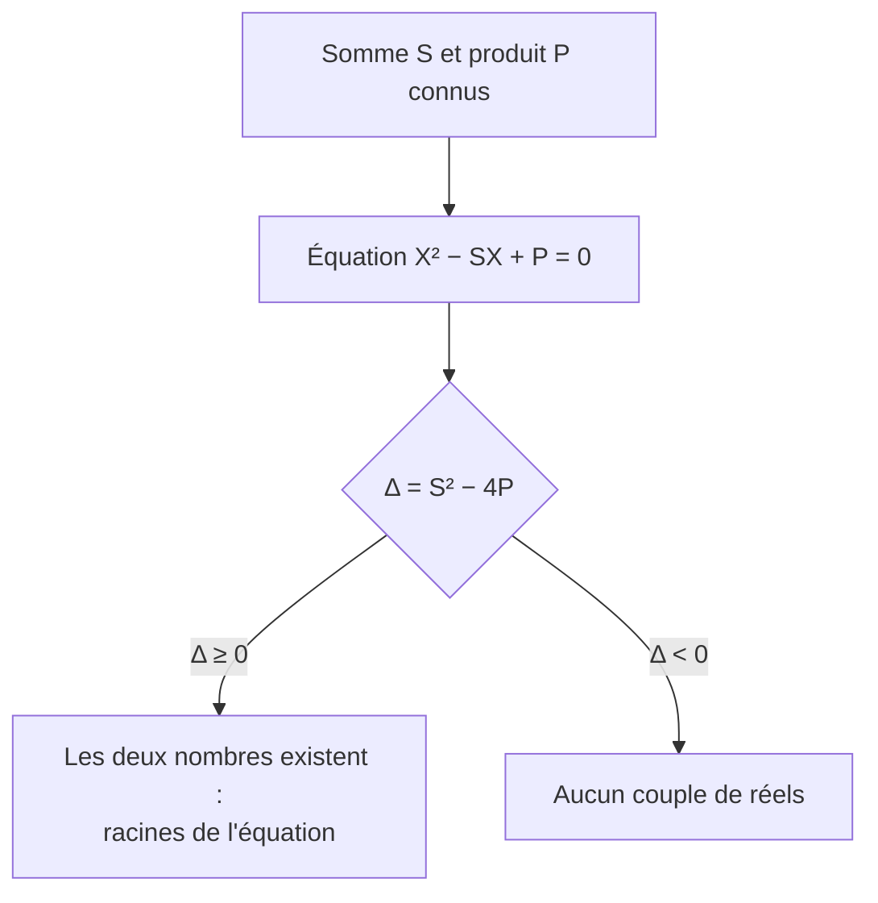
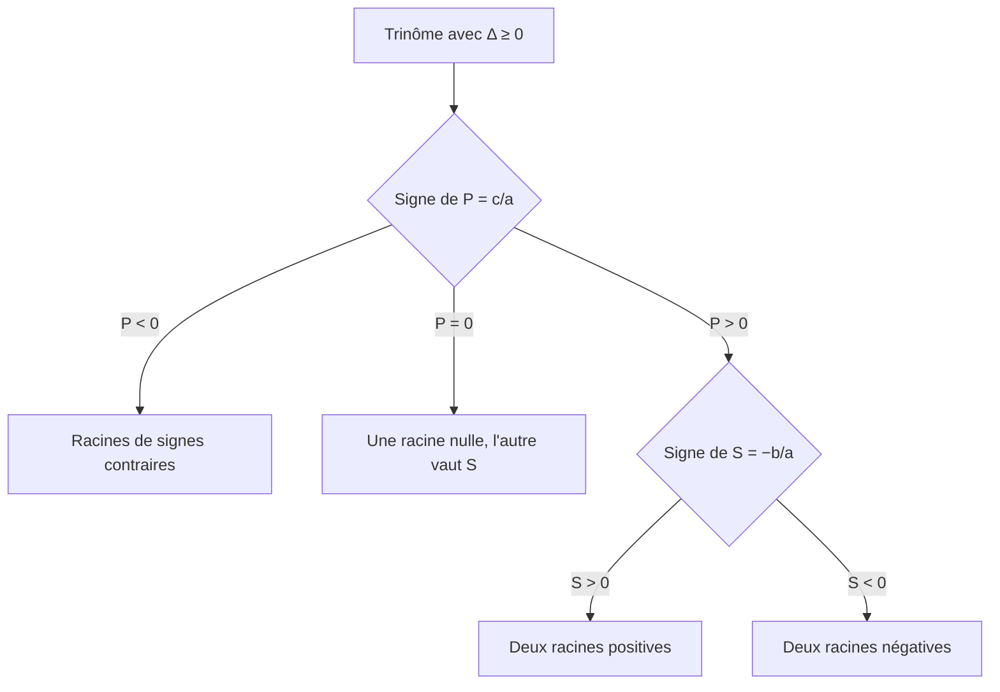

# Somme et produit des racines d'un trinôme

## Objectifs pédagogiques et compétences

À la fin de ce chapitre, tu dois savoir :

- énoncer et **démontrer** les relations entre coefficients et racines (somme et produit) ;
- énoncer et utiliser la **réciproque** : trouver deux nombres connaissant leur somme et leur produit ;
- déduire la seconde racine quand une racine est connue (racine évidente) ;
- calculer des expressions symétriques de $x_1$ et $x_2$ **sans résoudre** l'équation ;
- déterminer le **signe des racines** sans les calculer ;
- repérer les situations où les relations ne s'appliquent pas ($\Delta<0$).

## Prérequis

- discriminant, racines et factorisation $a(x-x_1)(x-x_2)$ (chapitre 2) ;
- identités remarquables, en particulier $(u+v)^2=u^2+2uv+v^2$ ;
- signe d'un produit et d'une somme ;
- résolution d'une équation du second degré.

---

## 1. Propriété directe : somme et produit

!!! abstract "Propriété : somme et produit des racines"
    Soit $ax^2+bx+c$ avec $a\neq0$ et $\Delta=b^2-4ac\ge0$. Notons $x_1$ et $x_2$ ses racines (avec $x_1=x_2$ si $\Delta=0$, la racine double étant comptée **deux fois**). Alors
    $$S=x_1+x_2=-\frac{b}{a}\qquad\text{et}\qquad P=x_1x_2=\frac{c}{a}.$$

!!! warning "Point d'attention : conditions"
    - La propriété suppose $\Delta\ge0$, c'est-à-dire que les racines **réelles existent**. Si $\Delta<0$, les quantités $-\frac ba$ et $\frac ca$ se calculent toujours, mais elles ne sont plus la somme et le produit de racines réelles (il n'y en a pas).
    - On divise **par $a$** : $S=-\frac ba$, et non $-b$. Seul le cas $a=1$ donne $S=-b$ et $P=c$.

### 1.1 Démonstration

!!! abstract "Démonstration (cas $\Delta>0$)"
    On a $x_1=\dfrac{-b-\sqrt\Delta}{2a}$ et $x_2=\dfrac{-b+\sqrt\Delta}{2a}$.

    **Somme** : $x_1+x_2=\dfrac{-b-\sqrt\Delta-b+\sqrt\Delta}{2a}=\dfrac{-2b}{2a}=-\dfrac ba$.

    **Produit** : $x_1x_2=\dfrac{(-b)^2-(\sqrt\Delta)^2}{4a^2}=\dfrac{b^2-(b^2-4ac)}{4a^2}=\dfrac{4ac}{4a^2}=\dfrac ca$.

!!! abstract "Démonstration (cas $\Delta=0$)"
    La racine double est $x_0=-\frac b{2a}$. Alors $x_0+x_0=-\frac ba$ et $x_0^2=\frac{b^2}{4a^2}=\frac{4ac}{4a^2}=\frac ca$, car $b^2=4ac$ quand $\Delta=0$. $\blacksquare$

!!! abstract "Démonstration alternative (par identification)"
    Si $\Delta\ge0$ : $ax^2+bx+c=a(x-x_1)(x-x_2)=ax^2-a(x_1+x_2)x+a\,x_1x_2$ pour tout réel $x$. Deux polynômes égaux ont les mêmes coefficients : $b=-a(x_1+x_2)$ et $c=a\,x_1x_2$, d'où $S=-\frac ba$ et $P=\frac ca$.

---

## 2. Réciproque : trouver deux nombres

!!! abstract "Propriété : réciproque"
    Soient $S$ et $P$ deux réels. Il existe deux réels $u$ et $v$ tels que $u+v=S$ et $uv=P$ **si et seulement si** $S^2-4P\ge0$. Dans ce cas, $u$ et $v$ sont les solutions de l'équation
    $$X^2-SX+P=0.$$

!!! abstract "Démonstration"
    Si $u+v=S$ et $uv=P$ : $(X-u)(X-v)=X^2-(u+v)X+uv=X^2-SX+P$. Donc $u$ et $v$ sont les racines de $X^2-SX+P$.
    Réciproquement, si $S^2-4P\ge0$, le trinôme $X^2-SX+P$ a des racines réelles $u,v$ et, d'après la propriété directe, $u+v=S$ et $uv=P$.
    Enfin, si $u,v$ existent, $S^2-4P=(u+v)^2-4uv=(u-v)^2\ge0$ : la condition est **nécessaire**. $\blacksquare$

---

## 3. Applications

### 3.1 Racine évidente et seconde racine

!!! tip "Méthode : connaître une racine, trouver l'autre"
    Si $x_1$ est une racine connue (par exemple $1$ quand $a+b+c=0$, ou $-1$ quand $a-b+c=0$), alors
    $$x_2=\frac{c}{a\,x_1}\qquad\text{ou}\qquad x_2=-\frac ba-x_1.$$
    On utilise la formule la plus simple. Cela évite de calculer $\Delta$.

### 3.2 Expressions symétriques

!!! abstract "Propriété : calculs sans résoudre"
    Avec $S=x_1+x_2$ et $P=x_1x_2$ (et $\Delta\ge0$) :

    | Expression | Valeur |
    |---|---|
    | $x_1^2+x_2^2$ | $S^2-2P$ |
    | $(x_1-x_2)^2$ | $S^2-4P=\dfrac{\Delta}{a^2}$ |
    | $\dfrac1{x_1}+\dfrac1{x_2}$ ($P\neq0$) | $\dfrac SP$ |
    | $\dfrac{x_1}{x_2}+\dfrac{x_2}{x_1}$ ($P\neq0$) | $\dfrac{S^2-2P}{P}$ |
    | $x_1^3+x_2^3$ | $S^3-3SP$ |

!!! abstract "Démonstration"
    $x_1^2+x_2^2=(x_1+x_2)^2-2x_1x_2=S^2-2P$ ; $(x_1-x_2)^2=x_1^2+x_2^2-2P=S^2-4P$ ; $\frac1{x_1}+\frac1{x_2}=\frac{x_1+x_2}{x_1x_2}$ ;
    $x_1^3+x_2^3=(x_1+x_2)^3-3x_1x_2(x_1+x_2)=S^3-3SP$. $\blacksquare$

### 3.3 Signe des racines

!!! abstract "Propriété : signe des racines sans les calculer"
    On suppose $\Delta\ge0$.

    - **$P<0$** : les racines sont **de signes contraires** (et dans ce cas $\Delta>0$ automatiquement).
    - **$P>0$** : les racines sont **de même signe**, celui de $S$ ($S>0$ : toutes deux positives ; $S<0$ : toutes deux négatives).
    - **$P=0$** : une racine est nulle, l'autre vaut $S$.

!!! abstract "Démonstration"
    Si $P=\frac ca<0$ alors $ac<0$, donc $\Delta=b^2-4ac>0$ et les racines existent ; un produit négatif impose des signes contraires. Si $P>0$, deux réels de produit positif ont le même signe, et celui-ci est celui de leur somme. $\blacksquare$

!!! warning "Points d'attention : erreurs fréquentes"
    - **Oublier de vérifier $\Delta\ge0$** avant de parler du signe des racines : $2x^2+x+3$ a $P=\frac32>0$ et $S=-\frac12<0$, mais **aucune** racine.
    - **Se tromper de signe** pour la somme : $S=-\frac ba$. Pour $x^2-5x+6$, $S=+5$.
    - **Diviser par $P$ nul** dans $\frac S P$.
    - **Cas $\Delta=0$** : une seule valeur numérique, mais comptée deux fois dans $S$ et $P$.
    - **Réciproque** : exiger $S^2-4P\ge0$ ; sinon le problème n'a pas de solution réelle.

---

## 4. Exemples corrigés

!!! example "Exemple 1 : calculer $S$ et $P$ sans résoudre"
    Pour $2x^2-5x-3=0$ : $\Delta=49>0$. $S=\frac52$, $P=-\frac32$. Vérification avec les racines $3$ et $-\frac12$ (chapitre 2) : $3-\frac12=\frac52$ ✔ et $3\times\left(-\frac12\right)=-\frac32$ ✔. Le produit est négatif : racines de signes contraires, ce qu'on constate.

!!! example "Exemple 2 : racine évidente"
    $3x^2+5x+2=0$ : $a-b+c=3-5+2=0$, donc $-1$ est racine. Le produit vaut $\frac23$ : l'autre racine est $\dfrac{2/3}{-1}=-\dfrac23$. Vérification par la somme : $-1-\frac23=-\frac53=-\frac ba$ ✔.

!!! example "Exemple 3 : deux nombres de somme $7$ et de produit $12$"
    $X^2-7X+12=0$, $\Delta=49-48=1$, $X=\frac{7\pm1}{2}$ : $3$ et $4$. Vérification : $3+4=7$, $3\times4=12$ ✔.

!!! example "Exemple 4 : expressions symétriques pour $x^2-3x+1=0$"
    $\Delta=5>0$, $S=3$, $P=1$.
    $x_1^2+x_2^2=9-2=7$ ; $\frac1{x_1}+\frac1{x_2}=3$ ; $(x_1-x_2)^2=9-4=5$ ; $x_1^3+x_2^3=27-9=18$.

---

## 5. Exercices progressifs

### Exercice 1 : $S$ et $P$

Donner, sans résoudre, la somme et le produit des racines (si elles existent) de : (a) $2x^2-7x+3=0$ ; (b) $x^2+x+1=0$ ; (c) $4x^2-4x+1=0$.

??? success "Corrigé"
    - (a) $\Delta=49-24=25>0$. $S=\frac72$, $P=\frac32$ (racines $3$ et $\frac12$).
    - (b) $\Delta=-3<0$ : **pas de racines réelles**, donc pas de somme ni de produit de racines (même si $-\frac ba=-1$ et $\frac ca=1$ se calculent).
    - (c) $\Delta=0$ : racine double $\frac12$. $S=1$ et $P=\frac14$ ✔ (la racine est comptée deux fois).

    **Piège** : tester $\Delta$ **avant** de conclure.

### Exercice 2 : racine évidente

Résoudre : (a) $7x^2-5x-2=0$ ; (b) $5x^2+4x-1=0$.

??? success "Corrigé"
    - (a) $a+b+c=0$ : $1$ est racine. Produit $=-\frac27$, donc l'autre racine est $-\frac27$. $S=\left\{-\frac27\,;1\right\}$.
    - (b) $a-b+c=5-4-1=0$ : $-1$ est racine. Produit $-\frac15$, donc l'autre vaut $\frac{-1/5}{-1}=\frac15$. $S=\left\{-1\,;\frac15\right\}$.

    Vérification avec $\Delta$ : (a) $\Delta=81$, $x=\frac{5\pm9}{14}$ ✔ ; (b) $\Delta=36$, $x=\frac{-4\pm6}{10}$ ✔.

### Exercice 3 : trouver deux nombres

Trouver, s'ils existent, deux réels de : (a) somme $10$ et produit $21$ ; (b) somme $-5$ et produit $6$ ; (c) somme $4$ et produit $7$.

??? success "Corrigé"
    - (a) $X^2-10X+21=0$, $\Delta=16$, $X=\frac{10\pm4}{2}$ : $3$ et $7$.
    - (b) $X^2+5X+6=0$, $\Delta=1$, $X=\frac{-5\pm1}{2}$ : $-3$ et $-2$. (Somme **négative**, produit positif : deux nombres négatifs.)
    - (c) $S^2-4P=16-28=-12<0$ : **aucun** couple de réels.

    **Piège (b)** : écrire $X^2-SX+P$ avec $S=-5$ donne $X^2+5X+6$ (changement de signe).

### Exercice 4 : expressions symétriques

Soit $x_1,x_2$ les racines de $x^2-5x+3=0$. Calculer sans les déterminer : $x_1^2+x_2^2$, $\frac1{x_1}+\frac1{x_2}$, $\frac{x_1}{x_2}+\frac{x_2}{x_1}$ et $|x_1-x_2|$.

??? success "Corrigé"
    $\Delta=25-12=13>0$ : les racines existent. $S=5$, $P=3\neq0$.

    - $x_1^2+x_2^2=25-6=19$.
    - $\frac1{x_1}+\frac1{x_2}=\frac53$.
    - $\frac{x_1}{x_2}+\frac{x_2}{x_1}=\frac{19}{3}$.
    - $(x_1-x_2)^2=25-12=13$, donc $|x_1-x_2|=\sqrt{13}$ (valeur absolue : on ne connaît pas l'ordre des racines).

### Exercice 5 : signe des racines

Sans résoudre, déterminer le signe des racines de : (a) $x^2-2x-8=0$ ; (b) $x^2-6x+5=0$ ; (c) $x^2+3x+1=0$ ; (d) $2x^2+x+3=0$.

??? success "Corrigé"
    - (a) $P=-8<0$ : racines de signes contraires (racines $-2$ et $4$).
    - (b) $\Delta=16>0$, $P=5>0$, $S=6>0$ : deux racines positives ($1$ et $5$).
    - (c) $\Delta=5>0$, $P=1>0$, $S=-3<0$ : deux racines négatives.
    - (d) $\Delta=1-24<0$ : aucune racine, bien que $P>0$.

### Exercice 6 : un paramètre et une relation entre racines

Pour quelle valeur de $m$ l'équation $x^2-5x+m=0$ a-t-elle une racine égale au double de l'autre ?

??? success "Corrigé"
    Notons les racines $r$ et $2r$. Somme : $3r=5$, donc $r=\frac53$. Produit : $2r^2=\frac{50}{9}=m$.
    **Condition d'existence** : $\Delta=25-4m=25-\frac{200}{9}=\frac{25}{9}>0$ ✔.
    Réponse : $m=\frac{50}{9}$ (racines $\frac53$ et $\frac{10}{3}$).

    **Piège** : on a supposé que les racines existaient ; il faut vérifier $\Delta\ge0$ à la fin.

---

## 6. Exercices type contrôle

### Exercice A : un paramètre et une condition sur la somme des carrés

Pour $m\in\mathbb R$, on considère $x^2-7x+m=0$.

1. Pour quelle valeur de $m$ les racines vérifient-elles $x_1^2+x_2^2=29$ ?
2. Même question avec $x_1^2+x_2^2=13$. Que constate-t-on ?

??? success "Corrigé"
    On a $S=7$ et $P=m$ (si les racines existent), donc $x_1^2+x_2^2=49-2m$.

    1. $49-2m=29\iff m=10$. Vérification : $\Delta=49-40=9>0$ ✔, racines $2$ et $5$, $4+25=29$ ✔.
    2. $49-2m=13\iff m=18$. Mais $\Delta=49-72=-23<0$ : l'équation n'a **aucune racine réelle**. La condition est donc **impossible** : il n'y a pas de $m$ convenable.

    **Piège** : la formule $S^2-2P$ n'a de sens que si les racines existent. On vérifie toujours $\Delta\ge0$ **après** avoir trouvé $m$.

### Exercice B : trouver les erreurs

Un élève écrit : (1) « pour $2x^2-6x+4=0$ : somme $=-6$, produit $=4$ » ; (2) « deux nombres de somme $2$ et de produit $5$ sont les racines de $X^2-2X+5$ ». Corriger.

??? success "Corrigé"
    1. Il a oublié de diviser par $a=2$. $S=-\frac{-6}{2}=3$ et $P=\frac42=2$ (racines $1$ et $2$ : $1+2=3$ ✔, $1\times2=2$ ✔).
    2. L'équation $X^2-2X+5=0$ est la bonne, mais $\Delta=4-20=-16<0$ : il n'y a **aucun** couple de réels. Il fallait conclure à l'impossibilité.

### Exercice C : démonstration de la réciproque

Soient $u,v$ deux réels avec $u+v=S$ et $uv=P$. Montrer que $u$ et $v$ sont solutions de $X^2-SX+P=0$ et que $S^2-4P\ge0$.

??? success "Corrigé"
    $u^2-Su+P=u^2-(u+v)u+uv=u^2-u^2-uv+uv=0$ : $u$ est solution. Symétriquement, $v^2-Sv+P=v^2-(u+v)v+uv=0$.
    Et $S^2-4P=(u+v)^2-4uv=(u-v)^2\ge0$. $\blacksquare$

### Exercice D : paramètre, signe des racines et condition (haut niveau)

Pour $m\in\mathbb R$, on considère $(E_m)\ :\ x^2-2(m-1)x+m+5=0$.

1. Calculer le discriminant réduit $\Delta'=(m-1)^2-(m+5)$ et le factoriser. Pour quelles valeurs de $m$ y a-t-il deux racines distinctes ?
2. Étudier le signe des racines selon $m$.
3. Pour quelle valeur de $m$ a-t-on $\frac1{x_1}+\frac1{x_2}=1$ ?

??? success "Corrigé"
    1. $\Delta'=m^2-2m+1-m-5=m^2-3m-4=(m-4)(m+1)$. Le discriminant de $(E_m)$ est $\Delta=4\Delta'$ : même signe. Positif à l'extérieur de $[-1\,;4]$. Deux racines distinctes $\iff m<-1$ ou $m>4$. (Pour $m=-1$ ou $m=4$ : racine double ; entre les deux, aucune.)
    2. Pour les $m$ où les racines existent : $S=2(m-1)$ et $P=m+5$.
       - $m>4$ : $P>0$ et $S>0$ : deux racines **positives**.
       - $-5<m<-1$ : $P>0$ et $S<0$ : deux racines **négatives**.
       - $m=-5$ : $P=0$, racines $0$ et $S=-12$.
       - $m<-5$ : $P<0$ : racines de **signes contraires**.
    3. Il faut $P\neq0$, donc $m\neq-5$ : $\frac SP=\frac{2(m-1)}{m+5}=1\iff2m-2=m+5\iff m=7$. Or $7>4$ : les racines existent ✔. Vérification : $x^2-12x+12=0$, $\Delta=96>0$, $\frac SP=\frac{12}{12}=1$ ✔.

    **Pièges** : ne pas oublier $\Delta\ge0$ avant de parler des racines ; ne pas écrire que $P>0$ donne « même signe » sans regarder $\Delta$ ; vérifier $P\neq0$ avant d'utiliser $\frac SP$.

---

## 7. Synthèse et fiche de révision

!!! abstract "Fiche de révision"
    | À retenir | Résultat |
    |---|---|
    | Somme | $x_1+x_2=-\dfrac ba$ |
    | Produit | $x_1x_2=\dfrac ca$ |
    | Condition | $\Delta\ge0$ (racine double comptée deux fois) |
    | Réciproque | $u,v$ racines de $X^2-SX+P$, existence $\iff S^2-4P\ge0$ |
    | Seconde racine | $x_2=\dfrac{c}{a\,x_1}$ ou $-\dfrac ba-x_1$ |
    | $x_1^2+x_2^2$ | $S^2-2P$ |
    | $(x_1-x_2)^2$ | $S^2-4P$ |
    | $\frac1{x_1}+\frac1{x_2}$ | $\dfrac SP$ |
    | $x_1^3+x_2^3$ | $S^3-3SP$ |
    | $P<0$ | racines de signes contraires |
    | $P>0$ | même signe que $S$ (si $\Delta\ge0$) |

    **Réflexes** : $\Delta\ge0$ d'abord ; diviser par $a$ ; signe de $S$ pour la réciproque ; vérifier les valeurs trouvées.

---

## 8. Comprendre, savoir quand l'utiliser, savoir démontrer

!!! tip "Pourquoi les résultats sont vrais"
    Il y a deux façons de voir le même trinôme : sous la forme développée $ax^2+bx+c$ et sous la forme factorisée $a(x-x_1)(x-x_2)$. Développer la seconde fait apparaître $-a(x_1+x_2)$ en facteur de $x$ et $a\,x_1x_2$ en terme constant. Identifier les deux écritures **donne** les relations. La réciproque lit cette identité dans l'autre sens : se donner $S$ et $P$, c'est se donner le trinôme $X^2-SX+P$, dont les racines sont les nombres cherchés.

!!! tip "Quand l'utiliser"
    - **Vérifier** des racines trouvées (somme, produit).
    - **Racine évidente** : obtenir la seconde racine sans $\Delta$.
    - **Problèmes de type « deux nombres »** (somme, produit, aires et périmètres).
    - **Expressions symétriques** de racines, sans les calculer (souvent avec un paramètre).
    - **Signe des racines** d'une équation avec paramètre.
    - À éviter si l'on a besoin des valeurs exactes des racines : on calcule alors $\Delta$.

!!! tip "Savoir le démontrer (checklist)"
    1. Écrire $ax^2+bx+c=a(x-x_1)(x-x_2)$ (valable si $\Delta\ge0$).
    2. Développer le membre de droite.
    3. Identifier les coefficients de $x$ et le terme constant.
    4. Réciproque : développer $(X-u)(X-v)$ et conclure que $u$ et $v$ sont racines de $X^2-SX+P$.
    5. Existence : $S^2-4P=(u-v)^2\ge0$.