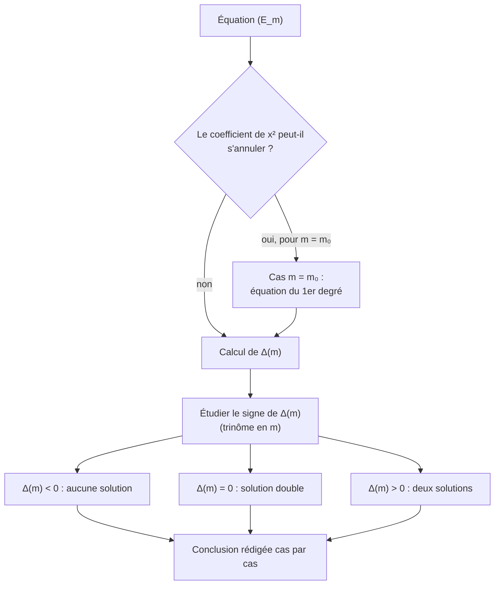

# Équations du second degré avec paramètre

## Objectifs pédagogiques et compétences

À la fin de ce chapitre, tu dois savoir :

- **discuter** le nombre de solutions d'une équation selon la valeur d'un paramètre $m$ ;
- repérer les valeurs de $m$ pour lesquelles l'équation **n'est plus du second degré** ;
- traduire une condition sur les racines (signes, racine double, racine donnée) par des conditions sur $\Delta$, $S$ et $P$ ;
- trouver une **racine fixe** (indépendante de $m$) ;
- rédiger une discussion complète, avec tous les cas traités.

## Prérequis

- discriminant, solutions et factorisation (chapitre 2) ;
- signe d'un trinôme et inéquations (chapitre 3) : le discriminant dépend de $m$ et est **lui-même un trinôme en $m$** ;
- somme et produit des racines (chapitre 4).

---

## 1. Définitions

!!! info "Définition : équation avec paramètre"
    Une **équation avec paramètre** $(E_m)$ est une équation dont les coefficients dépendent d'un réel $m$ appelé **paramètre**. Pour chaque valeur fixée de $m$, on obtient une équation ordinaire d'inconnue $x$.
    **Discuter** $(E_m)$, c'est déterminer, selon les valeurs de $m$, l'existence, le nombre et la valeur des solutions.

!!! warning "Point d'attention : $x$ et $m$ n'ont pas le même rôle"
    $x$ est l'**inconnue** ; $m$ est une **constante** que l'on fait varier. On résout **en $x$**, et on discute **en $m$**. Les solutions $x$ s'expriment en général **en fonction de $m$**.

---

## 2. Conditions sur les racines

!!! abstract "Propriété : traduire une condition sur les racines"
    Soit $(E_m)\ :\ a x^2+bx+c=0$ avec $a\neq0$, $\Delta=b^2-4ac$, $S=-\frac ba$, $P=\frac ca$.

    | Condition recherchée | Condition équivalente |
    |---|---|
    | deux solutions distinctes | $\Delta>0$ |
    | une solution (double) | $\Delta=0$ |
    | aucune solution | $\Delta<0$ |
    | au moins une solution | $\Delta\ge0$ |
    | deux racines de **signes contraires** | $P<0$ (soit $ac<0$), et alors $\Delta>0$ automatiquement |
    | deux racines **strictement positives** | $\Delta\ge0$ et $S>0$ et $P>0$ |
    | deux racines **strictement négatives** | $\Delta\ge0$ et $S<0$ et $P>0$ |
    | $x_0$ est racine | $a x_0^2+bx_0+c=0$ |
    | $ax^2+bx+c>0$ pour tout $x$ | $a>0$ et $\Delta<0$ |

!!! abstract "Démonstration du cas « signes contraires »"
    Si $ac<0$ alors $-4ac>0$ donc $\Delta=b^2-4ac>0$ : il y a deux racines distinctes, de produit $\frac ca<0$ : elles sont de signes contraires. Réciproquement, si deux racines sont de signes contraires, $P<0$ donc $ac=a^2P<0$. $\blacksquare$

---

## 3. Méthode de discussion

!!! tip "Méthode"
    1. **Regarder le coefficient de $x^2$** : s'il s'annule pour certaines valeurs de $m$, traiter ces cas **à part** (équation du premier degré, voire équation sans inconnue).
    2. Pour les autres $m$, calculer $\Delta(m)$ et le **simplifier ou factoriser**.
    3. Étudier le signe de $\Delta(m)$ (tableau de signes en $m$), en exploitant les chapitres 2 et 3.
    4. Donner les solutions dans chaque cas.
    5. **Conclure** par une phrase qui couvre **toutes** les valeurs de $m$, sans en oublier.

!!! warning "Points d'attention : erreurs fréquentes"
    - **Oublier le cas où le coefficient de $x^2$ s'annule** : pour $mx^2-2x+1=0$, la valeur $m=0$ donne une équation du **premier degré**.
    - **Confondre $\Delta(m)>0$ et $\Delta(m)<0$** : un trinôme en $m$ est positif à l'extérieur des racines (si son coefficient dominant est positif).
    - **Écrire des solutions avec $\sqrt{\Delta}$ sans avoir vérifié $\Delta\ge0$.**
    - **Divisions par une expression en $m$** : on ne divise par $m-1$ que si $m\neq1$ ; traiter $m=1$ à part.
    - **Oublier de vérifier**, dans les conditions de signe, que $\Delta\ge0$ (une somme $>0$ et un produit $>0$ ne suffisent pas).
    - **Conclusion incomplète** : tous les cas doivent apparaître, y compris les valeurs « frontières ».

---

## 4. Exemples corrigés

!!! example "Exemple 1 : $m x^2-2x+1=0$ (cas particulier en $m=0$)"
    - **$m=0$** : $-2x+1=0$, $x=\frac12$ : une solution.
    - **$m\neq0$** : $\Delta=4-4m=4(1-m)$.
        - $m<1$ et $m\neq0$ : deux solutions $x=\dfrac{1\pm\sqrt{1-m}}{m}$ ;
        - $m=1$ : solution double $x=1$ (équation $x^2-2x+1=0$) ;
        - $m>1$ : aucune solution.

    **Conclusion** : $m<1$, $m\neq0$ : deux solutions ; $m=0$ ou $m=1$ : une solution ; $m>1$ : aucune.

!!! example "Exemple 2 : $x^2+2mx+m+2=0$ (discriminant qui est un trinôme)"
    $\Delta'=m^2-(m+2)=m^2-m-2=(m-2)(m+1)$ (même signe que $\Delta=4\Delta'$).

    | $m$ | $-\infty$ | | $-1$ | | $2$ | | $+\infty$ |
    |---|---|---|---|---|---|---|---|
    | $(m-2)(m+1)$ | | $+$ | $0$ | $-$ | $0$ | $+$ | |

    - $m<-1$ ou $m>2$ : deux solutions $x=-m\pm\sqrt{m^2-m-2}$ ;
    - $m=-1$ ou $m=2$ : solution double (pour $m=-1$ : $x^2-2x+1$, $x=1$ ; pour $m=2$ : $x^2+4x+4$, $x=-2$) ;
    - $-1<m<2$ : aucune solution.

!!! example "Exemple 3 : $m$ tel que $1$ soit racine de $mx^2+(m-1)x-2=0$"
    $x=1$ racine $\iff m+(m-1)-2=0\iff m=\frac32$.
    Pour cette valeur : $\frac32x^2+\frac12x-2=0\iff3x^2+x-4=0$. Le produit des racines vaut $-\frac43$, donc l'autre racine est $-\frac43$.
    Vérification de la somme : $1-\frac43=-\frac13=-\frac ba$ ✔.

!!! example "Exemple 4 : une racine fixe"
    $x^2-(m+3)x+2m+2=0$. Pour $x=2$ : $4-2(m+3)+2m+2=0$ pour **tout** $m$. Donc $2$ est **racine quel que soit $m$**. Par le produit, l'autre racine est $\frac{2m+2}{2}=m+1$. Les racines sont $2$ et $m+1$.
    **Astuce** : écrire $f_m(x)=A(x)+m\,B(x)$ et chercher $x$ tel que $A(x)=B(x)=0$. Ici $f_m(x)=(x^2-3x+2)-m(x-2)$ et $x=2$ annule les deux.

---

## 5. Exercices progressifs

### Exercice 1 : discussion de base

Discuter selon $m$ le nombre de solutions de $2x^2-4x+m=0$.

??? success "Corrigé"
    Ici le coefficient de $x^2$ vaut $2$ : il ne dépend pas de $m$. $\Delta=16-8m=8(2-m)$.

    - $m<2$ : deux solutions $x=\frac{4\pm\sqrt{8(2-m)}}{4}=1\pm\frac{\sqrt{2(2-m)}}{2}$ ;
    - $m=2$ : solution double $x=1$ ;
    - $m>2$ : aucune.

### Exercice 2 : le coefficient de $x^2$ s'annule

Discuter selon $m$ : $(m-2)x^2-2x+1=0$.

??? success "Corrigé"
    - **$m=2$** : $-2x+1=0$, $x=\frac12$.
    - **$m\neq2$** : $\Delta=4-4(m-2)=4(3-m)$.
        - $m<3$, $m\neq2$ : deux solutions $x=\dfrac{1\pm\sqrt{3-m}}{m-2}$ ;
        - $m=3$ : solution double $x=1$ ;
        - $m>3$ : aucune.

    **Piège** : le cas $m=2$ ne rentre dans aucune des lignes de $\Delta$.

### Exercice 3 : racine donnée

Déterminer $m$ pour que $2$ soit racine de $x^2-mx+6=0$, puis donner l'autre racine.

??? success "Corrigé"
    $4-2m+6=0\iff m=5$. L'équation devient $x^2-5x+6=0$ : le produit vaut $6$, donc l'autre racine est $3$ (la somme $2+3=5=m$ ✔).

### Exercice 4 : signe des racines

Pour $x^2-2mx+3m-2=0$, déterminer $m$ pour que l'équation ait : (a) deux racines de signes contraires ; (b) deux racines strictement positives.

??? success "Corrigé"
    $\Delta'=m^2-(3m-2)=(m-1)(m-2)$, $S=2m$, $P=3m-2$.

    - (a) $P<0\iff m<\frac23$. Le discriminant est alors automatiquement positif (pour $m<\frac23$, $(m-1)(m-2)>0$ ✔).
    - (b) Il faut $\Delta'\ge0\iff m\le1$ ou $m\ge2$ ; $S>0\iff m>0$ ; $P>0\iff m>\frac23$.
      En croisant : $\frac23<m\le1$ ou $m\ge2$.
      Vérification pour $m=1$ : $x^2-2x+1=0$, racine double $1>0$ ✔.

    **Piège** : oublier la condition $\Delta\ge0$ ferait inclure $1<m<2$, valeurs pour lesquelles il n'y a **aucune** racine.

### Exercice 5 : racine fixe

Soit $x^2-(m+3)x+2m+2=0$.

1. Montrer que $2$ est racine pour tout $m$ et déterminer l'autre racine.
2. Pour quelle valeur de $m$ la racine est-elle double ?
3. Pour quelles valeurs de $m$ l'autre racine est-elle strictement négative ?

??? success "Corrigé"
    1. $4-2(m+3)+2m+2=0$ ✔. Produit $=2m+2$, donc l'autre racine est $m+1$.
    2. $m+1=2\iff m=1$ (équation $x^2-4x+4=0$).
    3. $m+1<0\iff m<-1$.

---

## 6. Exercices type contrôle

### Exercice A : discussion complète

Discuter selon $m$ les solutions de $(m+1)x^2-2mx+m-2=0$.

??? success "Corrigé"
    - **$m=-1$** : $2x-3=0$, $x=\frac32$.
    - **$m\neq-1$** : $\Delta'=m^2-(m+1)(m-2)=m^2-(m^2-m-2)=m+2$.
        - $m>-2$ et $m\neq-1$ : deux solutions $x=\dfrac{m\pm\sqrt{m+2}}{m+1}$ ;
        - $m=-2$ : solution double $x=\frac{m}{m+1}=2$ (équation $-x^2+4x-4=0$, soit $-(x-2)^2=0$) ;
        - $m<-2$ : aucune.

    **Conclusion** : deux solutions si $m>-2$, $m\neq-1$ ; une solution si $m=-1$ ou $m=-2$ ; aucune si $m<-2$.

### Exercice B : trouver les erreurs

Pour $mx^2-2x+1=0$, un élève écrit : « $\Delta=4-4m$ ; $\Delta>0\iff m<1$, donc deux solutions pour $m<1$ ». Pour une autre équation, il écrit : « $(m-1)(m-3)>0\iff m\in]1\,;3[$ ». Corriger.

??? success "Corrigé"
    1. Pour $m=0$, l'équation n'est plus du second degré : il y a **une** seule solution ($x=\frac12$), pas deux. La condition correcte est $m<1$ **et** $m\neq0$.
    2. Le trinôme $(m-1)(m-3)$ est positif à l'**extérieur** des racines : $m\in]-\infty\,;1[\cup]3\,;+\infty[$. L'élève a pris l'intervalle où il est **négatif**. Test : $m=2$ donne $-1<0$.

### Exercice C : démonstration

Démontrer que $(E)\ :\ ax^2+bx+c=0$ a deux racines de signes contraires si et seulement si $ac<0$.

??? success "Corrigé"
    ($\Leftarrow$) Si $ac<0$, $\Delta=b^2-4ac>0$ : deux racines distinctes, de produit $\frac ca=\frac{ac}{a^2}<0$ : signes contraires.
    ($\Rightarrow$) Si les racines sont de signes contraires, leur produit $\frac ca<0$, donc $ac=a^2\cdot\frac ca<0$. $\blacksquare$

### Exercice D : équation bicarrée avec paramètre (haut niveau)

Discuter selon $m$ le nombre de solutions réelles de $x^4-2x^2+m=0$.

??? success "Corrigé"
    On pose $X=x^2\ge0$ : $X^2-2X+m=0$. $\Delta'=1-m$.

    - $m>1$ : $\Delta'<0$, aucune valeur de $X$, donc **aucune** solution.
    - $m=1$ : $X=1$ (double), $x=\pm1$ : **2 solutions**.
    - $0<m<1$ : $X=1\pm\sqrt{1-m}$. Le produit $m>0$ et la somme $2>0$ : les deux valeurs sont strictement positives, chacune donne deux valeurs de $x$ : **4 solutions**.
    - $m=0$ : $X=0$ ou $X=2$ : $x=0$ et $x=\pm\sqrt2$ : **3 solutions**.
    - $m<0$ : produit $<0$, donc une seule valeur $X=1+\sqrt{1-m}>0$ (l'autre est négative, rejetée) : $x=\pm\sqrt{1+\sqrt{1-m}}$ : **2 solutions**.

    **Pièges** : $X=0$ ne donne qu'**une** valeur de $x$ ; une valeur $X<0$ ne donne aucune valeur de $x$ ; il faut étudier le signe des racines en $X$ (somme et produit) pour compter.

---

## 7. Synthèse et fiche de révision

!!! abstract "Fiche de révision"
    | Situation | Réflexe |
    |---|---|
    | Coefficient de $x^2$ avec $m$ | traiter à part la valeur qui l'annule |
    | Nombre de solutions | signe de $\Delta(m)$ (trinôme en $m$) |
    | Racines de signes contraires | $P<0$ |
    | Deux racines positives | $\Delta\ge0$, $S>0$, $P>0$ |
    | $x_0$ est racine | $f_m(x_0)=0$ |
    | Racine fixe | écrire $f_m(x)=A(x)+mB(x)$ et chercher $A=B=0$ |
    | Bicarrée avec paramètre | $X=x^2\ge0$, étudier le signe des racines en $X$ |
    | Rédaction | tous les cas, valeurs frontières incluses |

---

## 8. Comprendre, savoir quand l'utiliser, savoir démontrer

!!! tip "Pourquoi cette méthode"
    Un paramètre définit toute une **famille** d'équations. Le théorème du chapitre 2 donne, pour chaque équation de la famille, le nombre de solutions selon le signe de $\Delta$. Comme $\Delta$ dépend de $m$, étudier la famille revient à étudier **le signe de $\Delta(m)$**, c'est-à-dire un trinôme en $m$ : on réutilise donc le chapitre 3 sur une autre variable. Les relations sur $S$ et $P$ (chapitre 4) permettent de parler des racines **sans les calculer**.

!!! tip "Quand l'utiliser"
    - **Discussion** du nombre de solutions.
    - **Existence** de racines de signes imposés.
    - **Inéquations « pour tout $x$ »** : $ax^2+bx+c>0$ pour tout $x$ se ramène à $a>0$ et $\Delta<0$.
    - **Familles de paraboles** (sommets, points fixes).

!!! tip "Savoir le démontrer (checklist)"
    1. Condition d'existence des racines : $\Delta\ge0$.
    2. Signe du produit : $P=\frac{ac}{a^2}$ a le signe de $ac$.
    3. Si $ac<0$ alors $\Delta=b^2-4ac>0$ (existence automatique).
    4. Pour deux racines de même signe : $P>0$ **et** $\Delta\ge0$, le signe commun est celui de $S$.