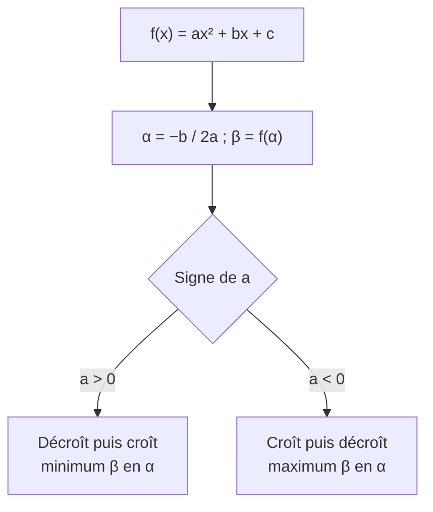

# Étude d'une fonction trinôme : variations et parabole

## Objectifs pédagogiques et compétences

À la fin de ce chapitre, tu dois savoir :

- dresser le **tableau de variations** de $f(x)=ax^2+bx+c$ selon le signe de $a$ ;
- **démontrer** les variations à partir de la forme canonique ;
- décrire la **parabole** : sommet, axe de symétrie, ouverture, intersections avec les axes ;
- tracer rapidement la courbe à la main avec les points caractéristiques ;
- déterminer l'expression d'un trinôme à partir d'informations graphiques (sommet, racines, trois points) ;
- déterminer l'**image d'un intervalle** et le nombre de solutions de $f(x)=k$ ;
- étudier la position d'une parabole et d'une droite (intersections, tangence).

## Prérequis

- forme canonique $a(x-\alpha)^2+\beta$ (chapitre 1) ;
- racines, discriminant, signe du trinôme (chapitres 2 et 3) ;
- somme et produit des racines (chapitre 4) ;
- vocabulaire sur les fonctions : croissante, décroissante, extremum, image, antécédent.

---

## 1. Définitions

!!! info "Définition : parabole"
    La courbe représentative d'un trinôme $f(x)=ax^2+bx+c$ ($a\neq0$) dans un repère est une **parabole**. Son point le plus « haut » ou le plus « bas » est son **sommet** $S(\alpha\,;\beta)$ avec $\alpha=-\frac b{2a}$ et $\beta=f(\alpha)$.

!!! info "Définition : rappel sur les variations"
    - $f$ est **croissante** sur un intervalle $I$ si, pour tous $x<y$ de $I$, $f(x)\le f(y)$ ;
    - $f$ est **décroissante** sur $I$ si, pour tous $x<y$ de $I$, $f(x)\ge f(y)$ ;
    - $f$ admet un **minimum** (resp. **maximum**) $m$ sur $I$ si $f(x)\ge m$ (resp. $\le m$) pour tout $x\in I$, avec égalité atteinte pour au moins un $x\in I$.

---

## 2. Variations

!!! abstract "Propriété : variations d'un trinôme"
    Soit $f(x)=ax^2+bx+c=a(x-\alpha)^2+\beta$.

    **Si $a>0$** : $f$ est **décroissante** sur $]-\infty\,;\alpha]$, **croissante** sur $[\alpha\,;+\infty[$ ; minimum $\beta$ en $\alpha$.

    | $x$ | $-\infty$ | | $\alpha$ | | $+\infty$ |
    |---|---|---|---|---|---|
    | $f(x)$ | | $\searrow$ | $\beta$ (min) | $\nearrow$ | |

    **Si $a<0$** : $f$ est **croissante** sur $]-\infty\,;\alpha]$, **décroissante** sur $[\alpha\,;+\infty[$ ; maximum $\beta$ en $\alpha$.

    | $x$ | $-\infty$ | | $\alpha$ | | $+\infty$ |
    |---|---|---|---|---|---|
    | $f(x)$ | | $\nearrow$ | $\beta$ (max) | $\searrow$ | |

### 2.1 Démonstration

!!! abstract "Démonstration (cas $a>0$)"
    On part de $f(x)=a(x-\alpha)^2+\beta$.

    *Sur $]-\infty\,;\alpha]$* : soient $x<y\le\alpha$. Alors $x-\alpha<y-\alpha\le0$. La fonction carré est strictement décroissante sur $]-\infty\,;0]$, donc $(x-\alpha)^2>(y-\alpha)^2$. En multipliant par $a>0$ puis en ajoutant $\beta$ : $f(x)>f(y)$. $f$ est décroissante.

    *Sur $[\alpha\,;+\infty[$* : soient $\alpha\le x<y$. Alors $0\le x-\alpha<y-\alpha$ et la fonction carré est strictement croissante sur $[0\,;+\infty[$ : $(x-\alpha)^2<(y-\alpha)^2$, donc $f(x)<f(y)$. $f$ est croissante.

    *Cas $a<0$* : multiplier par $a<0$ **renverse** les inégalités, donc les variations sont inversées. $\blacksquare$

!!! warning "Point d'attention"
    Le raisonnement utilise le **signe de $a$** (multiplication d'une inégalité) et la position de $x,y$ **de part et d'autre ou du même côté** de $\alpha$. Les variations changent **exactement** en $\alpha$.

---

## 3. La parabole et ses caractéristiques

!!! abstract "Propriété : caractéristiques de la courbe"
    La parabole $\mathcal P$ de $f(x)=ax^2+bx+c$ vérifie :

    1. **Sommet** $S(\alpha\,;\beta)$ ;
    2. **Axe de symétrie** : la droite $x=\alpha$. Pour tout $h$ : $f(\alpha+h)=f(\alpha-h)$ ;
    3. **Orientation** : « vers le haut » si $a>0$, « vers le bas » si $a<0$ ;
    4. **Ouverture** : plus $|a|$ est grand, plus la parabole est **resserrée** autour de l'axe ;
    5. **Ordonnée à l'origine** : $\mathcal P$ coupe l'axe des ordonnées en $(0\,;c)$ ;
    6. **Intersection avec l'axe des abscisses** : $\Delta>0$ → deux points $(x_1;0)$ et $(x_2;0)$ ; $\Delta=0$ → un point, le sommet $(x_0;0)$ ; $\Delta<0$ → aucun point ;
    7. **Obtention par transformations** : $\mathcal P$ est l'image de la courbe de $x\mapsto ax^2$ par la **translation** de vecteur $\vec u(\alpha\,;\beta)$.

!!! abstract "Démonstration de la symétrie"
    $f(\alpha+h)=a(\alpha+h-\alpha)^2+\beta=ah^2+\beta$ et $f(\alpha-h)=a(-h)^2+\beta=ah^2+\beta$. Les deux sont égaux. Donc les points $(\alpha+h\,;y)$ et $(\alpha-h\,;y)$ sont tous deux sur $\mathcal P$ : $\mathcal P$ est symétrique par rapport à $x=\alpha$. $\blacksquare$

!!! tip "Conséquences pratiques"
    - Deux valeurs de $x$ ayant la **même image** sont symétriques par rapport à $\alpha$ : si $f(u)=f(v)$ avec $u\neq v$, alors $\alpha=\frac{u+v}2$.
    - Entre deux points de la parabole de même ordonnée, le milieu des abscisses est l'abscisse du sommet.
    - Les racines $x_1,x_2$ sont symétriques par rapport à $\alpha$ : $\alpha=\frac{x_1+x_2}2$ (cohérent avec $-\frac b{2a}$).

---

## 4. Méthodes à maîtriser

!!! tip "Méthode 1 : tracer une parabole à la main"
    1. Calculer $\alpha$ et $\beta$ : placer le sommet et l'axe de symétrie.
    2. Calculer $f(0)=c$ : placer $(0\,;c)$ et son **symétrique** $(2\alpha\,;c)$.
    3. Si $\Delta\ge0$, placer les racines.
    4. Ajouter un ou deux points supplémentaires avec la symétrie, puis tracer une courbe lisse, **sans pointe** au sommet.

!!! tip "Méthode 2 : déterminer un trinôme"
    - **Sommet $S(\alpha;\beta)$ connu** : $f(x)=a(x-\alpha)^2+\beta$, puis un autre point donne $a$.
    - **Racines $x_1,x_2$ connues** : $f(x)=a(x-x_1)(x-x_2)$, puis un autre point donne $a$.
    - **Trois points quelconques** : système en $a,b,c$ ; on commence par le point d'abscisse $0$ qui donne $c$.

!!! tip "Méthode 3 : image d'un intervalle $[u\,;v]$ par $f$"
    1. Situer $\alpha$ par rapport à $[u\,;v]$.
    2. Si $\alpha\notin[u\,;v]$ : $f$ est monotone sur l'intervalle, l'image est entre $f(u)$ et $f(v)$ (dans le bon ordre).
    3. Si $\alpha\in[u\,;v]$ : l'extremum $\beta$ est atteint ; l'autre borne est le plus grand ou le plus petit de $f(u)$ et $f(v)$.

!!! tip "Méthode 4 : nombre de solutions de $f(x)=k$ et intersection avec une droite"
    - $f(x)=k$ : on compare $k$ à $\beta$ (voir tableau ci-dessous).
    - Parabole et droite $y=mx+p$ : résoudre $ax^2+bx+c=mx+p$, soit $ax^2+(b-m)x+(c-p)=0$ et étudier le **discriminant** : $\Delta>0$ deux points, $\Delta=0$ **tangence** (un point), $\Delta<0$ aucun.

    | $f(x)=k$, avec $a>0$ | Nombre de solutions |
    |---|---|
    | $k>\beta$ | 2 |
    | $k=\beta$ | 1 (le sommet) |
    | $k<\beta$ | 0 |

    (Pour $a<0$, c'est l'inverse : 2 solutions si $k<\beta$.)

!!! warning "Points d'attention : erreurs fréquentes"
    - **Confondre sommet et ordonnée à l'origine** : $\beta\ne c$ en général.
    - **Image d'un intervalle** : écrire $[f(u);f(v)]$ sans regarder si $\alpha$ est dans l'intervalle.
    - **Sens des variations** : à $a>0$, la fonction **décroît** d'abord.
    - **Signe de $\alpha$** : le sommet de $2(x+3)^2-1$ est $S(-3\,;-1)$.
    - **Courbe « pointue »** au sommet : la parabole y est **arrondie**, tangente à une droite horizontale.
    - **Comparer deux images** : si les points sont de part et d'autre de $\alpha$, on ne peut pas conclure avec les variations ; utiliser la **distance à $\alpha$**.
    - **Tangence** : une droite qui coupe la parabole en un seul point n'est pas forcément tangente (une droite **verticale** coupe la parabole en un seul point). On parle de tangence quand $\Delta=0$ pour une droite non verticale.

---

## 5. Exemples corrigés

!!! example "Exemple 1 : $f(x)=2x^2-8x+6$"
    $\alpha=-\frac{-8}{4}=2$, $\beta=f(2)=8-16+6=-2$, donc $f(x)=2(x-2)^2-2$.
    $a>0$ : décroissante sur $]-\infty\,;2]$, croissante sur $[2\,;+\infty[$, minimum $-2$.
    Racines : $\Delta=64-48=16$, $x=\frac{8\pm4}{4}$ : $1$ et $3$. Ordonnée à l'origine : $(0\,;6)$ et son symétrique $(4\,;6)$.

    | $x$ | $-\infty$ | | $2$ | | $+\infty$ |
    |---|---|---|---|---|---|
    | $f(x)$ | | $\searrow$ | $-2$ | $\nearrow$ | |

!!! example "Exemple 2 : $g(x)=-x^2+2x+3$ (cas $a<0$)"
    $\alpha=1$, $\beta=g(1)=4$, donc $g(x)=-(x-1)^2+4$.
    Croissante sur $]-\infty\,;1]$, décroissante sur $[1\,;+\infty[$, maximum $4$.
    Racines : $\Delta=4+12=16$, $x=\frac{-2\pm4}{-2}$ : $-1$ et $3$ (symétriques par rapport à $1$ ✔).

!!! example "Exemple 3 : trinôme passant par trois points"
    $A(0\,;1)$, $B(1\,;0)$, $C(3\,;4)$. On écrit $f(x)=ax^2+bx+c$.
    $f(0)=1$ : $c=1$. $f(1)=0$ : $a+b+1=0$, donc $b=-a-1$. $f(3)=4$ : $9a+3b+1=4$, soit $9a-3a-3+1=4$, donc $a=1$ et $b=-2$.
    $f(x)=x^2-2x+1=(x-1)^2$ : parabole tangente à l'axe des abscisses en $B$.

!!! example "Exemple 4 : trinôme de racines données"
    Racines $-2$ et $4$, passe par $(0\,;-4)$. $f(x)=a(x+2)(x-4)$ et $f(0)=-8a=-4$, donc $a=\frac12$.
    $f(x)=\frac12x^2-x-4$. Sommet : $\alpha=\frac{-2+4}{2}=1$, $\beta=\frac12-1-4=-\frac92$.

---

## 6. Exercices progressifs

### Exercice 1 : tableaux de variations

Dresser les tableaux de variations de $f(x)=x^2-6x+5$, $g(x)=-2x^2+4x$, $h(x)=3x^2+1$.

??? success "Corrigé"
    - $f$ : $\alpha=3$, $\beta=-4$. Décroissante sur $]-\infty\,;3]$, croissante sur $[3\,;+\infty[$, minimum $-4$.
    - $g$ : $\alpha=1$, $\beta=g(1)=2$. $a<0$ : croissante sur $]-\infty\,;1]$, décroissante sur $[1\,;+\infty[$, maximum $2$.
    - $h$ : $b=0$ donc $\alpha=0$, $\beta=1$. Décroissante sur $]-\infty\,;0]$, croissante sur $[0\,;+\infty[$, minimum $1$.

    **Piège** : pour $h$, le sommet est $(0\,;1)$ : ici $\beta=c$ car $\alpha=0$.

### Exercice 2 : comparer sans calculer

Pour $f(x)=x^2-6x+5$ : comparer (a) $f(1{,}5)$ et $f(2{,}5)$ ; (b) $f(2{,}5)$ et $f(4)$.

??? success "Corrigé"
    $\alpha=3$.

    - (a) $1{,}5<2{,}5\le3$ et $f$ est décroissante sur $]-\infty\,;3]$ : $f(1{,}5)>f(2{,}5)$. (Vérification : $-1{,}75>-3{,}75$.)
    - (b) Les points sont de **part et d'autre** de $\alpha$ : on compare les distances à $\alpha$. $|2{,}5-3|=0{,}5<|4-3|=1$ et $a>0$ : plus on s'éloigne de $\alpha$, plus $f$ est grande, donc $f(4)>f(2{,}5)$. (Vérification : $-3>-3{,}75$.)

### Exercice 3 : image d'un intervalle

Pour $f(x)=x^2-6x+5$, déterminer $f([0\,;4])$ et $f([4\,;7])$.

??? success "Corrigé"
    - $[0\,;4]$ : $\alpha=3\in[0\,;4]$, le minimum $-4$ est atteint. $f(0)=5$, $f(4)=-3$. Maximum $5$. Image $=[-4\,;5]$.
    - $[4\,;7]$ : $\alpha=3\notin[4\,;7]$, $f$ est croissante sur $[4\,;7]$. $f(4)=-3$, $f(7)=49-42+5=12$. Image $=[-3\,;12]$.

    **Piège** : sur $[0\,;4]$, écrire $[f(0)\,;f(4)]=[5\,;-3]$ est absurde (intervalle à bornes dans le mauvais ordre) ET faux.

### Exercice 4 : utiliser la symétrie

Un trinôme $f$ de coefficient dominant $2$ vérifie $f(-1)=f(5)$. Déterminer son axe de symétrie, puis le coefficient $b$ de $x$.

??? success "Corrigé"
    $\alpha=\frac{-1+5}{2}=2$. Or $\alpha=-\frac{b}{2a}=-\frac b4=2$, donc $b=-8$.

### Exercice 5 : droite et parabole

Soit $f(x)=x^2-2x-3$. Étudier l'intersection de sa courbe avec les droites : (a) $y=x-1$ ; (b) $y=-4$ ; (c) $y=-5$.

??? success "Corrigé"
    $f(x)=(x-1)^2-4$, sommet $S(1\,;-4)$.

    - (a) $x^2-2x-3=x-1\iff x^2-3x-2=0$, $\Delta=9+8=17>0$ : **deux** points d'abscisses $\frac{3\pm\sqrt{17}}{2}$.
    - (b) $y=-4$ : $x^2-2x+1=0$, $\Delta=0$ : un point, le sommet $S(1\,;-4)$. La droite est **tangente** à la parabole.
    - (c) $y=-5$ : $x^2-2x+2=0$, $\Delta=-4<0$ : **aucun** point (la droite est en dessous du minimum $-4$).

### Exercice 6 : trouver un trinôme

Déterminer le trinôme de sommet $S(-1\,;2)$ passant par $A(1\,;-2)$.

??? success "Corrigé"
    $f(x)=a(x+1)^2+2$. $f(1)=4a+2=-2$, donc $a=-1$.
    $f(x)=-(x+1)^2+2=-x^2-2x+1$.
    Vérification : $f(1)=-1-2+1=-2$ ✔.

### Exercice 7 : optimisation

Une entreprise réalise un bénéfice (en milliers d'euros) $B(x)=-2x^2+40x-100$ pour $x$ centaines d'articles vendus, avec $0\le x\le20$. Quel est le bénéfice maximal et pour quelle quantité ? Pour quelles quantités le bénéfice est-il strictement positif ?

??? success "Corrigé"
    $\alpha=-\frac{40}{-4}=10$, $\beta=B(10)=-200+400-100=100$.
    Bénéfice maximal : $100$ milliers d'euros pour $10$ centaines d'articles ($10\in[0\,;20]$ ✔).
    $B(x)>0$ : $\Delta=1600-800=800$, $\sqrt{800}=20\sqrt2$, racines $\frac{-40\pm20\sqrt2}{-4}=10\mp5\sqrt2$, soit $\approx2{,}93$ et $\approx17{,}07$. $a<0$ : positif entre les racines.
    Bénéfice $>0$ pour $x\in\,]10-5\sqrt2\,;10+5\sqrt2[$ (environ de $293$ à $1\,707$ articles).

---

## 7. Exercices type contrôle

### Exercice A : étude complète

Soit $f(x)=-x^2+4x+5$.

1. Donner la forme canonique, le tableau de variations et les coordonnées du sommet.
2. Déterminer les racines et le signe de $f$.
3. Déterminer l'image de $[3\,;6]$ par $f$.
4. Étudier l'intersection de la courbe avec la droite $y=x+5$.

??? success "Corrigé"
    1. $\alpha=2$, $\beta=f(2)=9$ : $f(x)=-(x-2)^2+9$. $a<0$ : croissante sur $]-\infty\,;2]$, décroissante sur $[2\,;+\infty[$, maximum $9$. $S(2\,;9)$.
    2. $\Delta=16+20=36$, $x=\frac{-4\pm6}{-2}$ : $-1$ et $5$. $a<0$ : $f\ge0$ sur $[-1\,;5]$, $f<0$ ailleurs.
    3. $\alpha=2\notin[3\,;6]$, $f$ décroissante sur $[3\,;6]$ : $f(3)=8$, $f(6)=-36+24+5=-7$. Image $=[-7\,;8]$.
    4. $-x^2+4x+5=x+5\iff-x^2+3x=0\iff x(3-x)=0$ : abscisses $0$ et $3$. Points $(0\,;5)$ et $(3\,;8)$.

### Exercice B : trouver les erreurs

Un élève écrit : (1) « pour $f(x)=-x^2+6x-5$ : $\alpha=-\frac b{2a}=-\frac62=-3$ » ; (2) « l'image de $[0\,;4]$ par $f(x)=x^2-6x+5$ est $[f(0)\,;f(4)]=[5\,;-3]$ ». Corriger.

??? success "Corrigé"
    1. Il a oublié que $a=-1$ : $2a=-2$ et $\alpha=-\frac{6}{-2}=3$. Sommet $S(3\,;4)$.
    2. La fonction n'est pas monotone sur $[0\,;4]$ car $\alpha=3\in[0\,;4]$. L'image est $[-4\,;5]$ (voir l'exercice 3).

### Exercice C : démonstration

Démontrer que si $a<0$, $f(x)=a(x-\alpha)^2+\beta$ est croissante sur $]-\infty\,;\alpha]$.

??? success "Corrigé"
    Soient $x<y\le\alpha$. Alors $x-\alpha<y-\alpha\le0$ ; la fonction carré est décroissante sur $]-\infty\,;0]$ donc $(x-\alpha)^2>(y-\alpha)^2$. On multiplie par $a<0$ : l'inégalité s'**inverse**, $a(x-\alpha)^2<a(y-\alpha)^2$. On ajoute $\beta$ : $f(x)<f(y)$. $f$ est croissante sur $]-\infty\,;\alpha]$. $\blacksquare$

### Exercice D : famille de paraboles (haut niveau)

Pour $m$ réel, on pose $f_m(x)=x^2-2mx+m+2$ et on note $\mathcal P_m$ sa courbe.

1. Déterminer le sommet $S_m$ de $\mathcal P_m$ et montrer que tous les sommets sont sur une même parabole $\mathcal Q$ dont on donnera l'équation.
2. Pour quelles valeurs de $m$ l'axe des abscisses est-il tangent à $\mathcal P_m$ ?
3. Montrer que toutes les paraboles $\mathcal P_m$ passent par un même point fixe.

??? success "Corrigé"
    1. $\alpha=m$, $\beta=f_m(m)=m^2-2m^2+m+2=-m^2+m+2$. $S_m(m\,;-m^2+m+2)$. Avec $x=m$ et $y=-m^2+m+2$ : $\mathcal Q$ a pour équation $y=-x^2+x+2$.
    2. Tangence $\iff\beta=0\iff-m^2+m+2=0\iff m^2-m-2=0\iff(m-2)(m+1)=0$ : $m=2$ ou $m=-1$. Vérification : $m=-1$ : $x^2+2x+1=(x+1)^2$ ✔ ; $m=2$ : $x^2-4x+4=(x-2)^2$ ✔.
    3. $f_m(x)=x^2+2-m(2x-1)$. Pour $x=\frac12$ : $f_m\!\left(\tfrac12\right)=\frac14+2-m\cdot0=\frac94$ pour **tout** $m$. Le point fixe est $\left(\frac12\,;\frac94\right)$.

    **Pièges** : le sommet $S_m$ dépend de $m$ : ne pas écrire $\beta=c$ ; pour le point fixe, regrouper les termes en $m$.

---

## 8. Synthèse et fiche de révision

!!! abstract "Fiche de révision"
    | À retenir | Résultat |
    |---|---|
    | Sommet | $S(\alpha\,;\beta)$, $\alpha=-\frac b{2a}$, $\beta=f(\alpha)$ |
    | Axe de symétrie | $x=\alpha$ ; $f(\alpha+h)=f(\alpha-h)$ |
    | $a>0$ | décroît sur $]-\infty;\alpha]$, croît sur $[\alpha;+\infty[$, minimum $\beta$ |
    | $a<0$ | croît sur $]-\infty;\alpha]$, décroît sur $[\alpha;+\infty[$, maximum $\beta$ |
    | Ordonnée à l'origine | $(0\,;c)$ |
    | Avec l'axe des abscisses | racines (selon $\Delta$) |
    | Droite $y=mx+p$ | $\Delta$ de $ax^2+(b-m)x+(c-p)$ : 2, 1 (tangente), 0 points |
    | Image de $[u;v]$ | regarder si $\alpha\in[u;v]$ |
    | Deux points de même image | $\alpha=\frac{u+v}{2}$ |

    **Réflexes** : placer $\alpha$ ; signe de $a$ ; symétrie ; vérifier avec un point.

---

## 9. Comprendre, savoir quand l'utiliser, savoir démontrer

!!! tip "Pourquoi les résultats sont vrais"
    Dans la forme canonique, $x$ n'apparaît que dans $(x-\alpha)^2$, qui mesure le **carré de la distance** à $\alpha$. Plus on s'éloigne de $\alpha$, plus ce carré augmente, et la valeur de $f$ augmente (si $a>0$) ou diminue (si $a<0$). Cela explique les variations, l'extremum en $\alpha$, et la symétrie : deux points à la même distance de $\alpha$ ont la même image. La parabole de $f$ est la parabole de $ax^2$ déplacée de $(\alpha\,;\beta)$.

!!! tip "Quand l'utiliser"
    - **Extremum** et **optimisation** (aire maximale, bénéfice maximal).
    - **Image d'un intervalle**, encadrement, résolution de $f(x)\le k$.
    - **Comparer** deux valeurs sans calculatrice (variations ou distance à $\alpha$).
    - **Intersection** avec une droite ou avec une autre courbe : on se ramène au discriminant.
    - **Reconstruire un trinôme** à partir d'un graphique.

!!! tip "Savoir le démontrer (checklist)"
    1. Partir de $f(x)=a(x-\alpha)^2+\beta$.
    2. Comparer $(x-\alpha)^2$ et $(y-\alpha)^2$ selon que $x,y$ sont du même côté de $\alpha$ (variations de la fonction carré).
    3. Multiplier par $a$ : conserve ou inverse l'inégalité selon le signe de $a$.
    4. Symétrie : $f(\alpha+h)=ah^2+\beta=f(\alpha-h)$.