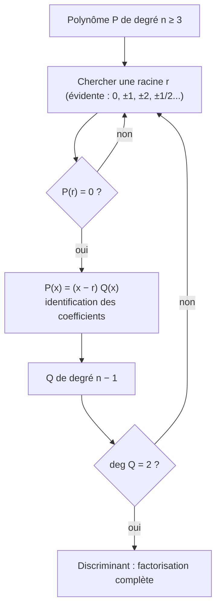

# Compléments sur les polynômes

## Objectifs pédagogiques et compétences

À la fin de ce chapitre, tu dois savoir :

- définir un **monôme**, un **polynôme** à coefficients réels, son **degré** et ses coefficients ;
- déterminer le degré d'une **somme** et d'un **produit** de polynômes, et **démontrer** ces propriétés ;
- factoriser $x^n-1$ et $x^n-a^n$ pour tout entier $n\ge2$, et **démontrer** l'identité ;
- utiliser le lien **racine / factorisation par $(x-r)$** ;
- factoriser un polynôme de degré 3 ou plus par **identification des coefficients** ;
- résoudre des équations et inéquations qui s'y ramènent.

## Prérequis

- trinôme, racines, discriminant, signe (chapitres 1 à 4) ;
- identités remarquables $a^2-b^2$, $a^3\pm b^3$ ;
- puissances, notation $\sum$ (rappel ci-dessous) ;
- développement d'un produit de deux facteurs.

!!! note "Rappel sur la notation $\sum$"
    $\displaystyle\sum_{k=0}^{n-1}u_k=u_0+u_1+\dots+u_{n-1}$ : somme de $n$ termes (de l'indice $0$ à $n-1$).

---

## 1. Définitions

!!! info "Définition : monôme de degré $n$"
    Soit $n$ un entier naturel. Un **monôme de degré $n$** est une fonction $x\mapsto a\,x^n$ définie sur $\mathbb R$, où $a$ est un réel **non nul**. Le réel $a$ est son **coefficient**.

!!! info "Définition : polynôme à coefficients réels"
    Un **polynôme à coefficients réels de la variable réelle $x$** est une fonction $P$ qui s'écrit, pour tout réel $x$,
    $$P(x)=a_nx^n+a_{n-1}x^{n-1}+\dots+a_1x+a_0,$$
    où $n$ est un entier naturel et $a_0,\dots,a_n$ sont des réels (les **coefficients**). C'est une **somme de monômes**.

    - Si $a_n\neq0$, $n$ est le **degré** de $P$, noté $\deg P$ ; $a_n$ est le **coefficient dominant** ; $a_0$ est le **terme constant**.
    - Le **polynôme nul** ($P(x)=0$ pour tout $x$) n'a **pas de degré** (convention).
    - Un polynôme constant non nul est de degré $0$.

!!! info "Définition : racine"
    Une **racine** d'un polynôme $P$ est un réel $r$ tel que $P(r)=0$.

!!! abstract "Propriété admise : égalité de polynômes"
    Deux polynômes sont égaux (pour tout réel $x$) **si et seulement si** ils ont les **mêmes coefficients** (monôme par monôme). C'est ce qui justifie la **méthode d'identification**.

!!! example "Exemples"
    | Polynôme | Degré | Coefficient dominant |
    |---|---|---|
    | $3x^2-5x+2$ | $2$ (trinôme) | $3$ |
    | $x^3-x(x^2-2x+1)=2x^2-x$ | $2$ (le $x^3$ disparaît) | $2$ |
    | $-7$ | $0$ | $-7$ |
    | $0$ | aucun | aucun |
    | $x^4-1$ | $4$ | $1$ |

!!! warning "Point d'attention"
    Le degré se lit **après développement et réduction**. Ainsi $(x+1)^3-x^3$ est de degré $2$ : $3x^2+3x+1$.

---

## 2. Degré d'une somme et d'un produit

!!! abstract "Propriété : degré d'une somme et d'un produit"
    Soient $P$ et $Q$ deux polynômes **non nuls**, de degrés $n$ et $m$.

    1. **Produit** : $PQ$ est non nul et $\deg(PQ)=n+m$.
    2. **Somme** : si $P+Q\neq0$, alors $\deg(P+Q)\le\max(n,m)$.
       - si $n\neq m$ : $\deg(P+Q)=\max(n,m)$ ;
       - si $n=m$ : le degré peut **baisser** (si les coefficients dominants sont opposés).

### 2.1 Démonstration

!!! abstract "Démonstration"
    Notons $P(x)=a_nx^n+\dots$ et $Q(x)=b_mx^m+\dots$ avec $a_n\neq0$, $b_m\neq0$.

    **Produit** : le terme de plus haut degré de $PQ$ est $a_nx^n\times b_mx^m=a_nb_m\,x^{n+m}$. Comme $a_n\neq0$ et $b_m\neq0$, on a $a_nb_m\neq0$ (un produit de réels non nuls est non nul). Tous les autres termes sont de degré inférieur. Donc $\deg(PQ)=n+m$.

    **Somme** : les termes de $P+Q$ sont de degré au plus $\max(n,m)$. Si $n>m$, le coefficient de $x^n$ est $a_n\neq0$ : degré $n$. Si $n=m$, le coefficient de $x^n$ est $a_n+b_n$, qui peut être nul. $\blacksquare$

!!! warning "Points d'attention : erreurs fréquentes"
    - **$\deg(P+Q)=\max$ est faux en général** : $P(x)=x^3+x$ et $Q(x)=-x^3+2$ donnent $P+Q=x+2$, de degré $1<3$.
    - **$\deg(P\times Q)=\deg P+\deg Q$** (somme, pas produit) ; **$\deg(P+Q)$** n'est pas $\deg P+\deg Q$.
    - **$\deg(P-P)$** : $P-P=0$ n'a pas de degré.
    - **Le polynôme nul** est exclu de ces formules.

---

## 3. Factorisation de $x^n-1$ et $x^n-a^n$

!!! abstract "Propriété : factorisation de $x^n-a^n$"
    Pour tout entier $n\ge2$ et tous réels $x$ et $a$ :
    $$x^n-a^n=(x-a)\left(x^{n-1}+ax^{n-2}+a^2x^{n-3}+\dots+a^{n-2}x+a^{n-1}\right)=(x-a)\sum_{k=0}^{n-1}x^{n-1-k}a^k.$$
    En particulier, pour $a=1$ :
    $$x^n-1=(x-1)\left(1+x+x^2+\dots+x^{n-1}\right).$$

!!! example "Cas $n=2$ et $n=3$"
    $x^2-a^2=(x-a)(x+a)$ ; $x^3-a^3=(x-a)(x^2+ax+a^2)$ ; $x^4-a^4=(x-a)(x^3+ax^2+a^2x+a^3)$.

### 3.1 Démonstration

!!! abstract "Démonstration"
    On développe : $(x-a)\displaystyle\sum_{k=0}^{n-1}x^{n-1-k}a^k=\sum_{k=0}^{n-1}x^{n-k}a^k-\sum_{k=0}^{n-1}x^{n-1-k}a^{k+1}.$

    Dans la seconde somme, posons $j=k+1$ ($j$ va de $1$ à $n$) : elle vaut $\sum_{j=1}^{n}x^{n-j}a^j$.
    Les deux sommes ont les mêmes termes pour $j$ de $1$ à $n-1$ : ils s'annulent. Il reste le terme $k=0$ de la première ($x^n$) et le terme $j=n$ de la seconde ($a^n$, précédé du signe $-$) :
    $$(x-a)\sum_{k=0}^{n-1}x^{n-1-k}a^k=x^n-a^n.\ \blacksquare$$

    **Exemple de la mécanique** ($n=3$) : $(x-a)(x^2+ax+a^2)=x^3+ax^2+a^2x-ax^2-a^2x-a^3=x^3-a^3$ (les termes intermédiaires s'annulent deux à deux).

!!! tip "Conséquences utiles"
    - **Somme géométrique** : pour $q\neq1$, $1+q+q^2+\dots+q^{n-1}=\dfrac{q^n-1}{q-1}$ (poser $x=q$ dans $x^n-1$).
    - **$n$ pair** : $x^n-a^n$ est aussi divisible par $(x+a)$. Par exemple $x^4-a^4=(x-a)(x+a)(x^2+a^2)$.
    - **$n$ impair** : $x^n+a^n=x^n-(-a)^n=(x+a)\left(x^{n-1}-ax^{n-2}+\dots+a^{n-1}\right)$. Par exemple $x^3+8=(x+2)(x^2-2x+4)$.
    - **$x^n+a^n$ avec $n$ pair** ne se factorise **pas** par $(x\pm a)$ ($x^2+1>0$ n'a pas de racine réelle).
    - **Divisibilité** : $a-b$ divise $a^n-b^n$ pour des entiers $a,b$ (poser $x=a$ et remplacer $a$ par $b$).

---

## 4. Racines et factorisation

!!! abstract "Propriété : théorème de factorisation"
    Soit $P$ un polynôme de degré $n\ge1$ et $r$ un réel. Alors
    $$P(r)=0\iff P(x)=(x-r)\,Q(x)\ \text{ pour tout }x,$$
    où $Q$ est un polynôme de degré $n-1$.

!!! abstract "Démonstration"
    ($\Leftarrow$) Si $P(x)=(x-r)Q(x)$, alors $P(r)=0$.

    ($\Rightarrow$) Soit $P(x)=\sum_{k=0}^na_kx^k$ avec $P(r)=0$. Alors
    $$P(x)=P(x)-P(r)=\sum_{k=1}^na_k\left(x^k-r^k\right)$$
    (le terme $k=0$ disparaît). Chaque $x^k-r^k$ avec $k\ge1$ est divisible par $x-r$ d'après la section 3 (pour $k=1$ : $x-r$ lui-même). Donc $P(x)=(x-r)Q(x)$ où $Q$ est somme de polynômes. Son degré est $n-1$ d'après la propriété sur le degré d'un produit. $\blacksquare$

!!! tip "Conséquence"
    Un polynôme de degré $n\ge1$ a **au plus $n$ racines réelles**. (On factorise une racine à la fois, le degré baisse de $1$ à chaque fois ; un polynôme de degré $0$, non nul, n'a pas de racine.)

!!! tip "Méthode : factoriser un polynôme de degré 3"
    1. **Chercher une racine évidente** $r$ parmi les petites valeurs : $\pm1$, $\pm2$, $\pm\frac12$... (on teste $P(1)$, $P(-1)$, $P(2)$...). Les racines **rationnelles** $\frac pq$ vérifient que $p$ divise le terme constant et $q$ divise le coefficient dominant (résultat admis, utile pour cibler les essais).
    2. Écrire $P(x)=(x-r)(\alpha x^2+\beta x+\gamma)$ avec $\alpha$ égal au coefficient dominant de $P$ et $\gamma\cdot(-r)=a_0$.
    3. **Développer** et **identifier** les coefficients.
    4. **Vérifier** avec les coefficients restants (cohérence) ; factoriser le trinôme avec $\Delta$.

!!! warning "Points d'attention : erreurs fréquentes"
    - **Se tromper de signe** : $r$ est racine de $(x-r)$ : pour $x+1=x-(-1)$, la racine est $-1$.
    - **Oublier de vérifier** que $P(r)=0$ avant de factoriser.
    - **Identification incomplète** : on a plus d'équations que d'inconnues ; les équations restantes servent de **contrôle**.
    - **Penser qu'un polynôme de degré 3 a trois racines réelles** : il en a au moins une, au plus trois. $x^3-1$ n'en a qu'une.
    - **Ne pas factoriser le trinôme restant** ($\Delta$) avant de conclure.

---

## 5. Exemples corrigés

!!! example "Exemple 1 : $x^3-1$ et $x^4-16$"
    $x^3-1=(x-1)(x^2+x+1)$, avec $\Delta=1-4<0$ : **irréductible** dans $\mathbb R$. Donc $x^3=1\iff x=1$.
    $x^4-16=(x^2-4)(x^2+4)=(x-2)(x+2)(x^2+4)$. $x^4=16\iff x=\pm2$.

!!! example "Exemple 2 : somme géométrique"
    $1+3+9+27+81=\dfrac{3^5-1}{3-1}=\dfrac{242}{2}=121$ (en effet $1+3+9+27+81=121$ ✔).

!!! example "Exemple 3 : factoriser $P(x)=2x^3-3x^2-3x+2$"
    $P(-1)=-2-3+3+2=0$ : $-1$ est racine. On écrit $P(x)=(x+1)(2x^2+bx+2)$.
    Développement : $2x^3+(b+2)x^2+(b+2)x+2$. Par identification : $b+2=-3$, donc $b=-5$ ; la ligne en $x$ vérifie $b+2=-3$ ✔ (contrôle).
    $P(x)=(x+1)(2x^2-5x+2)$. Le trinôme a $\Delta=25-16=9$, racines $\frac{5\pm3}{4}$ : $2$ et $\frac12$.
    $$P(x)=(x+1)(2x-1)(x-2).$$

!!! example "Exemple 4 : divisibilité"
    $11^n-1$ est divisible par $10$ pour tout $n\ge1$ : $11^n-1^n=(11-1)\left(11^{n-1}+\dots+1\right)=10\times(\text{entier})$.

---

## 6. Exercices progressifs

### Exercice 1 : degrés

Soit $P(x)=x^3-2x+1$ et $Q(x)=-x^3+x^2+5$. Déterminer $\deg(P+Q)$, $\deg(PQ)$, $\deg(P-P)$ et $\deg(P+2Q)$.

??? success "Corrigé"
    - $P+Q=x^2-2x+6$ : degré $2$ (les termes en $x^3$ s'annulent), alors que $\max=3$.
    - $PQ$ : degré $3+3=6$ (coefficient dominant $1\times(-1)=-1\neq0$).
    - $P-P=0$ : pas de degré.
    - $P+2Q=-x^3+2x^2-2x+11$ : degré $3$ (coefficients dominants $1$ et $-2$ : leur somme $-1\neq0$).

    **Piège** : le degré d'une somme se détermine en **développant**, jamais par $\max(n,m)$ automatiquement.

### Exercice 2 : factoriser

Factoriser dans $\mathbb R$ : (a) $x^5-1$ ; (b) $x^4-81$ ; (c) $8x^3-27$ ; (d) $x^3+8$.

??? success "Corrigé"
    - (a) $(x-1)(x^4+x^3+x^2+x+1)$.
    - (b) $(x^2-9)(x^2+9)=(x-3)(x+3)(x^2+9)$ ($x^2+9>0$ : irréductible).
    - (c) $(2x)^3-3^3=(2x-3)(4x^2+6x+9)$ ($\Delta=36-144<0$).
    - (d) $x^3-(-2)^3=(x+2)(x^2-2x+4)$ ($\Delta=4-16<0$).

### Exercice 3 : sommes

Calculer : (a) $1+2+4+\dots+2^9$ ; (b) $1+x+x^2+\dots+x^{10}$ pour $x=\frac12$ (valeur exacte).

??? success "Corrigé"
    - (a) $q=2$, $n=10$ termes : $\dfrac{2^{10}-1}{2-1}=1023$.
    - (b) $q=\frac12$, $11$ termes : $\dfrac{\left(\frac12\right)^{11}-1}{\frac12-1}=2\left(1-\frac1{2^{11}}\right)=2-\frac1{1024}=\frac{2047}{1024}$.

    **Piège** : $1+q+\dots+q^{n-1}$ contient $n$ termes (donc l'exposant final dans la formule est $n$, pas $n-1$). Ici $x^0$ à $x^{10}$ font $11$ termes.

### Exercice 4 : divisibilité

Montrer que, pour tout entier $n\ge1$, $7^n-1$ est divisible par $6$ et $5^n-3^n$ par $2$.

??? success "Corrigé"
    $7^n-1^n=(7-1)\left(7^{n-1}+\dots+1\right)=6\times N$ avec $N$ entier : divisible par $6$.
    $5^n-3^n=(5-3)\left(5^{n-1}+5^{n-2}3+\dots+3^{n-1}\right)=2\times N'$ : divisible par $2$.

### Exercice 5 : factorisation d'un cubique

Factoriser $P(x)=x^3-6x^2+11x-6$ et résoudre $P(x)=0$.

??? success "Corrigé"
    $P(1)=1-6+11-6=0$ : $1$ est racine. $P(x)=(x-1)(x^2+bx+6)=x^3+(b-1)x^2+(6-b)x-6$. Identification : $b-1=-6$ donc $b=-5$ ; contrôle sur le terme en $x$ : $6-b=11$ ✔.
    $P(x)=(x-1)(x^2-5x+6)=(x-1)(x-2)(x-3)$. $S=\{1\,;2\,;3\}$.
    Contrôle par somme et produit : $1+2+3=6$ ✔ ; $1\times2\times3=6$ ✔.

### Exercice 6 : équation de degré 6

Résoudre dans $\mathbb R$ : $x^6=1$, puis $x^6-1=0$ en la factorisant complètement.

??? success "Corrigé"
    $x^6-1=(x^3-1)(x^3+1)=(x-1)(x^2+x+1)(x+1)(x^2-x+1)$.
    Les trinômes ont $\Delta=-3<0$ : aucune racine. Donc $S=\{-1\,;1\}$.
    Autre voie : $x^6=1\iff(x^2)^3=1\iff x^2=1\iff x=\pm1$.

    **Piège** : $x^n=1$ a pour solution réelle $1$ si $n$ impair ; $1$ et $-1$ si $n$ pair.

---

## 7. Exercices type contrôle

### Exercice A : trouver un polynôme

On cherche $P(x)=2x^3+ax^2+bx-3$ divisible par $(x-1)$ et par $(x+3)$.

1. Déterminer $a$ et $b$.
2. Factoriser $P$ complètement.
3. Résoudre $P(x)>0$.

??? success "Corrigé"
    1. $P(1)=0$ : $2+a+b-3=0$, donc $a+b=1$. $P(-3)=0$ : $-54+9a-3b-3=0$, donc $3a-b=19$. En additionnant : $4a=20$, $a=5$, $b=-4$.
       $P(x)=2x^3+5x^2-4x-3$.
    2. $P(x)=(x-1)(2x^2+cx+3)=2x^3+(c-2)x^2+(3-c)x-3$. Identification : $c-2=5$ donc $c=7$ ; contrôle : $3-c=-4$ ✔.
       $2x^2+7x+3$ : $\Delta=25$, racines $\frac{-7\pm5}{4}$ : $-3$ et $-\frac12$. Donc
       $$P(x)=(x-1)(2x+1)(x+3).$$
    3. Racines $-3<-\frac12<1$, coefficient dominant $2>0$ :

       | $x$ | $-\infty$ | | $-3$ | | $-\frac12$ | | $1$ | | $+\infty$ |
       |---|---|---|---|---|---|---|---|---|---|
       | $x+3$ | | $-$ | $0$ | $+$ | | $+$ | | $+$ | |
       | $2x+1$ | | $-$ | | $-$ | $0$ | $+$ | | $+$ | |
       | $x-1$ | | $-$ | | $-$ | | $-$ | $0$ | $+$ | |
       | $P(x)$ | | $-$ | $0$ | $+$ | $0$ | $-$ | $0$ | $+$ | |

       $S=\left]-3\,;-\frac12\right[\cup\,]1\,;+\infty[$.

### Exercice B : trouver les erreurs

Un élève écrit : (1) « $\deg(P+Q)=\max(\deg P,\deg Q)$ » ; (2) « $x^3-a^3=(x-a)(x^2+a^2)$ ». Corriger avec un contre-exemple chaque fois.

??? success "Corrigé"
    1. Faux en général : $P(x)=x^2+x$, $Q(x)=-x^2+3$ donnent $P+Q=x+3$, de degré $1<2$. L'égalité n'est vraie que si $\deg P\neq\deg Q$ (ou si les coefficients dominants ne s'annulent pas).
    2. Faux : le facteur est $x^2+ax+a^2$. Contre-exemple : avec $x=2$ et $a=1$, $x^3-a^3=7$ mais $(x-a)(x^2+a^2)=1\times5=5$. L'oubli du terme $ax$ casse l'égalité.

### Exercice C : démonstration

Démontrer que $1+q+\dots+q^{n-1}=\dfrac{q^n-1}{q-1}$ pour $q\neq1$ et $n\ge1$.

??? success "Corrigé"
    D'après l'identité de la section 3 avec $x=q$ et $a=1$ : $q^n-1=(q-1)\left(q^{n-1}+\dots+q+1\right)$. Comme $q\neq1$, on divise par $q-1$. $\blacksquare$
    **Remarque** : si $q=1$, la somme vaut $n$, pas $\frac00$.

### Exercice D : haut niveau

1. Soit $n\ge2$. Montrer que $Q_n(x)=x^n-nx+n-1$ est divisible par $(x-1)^2$. Le vérifier pour $n=3$.
2. Déterminer **tous** les polynômes $P$ tels que, pour tout réel $x$, $P(x+1)-P(x)=2x+1$.

??? success "Corrigé"
    1. $Q_n(x)=(x^n-1)-n(x-1)=(x-1)\left(1+x+\dots+x^{n-1}\right)-(x-1)\times n=(x-1)\left[\sum_{k=0}^{n-1}x^k-n\right]$.
       Comme $n=\sum_{k=0}^{n-1}1$, le crochet vaut $\sum_{k=0}^{n-1}\left(x^k-1\right)$. Le terme $k=0$ est nul, et pour $k\ge1$ : $x^k-1=(x-1)(1+x+\dots+x^{k-1})$. Donc
       $$Q_n(x)=(x-1)^2\sum_{k=1}^{n-1}\left(1+x+\dots+x^{k-1}\right).$$
       Pour $n=3$ : $\sum=1+(1+x)=x+2$ et $x^3-3x+2=(x-1)^2(x+2)$ (développement : $(x^2-2x+1)(x+2)=x^3-3x+2$ ✔).

    2. *Les constantes ne conviennent pas* : $P(x+1)-P(x)=0\neq2x+1$.
       *Degré* : si $\deg P=n\ge1$ de coefficient dominant $a_n$, alors $(x+1)^n-x^n=nx^{n-1}+\dots$ (le terme en $x^n$ s'annule), donc $P(x+1)-P(x)$ est de degré $n-1$ de coefficient dominant $na_n\neq0$. Il faut $n-1=1$, donc $n=2$.
       Écrivons $P(x)=ax^2+bx+c$ avec $a\neq0$ : $P(x+1)-P(x)=a(2x+1)+b=2ax+a+b$. Identification avec $2x+1$ : $2a=2$, $a+b=1$, donc $a=1$ et $b=0$.
       Les polynômes cherchés sont $P(x)=x^2+c$, **avec $c$ réel quelconque**.

    **Pièges** : le terme constant $c$ est **libre** (il disparaît dans la différence) ; penser à exclure le cas des constantes et à vérifier la condition $a\neq0$.

---

## 8. Synthèse et fiche de révision

!!! abstract "Fiche de révision"
    | À retenir | Résultat |
    |---|---|
    | Polynôme | $a_nx^n+\dots+a_1x+a_0$, degré $n$ si $a_n\neq0$ |
    | Polynôme nul | pas de degré |
    | $\deg(PQ)$ | $\deg P+\deg Q$ |
    | $\deg(P+Q)$ | $\le\max$ ; égalité si degrés différents |
    | Égalité de polynômes | mêmes coefficients (identification) |
    | $x^n-a^n$ | $(x-a)\sum_{k=0}^{n-1}x^{n-1-k}a^k$ |
    | $x^n-1$ | $(x-1)(1+x+\dots+x^{n-1})$ |
    | Somme géométrique | $\dfrac{q^n-1}{q-1}$ ($q\neq1$, $n$ termes) |
    | $x^n+a^n$ | $(x+a)(\dots)$ si $n$ **impair** ; pas de racine réelle si $n$ pair |
    | $P(r)=0$ | $P(x)=(x-r)Q(x)$, $\deg Q=n-1$ |
    | Nombre de racines | au plus $\deg P$ |

    **Réflexes** : développer avant de lire le degré ; chercher une racine évidente ; identifier avec un contrôle ; factoriser le trinôme restant.

---

## 9. Comprendre, savoir quand l'utiliser, savoir démontrer

!!! tip "Pourquoi les résultats sont vrais"
    Un polynôme est une somme de monômes : dans un produit, les termes de plus haut degré se multiplient entre eux et **rien d'autre ne peut les compenser**, d'où l'addition des degrés. Dans une somme, au contraire, ils peuvent s'annuler. L'identité $x^n-a^n=(x-a)(\dots)$ vient d'un **télescopage** : chaque terme produit est annulé par le terme suivant, il ne reste que les deux extrémités. Enfin, si $P(r)=0$, alors $P(x)=P(x)-P(r)$ est une somme de différences $x^k-r^k$, toutes divisibles par $x-r$ : c'est le lien entre **racine** et **facteur**.

!!! tip "Quand l'utiliser"
    - **Factoriser** un polynôme de degré $\ge3$ pour résoudre une équation ou une inéquation.
    - **Calculer des sommes** de puissances successives (somme géométrique).
    - **Prouver une divisibilité** ($a^n-b^n$ divisible par $a-b$).
    - **Étudier le signe** d'un polynôme après factorisation (tableau de signes).
    - **Identifier** des coefficients (polynômes cherchés, polynômes égaux).

!!! tip "Savoir le démontrer (checklist)"
    1. Degré d'un produit : multiplier les termes dominants, vérifier que le produit des coefficients n'est pas nul.
    2. Degré d'une somme : ne pas confondre avec $\max$, regarder les coefficients dominants.
    3. $x^n-a^n$ : développer $(x-a)\sum x^{n-1-k}a^k$ et reconnaître le télescopage.
    4. Racine et facteur : écrire $P(x)=P(x)-P(r)=\sum a_k(x^k-r^k)$ et appliquer l'identité.