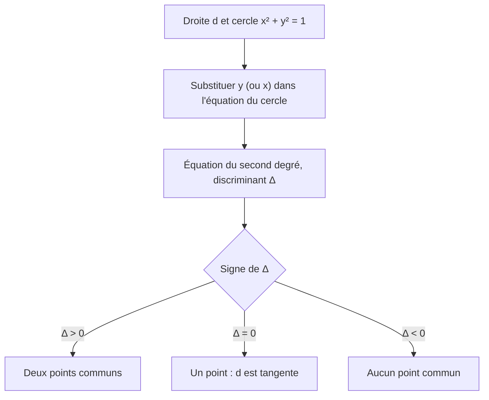

# Le cercle trigonométrique

!!! info "Objectifs pédagogiques et compétences"
    - Définir le cercle trigonométrique et son **orientation**.
    - Démontrer et utiliser son **équation** $x^2+y^2=1$.
    - Déterminer des points du cercle à partir d'une coordonnée, ou d'une droite.
    - Connaître les longueurs d'arcs remarquables ($2\pi$, $\pi$, $\frac\pi2$).

!!! note "Prérequis"
    Repère orthonormé, distance entre deux points, équations du second degré, discriminant, équation de droite.

## 1. Définition

!!! definition "Définition : Cercle trigonométrique"
    Le plan est muni d'un repère **orthonormé direct** $(O;I,J)$. Le **cercle trigonométrique** $\mathcal{C}$ est le cercle de **centre $O$** et de **rayon $1$** (l'unité du repère), muni du **sens direct** (ou trigonométrique) : le sens **inverse** des aiguilles d'une montre. L'autre sens est le sens indirect.

<svg viewBox="0 0 300 300" width="280" role="img" aria-label="Cercle trigonométrique, points I, J, I', J' et un point M avec l'arc IM" style="max-width:100%;color:inherit">
<g fill="none" stroke="currentColor" stroke-width="1.5">
<circle cx="150" cy="150" r="100"/>
<line x1="20" y1="150" x2="280" y2="150"/>
<line x1="150" y1="280" x2="150" y2="20"/>
<path d="M 250 150 A 100 100 0 0 0 200 63.4" stroke="#e53935" stroke-width="3"/>
<line x1="150" y1="150" x2="200" y2="63.4" stroke-dasharray="4 3"/>
</g>
<g fill="currentColor" font-size="14" font-family="sans-serif">
<text x="256" y="168">I (1 ; 0)</text>
<text x="156" y="42">J (0 ; 1)</text>
<text x="2" y="168">I' (-1 ; 0)</text>
<text x="156" y="270">J' (0 ; -1)</text>
<text x="204" y="58">M</text>
<text x="136" y="168">O</text>
<text x="232" y="118" fill="#e53935">arc IM</text>
</g>
</svg>

*Figure : les points $I,J,I',J'$ et un point $M$ du cercle ; l'arc $\widehat{IM}$ est parcouru dans le sens direct.*

!!! propriete "Propriété : Équation du cercle trigonométrique"
    Un point $M(x\,;y)$ appartient à $\mathcal{C}$ si et seulement si $x^2+y^2=1$. En particulier, pour tout point de $\mathcal{C}$ : $-1\le x\le1$ et $-1\le y\le1$.

??? abstract "Démonstration"
    Le repère est orthonormé, donc $OM=\sqrt{x^2+y^2}$. Alors $M\in\mathcal{C}\iff OM=1\iff x^2+y^2=1$. Comme $y^2\ge0$, $x^2\le1$ donc $|x|\le1$ (propriété de la valeur absolue : $x^2\le1\iff|x|\le1$) ; de même pour $y$.

!!! propriete "Propriété : Longueurs d'arcs"
    Le périmètre du cercle trigonométrique est $2\pi$. Un demi-cercle mesure $\pi$, un quart de cercle $\dfrac\pi2$, un huitième $\dfrac\pi4$, un douzième $\dfrac\pi6$.

!!! attention "Attention : Ce que « trigonométrique » ne veut pas dire"
    - Le cercle de rayon $1$ **n'est pas** automatiquement trigonométrique : il faut le centre à l'origine d'un repère orthonormé, et une orientation. Un cercle de rayon $2$ centré en $O$ ne l'est pas.
    - Avec un repère seulement orthogonal (non normé), la propriété $x^2+y^2=1$ est **fausse**.
    - Le sens positif est le sens **inverse** des aiguilles : ne pas le confondre avec le sens des aiguilles (indirect).

## 2. Méthodes

!!! methode "Méthode : Trouver un point du cercle connaissant une coordonnée"
    1. Vérifier que la coordonnée connue $a$ vérifie $|a|\le1$ (sinon aucun point). 2. Résoudre $y^2=1-x^2$ : $y=\pm\sqrt{1-x^2}$. 3. Utiliser une condition de signe (quadrant) pour choisir. 4. Si $|a|=1$, il n'y a qu'**un seul** point.

!!! methode "Méthode : Intersection du cercle et d'une droite"
    Substituer l'équation de la droite dans $x^2+y^2=1$ : on obtient une équation du second degré ; le **discriminant** donne le nombre de points communs ($>0$ : deux ; $=0$ : un, droite tangente ; $<0$ : aucun).

## 3. Exemples corrigés

!!! example "Exemple : Une coordonnée connue"
    Le point $M\bigl(\tfrac35\,;y\bigr)$, avec $y>0$, appartient à $\mathcal{C}$ : $y^2=1-\frac9{25}=\frac{16}{25}$, $y=\frac45$. Pour l'abscisse $-\frac12$ : $y=\pm\frac{\sqrt3}2$ (deux points).

!!! example "Exemple : Intersection avec la droite $y=x$"
    $2x^2=1$ : $x=\pm\frac{\sqrt2}2$. Points $\bigl(\frac{\sqrt2}2;\frac{\sqrt2}2\bigr)$ et $\bigl(-\frac{\sqrt2}2;-\frac{\sqrt2}2\bigr)$.

## 4. Exercices progressifs

!!! question "Exercice 1 – Appartenance"
    Parmi $A\bigl(\tfrac{\sqrt3}2;\tfrac12\bigr)$, $B(0{,}6;0{,}7)$, $C\bigl(-\tfrac{\sqrt2}2;\tfrac{\sqrt2}2\bigr)$, $D(1{,}2;0)$, lesquels sont sur $\mathcal{C}$ ?

    ??? success "Corrigé"
        $A$ : $\frac34+\frac14=1$ ✓. $B$ : $0{,}36+0{,}49=0{,}85\neq1$ ✗. $C$ : $\frac12+\frac12=1$ ✓. $D$ : $1{,}44\neq1$ ✗ (et $|1{,}2|>1$ de toute façon).

!!! question "Exercice 2 – La droite $(IJ)$"
    Déterminer l'intersection de $\mathcal{C}$ avec la droite d'équation $y=1-x$.

    ??? success "Corrigé"
        $x^2+(1-x)^2=1\iff2x^2-2x=0\iff x=0$ ou $x=1$ : points $J(0;1)$ et $I(1;0)$. C'est bien la droite $(IJ)$.

!!! question "Exercice 3 – Droites $x+y=k$ (niveau soutenu)"
    Discuter, selon $k\in\mathbb{R}$, le nombre de points communs de $\mathcal{C}$ et de la droite $d_k:\,x+y=k$. Identifier le cas de tangence.

    ??? success "Corrigé"
        $y=k-x$ : $x^2+(k-x)^2=1\iff2x^2-2kx+k^2-1=0$. $\Delta=4k^2-8(k^2-1)=8-4k^2=4(2-k^2)$.

        - $|k|<\sqrt2$ : deux points ;
        - $|k|=\sqrt2$ : un point, $x=\frac k2=\pm\frac{\sqrt2}2$ : la droite est **tangente** en $\bigl(\pm\frac{\sqrt2}2;\pm\frac{\sqrt2}2\bigr)$ ;
        - $|k|>\sqrt2$ : aucun point.

        Interprétation : $x+y$ est maximal ($\sqrt2$) au point à $45^\circ$.

## 5. Exercices type contrôle

!!! question "Exercice C1 – Paramétrage rationnel (15 min)"
    Pour $t\in\mathbb{R}$ on pose $M_t\Bigl(\dfrac{1-t^2}{1+t^2}\,;\dfrac{2t}{1+t^2}\Bigr)$. a) Montrer que $M_t\in\mathcal{C}$. b) Pour quelles valeurs de $t$ obtient-on $I$ ? $J$ ? c) $I'$ est-il atteint ?

    ??? success "Corrigé"
        a) $\dfrac{(1-t^2)^2+4t^2}{(1+t^2)^2}=\dfrac{1+2t^2+t^4}{(1+t^2)^2}=1$.

        b) $M_t=I$ : $y=0\iff t=0$, alors $x=1$ ✓. $M_t=J$ : $x=0\iff t=\pm1$ et $y=1\iff 2t=1+t^2\iff(t-1)^2=0\iff t=1$. Donc $t=1$.

        c) $x=-1\iff1-t^2=-1-t^2\iff1=-1$ : **impossible**. $I'$ n'est jamais atteint (il correspond à « $t=\infty$ »). *Piège : la paramétrisation ne couvre pas tout le cercle.*

!!! question "Exercice C2 – Une distance (12 min)"
    Soit $M(x;y)\in\mathcal{C}$. a) Montrer que $IM^2=2-2x$. b) En déduire que $IM\in[0;2]$ et les positions de $M$ pour $IM=0$, $IM=2$, $IM=\sqrt2$. c) Pour $M$ avec $y>0$ et $y=2x$, calculer $M$ puis $IM$.

    ??? success "Corrigé"
        a) $IM^2=(x-1)^2+y^2=x^2+y^2-2x+1=2-2x$.

        b) $x\in[-1;1]$ donc $IM^2\in[0;4]$. $IM=0\iff x=1$ ($M=I$) ; $IM=2\iff x=-1$ ($M=I'$) ; $IM=\sqrt2\iff x=0$ ($M=J$ ou $J'$).

        c) $x^2+4x^2=1$, $x=\pm\frac1{\sqrt5}$ ; $y=2x>0$ impose $x=\frac{\sqrt5}5$, $M\bigl(\frac{\sqrt5}5;\frac{2\sqrt5}5\bigr)$. $IM^2=2-\frac{2\sqrt5}5$, soit $IM=\sqrt{2-\frac{2\sqrt5}5}\approx0{,}74$.

!!! tip "Fiche de révision"
    - $\mathcal{C}$ : centre $O$, rayon $1$, repère **orthonormé direct**, sens direct = sens inverse des aiguilles.
    - $M(x;y)\in\mathcal{C}\iff x^2+y^2=1$ ; alors $|x|\le1$, $|y|\le1$.
    - Périmètre $2\pi$ ; demi-cercle $\pi$ ; quart $\frac\pi2$.
    - Droite $\cap$ cercle : substitution, discriminant.
