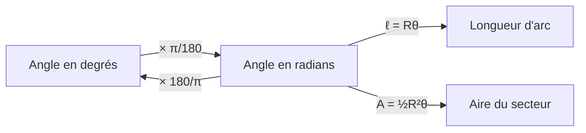

# Les radians

!!! info "Objectifs pédagogiques et compétences"
    - Définir le radian et **convertir** entre degrés et radians.
    - Connaître les angles usuels en radians.
    - Calculer **longueur d'arc** et **aire de secteur**.
    - Modéliser avec des angles en radians (rotations, engrenages, horloges).

!!! note "Prérequis"
    Chapitre 02 ; proportionnalité ; périmètre et aire du disque ; équations du premier et du second degré.

## 1. Définition

!!! definition "Définition : Radian"
    Le **radian** est l'unité de mesure d'angle telle que l'angle au centre qui intercepte, sur le cercle trigonométrique, un arc de **longueur $1$** mesure **$1$ radian** (noté $1$ rad). Plus généralement, dans un cercle de rayon $R$, un angle de $1$ rad intercepte un arc de longueur $R$.

!!! propriete "Propriété : Proportionnalité et conversion"
    Les mesures en degrés et en radians d'un même angle sont **proportionnelles**, avec $360^\circ\leftrightarrow2\pi$ rad, donc $180^\circ\leftrightarrow\pi$ rad :
    $$\theta_{\text{rad}}=\theta_{\text{deg}}\times\frac{\pi}{180},\qquad\theta_{\text{deg}}=\theta_{\text{rad}}\times\frac{180}{\pi}.$$
    Ainsi $1^\circ=\dfrac\pi{180}\approx0{,}01745$ rad et $1\text{ rad}=\dfrac{180}\pi\approx57{,}30^\circ$.

| Degrés | $0^\circ$ | $30^\circ$ | $45^\circ$ | $60^\circ$ | $90^\circ$ | $120^\circ$ | $135^\circ$ | $150^\circ$ | $180^\circ$ | $270^\circ$ | $360^\circ$ |
|:---:|:---:|:---:|:---:|:---:|:---:|:---:|:---:|:---:|:---:|:---:|:---:|
| Radians | $0$ | $\frac\pi6$ | $\frac\pi4$ | $\frac\pi3$ | $\frac\pi2$ | $\frac{2\pi}3$ | $\frac{3\pi}4$ | $\frac{5\pi}6$ | $\pi$ | $\frac{3\pi}2$ | $2\pi$ |

!!! propriete "Propriété : Longueur d'un arc et aire d'un secteur"
    Dans un disque de rayon $R$, pour un angle au centre de mesure $\theta\in[0;2\pi]$ **en radians** :
    $$\text{longueur de l'arc}=R\theta,\qquad\text{aire du secteur}=\tfrac12R^2\theta.$$

??? abstract "Démonstration"
    La longueur de l'arc est proportionnelle à l'angle : $\dfrac{\ell}{2\pi R}=\dfrac{\theta}{2\pi}$, d'où $\ell=R\theta$. L'aire du secteur est proportionnelle à l'angle : $\dfrac{\mathcal{A}}{\pi R^2}=\dfrac\theta{2\pi}$, d'où $\mathcal{A}=\frac12R^2\theta=\frac12R\ell$.

!!! attention "Attention : Les formules $\ell=R\theta$ et $\frac12R^2\theta$ supposent des radians"
    En degrés elles deviennent $\ell=\dfrac{\pi R\theta}{180}$ et $\mathcal{A}=\dfrac{\pi R^2\theta}{360}$. Avec une calculatrice, **vérifier le mode** (RAD ou DEG) avant tout calcul. Un radian n'est pas « un petit angle » : $1$ rad $\approx57^\circ$.

## 2. Méthodes

!!! methode "Méthode : Convertir rapidement"
    1. $\theta_{\text{rad}}=\theta_{\text{deg}}\times\frac\pi{180}$ : simplifier la fraction ($72^\circ=\frac{72\pi}{180}=\frac{2\pi}5$). 2. Dans l'autre sens, remplacer $\pi$ par $180$ : $\frac{7\pi}{12}\to\frac{7\times180}{12}=105^\circ$. 3. Vérifier avec les angles de référence $30^\circ,45^\circ,60^\circ$.

!!! methode "Méthode : Problème de modélisation"
    Identifier les angles (en radians) et les rayons ; appliquer $\ell=R\theta$ ; exprimer les contraintes (périmètre, aire) ; résoudre ; interpréter.

## 3. Exemples corrigés

!!! example "Exemple : Conversions"
    $7\pi/12\to105^\circ$ ; $72^\circ\to\frac{2\pi}5$ ; $1{,}2\text{ rad}\approx68{,}8^\circ$.

!!! example "Exemple : Secteur"
    Rayon $6$ cm, angle $\frac{5\pi}6$ : $\ell=6\times\frac{5\pi}6=5\pi\approx15{,}7$ cm ; $\mathcal{A}=\frac12\times36\times\frac{5\pi}6=15\pi\approx47{,}1$ cm².

!!! example "Exemple : Roue"
    Une roue de rayon $0{,}35$ m parcourt $100$ m sans glisser. Angle de rotation : $\theta=\frac{100}{0{,}35}\approx285{,}7$ rad, soit $\frac{285{,}7}{2\pi}\approx45{,}5$ tours.

## 4. Exercices progressifs

!!! question "Exercice 1 – Conversions"
    Convertir en radians : $15^\circ$, $210^\circ$, $-135^\circ$. En degrés : $\frac{4\pi}3$, $\frac{\pi}{12}$, $2$ rad, $\frac{11\pi}{6}$.

    ??? success "Corrigé"
        $15^\circ=\frac\pi{12}$ ; $210^\circ=\frac{7\pi}6$ ; $-135^\circ=-\frac{3\pi}4$. $\frac{4\pi}3=240^\circ$ ; $\frac\pi{12}=15^\circ$ ; $2\text{ rad}=\frac{360}\pi\approx114{,}6^\circ$ ; $\frac{11\pi}6=330^\circ$.

!!! question "Exercice 2 – Engrenages"
    Deux roues dentées de rayons $3$ cm et $8$ cm sont en contact et tournent sans glisser. La grande roue tourne de $\frac{3\pi}4$ rad. De quel angle tourne la petite ?

    ??? success "Corrigé"
        Les arcs parcourus sont égaux : $R_1\theta_1=R_2\theta_2$, donc $3\theta_1=8\times\frac{3\pi}4=6\pi$, $\theta_1=2\pi$ : la petite roue fait **un tour exactement**.

!!! question "Exercice 3 – Secteur de périmètre fixé (niveau soutenu)"
    Un secteur angulaire de rayon $R$ et d'angle $\theta$ rad a un périmètre (arc + deux rayons) égal à $20$ cm. a) Exprimer son aire en fonction de $R$. b) Quelles valeurs de $R$ sont possibles ? c) Pour quelles valeurs de $R$ et $\theta$ l'aire est-elle maximale ? Quelle est cette aire ?

    ??? success "Corrigé"
        a) $2R+R\theta=20$, donc $R\theta=20-2R$ et $\mathcal{A}=\frac12R(R\theta)=\frac12R(20-2R)=R(10-R)=-R^2+10R$.

        b) Il faut $\theta\in\,]0;2\pi]$ : $0<20-2R\le2\pi R\iff\dfrac{20}{2+2\pi}\le R<10$, soit $\dfrac{10}{1+\pi}\le R<10$, avec $\frac{10}{1+\pi}\approx2{,}41$.

        c) $-R^2+10R=25-(R-5)^2\le25$, maximum $25$ cm² pour $R=5$, alors $\theta=\frac{20-10}5=2$ rad ($\approx114{,}6^\circ$). La valeur $R=5$ est bien dans l'intervalle de la question b). *Le maximum est un secteur dont l'arc est égal à $2R$.*

## 5. Exercices type contrôle

!!! question "Exercice C1 – Horloge (12 min)"
    À $4$ h $20$, quel est l'angle (non orienté) entre les aiguilles, en degrés puis en radians ?

    ??? success "Corrigé"
        Minutes : $6^\circ$ par minute, donc $20\times6=120^\circ$. Heures : $30^\circ$ par heure et $0{,}5^\circ$ par minute, soit $4\times30+20\times0{,}5=130^\circ$. Écart : $10^\circ=\frac{\pi}{18}$ rad. *Piège : oublier que l'aiguille des heures avance avec les minutes (elle ne reste pas sur le $4$).*

!!! question "Exercice C2 – Quand les aiguilles se superposent (20 min)"
    Entre $3$ h et $4$ h, à quel instant les aiguilles d'une horloge sont-elles superposées ? Résoudre en radians.

    ??? success "Corrigé"
        Soit $m$ le nombre de minutes écoulées après $3$ h. L'aiguille des minutes parcourt $\frac{2\pi}{60}=\frac\pi{30}$ rad par minute, celle des heures $\frac{2\pi}{12\times60}=\frac\pi{360}$ rad par minute, et part de $3\times\frac\pi6=\frac\pi2$.

        Superposition : $\frac{m\pi}{30}\equiv\frac\pi2+\frac{m\pi}{360}\ [2\pi]$. Pour $m\in[0;60[$, l'angle de l'aiguille des minutes est dans $[0;2\pi[$ et on peut écrire l'égalité sans congruence (aucun tour supplémentaire n'est possible avant $4$ h) : $\frac m{30}-\frac m{360}=\frac12\iff\frac{11m}{360}=\frac12\iff m=\frac{180}{11}\approx16{,}36$ min, soit environ $3$ h $16$ min $22$ s.

!!! question "Exercice C3 – Mesures et arcs (12 min)"
    Un arc de longueur $7$ cm est porté par un cercle de rayon $4$ cm. a) Mesure de l'angle au centre en radians et en degrés. b) Même angle pour un arc de $7$ cm sur un cercle de rayon $2$ cm : commentaire.

    ??? success "Corrigé"
        a) $\theta=\frac74=1{,}75$ rad $\approx100{,}3^\circ$.

        b) $\theta=\frac72=3{,}5$ rad $\approx200{,}5^\circ$ : l'angle double quand le rayon est divisé par $2$ (à longueur d'arc fixée), conformément à $\theta=\ell/R$.

!!! tip "Fiche de révision"
    - $180^\circ=\pi$ rad ; $\theta_{\text{rad}}=\theta_{\text{deg}}\times\frac\pi{180}$.
    - $30^\circ=\frac\pi6$, $45^\circ=\frac\pi4$, $60^\circ=\frac\pi3$, $90^\circ=\frac\pi2$.
    - $\ell=R\theta$ ; $\mathcal{A}=\frac12R^2\theta$ (radians !).
    - Une mesure d'angle orienté est définie modulo $2\pi$ ; principale dans $]-\pi;\pi]$.
