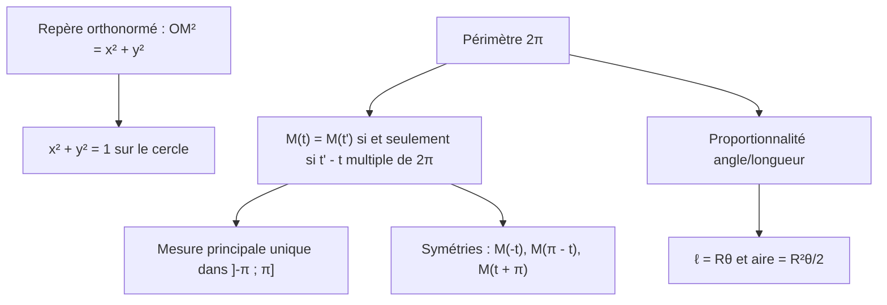

# Comprendre, utiliser, démontrer : trigonométrie

## 1. Pourquoi ces résultats sont vrais

!!! propriete "Propriété : Les trois idées à comprendre"
    1. **Le cercle est la définition de $x^2+y^2=1$** : c'est la distance $OM=1$ écrite en coordonnées (Pythagore).
    2. **L'enroulement convertit une longueur en angle** parce que le cercle de rayon $1$ a une longueur $2\pi$ : un tour complet fait revenir au même point, d'où les mesures « modulo $2\pi$ ».
    3. **Le radian est « naturel »** : il mesure l'angle par la longueur de l'arc intercepté. D'où $\ell=R\theta$ sans coefficient parasite.

## 2. Savoir quand l'utiliser

| Situation | Outil |
|---|---|
| Montrer qu'un point est sur le cercle | $x^2+y^2=1$ |
| Connaître un point du cercle par une coordonnée | $y=\pm\sqrt{1-x^2}$, avec un signe |
| Droite et cercle | substitution, discriminant |
| Plusieurs réels, même point | $t'=t+2k\pi$ |
| Donner la mesure principale | réduire dans $]-\pi;\pi]$ |
| Résoudre $M(a)=M(b)$ | $a-b\in2\pi\mathbb{Z}$, puis encadrer $k$ |
| Image par symétrie | $-t$, $\pi-t$, $t+\pi$, $\frac\pi2-t$ |
| Longueur d'arc, aire de secteur | $R\theta$, $\frac12R^2\theta$ en **radians** |

## 3. Savoir démontrer

!!! attention "Attention : Les erreurs à ne plus commettre"
    1. Calculer en degrés avec une formule faite pour les radians (et réciproquement).
    2. Oublier que $-\pi$ n'est pas une mesure principale.
    3. Écrire « $t=\frac{\pi}3$ » au lieu de « $t\equiv\frac\pi3\ [2\pi]$ ».
    4. Confondre le point $M(t)$ et le réel $t$.
    5. Oublier le signe en résolvant $y^2=1-x^2$.
    6. Ne pas vérifier la plage de $k$ en cherchant des solutions dans $]-\pi;\pi]$.

!!! question "Exercice Auto-évaluation"
    Sans le cours : (1) démontrer $x^2+y^2=1$ sur le cercle ; (2) expliquer pourquoi $M(t)=M(t')\iff t'-t\in2\pi\mathbb{Z}$ ; (3) donner la mesure principale de $-\frac{29\pi}{6}$ ; (4) démontrer $\mathcal{A}=\frac12R^2\theta$ ; (5) résoudre $M(3t)=M(t+\frac\pi2)$ dans $]-\pi;\pi]$.

    ??? success "Corrigé"
        (3) $-\frac{29\pi}6+4\pi=-\frac{5\pi}6$. (5) $3t\equiv t+\frac\pi2\iff2t=\frac\pi2+2k\pi\iff t=\frac\pi4+k\pi$ : dans $]-\pi;\pi]$, $t\in\bigl\{\frac\pi4;-\frac{3\pi}4\bigr\}$. Pour les autres, voir les chapitres 01 à 03.
