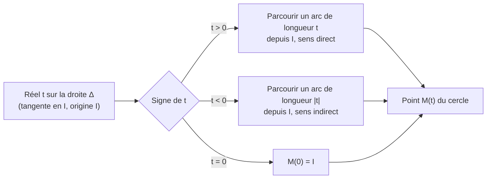
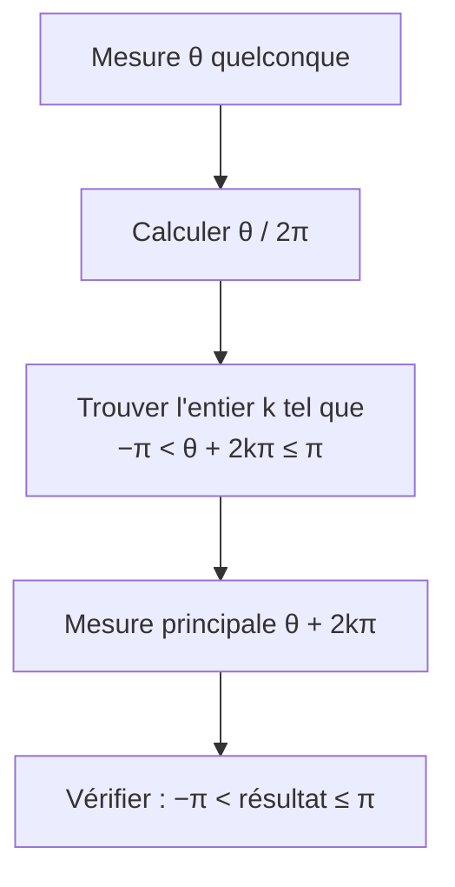

# Cercle trigonométrique et radians

## Objectifs pédagogiques et compétences

À la fin de ce chapitre, tu dois savoir :

- définir le **cercle trigonométrique** et son orientation ;
- expliquer l'**enroulement de la droite des réels** autour du cercle, et en déduire que $M(t)=M(t')\iff t'=t+2k\pi$ ;
- définir le **radian**, **convertir** degrés et radians, calculer longueurs d'arc et aires de secteurs ;
- définir une **mesure d'un angle orienté** de deux vecteurs, la **mesure principale**, et les calculer ;
- placer sur le cercle les points associés aux réels usuels ($\frac\pi6$, $\frac\pi4$, $\frac\pi3$, etc.) ;
- **démontrer** les propriétés de ce chapitre.

## Prérequis

- cercle : centre, rayon, périmètre $2\pi r$, aire $\pi r^2$ ;
- repère orthonormé, symétries axiale et centrale ;
- vecteurs, norme d'un vecteur, vecteur unitaire $\dfrac{\vec u}{\|\vec u\|}$ ;
- division euclidienne, parties entières, congruences simples ;
- théorème de Pythagore.

---

## 1. Le cercle trigonométrique

!!! info "Définition : cercle trigonométrique"
    Le plan est muni d'un repère **orthonormé** $(O\,;I,J)$ avec $I(1\,;0)$ et $J(0\,;1)$. Le **cercle trigonométrique** $\mathcal C$ est le cercle de **centre $O$** et de **rayon $1$**, **orienté** dans le **sens direct** (sens **inverse** des aiguilles d'une montre, appelé aussi sens trigonométrique).

    Le sens contraire (celui des aiguilles d'une montre) est le **sens indirect** (ou rétrograde).

!!! info "Points remarquables"
    $I(1\,;0)$, $J(0\,;1)$, $I'(-1\,;0)$ et $J'(0\,;-1)$ partagent le cercle en quatre quarts. Le **périmètre** de $\mathcal C$ est $2\pi\times1=2\pi$.

!!! warning "Point d'attention"
    Le cercle est de rayon **$1$** parce que l'unité du repère est prise comme unité de longueur : une longueur d'arc sur $\mathcal C$ est alors directement un nombre. C'est ce choix qui fait fonctionner les radians.

---

## 2. Enroulement de la droite des réels

### 2.1 Construction

!!! info "Définition : la droite $\Delta$ et l'enroulement"
    Soit $\Delta$ la **tangente** à $\mathcal C$ au point $I$ (c'est la droite d'équation $x=1$). On la gradue en prenant **$I$ pour origine**, la **même unité** que le repère, et on l'oriente **vers le haut** (dans la direction de $J$) : cette droite représente l'ensemble des réels $\mathbb R$.

    On **enroule** $\Delta$ autour du cercle : la partie positive dans le sens **direct**, la partie négative dans le sens **indirect**. À tout réel $t$ correspond ainsi un point $M(t)$ de $\mathcal C$, obtenu en partant de $I$ et en parcourant sur le cercle un arc de **longueur $|t|$**, dans le sens direct si $t>0$, indirect si $t<0$.

!!! example "Points associés aux réels usuels"
    | Réel $t$ | $0$ | $\dfrac\pi2$ | $\pi$ | $-\dfrac\pi2$ | $2\pi$ | $\dfrac\pi4$ |
    |---|---|---|---|---|---|---|
    | Point $M(t)$ | $I$ | $J$ | $I'$ | $J'$ | $I$ | milieu de l'arc $\overset\frown{IJ}$ |

    Raison : un quart de cercle mesure $\frac{2\pi}4=\frac\pi2$, un demi-cercle $\pi$, un tour $2\pi$.

### 2.2 Propriété fondamentale

!!! abstract "Propriété : un point, plusieurs réels"
    Pour tous réels $t$ et $t'$ :
    $$M(t)=M(t')\iff t'=t+2k\pi\ \text{ pour un entier relatif }k.$$

!!! abstract "Démonstration"
    Le périmètre du cercle est $2\pi$ : faire un tour complet (dans un sens ou dans l'autre) ramène au même point.

    ($\Leftarrow$) Si $t'=t+2k\pi$, partir de $I$ et parcourir $t'$ revient à parcourir $t$ puis $|k|$ tours complets : on arrive au même point.

    ($\Rightarrow$) Si $M(t)=M(t')$, le chemin signé de longueur $t'-t$ ramène de $M(t)$ à $M(t)$ lui-même : c'est un nombre **entier** de tours. Donc $t'-t$ est un multiple entier de la longueur d'un tour, soit $2k\pi$. $\blacksquare$

!!! info "Notation : congruence modulo $2\pi$"
    On écrit $t\equiv t'\ [2\pi]$ (lire « $t$ congru à $t'$ modulo $2\pi$ ») lorsque $t'-t$ est un multiple entier de $2\pi$. Ainsi $M(t)=M(t')\iff t\equiv t'\ [2\pi]$.

!!! warning "Points d'attention : erreurs fréquentes"
    - **Un point du cercle a une infinité de réels associés**, tous séparés d'un multiple de $2\pi$. On ne peut donc **pas** écrire « $M(t)=M(t')\Rightarrow t=t'$ ».
    - **Un réel donné** n'a **qu'un** point : l'application $t\mapsto M(t)$ est bien définie, mais pas injective.
    - **Le signe** compte : $M(t)$ et $M(-t)$ sont symétriques par rapport à $(OI)$, pas égaux.
    - Les multiples de $\pi$ (et non de $\frac\pi2$) donnent seulement $I$ ou $I'$ : $M(k\pi)=I$ si $k$ est pair, $I'$ si $k$ est impair.

!!! abstract "Propriété : symétries"
    Pour tout réel $t$ :

    | Point | Relation avec $M(t)$ |
    |---|---|
    | $M(-t)$ | symétrique par rapport à l'axe $(OI)$ (axe des abscisses) |
    | $M(\pi-t)$ | symétrique par rapport à l'axe $(OJ)$ (axe des ordonnées) |
    | $M(t+\pi)$ | symétrique par rapport à l'origine $O$ |

!!! abstract "Démonstration"
    - *$M(-t)$* : la symétrie d'axe $(OI)$ fixe $I$, conserve les longueurs et **renverse** l'orientation. L'arc de $I$ à $M(t)$, de longueur signée $t$, est transformé en l'arc de $I$ au symétrique de $M(t)$, de longueur signée $-t$ : ce symétrique est $M(-t)$.
    - *$M(\pi-t)$* : la symétrie d'axe $(OJ)$ fixe $J=M(\frac\pi2)$ et renverse l'orientation. L'arc de $J$ à $M(t)$, de longueur signée $t-\frac\pi2$, devient l'arc de $J$ à son symétrique, de longueur signée $\frac\pi2-t$. Le symétrique est donc $M\!\left(\frac\pi2+\frac\pi2-t\right)=M(\pi-t)$.
    - *$M(t+\pi)$* : la symétrie centrale de centre $O$ envoie chaque point sur le point diamétralement opposé, c'est-à-dire à un demi-tour de distance : $M(t)\mapsto M(t+\pi)$. $\blacksquare$

---

## 3. Le radian

!!! info "Définition : mesure en radians d'un angle"
    Un angle au centre du cercle trigonométrique **intercepte un arc** de $\mathcal C$. Sa **mesure en radians** est la **longueur de cet arc**.
    Le **radian** (symbole **rad**) est donc la mesure de l'angle au centre qui intercepte un arc de longueur $1$ sur le cercle de rayon $1$.

!!! abstract "Propriété : proportionnalité degrés et radians"
    L'angle plein mesure $360^\circ$ et $2\pi$ rad ; l'angle plat $180^\circ$ et $\pi$ rad. La conversion est une **proportionnalité** :
    $$\boxed{\ \theta_{\text{rad}}=\frac{\pi}{180}\,\alpha^\circ\ }\qquad\Longleftrightarrow\qquad\boxed{\ \alpha^\circ=\frac{180}{\pi}\,\theta_{\text{rad}}\ }$$

!!! abstract "Démonstration"
    La longueur d'un arc de cercle est proportionnelle à l'angle au centre qui l'intercepte. L'angle de $360^\circ$ intercepte tout le cercle, de longueur $2\pi$ ; l'angle de $\alpha^\circ$ intercepte donc un arc de longueur $\dfrac{\alpha}{360}\times2\pi=\dfrac{\alpha\pi}{180}$. $\blacksquare$

!!! example "Tableau de conversion à connaître"
    | Degrés | $0^\circ$ | $30^\circ$ | $45^\circ$ | $60^\circ$ | $90^\circ$ | $120^\circ$ | $135^\circ$ | $150^\circ$ | $180^\circ$ | $270^\circ$ | $360^\circ$ |
    |---|---|---|---|---|---|---|---|---|---|---|---|
    | Radians | $0$ | $\frac\pi6$ | $\frac\pi4$ | $\frac\pi3$ | $\frac\pi2$ | $\frac{2\pi}3$ | $\frac{3\pi}4$ | $\frac{5\pi}6$ | $\pi$ | $\frac{3\pi}2$ | $2\pi$ |

    Autres conversions : $1\text{ rad}=\dfrac{180}\pi\approx57{,}3^\circ$ et $1^\circ=\dfrac\pi{180}\approx0{,}0175$ rad.

!!! abstract "Propriété : arc et secteur dans un cercle de rayon $r$"
    Dans un cercle de rayon $r$, pour un angle au centre de mesure $\theta$ **en radians** ($0\le\theta\le2\pi$) :
    $$\ell=r\,\theta\qquad\text{(longueur de l'arc)}\qquad\text{et}\qquad\mathcal A=\frac12\,r^2\theta\qquad\text{(aire du secteur)}.$$

!!! abstract "Démonstration"
    Le cercle de rayon $r$ est l'image du cercle de rayon $1$ par un agrandissement de rapport $r$ : les longueurs sont multipliées par $r$, les aires par $r^2$. L'arc intercepté par un angle $\theta$ a pour longueur $\theta$ sur le cercle unité, donc $r\theta$ ici. Le secteur occupe la fraction $\dfrac\theta{2\pi}$ du disque d'aire $\pi r^2$ : $\mathcal A=\dfrac\theta{2\pi}\times\pi r^2=\dfrac12r^2\theta$. $\blacksquare$

!!! warning "Points d'attention : radians"
    - **Un radian n'a pas d'unité « physique »** : c'est un rapport de longueurs (arc sur rayon). On écrit « $\theta=\dfrac\pi3$ » ou « $\dfrac\pi3$ rad ».
    - **Les formules $\ell=r\theta$ et $\mathcal A=\frac12r^2\theta$ exigent des radians** (avec des degrés, il faudrait $\ell=\frac{\pi r\alpha}{180}$).
    - **$\pi\approx3{,}14$ est un nombre**, pas « $180$ » ; on écrit $\pi\text{ rad}=180^\circ$, pas $\pi=180$.
    - **Calculatrice** : régler le **mode radian** ou **degré** selon le contexte.
    - **Garder les valeurs exactes** ($\frac\pi3$) sauf demande d'une valeur approchée.

---

## 4. Angles orientés et mesure principale

!!! info "Définition : mesure d'un angle orienté de deux vecteurs"
    Soient $\vec u$ et $\vec v$ deux vecteurs **non nuls**. Notons $A$ et $B$ les points de $\mathcal C$ tels que $\overrightarrow{OA}=\dfrac{\vec u}{\|\vec u\|}$ et $\overrightarrow{OB}=\dfrac{\vec v}{\|\vec v\|}$, et choisissons des réels $a$ et $b$ avec $A=M(a)$ et $B=M(b)$. Une **mesure en radians de l'angle orienté** $(\vec u\,,\vec v)$ est tout réel de la forme
    $$\theta=b-a+2k\pi,\qquad k\in\mathbb Z.$$
    Elle est donc **définie modulo $2\pi$** : on écrit $(\vec u,\vec v)\equiv\theta\ [2\pi]$.

    Par exemple, $(\vec\imath,\vec u)$ a pour mesure $a$ lorsque $\overrightarrow{OA}=\dfrac{\vec u}{\|\vec u\|}$ avec $A=M(a)$.

!!! abstract "Propriétés des angles orientés"
    Pour des vecteurs $\vec u,\vec v,\vec w$ non nuls :

    1. **Relation de Chasles** : $(\vec u,\vec v)+(\vec v,\vec w)\equiv(\vec u,\vec w)\ [2\pi]$.
    2. $(\vec v,\vec u)\equiv-(\vec u,\vec v)\ [2\pi]$.
    3. $(\vec u,\vec v)\equiv0\ [2\pi]\iff\vec u$ et $\vec v$ sont **colinéaires de même sens**.
    4. $(\vec u,\vec v)\equiv\pi\ [2\pi]\iff\vec u$ et $\vec v$ sont **colinéaires de sens contraires**.

!!! abstract "Démonstration"
    Avec $A=M(a)$, $B=M(b)$, $C=M(c)$ pour $\vec u,\vec v,\vec w$ : (1) $(b-a)+(c-b)=c-a$ ; (2) $(a-b)=-(b-a)$ ; (3) $b-a\equiv0\iff M(b)=M(a)\iff\frac{\vec u}{\|\vec u\|}=\frac{\vec v}{\|\vec v\|}$ ; (4) $b-a\equiv\pi\iff M(b)=M(a+\pi)$, le point diamétralement opposé, donc $\frac{\vec v}{\|\vec v\|}=-\frac{\vec u}{\|\vec u\|}$. $\blacksquare$

!!! info "Définition : mesure principale"
    La **mesure principale** d'un angle orienté est son **unique** mesure appartenant à l'intervalle $]-\pi\,;\pi]$.

!!! abstract "Propriété : existence et unicité"
    Tout réel $\theta$ est congru modulo $2\pi$ à **un unique** réel de $]-\pi\,;\pi]$, c'est-à-dire qu'il existe un unique entier $k$ tel que $-\pi<\theta+2k\pi\le\pi$.

!!! abstract "Démonstration"
    $-\pi<\theta+2k\pi\le\pi\iff-\dfrac12-\dfrac\theta{2\pi}<k\le\dfrac12-\dfrac\theta{2\pi}$. Cet intervalle est de longueur $1$, ouvert à gauche et fermé à droite : il contient **exactement un** entier. $\blacksquare$

!!! tip "Méthode : trouver la mesure principale"
    1. Écrire $\theta$ sous la forme $\dfrac{p\,\pi}{q}$.
    2. Retrancher ou ajouter des multiples de $2\pi$ (donc de $\dfrac{2q\pi}{q}$), jusqu'à tomber dans $]-\pi\,;\pi]$.
    3. **Vérifier** le résultat : $-\pi<\text{résultat}\le\pi$.

    **Exemple** : $\dfrac{17\pi}4=\dfrac\pi4+4\pi=\dfrac\pi4+2\times2\pi$ : mesure principale $\dfrac\pi4$.
    **Exemple** : $-\dfrac{11\pi}3=-\dfrac{11\pi}3+4\pi=\dfrac\pi3$ (on ajoute $2\times2\pi=\dfrac{12\pi}3$).

!!! warning "Points d'attention : mesure principale"
    - L'intervalle est **ouvert en $-\pi$ et fermé en $\pi$** : la mesure principale d'un angle plat est $\pi$ (**jamais** $-\pi$).
    - **Mesure principale $\ne$ mesure positive** : on peut aussi prendre l'intervalle $[0\,;2\pi[$ pour les points du cercle, mais l'angle orienté se donne par défaut dans $]-\pi\,;\pi]$.
    - Vérifier le **signe** : $\dfrac{5\pi}3\notin\;]-\pi\,;\pi]$ ; sa mesure principale est $-\dfrac\pi3$.
    - **Ne pas additionner $\pi$** au lieu de $2\pi$ : on change de point.

---

## 5. Aperçu : cosinus et sinus

!!! info "Définition (annonce du chapitre suivant)"
    Pour tout réel $t$, le point $M(t)$ a pour coordonnées $\big(\cos t\,;\sin t\big)$. Cela définit le **cosinus** et le **sinus** du réel $t$.

!!! abstract "Propriété : relation fondamentale"
    Pour tout réel $t$ : $\cos^2t+\sin^2t=1$, et $-1\le\cos t\le1$, $-1\le\sin t\le1$. Par la propriété de l'enroulement : $\cos(t+2k\pi)=\cos t$ et $\sin(t+2k\pi)=\sin t$.

!!! abstract "Démonstration"
    $M(t)$ est sur le cercle de centre $O$ et de rayon $1$ : $OM^2=1$, c'est-à-dire $\cos^2t+\sin^2t=1$. Les coordonnées d'un point de ce cercle sont comprises entre $-1$ et $1$. La périodicité vient de $M(t+2k\pi)=M(t)$. $\blacksquare$

!!! example "Valeurs remarquables"
    | $t$ | $0$ | $\dfrac\pi6$ | $\dfrac\pi4$ | $\dfrac\pi3$ | $\dfrac\pi2$ |
    |---|---|---|---|---|---|
    | $\cos t$ | $1$ | $\dfrac{\sqrt3}2$ | $\dfrac{\sqrt2}2$ | $\dfrac12$ | $0$ |
    | $\sin t$ | $0$ | $\dfrac12$ | $\dfrac{\sqrt2}2$ | $\dfrac{\sqrt3}2$ | $1$ |

---

## 6. Exemples corrigés

!!! example "Exemple 1 : conversions"
    $72^\circ=72\times\dfrac\pi{180}=\dfrac{2\pi}5$ rad. $\dfrac{5\pi}{12}$ rad $=\dfrac{5\times180}{12}=75^\circ$. $3$ rad $=\dfrac{3\times180}\pi\approx171{,}9^\circ$.

!!! example "Exemple 2 : réduction modulo $2\pi$"
    $M\!\left(\dfrac{7\pi}3\right)$ : $\dfrac{7\pi}3-2\pi=\dfrac\pi3$, donc $M\!\left(\dfrac{7\pi}3\right)=M\!\left(\dfrac\pi3\right)$.
    $M(-10\pi)=M(0)=I$ (car $-10\pi=-5\times2\pi$).
    $M\!\left(\dfrac{13\pi}2\right)=M\!\left(\dfrac\pi2\right)=J$ ($\dfrac{13\pi}2-6\pi=\dfrac\pi2$).

!!! example "Exemple 3 : mesure principale"
    $-\dfrac{47\pi}6+8\pi=\dfrac{-47\pi+48\pi}6=\dfrac\pi6$ : mesure principale $\dfrac\pi6$.
    $\dfrac{3\pi}2-2\pi=-\dfrac\pi2$ : la mesure principale de $\dfrac{3\pi}2$ est $-\dfrac\pi2$.

!!! example "Exemple 4 : arc et secteur"
    Cercle de rayon $6$ cm, angle au centre $\dfrac{2\pi}3$ : $\ell=6\times\dfrac{2\pi}3=4\pi\approx12{,}6$ cm ; $\mathcal A=\dfrac12\times36\times\dfrac{2\pi}3=12\pi\approx37{,}7$ cm².

!!! example "Exemple 5 : angle orienté"
    $A=M\!\left(\dfrac\pi4\right)$, $B=M\!\left(-\dfrac\pi6\right)$. Une mesure de $(\overrightarrow{OA},\overrightarrow{OB})$ est $-\dfrac\pi6-\dfrac\pi4=-\dfrac{5\pi}{12}\in\,]-\pi\,;\pi]$ : c'est la mesure principale (l'angle est dans le sens indirect).

---

## 7. Exercices progressifs

### Exercice 1 : conversions

Convertir en radians (valeur exacte) : $15^\circ$, $210^\circ$, $-45^\circ$. Convertir en degrés : $\dfrac{7\pi}6$, $\dfrac{2\pi}5$, $2$ rad (arrondi au dixième).

??? success "Corrigé"
    - $15^\circ=\dfrac{15\pi}{180}=\dfrac\pi{12}$ ; $210^\circ=\dfrac{7\pi}6$ ; $-45^\circ=-\dfrac\pi4$.
    - $\dfrac{7\pi}6=\dfrac{7\times180}6=210^\circ$ ; $\dfrac{2\pi}5=72^\circ$ ; $2\text{ rad}=\dfrac{360}\pi\approx114{,}6^\circ$.

    **Piège** : ne pas oublier le signe pour $-45^\circ$ (sens indirect).

### Exercice 2 : points du cercle

Pour chaque réel, donner l'angle équivalent dans $[0\,;2\pi[$ et situer le point : $\dfrac{9\pi}4$, $-\dfrac{5\pi}4$, $\dfrac{17\pi}3$, $-7\pi$.

??? success "Corrigé"
    - $\dfrac{9\pi}4-2\pi=\dfrac\pi4$ : milieu de l'arc $\overset\frown{IJ}$.
    - $-\dfrac{5\pi}4+2\pi=\dfrac{3\pi}4$ : milieu de l'arc $\overset\frown{JI'}$.
    - $\dfrac{17\pi}3-4\pi=\dfrac{5\pi}3$ : dans le quart bas-droite (quatrième quadrant), à $\dfrac\pi3$ au-dessous de $I$.
    - $-7\pi+8\pi=\pi$ : le point $I'$.

### Exercice 3 : mesures principales

Déterminer la mesure principale de : $\dfrac{25\pi}6$, $-\dfrac{11\pi}3$, $5\pi$, $-\pi$, $\dfrac{3\pi}2$.

??? success "Corrigé"
    - $\dfrac{25\pi}6-4\pi=\dfrac{25\pi-24\pi}6=\dfrac\pi6$.
    - $-\dfrac{11\pi}3+4\pi=\dfrac\pi3$.
    - $5\pi-4\pi=\pi$.
    - $-\pi+2\pi=\pi$ (**pas** $-\pi$ : l'intervalle est ouvert en $-\pi$).
    - $\dfrac{3\pi}2-2\pi=-\dfrac\pi2$.

### Exercice 4 : longueur et aire

Un secteur circulaire de rayon $5$ cm a un angle au centre de $\dfrac{2\pi}3$. Calculer la longueur de l'arc et l'aire du secteur. Même question pour un angle de $150^\circ$ (en convertissant d'abord).

??? success "Corrigé"
    - $\ell=5\times\dfrac{2\pi}3=\dfrac{10\pi}3\approx10{,}5$ cm ; $\mathcal A=\dfrac12\times25\times\dfrac{2\pi}3=\dfrac{25\pi}3\approx26{,}2$ cm².
    - $150^\circ=\dfrac{5\pi}6$ : $\ell=\dfrac{25\pi}6\approx13{,}1$ cm ; $\mathcal A=\dfrac12\times25\times\dfrac{5\pi}6=\dfrac{125\pi}{12}\approx32{,}7$ cm².

### Exercice 5 : angles orientés

Calculer la mesure principale de $(\overrightarrow{OA},\overrightarrow{OB})$ pour : (a) $A=M\!\left(\dfrac{5\pi}6\right)$, $B=M\!\left(-\dfrac{3\pi}4\right)$ ; (b) $A=M\!\left(\dfrac{\pi}3\right)$, $B=M\!\left(\dfrac{4\pi}3\right)$.

??? success "Corrigé"
    - (a) $b-a=-\dfrac{3\pi}4-\dfrac{5\pi}6=-\dfrac{9\pi+10\pi}{12}=-\dfrac{19\pi}{12}$ ; en ajoutant $2\pi$ : $\dfrac{5\pi}{12}\in\,]-\pi\,;\pi]$.
    - (b) $b-a=\dfrac{4\pi}3-\dfrac\pi3=\pi$ : angle plat, mesure principale $\pi$. (Cohérent : $B=M(a+\pi)$ est diamétralement opposé à $A$.)

### Exercice 6 : équations sur le cercle

Résoudre dans $[0\,;2\pi[$ : (a) $M(2t)=M\!\left(\dfrac\pi3\right)$ ; (b) $M(3t)=I$.

??? success "Corrigé"
    - (a) $2t=\dfrac\pi3+2k\pi\iff t=\dfrac\pi6+k\pi$. Dans $[0\,;2\pi[$ : $k=0$ et $k=1$, donc $t\in\left\{\dfrac\pi6\,;\dfrac{7\pi}6\right\}$.
    - (b) $3t=2k\pi\iff t=\dfrac{2k\pi}3$. Dans $[0\,;2\pi[$ : $k=0,1,2$, donc $t\in\left\{0\,;\dfrac{2\pi}3\,;\dfrac{4\pi}3\right\}$.

    **Piège** : ne pas se contenter de la solution « évidente » ; la périodicité fournit plusieurs solutions dans l'intervalle.

### Exercice 7 : symétries

Donner, en fonction de $t=\dfrac\pi6$, les réels associés aux symétriques de $M(t)$ par rapport à $(OI)$, $(OJ)$ et $O$ (dans $]-\pi\,;\pi]$).

??? success "Corrigé"
    - $(OI)$ : $M(-t)=M\!\left(-\dfrac\pi6\right)$.
    - $(OJ)$ : $M(\pi-t)=M\!\left(\dfrac{5\pi}6\right)$.
    - $O$ : $M(t+\pi)=M\!\left(\dfrac{7\pi}6\right)=M\!\left(-\dfrac{5\pi}6\right)$ (en réduisant dans $]-\pi\,;\pi]$).

---

## 8. Exercices type contrôle

### Exercice A : mobile sur le cercle

Un point mobile part de $I$ à l'instant $0$ et parcourt le cercle trigonométrique dans le sens direct à la vitesse constante de $3$ unités de longueur par seconde. À l'instant $s$ (en secondes), il est en $M(3s)$.

1. Où se trouve le mobile à $s=\dfrac{2\pi}3$ ? à $s=\dfrac{7\pi}{6}$ ?
2. Combien de tours complets a-t-il effectués à $s=5$ ?
3. À quels instants de l'intervalle $[0\,;5]$ passe-t-il par $J$ ?

??? success "Corrigé"
    1. $M(2\pi)=I$ : il est en $I$ (un tour complet). Pour $s=\dfrac{7\pi}6$ : $M\!\left(\dfrac{7\pi}2\right)=M\!\left(\dfrac{7\pi}2-2\pi\right)=M\!\left(\dfrac{3\pi}2\right)=J'$.
    2. Longueur parcourue : $3\times5=15$. $\dfrac{15}{2\pi}\approx2{,}39$ : **$2$ tours complets** ($4\pi\approx12{,}57<15<6\pi\approx18{,}85$).
    3. $M(3s)=J\iff3s=\dfrac\pi2+2k\pi\iff s=\dfrac\pi6+\dfrac{2k\pi}3$. Valeurs : $k=0$ : $0{,}52$ ; $k=1$ : $\dfrac{5\pi}6\approx2{,}62$ ; $k=2$ : $\dfrac{3\pi}2\approx4{,}71$ ; $k=3$ : $\approx6{,}81>5$. Il passe par $J$ **trois fois** : $s\in\left\{\dfrac\pi6\,;\dfrac{5\pi}6\,;\dfrac{3\pi}2\right\}$.

    **Pièges** : borner $k$ avec l'intervalle $[0\,;5]$ **après** avoir converti en valeurs approchées ; ne pas confondre longueur parcourue et nombre de tours.

### Exercice B : trouver les erreurs

Un élève écrit : (1) « $M(t)=M(t')$ donc $t=t'$ » ; (2) « la mesure principale de $\dfrac{3\pi}2$ est $\dfrac{3\pi}2$ » ; (3) « $\pi=180$, donc $\dfrac\pi3=60$ » ; (4) « la mesure principale de $-\pi$ est $-\pi$ ». Corriger.

??? success "Corrigé"
    1. Faux : $M(0)=M(2\pi)$ mais $0\ne2\pi$. Correct : $t'=t+2k\pi$.
    2. $\dfrac{3\pi}2>\pi$ n'est pas dans $]-\pi\,;\pi]$ ; la mesure principale est $-\dfrac\pi2$.
    3. $\pi$ rad $=180^\circ$, mais $\pi$ est le nombre $3{,}14\ldots$. Correct : $\dfrac\pi3$ rad $=60^\circ$.
    4. L'intervalle est ouvert en $-\pi$ : la mesure principale est $\pi$.

### Exercice C : démonstration

Montrer que $M(-t)$ est le symétrique de $M(t)$ par rapport à $(OI)$ et que $M(t+\pi)$ est son symétrique par rapport à $O$. En déduire que $M(\pi-t)$ est son symétrique par rapport à $(OJ)$ à l'aide de la composition des deux symétries précédentes.

??? success "Corrigé"
    $(OI)$ fixe $I$, conserve les longueurs et renverse l'orientation : l'arc signé de longueur $t$ issu de $I$ est transformé en un arc de longueur signée $-t$, donc $M(t)\mapsto M(-t)$.
    La symétrie de centre $O$ envoie tout point du cercle sur le point diamétralement opposé, soit un demi-tour : $M(t)\mapsto M(t+\pi)$.
    Composition : la symétrie d'axe $(OJ)$ est la composée de la symétrie de centre $O$ et de la symétrie d'axe $(OI)$ (les deux axes $(OI)$ et $(OJ)$ sont perpendiculaires en $O$). On a $M(t)\overset{(OI)}\longmapsto M(-t)\overset{O}\longmapsto M(-t+\pi)=M(\pi-t)$. $\blacksquare$

### Exercice D : haut niveau

Soit $n\ge1$ un entier. On considère l'ensemble $E_n=\left\{M\!\left(\dfrac{2k\pi}n\right)\,;\ k\in\mathbb Z\right\}$.

1. Montrer que $E_n$ contient **exactement $n$ points** et que ce sont ceux obtenus pour $k=0,1,\ldots,n-1$.
2. Pour $n=12$ et $n=8$, déterminer les points communs à $E_{12}$ et $E_8$.
3. Montrer que $E_n$ est invariant par la rotation d'angle $\dfrac{2\pi}n$ (c'est-à-dire que $M(t)\in E_n\Rightarrow M\!\left(t+\dfrac{2\pi}n\right)\in E_n$).

??? success "Corrigé"
    1. $M\!\left(\dfrac{2k\pi}n\right)=M\!\left(\dfrac{2k'\pi}n\right)\iff\dfrac{2(k-k')\pi}n=2m\pi$ pour un entier $m$ $\iff k-k'=mn$ $\iff k\equiv k'$ modulo $n$. Il y a donc autant de points que de restes modulo $n$ : $n$ points, obtenus pour $k=0,\ldots,n-1$ (ce sont les sommets d'un polygone régulier à $n$ côtés).
    2. $E_{12}\cap E_8$ : on cherche $a,b$ entiers avec $\dfrac{2a\pi}{12}\equiv\dfrac{2b\pi}8\ [2\pi]$, soit $\dfrac a{12}-\dfrac b8\in\mathbb Z$. Notons $x=\dfrac a{12}-m=\dfrac b8$ ($m$ entier) : alors $12x$ et $8x$ sont entiers, donc leur différence $4x$ l'est aussi : $x\in\dfrac14\mathbb Z$. Réciproquement, les multiples de $\dfrac14$ conviennent. Les angles sont $2\pi x$ avec $x\in\dfrac14\mathbb Z$ : les quatre points $I$, $J$, $I'$, $J'$.
       **Les points communs sont exactement $I,J,I',J'$.**
    3. $M\!\left(\dfrac{2k\pi}n+\dfrac{2\pi}n\right)=M\!\left(\dfrac{2(k+1)\pi}n\right)\in E_n$.

    **Pièges** : la condition $\frac a{12}-\frac b8\in\mathbb Z$ se règle par une combinaison de $12x$ et $8x$ ; deux entiers distincts peuvent donner le **même** point (d'où le raisonnement modulo $n$).

---

## 9. Synthèse et fiche de révision

!!! abstract "Fiche de révision"
    | À retenir | Résultat |
    |---|---|
    | Cercle trigonométrique | centre $O$, rayon $1$, sens direct (anti-horaire) |
    | Enroulement | $\Delta$ tangente en $I$, origine $I$ ; $t>0$ direct, $t<0$ indirect |
    | $M(t)=M(t')$ | $\iff t'=t+2k\pi$ ($k\in\mathbb Z$) |
    | $M(0)$, $M(\frac\pi2)$, $M(\pi)$, $M(-\frac\pi2)$ | $I$, $J$, $I'$, $J'$ |
    | Radian | longueur de l'arc intercepté sur le cercle de rayon $1$ |
    | Conversion | $\theta_{\text{rad}}=\dfrac{\pi}{180}\alpha^\circ$ ; $\pi\text{ rad}=180^\circ$ |
    | Arc, secteur | $\ell=r\theta$ ; $\mathcal A=\frac12r^2\theta$ ($\theta$ en rad) |
    | Angle orienté | mesure $b-a+2k\pi$ ; relation de Chasles |
    | Mesure principale | unique mesure dans $]-\pi\,;\pi]$ |
    | Symétries | $M(-t)$ par $(OI)$, $M(\pi-t)$ par $(OJ)$, $M(t+\pi)$ par $O$ |
    | Cosinus, sinus | $M(t)=(\cos t\,;\sin t)$ ; $\cos^2t+\sin^2t=1$ |

    **Réflexes** : réduire modulo $2\pi$ ; vérifier la borne de l'intervalle ; garder les valeurs exactes ; mode radian sur la calculatrice.

---

## 10. Comprendre, savoir quand l'utiliser, savoir démontrer

!!! tip "Pourquoi les résultats sont vrais"
    Le radian est le choix le plus naturel pour mesurer un angle : on regarde **combien de rayons** d'arc il faut parcourir. Sur le cercle de rayon $1$, un angle est alors **égal à la longueur de l'arc** qu'il intercepte, et on n'a plus besoin de facteur de conversion. Enrouler la droite des réels sur le cercle, c'est **mesurer des distances en parcourant le cercle** ; comme un tour mesure $2\pi$, deux réels différents d'un multiple de $2\pi$ aboutissent au **même point**. La mesure principale est simplement le **représentant canonique** de cette famille infinie de réels.

!!! tip "Quand l'utiliser"
    - **Repérer** un point ou un angle sur le cercle, quel que soit le réel donné.
    - **Calculer** longueurs d'arc, aires de secteurs, vitesses angulaires.
    - **Résoudre** des équations trigonométriques (le chapitre suivant) : on cherche **tous** les réels associés à un point.
    - **Simplifier** des angles : réduire modulo $2\pi$ avant tout calcul de cosinus ou de sinus.
    - **Utiliser les symétries** pour déduire des valeurs de $\cos$ et $\sin$ à partir d'angles connus.

!!! tip "Savoir le démontrer (checklist)"
    1. $M(t)=M(t')\iff t'-t\in2\pi\mathbb Z$ : un tour complet mesure $2\pi$.
    2. Conversion degrés/radians : l'arc est proportionnel à l'angle, donc $\theta=\dfrac{2\pi}{360}\alpha$.
    3. $\ell=r\theta$ et $\mathcal A=\frac12r^2\theta$ : agrandissement de rapport $r$ du cercle unité, puis proportion $\dfrac\theta{2\pi}$ du disque.
    4. Mesure principale : l'intervalle $]-\frac12-\frac\theta{2\pi}\,;\frac12-\frac\theta{2\pi}]$ contient un unique entier.
    5. Symétries : la symétrie axiale renverse l'orientation (signe moins), la symétrie centrale ajoute $\pi$.