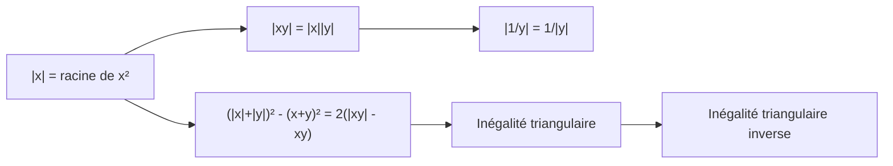

# Comprendre, utiliser, démontrer : valeur absolue

## 1. Pourquoi ces résultats sont vrais

!!! propriete "Propriété : L'idée directrice"
    La valeur absolue **mesure une distance** : $|a-b|$ est la distance entre $a$ et $b$ sur la droite. Presque tous les résultats se lisent alors comme des énoncés géométriques.

    - $|x|=|y|$ : $x$ et $y$ sont à la même distance de $0$ : ils sont égaux ou opposés.
    - $|x-c|\le r$ : $x$ est à distance au plus $r$ de $c$ : il est dans $[c-r\,;c+r]$.
    - Inégalité triangulaire : aller de $0$ à $x+y$ directement n'est jamais plus long que d'aller de $0$ à $x$ puis de $x$ à $x+y$.

!!! propriete "Propriété : Deux outils de démonstration"
    1. **Disjonction de cas** sur le signe de ce qui est dans la valeur absolue.
    2. **Passage au carré** : si $a,b\ge0$, alors $a\le b\iff a^2\le b^2$ et $|x|^2=x^2$.

## 2. Savoir quand l'utiliser

| Situation | Outil |
|---|---|
| Équation $\lvert u\rvert=\lvert v\rvert$ | $u=v$ ou $u=-v$ |
| Équation $\lvert u\rvert=a$ | vérifier $a\ge0$, puis $u=\pm a$ |
| Inéquation $\lvert u\rvert\le a$ | encadrement $-a\le u\le a$ |
| Inéquation $\lvert u\rvert\ge a$ | $u\le-a$ ou $u\ge a$ |
| Plusieurs valeurs absolues | tableau de signes, disjonction de cas |
| Majorer une somme ou un écart | inégalité triangulaire |
| Écrire $\sqrt{(\dots)^2}$ | $\sqrt{u^2}=\lvert u\rvert$ (jamais $u$ seul) |
| Étudier $\lvert f\rvert$ | signe de $f$ puis symétrie de la courbe |

## 3. Savoir démontrer (à refaire sans le cours)

!!! attention "Attention : Les cinq erreurs à ne plus jamais commettre"
    1. Écrire $|x+y|=|x|+|y|$.
    2. Écrire $\sqrt{x^2}=x$.
    3. Oublier que $|x|=a$ n'a pas de solution si $a<0$.
    4. Remplacer « ou » par « et » dans $|x|>a$.
    5. Garder une solution trouvée dans un cas **sans** vérifier qu'elle appartient à l'intervalle du cas.

!!! question "Exercice Auto-évaluation"
    Sans le cours : (1) démontrer $|xy|=|x||y|$ ; (2) démontrer l'inégalité triangulaire avec son cas d'égalité ; (3) résoudre $|x-1|+|x+2|\le5$ ; (4) tracer la courbe de $x\mapsto|x^2-2x|$.

    ??? success "Corrigé"
        Les trois premières démonstrations et la résolution sont dans les chapitres 02 et 03 ; si l'une d'elles n'est pas fluide, refaites-la jusqu'à pouvoir l'écrire en moins de cinq minutes.
