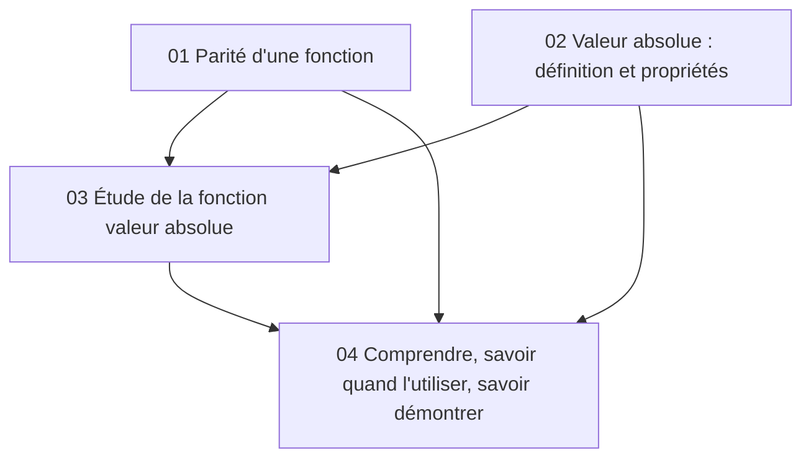

# Fonction valeur absolue

Ce thème regroupe trois chapitres et une synthèse.

| Chapitre | Contenu |
|---|---|
| [01 – Parité](01-parite.md) | Fonctions paires et impaires, symétries de la courbe |
| [02 – Valeur absolue](02-valeur-absolue-proprietes.md) | Définition, propriétés, équations et inéquations |
| [03 – La fonction valeur absolue](03-fonction-valeur-absolue.md) | Parité, variations, courbe, fonctions $\lvert f\rvert$ |
| [04 – Comprendre et démontrer](04-comprendre-et-demontrer.md) | Pourquoi c'est vrai, quand l'utiliser, comment le démontrer |
