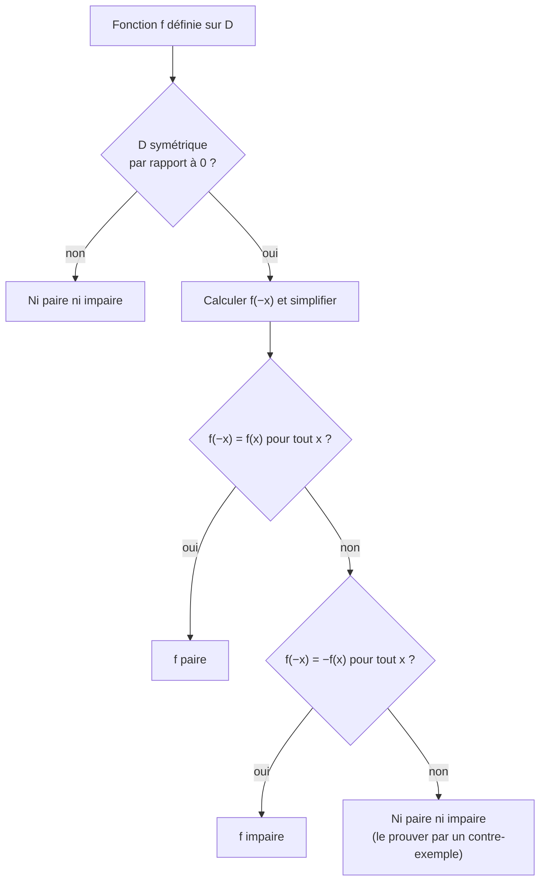

# Rappel : parité d'une fonction

## Objectifs pédagogiques et compétences

À la fin de ce chapitre, tu dois savoir :

- vérifier qu'un ensemble de définition est **symétrique par rapport à $0$** ;
- démontrer qu'une fonction est **paire**, **impaire**, ou **ni l'un ni l'autre** ;
- relier la parité à la **symétrie de la courbe** (axe des ordonnées ou origine) et le **démontrer** ;
- déterminer la parité d'une somme, d'un produit ou d'un quotient de fonctions ;
- utiliser la parité pour **réduire l'étude** d'une fonction à $[0\,;+\infty[$ ;
- compléter une courbe ou un tableau de valeurs grâce à la parité.

## Prérequis

- notion de fonction, ensemble de définition, image, antécédent ;
- calcul algébrique avec des signes ($(-x)^2$, $(-x)^3$, $\dfrac{1}{-x}$) ;
- repère orthonormé, symétries axiale et centrale ;
- polynômes et identification des coefficients (chapitre 7 du second degré).

---

## 1. Définitions

!!! info "Définition : ensemble symétrique par rapport à $0$"
    Une partie $D$ de $\mathbb R$ est **symétrique par rapport à $0$** si, pour tout réel $x\in D$, on a aussi $-x\in D$.

!!! example "Exemples"
    | Ensemble | Symétrique par rapport à $0$ ? |
    |---|---|
    | $\mathbb R$ | Oui |
    | $\mathbb R^*=\mathbb R\setminus\{0\}$ | Oui |
    | $[-3\,;3]$ | Oui |
    | $]-\infty\,;-1]\cup[1\,;+\infty[$ | Oui |
    | $[-2\,;3]$ | **Non** ($3\in D$ mais $-3\notin D$) |
    | $\mathbb R\setminus\{1\}$ | **Non** ($-1\in D$ mais $1\notin D$) |
    | $[0\,;+\infty[$ | **Non** |

!!! info "Définition : fonction paire, fonction impaire"
    Soit $f$ une fonction définie sur un ensemble $D$ **symétrique par rapport à $0$**.

    - $f$ est **paire** si, pour tout $x\in D$ : $\ f(-x)=f(x)$.
    - $f$ est **impaire** si, pour tout $x\in D$ : $\ f(-x)=-f(x)$.

!!! warning "Point d'attention : la condition sur $D$ fait partie de la définition"
    Avant de calculer $f(-x)$, il faut **toujours** vérifier que $D$ est symétrique par rapport à $0$. Si ce n'est pas le cas, la fonction n'est **ni paire ni impaire**, quelle que soit son expression.
    Exemple : $f(x)=x^2$ définie seulement sur $[-2\,;3]$ n'est pas paire.

!!! info "Vocabulaire"
    Les mots viennent des fonctions puissances : $x\mapsto x^n$ est **paire** si $n$ est pair ($(-x)^n=x^n$) et **impaire** si $n$ est impair ($(-x)^n=-x^n$).

---

## 2. Propriétés des courbes

!!! abstract "Propriété : symétrie de la courbe"
    Soit $f$ une fonction définie sur $D$ symétrique par rapport à $0$ et $\mathcal C_f$ sa courbe dans un repère **orthogonal**.

    - $f$ est **paire** $\iff$ $\mathcal C_f$ est **symétrique par rapport à l'axe des ordonnées**.
    - $f$ est **impaire** $\iff$ $\mathcal C_f$ est **symétrique par rapport à l'origine** $O$.

!!! abstract "Démonstration"
    Soit $M(x\,;f(x))$ un point de $\mathcal C_f$.

    **Cas pair** : le symétrique de $M$ par rapport à l'axe des ordonnées est $M'(-x\,;f(x))$. Si $f$ est paire, $f(-x)=f(x)$, donc $M'(-x\,;f(-x))$ est bien sur $\mathcal C_f$ : la courbe est globalement invariante par cette symétrie.
    Réciproquement, si $\mathcal C_f$ est symétrique par rapport à l'axe des ordonnées, $M'(-x\,;f(x))\in\mathcal C_f$ ; comme l'ordonnée du point d'abscisse $-x$ est $f(-x)$, on a $f(-x)=f(x)$.

    **Cas impair** : le symétrique de $M$ par rapport à $O$ est $M'(-x\,;-f(x))$. Si $f$ est impaire, $-f(x)=f(-x)$, donc $M'\in\mathcal C_f$. La réciproque est identique : $M'\in\mathcal C_f$ impose $f(-x)=-f(x)$. $\blacksquare$

!!! abstract "Propriété : valeur en $0$"
    Si $f$ est **impaire** et définie en $0$, alors $f(0)=0$ (la courbe passe par l'origine).

!!! abstract "Démonstration"
    $f(-0)=-f(0)$ s'écrit $f(0)=-f(0)$, donc $2f(0)=0$ et $f(0)=0$. $\blacksquare$

!!! warning "Points d'attention"
    - **La réciproque est fausse** : $f(0)=0$ ne prouve pas que $f$ est impaire ($f(x)=x^2+x$ vérifie $f(0)=0$ et n'est pas impaire).
    - Si $f$ est impaire et **non définie** en $0$ (par exemple $\frac1x$), on ne peut rien dire sur $f(0)$.
    - Une fonction **paire** peut valoir n'importe quoi en $0$ : $f(0)=f(-0)$ est vrai sans information.
    - La symétrie par rapport à l'origine ou à l'axe des ordonnées exige un repère **orthogonal** (les deux axes sont perpendiculaires).

---

## 3. Parité et opérations

!!! abstract "Propriété : opérations sur les fonctions de parité connue"
    Soient $f$ et $g$ définies sur un même ensemble $D$ symétrique par rapport à $0$, et $k$ un réel.

    | Opération | $f$, $g$ paires | $f$, $g$ impaires | $f$ paire, $g$ impaire |
    |---|---|---|---|
    | $f+g$ | paire | impaire | en général **ni l'une ni l'autre** |
    | $k\,f$ | paire | impaire | |
    | $f\times g$ | paire | **paire** | **impaire** |
    | $\dfrac fg$ (si $g\neq0$) | paire | **paire** | **impaire** |

!!! abstract "Démonstration (produit et somme)"
    - **Produit, impaire × impaire** : $(fg)(-x)=f(-x)\,g(-x)=(-f(x))(-g(x))=f(x)g(x)=(fg)(x)$ : paire.
    - **Produit, paire × impaire** : $(fg)(-x)=f(x)\times(-g(x))=-(fg)(x)$ : impaire.
    - **Somme, impaires** : $(f+g)(-x)=-f(x)-g(x)=-(f+g)(x)$ : impaire.
    - **Somme, paire + impaire** : supposons $f$ paire, $g$ impaire et $f+g$ paire. Alors $g=(f+g)-f$ est paire, donc $g$ est à la fois paire et impaire : $g(x)=g(-x)=-g(x)$, soit $g=0$. Ainsi, si $g$ n'est pas la fonction nulle, $f+g$ n'est pas paire (et symétriquement pas impaire). $\blacksquare$

!!! abstract "Propriété : cas des polynômes"
    Un polynôme $P(x)=a_nx^n+\dots+a_1x+a_0$ est **pair** si et seulement si tous ses coefficients de **degré impair** sont nuls, et **impair** si et seulement si tous ses coefficients de **degré pair** sont nuls.

!!! abstract "Démonstration"
    $P(-x)=\sum a_k(-1)^kx^k$. Par identification des coefficients, $P(-x)=P(x)$ pour tout $x$ équivaut à $a_k(-1)^k=a_k$ pour tout $k$, c'est-à-dire $a_k=0$ quand $k$ est impair. Même raisonnement avec $P(-x)=-P(x)$ : $a_k(-1)^k=-a_k$, donc $a_k=0$ quand $k$ est pair. $\blacksquare$

---

## 4. Méthodes à maîtriser

!!! tip "Méthode 1 : étudier la parité"
    1. Déterminer $D$ et vérifier la symétrie de $D$.
    2. Calculer $f(-x)$ : remplacer **chaque** $x$ par $(-x)$ **entre parenthèses**.
    3. Comparer avec $f(x)$ et $-f(x)$.
    4. Pour prouver « ni paire ni impaire », exhiber **un** réel $x_0$ tel que $f(-x_0)\neq f(x_0)$ **et** $f(-x_0)\neq-f(x_0)$ (contre-exemple).

!!! tip "Méthode 2 : réduire l'étude"
    - $f$ **paire** : on étudie sur $D\cap[0\,;+\infty[$, puis on complète par symétrie par rapport à l'axe des ordonnées. Les variations sont **inversées** de part et d'autre de $0$ : si $f$ est croissante sur $[a\,;b]\subset[0\,;+\infty[$, elle est décroissante sur $[-b\,;-a]$.
    - $f$ **impaire** : on étudie sur $D\cap[0\,;+\infty[$, puis on complète par symétrie par rapport à l'origine. Les variations sont **conservées** : croissante sur $[a\,;b]$ implique croissante sur $[-b\,;-a]$.

!!! warning "Points d'attention : erreurs fréquentes"
    - **Oublier de tester le domaine** (cas $\frac1{x-1}$, $\sqrt x$, fonctions définies sur un intervalle non symétrique).
    - **Mal remplacer** : $(-x)^2=x^2$ mais $-x^2\ne(-x)^2$ ; $f(x)=x^2-x$ donne $f(-x)=x^2+x$ (et non $-x^2+x$).
    - **Conclure « impaire » parce que $f(0)=0$.**
    - **Conclure « ni paire ni impaire » sans contre-exemple** quand le calcul algébrique est confus : tester une valeur précise (par exemple $x=1$ et $x=-1$).
    - **Penser qu'une fonction est forcément l'un ou l'autre** : la plupart ne sont ni paires ni impaires (par exemple $x^2+x$, $x^3+1$).
    - **Somme d'une paire et d'une impaire** : en général ni paire ni impaire.
    - **Seule la fonction nulle** est à la fois paire et impaire.

---

## 5. Exemples corrigés

!!! example "Exemple 1 : fonction paire, $f(x)=x^4-3x^2+1$"
    $D=\mathbb R$, symétrique. $f(-x)=(-x)^4-3(-x)^2+1=x^4-3x^2+1=f(x)$ : **paire**.

!!! example "Exemple 2 : fonction impaire, $g(x)=\dfrac{x}{x^2+1}$"
    $D=\mathbb R$ (car $x^2+1>0$). $g(-x)=\dfrac{-x}{(-x)^2+1}=-\dfrac{x}{x^2+1}=-g(x)$ : **impaire**. Vérification : $g(0)=0$ ✔.

!!! example "Exemple 3 : ni paire ni impaire, $h(x)=x^2+x$"
    $D=\mathbb R$. $h(1)=2$ et $h(-1)=0$. On a $h(-1)\neq h(1)$ (donc pas paire) et $h(-1)\neq-h(1)=-2$ (donc pas impaire). **Contre-exemple en $x_0=1$.**

!!! example "Exemple 4 : le domaine empêche la parité, $k(x)=\dfrac{x^2}{x-1}$"
    $D=\mathbb R\setminus\{1\}$. Le réel $-1$ est dans $D$, mais pas $1$ : $D$ n'est pas symétrique par rapport à $0$. $k$ est **ni paire ni impaire**, sans calcul supplémentaire.

!!! example "Exemple 5 : domaine non évident, $m(x)=\sqrt{x^2-4}$"
    $x^2-4\ge0\iff x\le-2$ ou $x\ge2$ : $D=]-\infty\,;-2]\cup[2\,;+\infty[$, symétrique. $m(-x)=\sqrt{(-x)^2-4}=\sqrt{x^2-4}=m(x)$ : **paire**.

---

## 6. Exercices progressifs

### Exercice 1 : étudier la parité

Étudier la parité de : $A(x)=3x^4-x^2+5$ ; $B(x)=x^5-2x^3+x$ ; $C(x)=x^2+2x$ ; $D(x)=\dfrac{x^3}{x^2+1}$ ; $E(x)=\dfrac{1}{x-2}$.

??? success "Corrigé"
    - $A$ : $D=\mathbb R$, uniquement des puissances paires : $A(-x)=A(x)$, **paire**.
    - $B$ : $B(-x)=-x^5+2x^3-x=-B(x)$, **impaire**.
    - $C$ : $C(1)=3$ et $C(-1)=-1$ : ni égal à $3$ ni à $-3$. **Ni paire ni impaire.**
    - $D$ : $D=\mathbb R$. $D(-x)=\dfrac{-x^3}{x^2+1}=-D(x)$, **impaire** (quotient impair/pair).
    - $E$ : $D=\mathbb R\setminus\{2\}$ : $-2\in D$ mais $2\notin D$. **Ni paire ni impaire.**

    **Piège** : $E$ ressemble à la fonction inverse (impaire), mais le décalage détruit la symétrie du domaine.

### Exercice 2 : ensemble de définition d'abord

Étudier la parité de : $f(x)=\sqrt{x+1}$ ; $g(x)=\sqrt{1-x^2}$ ; $h(x)=\dfrac{1}{x^2-4}$.

??? success "Corrigé"
    - $f$ : $D=[-1\,;+\infty[$ : $1\in D$ mais $-1\in D$ ; vérifions $2\in D$ et $-2\notin D$. $D$ n'est pas symétrique : **ni paire ni impaire**.
    - $g$ : $1-x^2\ge0\iff x\in[-1\,;1]$, symétrique. $g(-x)=\sqrt{1-x^2}=g(x)$ : **paire**.
    - $h$ : $D=\mathbb R\setminus\{-2\,;2\}$, symétrique. $h(-x)=\dfrac1{x^2-4}=h(x)$ : **paire**.

### Exercice 3 : compléter grâce à la parité

1. $f$ est paire avec $f(2)=3$ et $f(-5)=1$. Donner $f(-2)$ et $f(5)$.
2. $g$ est impaire avec $g(2)=3$ et $g(-5)=1$. Donner $g(-2)$, $g(5)$, et $g(0)$ si $g$ est définie en $0$.

??? success "Corrigé"
    1. $f(-2)=f(2)=3$ et $f(5)=f(-5)=1$.
    2. $g(-2)=-g(2)=-3$ ; $g(5)=-g(-5)=-1$ ; $g(0)=0$.

### Exercice 4 : parité d'un trinôme

Soit $f(x)=ax^2+bx+c$ avec $a\neq0$. Pour quelles valeurs de $b$ et $c$ la fonction $f$ est-elle paire ? Peut-elle être impaire ?

??? success "Corrigé"
    $f(-x)=ax^2-bx+c$.

    - **Paire** : $f(-x)=f(x)$ pour tout $x\iff-bx=bx$ pour tout $x\iff2bx=0$ pour tout $x\iff b=0$. $c$ est libre.
    - **Impaire** : $f(-x)=-f(x)\iff ax^2-bx+c=-ax^2-bx-c\iff2ax^2+2c=0$ pour tout $x$. En $x=0$ : $c=0$, puis $2ax^2=0$ pour tout $x$ impose $a=0$ : contradiction. **Jamais impaire.**

    **Lien avec le cours** : $b=0$ équivaut à $\alpha=-\frac b{2a}=0$ : l'axe de symétrie de la parabole est l'axe des ordonnées.

### Exercice 5 : opérations

Soit $f$ paire et $g$ impaire, définies sur $\mathbb R$. Déterminer la parité de $f\times g$, de $f^2$, de $g^2$ et de $f\times g^3$.

??? success "Corrigé"
    - $f\times g$ : paire × impaire = **impaire**.
    - $f^2=f\times f$ : paire × paire = **paire**.
    - $g^2=g\times g$ : impaire × impaire = **paire**.
    - $g^3=g^2\times g$ : paire × impaire = impaire ; puis $f\times g^3$ : paire × impaire = **impaire**.

    **Piège** : le carré d'une fonction est **toujours** pair, même si la fonction est impaire.

### Exercice 6 : réduire l'étude

Soit $f(x)=x^4-2x^2$.

1. Montrer que $f$ est paire.
2. Étudier les variations de $f$ sur $[0\,;+\infty[$ à l'aide de $f(x)=(x^2-1)^2-1$.
3. En déduire le tableau de variations sur $\mathbb R$ et les racines de $f$.

??? success "Corrigé"
    1. $D=\mathbb R$ et $f(-x)=x^4-2x^2=f(x)$ : **paire**.
    2. Posons $u(x)=x^2-1$. Sur $[0\,;+\infty[$, $u$ est strictement croissante.
       - Sur $[0\,;1]$ : $u$ varie dans $[-1\,;0]$ où la fonction carré est décroissante ; la composée $f=u^2-1$ est **décroissante** (une croissante suivie d'une décroissante).
       - Sur $[1\,;+\infty[$ : $u\ge0$, carré croissant : $f$ est **croissante**.
       Minimum en $x=1$ : $f(1)=-1$ ; $f(0)=0$.
    3. Par symétrie par rapport à l'axe des ordonnées (variations **inversées**) :

       | $x$ | $-\infty$ | | $-1$ | | $0$ | | $1$ | | $+\infty$ |
       |---|---|---|---|---|---|---|---|---|---|
       | $f(x)$ | | $\searrow$ | $-1$ | $\nearrow$ | $0$ | $\searrow$ | $-1$ | $\nearrow$ | |

       Racines : $x^2(x^2-2)=0\iff x\in\{-\sqrt2\,;0\,;\sqrt2\}$.

---

## 7. Exercices type contrôle

### Exercice A : étude complète

Soit $f(x)=\dfrac{x^2-4}{x^2+1}$.

1. Donner l'ensemble de définition et étudier la parité de $f$.
2. Vérifier que $f(x)=1-\dfrac5{x^2+1}$, puis étudier les variations de $f$ sur $[0\,;+\infty[$.
3. En déduire les variations sur $\mathbb R$, et montrer que $-4\le f(x)<1$ pour tout réel $x$.
4. Résoudre $f(x)=-1$.

??? success "Corrigé"
    1. $x^2+1\ge1>0$ : $D=\mathbb R$. $f(-x)=\dfrac{x^2-4}{x^2+1}=f(x)$ : **paire**.
    2. $1-\dfrac5{x^2+1}=\dfrac{x^2+1-5}{x^2+1}=\dfrac{x^2-4}{x^2+1}$ ✔.
       Sur $[0\,;+\infty[$, $x^2+1$ est croissante et strictement positive, donc $\dfrac5{x^2+1}$ est **décroissante**, et $f=1-\dfrac5{x^2+1}$ est **croissante**.
    3. Par parité : $f$ décroissante sur $]-\infty\,;0]$, croissante sur $[0\,;+\infty[$, minimum $f(0)=-4$. Donc $f(x)\ge-4$.
       De plus $\dfrac5{x^2+1}>0$, donc $f(x)<1$ pour tout $x$. D'où $-4\le f(x)<1$.
    4. $1-\dfrac5{x^2+1}=-1\iff\dfrac5{x^2+1}=2\iff x^2+1=\dfrac52\iff x^2=\dfrac32$, soit $x=\pm\sqrt{\tfrac32}=\pm\dfrac{\sqrt6}2$.

    **Point d'attention** : $1$ n'est **jamais atteint** (borne exclue) alors que $-4$ l'est (borne incluse).

### Exercice B : trouver les erreurs

Un élève écrit : (1) « $f(x)=x^3+1$ est impaire car $x^3$ est impaire » ; (2) « $g(x)=\dfrac1{x-1}$ est impaire car la fonction inverse l'est ». Corriger.

??? success "Corrigé"
    1. $f(1)=2$ et $f(-1)=0$ : $f(-1)\neq f(1)$ et $f(-1)\neq-f(1)$. La fonction $f$ est **ni paire ni impaire**. La constante $1$ est une fonction paire non nulle : somme d'une impaire et d'une paire non nulle (voir la propriété sur la somme). De plus $f(0)=1\neq0$, ce qui contredit l'imparité.
    2. $D=\mathbb R\setminus\{1\}$ n'est pas symétrique ($-1\in D$, $1\notin D$) : **ni paire ni impaire**.

### Exercice C : démonstration

Soit $f$ une fonction impaire définie sur $\mathbb R$. Montrer que sa courbe est symétrique par rapport à l'origine, c'est-à-dire que le milieu de $M(x\,;f(x))$ et de $M'(-x\,;f(-x))$ est $O$.

??? success "Corrigé"
    Le milieu de $[MM']$ a pour coordonnées $\left(\dfrac{x+(-x)}2\,;\dfrac{f(x)+f(-x)}2\right)=\left(0\,;\dfrac{f(x)-f(x)}2\right)=(0\,;0)$ car $f(-x)=-f(x)$. Donc $O$ est le milieu de $[MM']$ pour tout $x$ : la courbe est symétrique par rapport à $O$. $\blacksquare$

### Exercice D : décomposition en partie paire et impaire (haut niveau)

Soit $f$ définie sur $\mathbb R$.

1. On pose $p(x)=\dfrac{f(x)+f(-x)}2$ et $i(x)=\dfrac{f(x)-f(-x)}2$. Montrer que $p$ est paire, $i$ impaire et $f=p+i$.
2. Montrer que cette décomposition est **unique**.
3. Déterminer $p$ et $i$ pour $f(x)=(x+1)^3$.

??? success "Corrigé"
    1. $p(-x)=\dfrac{f(-x)+f(x)}2=p(x)$ : paire. $i(-x)=\dfrac{f(-x)-f(x)}2=-i(x)$ : impaire. $p(x)+i(x)=\dfrac{2f(x)}2=f(x)$ ✔.
    2. Si $f=p+i=p'+i'$ avec $p,p'$ paires et $i,i'$ impaires, alors $h=p-p'=i'-i$. Le premier membre est pair, le second impair : $h(-x)=h(x)$ et $h(-x)=-h(x)$, donc $h=0$. Ainsi $p=p'$ et $i=i'$.
    3. $f(x)=x^3+3x^2+3x+1$. Les termes de degré pair forment la partie paire, ceux de degré impair la partie impaire :
       $p(x)=3x^2+1$ et $i(x)=x^3+3x$.
       Vérification avec la formule : $f(-x)=(1-x)^3=1-3x+3x^2-x^3$, donc $\frac{f(x)+f(-x)}2=\frac{2+6x^2}2=1+3x^2$ ✔.

    **Pièges** : la formule de $i$ et de $p$ marche pour **toute** fonction définie sur un ensemble symétrique ; l'unicité repose sur le fait que la **seule** fonction à la fois paire et impaire est la fonction nulle.

---

## 8. Synthèse et fiche de révision

!!! abstract "Fiche de révision"
    | À retenir | Résultat |
    |---|---|
    | Ensemble symétrique | $x\in D\Rightarrow-x\in D$ |
    | Paire | $f(-x)=f(x)$ ; courbe symétrique par rapport à l'axe des **ordonnées** |
    | Impaire | $f(-x)=-f(x)$ ; courbe symétrique par rapport à l'**origine** |
    | Impaire définie en $0$ | $f(0)=0$ |
    | Paire × impaire | impaire |
    | Impaire × impaire | **paire** |
    | Paire + impaire | en général ni l'une ni l'autre |
    | Polynôme pair | uniquement des degrés pairs |
    | Polynôme impair | uniquement des degrés impairs |
    | Variations d'une fonction paire | **inversées** de part et d'autre de $0$ |
    | Variations d'une fonction impaire | **conservées** |
    | Ni paire ni impaire | contre-exemple, ou domaine non symétrique |

    **Réflexes** : domaine d'abord ; $f(-x)$ avec des parenthèses ; contre-exemple chiffré ; réduire l'étude à $[0\,;+\infty[$.

---

## 9. Comprendre, savoir quand l'utiliser, savoir démontrer

!!! tip "Pourquoi les résultats sont vrais"
    Remplacer $x$ par $-x$, c'est regarder le point **symétrique** de $x$ par rapport à $0$ sur l'axe des abscisses. Si l'image ne change pas, le point $(x\,;f(x))$ et le point $(-x\,;f(x))$ sont deux points de la courbe symétriques par rapport à l'axe vertical : c'est la parité. Si l'image change de signe, les deux points sont symétriques par rapport à l'origine : c'est l'imparité. Les règles du produit sont des règles de signes : deux « $-$ » donnent un « $+$ ». Enfin, une fonction ne peut être à la fois paire et impaire que si $f(x)=-f(x)$, c'est-à-dire $f=0$.

!!! tip "Quand l'utiliser"
    - **Réduire** une étude de fonction de moitié (tableau, courbe).
    - **Compléter** un graphe ou un tableau de valeurs.
    - **Simplifier** un calcul : par exemple, résoudre $f(x)=k$ revient à trouver les solutions positives, puis leurs opposées.
    - **Contrôler** un résultat : une fonction trouvée impaire doit s'annuler en $0$.
    - Au chapitre suivant, la **fonction valeur absolue** est un exemple fondamental de fonction paire.

!!! tip "Savoir le démontrer (checklist)"
    1. Vérifier que $D$ est symétrique par rapport à $0$.
    2. Calculer $f(-x)$ et le comparer à $f(x)$, puis à $-f(x)$.
    3. Symétrie de la courbe : écrire le symétrique d'un point générique $M(x\,;f(x))$ et utiliser la définition.
    4. Pour « ni paire ni impaire » : un seul contre-exemple valable pour **les deux** égalités.
    5. Pour une somme paire + impaire : si elle était paire, la composante impaire serait aussi paire, donc nulle.