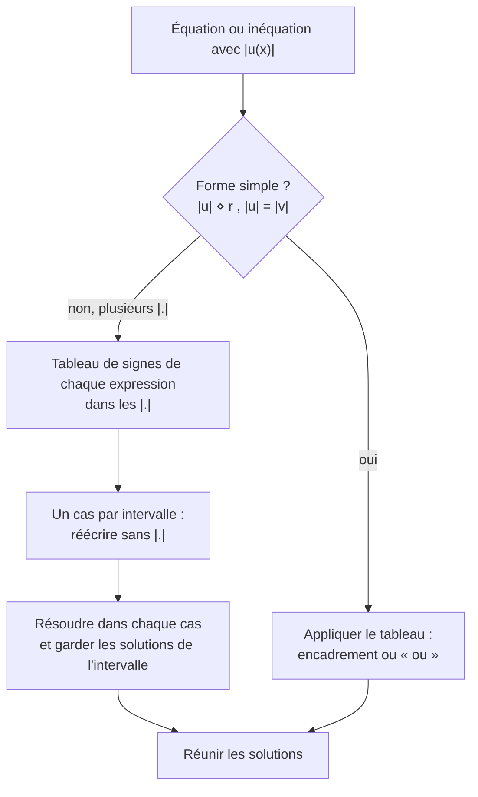

# La fonction valeur absolue

## Objectifs pédagogiques et compétences

À la fin de ce chapitre, tu dois savoir :

- définir la valeur absolue d'un réel, par disjonction de cas et comme **distance** ;
- énoncer et **démontrer** ses propriétés (nullité, produit, quotient, puissance, inégalité triangulaire) ;
- écrire une expression avec valeur absolue **sans valeur absolue**, par disjonction de cas ;
- résoudre équations et inéquations du type $|x-a|=r$, $|x-a|\le r$, $|x-a|\ge r$, $|u|=|v|$ ;
- étudier la fonction $x\mapsto|x|$ : parité, variations, courbe ;
- tracer la courbe de $|f|$ à partir de celle de $f$.

## Prérequis

- parité d'une fonction (chapitre précédent) ;
- signe d'une expression affine et d'un trinôme (chapitre 3 du second degré) ;
- $\sqrt{x^2}$ et $(\sqrt a)^2=a$ pour $a\ge0$ ;
- intervalles, réunion et intersection ;
- variations de la fonction carré.

---

## 1. Rappels : définition et propriétés

### 1.1 Définition

!!! info "Définition : valeur absolue"
    La **valeur absolue** d'un réel $x$, notée $|x|$, est définie par
    $$|x|=\begin{cases}x&\text{si }x\ge0,\\-x&\text{si }x\le0.\end{cases}$$
    (Pour $x=0$, les deux lignes donnent $0$ : pas de contradiction.)

!!! info "Interprétation : distance"
    Sur une droite graduée, $|x|$ est la **distance** entre $x$ et $0$. Plus généralement, $|x-y|$ est la **distance** entre les réels $x$ et $y$.

!!! abstract "Propriété : lien avec la racine carrée"
    Pour tout réel $x$ : $\ |x|=\sqrt{x^2}$ et $|x|^2=x^2$.

!!! abstract "Démonstration"
    Si $x\ge0$ : $\sqrt{x^2}=x=|x|$. Si $x\le0$ : $-x\ge0$ et $(-x)^2=x^2$, donc $\sqrt{x^2}=-x=|x|$. $\blacksquare$

!!! warning "Points d'attention : définition"
    - $-x$ n'est **pas** forcément négatif : si $x=-3$, alors $|x|=-x=3$.
    - **$\sqrt{x^2}=x$ est faux** en général : $\sqrt{(-3)^2}=3$. La bonne égalité est $\sqrt{x^2}=|x|$.
    - $|x|\ge0$ toujours. Une valeur absolue **n'est jamais négative**.

!!! example "Exemples"
    - $|-5|=5$ ; $|0|=0$ ; $|7|=7$.
    - $|3-\pi|=\pi-3$ car $\pi>3$, donc $3-\pi<0$.
    - $|\sqrt2-2|=2-\sqrt2$ car $\sqrt2<2$.
    - $|a^2+1|=a^2+1$ (toujours positif).

### 1.2 Propriétés

!!! abstract "Propriété : opérations sur les valeurs absolues"
    Pour tous réels $x$ et $y$ :

    | Propriété | Énoncé |
    |---|---|
    | Positivité et nullité | $|x|\ge0$ ; $\ |x|=0\iff x=0$ |
    | Égalité de deux valeurs absolues | $|x|=|y|\iff x=y\ \text{ou}\ x=-y$ |
    | Opposé | $|-x|=|x|$ |
    | Encadrement | $-|x|\le x\le|x|$ |
    | Produit | $|xy|=|x|\,|y|$ |
    | Inverse | $\left|\dfrac1y\right|=\dfrac1{|y|}$ ($y\neq0$) |
    | Quotient | $\left|\dfrac xy\right|=\dfrac{|x|}{|y|}$ ($y\neq0$) |
    | Puissance | $|x^n|=|x|^n$ ($n\in\mathbb N$) |
    | **Inégalité triangulaire** | $|x+y|\le|x|+|y|$, avec égalité $\iff xy\ge0$ |

!!! abstract "Démonstrations"
    - **Nullité** : $|x|=\sqrt{x^2}=0\iff x^2=0\iff x=0$.
    - **Égalité** : $|x|=|y|\iff|x|^2=|y|^2$ (deux nombres positifs sont égaux si et seulement si leurs carrés le sont) $\iff x^2=y^2\iff(x-y)(x+y)=0\iff x=y$ ou $x=-y$.
    - **Opposé** : $|-x|=\sqrt{(-x)^2}=\sqrt{x^2}=|x|$.
    - **Encadrement** : si $x\ge0$, $x=|x|\ge-|x|$ ; si $x\le0$, $x=-|x|\le|x|$.
    - **Produit** : $|xy|=\sqrt{x^2y^2}=\sqrt{x^2}\sqrt{y^2}=|x||y|$.
    - **Inverse et quotient** : $|y|\left|\frac1y\right|=\left|y\cdot\frac1y\right|=1$, d'où $\left|\frac1y\right|=\frac1{|y|}$ ; puis $\left|\frac xy\right|=\left|x\cdot\frac1y\right|=|x|\cdot\frac1{|y|}$.
    - **Puissance** : par applications répétées de la propriété du produit (récurrence sur $n$) : $|x^n|=|x|^n$.
    - **Inégalité triangulaire** : les deux membres sont positifs, on compare leurs carrés.
      $$(|x|+|y|)^2-|x+y|^2=x^2+2|x||y|+y^2-(x^2+2xy+y^2)=2\left(|xy|-xy\right)\ge0$$
      car $xy\le|xy|$. Donc $|x+y|\le|x|+|y|$. L'égalité a lieu $\iff|xy|=xy\iff xy\ge0$ ($x$ et $y$ de même signe, ou l'un nul). $\blacksquare$

!!! abstract "Propriété (complément) : inégalité triangulaire inversée"
    Pour tous réels $x,y$ : $\ \big||x|-|y|\big|\le|x-y|$ (démonstration à l'exercice C).

!!! warning "Points d'attention : erreurs fréquentes"
    - **$|x+y|=|x|+|y|$ est faux en général** : $|1+(-1)|=0$ mais $|1|+|-1|=2$.
    - **$|x-y|\ne|x|-|y|$** en général ; la bonne relation est $|x-y|\ge\big||x|-|y|\big|$.
    - **$|x^n|=|x|^n$** mais $|x|^n\ne x^n$ si $n$ est impair et $x<0$.
    - **Pas de règle simple pour $|x+y|$** : on ne « distribue » pas la valeur absolue sur une somme.
    - **$|-x|=|x|$** mais $-|x|\neq|x|$ sauf si $x=0$.

---

## 2. Équations et inéquations

!!! abstract "Propriété : résolution (avec $a$ réel et $r$ réel)"
    | Équation / inéquation | Si $r>0$ | Si $r=0$ | Si $r<0$ |
    |---|---|---|---|
    | $\lvert x-a\rvert=r$ | $\{a-r\,;a+r\}$ | $\{a\}$ | $\varnothing$ |
    | $\lvert x-a\rvert\le r$ | $[a-r\,;a+r]$ | $\{a\}$ | $\varnothing$ |
    | $\lvert x-a\rvert<r$ | $]a-r\,;a+r[$ | $\varnothing$ | $\varnothing$ |
    | $\lvert x-a\rvert\ge r$ | $]-\infty\,;a-r]\cup[a+r\,;+\infty[$ | $\mathbb R$ | $\mathbb R$ |
    | $\lvert x-a\rvert>r$ | $]-\infty\,;a-r[\cup]a+r\,;+\infty[$ | $\mathbb R\setminus\{a\}$ | $\mathbb R$ |

    Interprétation : $|x-a|\le r$ signifie « **$x$ est à une distance de $a$ au plus $r$** », c'est-à-dire $x\in[a-r\,;a+r]$ (intervalle de **centre $a$** et de **rayon $r$**).

!!! abstract "Démonstration (cas $r>0$, inégalité large)"
    $|x-a|\le r\iff|x-a|^2\le r^2\iff(x-a)^2\le r^2$ (deux nombres positifs sont dans le même ordre que leurs carrés). C'est l'inéquation $X^2\le r^2$ du chapitre 3, de solutions $-r\le X\le r$ : $-r\le x-a\le r\iff a-r\le x\le a+r$. $\blacksquare$

!!! tip "Méthode 1 : disjonction de cas"
    1. Repérer les valeurs de $x$ qui annulent chaque expression dans une valeur absolue.
    2. Dresser un **tableau de signes** ; en déduire les intervalles.
    3. Sur chaque intervalle, réécrire l'expression **sans valeur absolue**.
    4. Résoudre sur chaque intervalle et **ne garder que les solutions appartenant à cet intervalle**.
    5. **Réunir** les solutions.

!!! tip "Méthode 2 : $|u|=|v|$"
    $|u|=|v|\iff u=v$ ou $u=-v$. On résout les deux équations et on **réunit** les solutions.

!!! tip "Méthode 3 : $|u|=v$ avec $v$ expression"
    Il faut d'abord $v\ge0$ (condition d'existence). Ensuite $|u|=v\iff u=v$ ou $u=-v$. On **vérifie** les solutions dans la condition $v\ge0$.

!!! warning "Points d'attention : résolution"
    - **« et » ou « ou »** : $|x-2|\le3$ donne $x\ge-1$ **et** $x\le5$ (intersection, un intervalle). $|x-2|\ge3$ donne $x\le-1$ **ou** $x\ge5$ (réunion).
    - **Second membre négatif** : $|u|=-2$ n'a **aucune** solution ; $|u|\ge-2$ est **toujours** vrai ; $|u|\le-2$ n'a aucune solution.
    - **Oublier de vérifier** les solutions dans l'intervalle du cas traité.
    - **Équation $|u|=v$** : écarter les solutions pour lesquelles $v<0$.
    - **Bornes** : $\le$ et $\ge$ donnent des crochets fermés ; $<$ et $>$ des crochets ouverts.

---

## 3. Étude de la fonction valeur absolue

!!! abstract "Propriété : la fonction $x\mapsto|x|$"
    Soit $f(x)=|x|$, définie sur $\mathbb R$.

    1. $f$ est **paire**.
    2. $f$ est **décroissante** sur $]-\infty\,;0]$ et **croissante** sur $[0\,;+\infty[$.
    3. $f$ admet un **minimum** $0$, atteint **uniquement** en $x=0$.
    4. Sa courbe $\mathcal C_f$ est la réunion de deux **demi-droites** : $y=x$ pour $x\ge0$ (première bissectrice) et $y=-x$ pour $x\le0$. Elle a la forme d'un « **V** » de sommet $O$, symétrique par rapport à l'axe des ordonnées.

    | $x$ | $-\infty$ | | $0$ | | $+\infty$ |
    |---|---|---|---|---|---|
    | $\lvert x\rvert$ | | $\searrow$ | $0$ | $\nearrow$ | |

!!! abstract "Démonstration"
    1. $D=\mathbb R$ est symétrique et $|-x|=|x|$ : $f$ est paire.
    2. Sur $[0\,;+\infty[$, $f(x)=x$ est croissante. Par parité, les variations sont **inversées** sur $]-\infty\,;0]$ : $f$ y est décroissante. (Directement : si $x<y\le0$, alors $-x>-y\ge0$, donc $f(x)=-x>-y=f(y)$.)
    3. $|x|\ge0=|0|$ pour tout $x$, avec égalité $\iff x=0$.
    4. Découle de la définition par disjonction de cas. La courbe est bien symétrique par rapport à l'axe des ordonnées (parité). $\blacksquare$

!!! warning "Point d'attention"
    La courbe a un **point anguleux** en $O$ (le V n'est pas arrondi comme une parabole). À la différence de la parabole de $x^2$, il n'existe pas de tangente unique en $O$ (hors programme de 1ère, mais à bien visualiser). De plus, $|x|\ne x^2$ : par exemple $|0{,}5|=0{,}5>0{,}25=0{,}5^2$.

### 3.1 Courbe de $|f|$

!!! tip "Méthode : tracer la courbe de $x\mapsto|f(x)|$ à partir de celle de $f$"
    Par définition, $|f(x)|=f(x)$ si $f(x)\ge0$ et $-f(x)$ si $f(x)\le0$. Donc :

    - là où $\mathcal C_f$ est **au-dessus (ou sur)** l'axe des abscisses, on **garde** la courbe ;
    - là où $\mathcal C_f$ est **en dessous** de l'axe des abscisses, on la remplace par sa **symétrique par rapport à l'axe des abscisses**.

    La courbe de $|f|$ est donc **toujours au-dessus (ou sur)** l'axe des abscisses. Les variations changent aux points où $f$ s'annule en changeant de signe (« pointes »).

---

## 4. Exemples corrigés

!!! example "Exemple 1 : disjonction de cas, $|2x-4|$"
    $2x-4\ge0\iff x\ge2$. Donc $|2x-4|=2x-4$ si $x\ge2$ et $|2x-4|=4-2x$ si $x\le2$.

!!! example "Exemple 2 : $|2x-1|=5$"
    $2x-1=5$ ou $2x-1=-5$, soit $x=3$ ou $x=-2$. $S=\{-2\,;3\}$.
    Interprétation : $|2x-1|=2\left|x-\frac12\right|=5\iff\left|x-\frac12\right|=\frac52$ : les points à distance $\frac52$ de $\frac12$ sont $-2$ et $3$ ✔.

!!! example "Exemple 3 : $|x+3|=|2x-1|$"
    $x+3=2x-1\iff x=4$ ou $x+3=-(2x-1)\iff3x=-2\iff x=-\frac23$. $S=\left\{-\frac23\,;4\right\}$.
    Vérification : $|4+3|=7=|8-1|$ ✔ ; $\left|\frac73\right|=\frac73$ et $\left|-\frac43-1\right|=\frac73$ ✔.

!!! example "Exemple 4 : $|x-3|=2x$ (second membre variable)"
    Condition : $2x\ge0$, donc $x\ge0$.
    - $x-3=2x\iff x=-3$ : **rejeté** ($-3<0$).
    - $x-3=-2x\iff3x=3\iff x=1$ : accepté.

    $S=\{1\}$. Vérification : $|1-3|=2=2\times1$ ✔.

!!! example "Exemple 5 : $|x-4|\le3$ et $|x-4|\ge3$"
    $|x-4|\le3\iff x\in[1\,;7]$ ; $|x-4|\ge3\iff x\in]-\infty\,;1]\cup[7\,;+\infty[$.

!!! example "Exemple 6 : $x^2-3|x|+2=0$"
    On utilise $x^2=|x|^2$ et on pose $X=|x|\ge0$ : $X^2-3X+2=0$, $\Delta=1$, $X=1$ ou $X=2$ (toutes deux positives). Donc $|x|=1$ ou $|x|=2$ : $S=\{-2\,;-1\,;1\,;2\}$.

!!! example "Exemple 7 : courbe de $|x-2|$"
    $f(x)=x-2$ est une droite coupant l'axe en $x=2$. La partie sous l'axe ($x<2$) est symétrisée : on obtient un « V » de sommet $(2\,;0)$. $|x-2|=x-2$ pour $x\ge2$ et $2-x$ pour $x\le2$.

---

## 5. Exercices progressifs

### Exercice 1 : calculs

Calculer sans valeur absolue : $|-7|$, $|5-8|$, $|\sqrt3-2|$, $|\pi-4|$, $\big||{-3}|-|2|\big|$ et $|{-3}+2|$. Comparer $|{-3}+2|$ et $|{-3}|+|2|$.

??? success "Corrigé"
    $|-7|=7$ ; $|5-8|=3$ ; $|\sqrt3-2|=2-\sqrt3$ ; $|\pi-4|=4-\pi$ ; $\big||{-3}|-|2|\big|=|3-2|=1$ ; $|{-3}+2|=1$.
    $|{-3}+2|=1<5=|{-3}|+|2|$ : inégalité triangulaire **stricte**, car $(-3)\times2<0$ (signes contraires).

### Exercice 2 : disjonction de cas

Écrire sans valeur absolue : (a) $|x-5|$ ; (b) $A(x)=|x-1|+|x+2|$.

??? success "Corrigé"
    - (a) $|x-5|=x-5$ si $x\ge5$, $5-x$ si $x\le5$.
    - (b) Annulations en $1$ et $-2$ :

      | $x$ | $-\infty$ | | $-2$ | | $1$ | | $+\infty$ |
      |---|---|---|---|---|---|---|---|
      | $x-1$ | | $-$ | | $-$ | $0$ | $+$ | |
      | $x+2$ | | $-$ | $0$ | $+$ | | $+$ | |

      - $x\le-2$ : $A(x)=(1-x)+(-x-2)=-2x-1$ ;
      - $-2\le x\le1$ : $A(x)=(1-x)+(x+2)=3$ ;
      - $x\ge1$ : $A(x)=(x-1)+(x+2)=2x+1$.

      Vérification en $x=0$ : $|{-1}|+|2|=3$ ✔.

### Exercice 3 : équations

Résoudre : (a) $|2x-1|=3$ ; (b) $|x+1|=-2$ ; (c) $|3x+2|=0$ ; (d) $|x-1|=|2x+3|$.

??? success "Corrigé"
    - (a) $2x-1=\pm3$ : $x=2$ ou $x=-1$. $S=\{-1\,;2\}$.
    - (b) Une valeur absolue ne peut pas valoir $-2$ : $S=\varnothing$.
    - (c) $3x+2=0$ : $S=\left\{-\frac23\right\}$.
    - (d) $x-1=2x+3\iff x=-4$ ; $x-1=-2x-3\iff3x=-2\iff x=-\frac23$. $S=\left\{-4\,;-\frac23\right\}$.

### Exercice 4 : inéquations

Résoudre : (a) $|x-2|<3$ ; (b) $|2x+1|\ge5$ ; (c) $|x+1|\le-1$ ; (d) $|x-4|>-3$ ; (e) $|3-2x|\le1$.

??? success "Corrigé"
    - (a) $-3<x-2<3$ : $S=]-1\,;5[$.
    - (b) $2x+1\ge5$ ou $2x+1\le-5$ : $x\ge2$ ou $x\le-3$. $S=]-\infty\,;-3]\cup[2\,;+\infty[$.
    - (c) Impossible : $S=\varnothing$.
    - (d) Toujours vrai : $S=\mathbb R$.
    - (e) $|3-2x|=|2x-3|\le1\iff-1\le2x-3\le1\iff2\le2x\le4$ : $S=[1\,;2]$.

    **Pièges** : (c) et (d) ne se résolvent pas avec la formule car $r<0$ ; (b) donne **deux** intervalles (« ou »).

### Exercice 5 : encadrement avec l'inégalité triangulaire

On sait que $|x-2|\le0{,}1$ et $|y+1|\le0{,}2$. Montrer que $|x+y-1|\le0{,}3$.

??? success "Corrigé"
    $x+y-1=(x-2)+(y+1)$. Par l'inégalité triangulaire : $|x+y-1|\le|x-2|+|y+1|\le0{,}1+0{,}2=0{,}3$.

    **Remarque** : on ne peut pas faire mieux sans autre information (le cas $x-2=0{,}1$ et $y+1=0{,}2$ donne exactement $0{,}3$).

### Exercice 6 : deux valeurs absolues

Résoudre $|x-1|+|x+2|=5$.

??? success "Corrigé"
    On utilise l'exercice 2 : $A(x)=-2x-1$ si $x\le-2$, $3$ si $-2\le x\le1$, $2x+1$ si $x\ge1$.
    - $x\le-2$ : $-2x-1=5\iff x=-3$ ✔ ($-3\le-2$).
    - $-2\le x\le1$ : $3=5$ impossible.
    - $x\ge1$ : $2x+1=5\iff x=2$ ✔ ($2\ge1$).

    $S=\{-3\,;2\}$. Vérification : $|-4|+|-1|=5$ ✔ ; $|1|+|4|=5$ ✔.

    **Interprétation** : la somme des distances de $x$ à $1$ et à $-2$ vaut $5$ ; elle vaut au minimum $3$ (entre les deux points).

### Exercice 7 : $|x|$ et équation du second degré

Résoudre : (a) $x^2-3|x|-4=0$ ; (b) $x^2+|x|+1=0$.

??? success "Corrigé"
    - (a) $X=|x|\ge0$ : $X^2-3X-4=0$, $\Delta=25$, $X=4$ ou $X=-1$. $X=-1<0$ est **rejeté**. $|x|=4$ : $S=\{-4\,;4\}$.
    - (b) $x^2+|x|+1\ge1>0$ pour tout $x$ : $S=\varnothing$. (Avec $X=|x|$ : $\Delta=-3<0$.)

---

## 6. Exercices type contrôle

### Exercice A : étude complète

Soit $f(x)=|x-1|+|x-3|$.

1. Écrire $f(x)$ sans valeur absolue sur chaque intervalle.
2. Dresser le tableau de variations de $f$ et donner son minimum.
3. Résoudre $f(x)=4$, puis $f(x)\le4$.
4. Montrer que $f(4-x)=f(x)$ et interpréter graphiquement.

??? success "Corrigé"
    1. Annulations en $1$ et $3$ :
       - $x\le1$ : $f(x)=(1-x)+(3-x)=4-2x$ ;
       - $1\le x\le3$ : $f(x)=(x-1)+(3-x)=2$ ;
       - $x\ge3$ : $f(x)=(x-1)+(x-3)=2x-4$.
    2. $f$ est décroissante sur $]-\infty\,;1]$, **constante** égale à $2$ sur $[1\,;3]$, croissante sur $[3\,;+\infty[$. Minimum $2$ (atteint sur tout $[1\,;3]$).

       | $x$ | $-\infty$ | | $1$ | | $3$ | | $+\infty$ |
       |---|---|---|---|---|---|---|---|
       | $f(x)$ | | $\searrow$ | $2$ | $\rightarrow$ | $2$ | $\nearrow$ | |

    3. $f(x)=4$ : sur $x\le1$ : $4-2x=4\iff x=0$ ✔ ; sur $[1\,;3]$ : $2\neq4$ ; sur $x\ge3$ : $2x-4=4\iff x=4$ ✔. $S=\{0\,;4\}$.
       $f(x)\le4$ : d'après les variations, $S=[0\,;4]$.
       Vérification : $f(0)=1+3=4$ ✔ ; $f(4)=3+1=4$ ✔.
    4. $f(4-x)=|3-x|+|1-x|=|x-3|+|x-1|=f(x)$. Graphiquement, la courbe est **symétrique par rapport à la droite $x=2$**.

    **Interprétation** : $f(x)$ est la somme des distances de $x$ aux points $1$ et $3$ ; elle est minimale quand $x$ est entre les deux.

### Exercice B : trouver les erreurs

Un élève écrit : (1) « $|x+y|=|x|+|y|$ » ; (2) « $\sqrt{x^2}=x$ » ; (3) « $|x-2|\le3\iff x\le5$ ou $x\ge-1$ ». Corriger avec un contre-exemple ou la bonne réponse.

??? success "Corrigé"
    1. Faux : $x=1$, $y=-1$ donnent $|0|=0\ne2$. Vrai : $|x+y|\le|x|+|y|$, égalité si $xy\ge0$.
    2. Faux : $x=-3$ donne $\sqrt9=3\neq-3$. Vrai : $\sqrt{x^2}=|x|$.
    3. Faux : c'est un **et** : $-1\le x\le5$, soit $S=[-1\,;5]$. Avec « ou », on obtiendrait $\mathbb R$ (tout réel vérifie $x\le5$ ou $x\ge-1$).

### Exercice C : démonstration

Démontrer que pour tous réels $x,y$ : $\ \big||x|-|y|\big|\le|x-y|$.

??? success "Corrigé"
    Par l'inégalité triangulaire : $|x|=|(x-y)+y|\le|x-y|+|y|$, donc $|x|-|y|\le|x-y|$.
    En échangeant $x$ et $y$ : $|y|-|x|\le|y-x|=|x-y|$, soit $-(|x|-|y|)\le|x-y|$.
    Ainsi $-|x-y|\le|x|-|y|\le|x-y|$, ce qui équivaut à $\big||x|-|y|\big|\le|x-y|$ (car $|u|\le r\iff-r\le u\le r$). $\blacksquare$

### Exercice D : valeur absolue d'un trinôme (haut niveau)

Soit $g(x)=|x^2-2x-3|$.

1. Étudier le signe de $x^2-2x-3$ et écrire $g(x)$ sans valeur absolue.
2. Dresser le tableau de variations de $g$.
3. Discuter, selon le réel $m$, le **nombre de solutions** de $g(x)=m$.

??? success "Corrigé"
    1. $x^2-2x-3=(x+1)(x-3)$, racines $-1$ et $3$, $a>0$ : positif à l'extérieur de $[-1\,;3]$, négatif entre. Donc
       $g(x)=x^2-2x-3$ si $x\le-1$ ou $x\ge3$, et $g(x)=-x^2+2x+3$ si $-1\le x\le3$.
    2. Le trinôme $x^2-2x-3=(x-1)^2-4$ a pour sommet $(1\,;-4)$ ; sa courbe est symétrisée sur $[-1\,;3]$ : le sommet devient $(1\,;4)$ (maximum local).

       | $x$ | $-\infty$ | | $-1$ | | $1$ | | $3$ | | $+\infty$ |
       |---|---|---|---|---|---|---|---|---|---|
       | $g(x)$ | | $\searrow$ | $0$ | $\nearrow$ | $4$ | $\searrow$ | $0$ | $\nearrow$ | |

       C'est un « W » : minima $0$ en $-1$ et en $3$, maximum local $4$ en $1$.
    3. On compte les intersections avec la droite $y=m$ :
       - $m<0$ : **0** solution ($g\ge0$) ;
       - $m=0$ : **2** solutions ($-1$ et $3$) ;
       - $0<m<4$ : **4** solutions (deux sur chacune des branches décroissante/croissante de l'intérieur, deux à l'extérieur) ;
       - $m=4$ : **3** solutions : $x=1$ et $x=1\pm2\sqrt2$ ;
       - $m>4$ : **2** solutions (à l'extérieur de $[-1\,;3]$ uniquement).

       Vérification pour $m=4$ : $x^2-2x-3=4\iff x^2-2x-7=0$, $x=1\pm2\sqrt2$ ($\approx-1{,}83$ et $3{,}83$, bien hors de $[-1\,;3]$) ; et $-x^2+2x+3=4\iff(x-1)^2=0\iff x=1$.

    **Pièges** : ne pas oublier le cas frontière $m=4$ (3 solutions) ; vérifier que les solutions appartiennent bien à l'intervalle de la branche correspondante.

---

## 7. Synthèse et fiche de révision

!!! abstract "Fiche de révision"
    | À retenir | Résultat |
    |---|---|
    | Définition | $|x|=x$ si $x\ge0$, $-x$ si $x\le0$ ; distance à $0$ |
    | Racine carrée | $\sqrt{x^2}=|x|$ |
    | Nullité | $|x|=0\iff x=0$ |
    | $|x|=|y|$ | $x=y$ ou $x=-y$ |
    | Produit, quotient, puissance | $|xy|=|x||y|$, $\left|\frac xy\right|=\frac{|x|}{|y|}$, $|x^n|=|x|^n$ |
    | Inégalité triangulaire | $|x+y|\le|x|+|y|$ ; égalité $\iff xy\ge0$ |
    | Inversée | $\big||x|-|y|\big|\le|x-y|$ |
    | $|x-a|\le r$ ($r>0$) | $[a-r\,;a+r]$ |
    | $|x-a|\ge r$ ($r>0$) | $]-\infty;a-r]\cup[a+r;+\infty[$ |
    | $r<0$ | $\le,<$ : $\varnothing$ ; $\ge,>$ : $\mathbb R$ |
    | Fonction $|x|$ | paire, décroît sur $]-\infty;0]$, croît sur $[0;+\infty[$, minimum $0$ |
    | Courbe | « V » de sommet $O$ ; $|f|$ : symétriser ce qui est sous l'axe |

    **Réflexes** : disjonction de cas avec tableau de signes ; second membre négatif ; vérifier les solutions dans l'intervalle du cas ; $X=|x|\ge0$ pour se ramener au second degré.

---

## 8. Comprendre, savoir quand l'utiliser, savoir démontrer

!!! tip "Pourquoi les résultats sont vrais"
    La valeur absolue **efface le signe** : elle ne garde que la **taille** (la distance à $0$). Cela explique le produit et le quotient (la taille d'un produit est le produit des tailles), la parité ($x$ et $-x$ ont la même taille) et le « V » (deux demi-droites symétriques). L'inégalité triangulaire traduit une idée géométrique : aller de $0$ à $x+y$ directement ne peut pas être plus long que de passer par $x$ ; il y a égalité quand $x$ et $y$ sont dans le même sens. Enfin, $|x-a|\le r$ se lit « $x$ est à distance au plus $r$ de $a$ », ce qui donne un intervalle centré en $a$.

!!! tip "Quand l'utiliser"
    - **Exprimer une distance ou une précision** : $|x-a|\le\varepsilon$ (approximation, tolérance).
    - **Résoudre** équations et inéquations avec des valeurs absolues (disjonction de cas ou lecture en distance).
    - **Encadrer** une somme avec l'inégalité triangulaire.
    - **Ramener une équation en $|x|$** au second degré avec $X=|x|\ge0$.
    - **Construire des courbes** de $|f|$ par symétrie de la partie négative.

!!! tip "Savoir le démontrer (checklist)"
    1. Partir de $|x|=\sqrt{x^2}$ pour le produit, le quotient et la nullité.
    2. Égalité $|x|=|y|$ : élever au carré, factoriser $x^2-y^2$.
    3. Inégalité triangulaire : comparer les carrés ($(|x|+|y|)^2-|x+y|^2=2(|xy|-xy)\ge0$).
    4. Intervalle $|x-a|\le r$ : se ramener à $X^2\le r^2$ (chapitre 3) ou utiliser la distance.
    5. Variations de $|x|$ : $f(x)=x$ sur $[0\,;+\infty[$, puis parité.