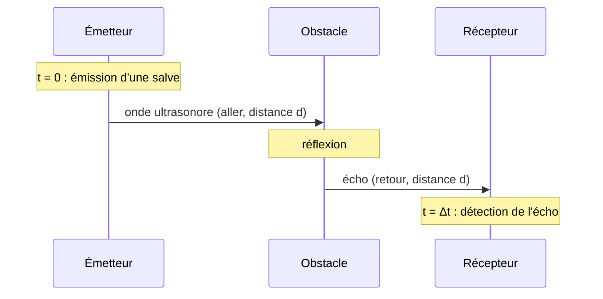

# 1. La physique du télémètre ultrasonore

!!! abstract "Objectifs de cette section"
    - Définir une **onde mécanique progressive** et ses caractéristiques (retard, célérité).
    - Expliquer le **principe** du télémètre ultrasonore et en déduire la formule $d=\dfrac{v\,\Delta t}{2}$.
    - Déterminer la **portée maximale** du capteur et discuter ses limites (température, résolution).

## 1.1 Qu'est-ce qu'une onde mécanique progressive ?

!!! info "Définition : onde mécanique progressive"
    Une **onde mécanique progressive** est le phénomène de **propagation d'une perturbation** (déformation) dans un **milieu matériel élastique**, de proche en proche, **sans transport de matière** mais avec **transport d'énergie**.

- Un **milieu matériel** est indispensable : le son ne se propage pas dans le vide.
- Chaque point du milieu reproduit, avec un **retard**, le mouvement de la source.
- Les entités du milieu **oscillent autour de leur position d'équilibre** : elles ne voyagent pas avec l'onde.

!!! info "Définition : onde transversale et onde longitudinale"
    - Onde **transversale** : la direction de la perturbation est **perpendiculaire** à la direction de propagation (ex. corde, onde à la surface de l'eau, onde sismique S).
    - Onde **longitudinale** : la direction de la perturbation est **parallèle** à la direction de propagation (ex. **onde sonore**, ressort comprimé, onde sismique P).

!!! failure "Erreur fréquente"
    « L'eau avance avec la vague. » **Faux.** Un bouchon posé sur l'eau **monte et descend** (il oscille) : il n'est pas entraîné avec l'onde. Une onde transporte de l'énergie, pas de la matière.

### Retard et célérité

!!! info "Définition : célérité et retard"
    La **célérité** $v$ d'une onde est la vitesse à laquelle la perturbation se propage. Si la perturbation parcourt la distance $d$ pendant la durée $\tau$ (le **retard**) :
    $$v=\frac{d}{\tau}\qquad\Longleftrightarrow\qquad \tau=\frac{d}{v}.$$

!!! success "Propriété : de quoi dépend la célérité ?"
    La célérité d'une onde mécanique dépend **uniquement du milieu** (nature, température, pression…), **pas** de la fréquence de la source (dans un milieu non dispersif) ni de l'amplitude de l'onde.

| Milieu | Célérité du son (ordre de grandeur) |
|---|---|
| Air à 20 °C | $\approx343$ m·s⁻¹ |
| Eau liquide | $\approx1\,500$ m·s⁻¹ |
| Acier | $\approx5\,000$ m·s⁻¹ |

Pour l'air, on utilisera, sauf indication contraire, $v=340$ m·s⁻¹. Plus précisément, $v_{air}(\theta)\approx331+0{,}60\,\theta$ en m·s⁻¹ avec $\theta$ en °C.

## 1.2 Les ultrasons

!!! info "Définition : ultrasons"
    Les **ultrasons** sont des ondes sonores de **fréquence supérieure à 20 kHz**, donc inaudibles pour l'humain. Le domaine audible va d'environ **20 Hz à 20 kHz**.

Les télémètres courants utilisent des ultrasons de fréquence **40 kHz**. Intérêts : faisceau **directif** (peu étalé), grande **précision** car la longueur d'onde est courte (ici $\lambda=\frac{340}{40\,000}=8{,}5$ mm), pas de gêne sonore.

## 1.3 Principe du télémètre

Un télémètre ultrasonore comporte un **émetteur** et un **récepteur** (souvent des capteurs **piézoélectriques**, qui convertissent une tension électrique en vibration mécanique et inversement).

!!! tip "Méthode : mesurer une distance avec un télémètre"
    1. L'émetteur envoie une **salve** d'ultrasons à $t=0$.
    2. L'onde se propage jusqu'à l'obstacle, se **réfléchit** et revient au récepteur.
    3. On mesure la durée $\Delta t$ entre l'émission et la réception (à l'oscilloscope ou par un microcontrôleur).
    4. L'onde a parcouru **l'aller et le retour**, soit $2d$, à la célérité $v$ :
    $$2d=v\,\Delta t\qquad\Longrightarrow\qquad\boxed{d=\frac{v\,\Delta t}{2}}$$

!!! failure "Erreur fréquente"
    Oublier le **facteur 2** : $\Delta t$ correspond à un **aller-retour**. Une durée de 5,8 ms ne donne pas $d=340\times5{,}8\times10^{-3}=1{,}97$ m, mais $d=\dfrac{1{,}97}{2}=0{,}99$ m.

!!! example "Exemple 1 : calcul d'une distance"
    L'écho d'un télémètre revient $\Delta t=5{,}8$ ms après l'émission. Quelle est la distance à l'obstacle ?

    ??? success "Corrigé"
        $d=\dfrac{v\Delta t}{2}=\dfrac{340\times5{,}8\times10^{-3}}{2}=0{,}99$ m. (Conversion : $5{,}8$ ms $=5{,}8\times10^{-3}$ s.)

## 1.4 Lecture d'un oscillogramme

Sur l'oscilloscope, la **voie 1** est reliée à l'émetteur, la **voie 2** au récepteur. On lit le **décalage temporel** entre le début de la salve émise et le début de la salve reçue.

!!! tip "Méthode : lire $\Delta t$"
    $\Delta t=\text{(nombre de divisions)}\times\text{(base de temps en s/div)}$. Pour limiter l'incertitude, on lit la **position du début** de chaque salve, avec la **base de temps la plus adaptée** (signal qui occupe l'écran).

!!! warning "Point d'attention"
    La salve reçue est **beaucoup plus faible** (atténuée) que la salve émise : on adapte la **sensibilité verticale** de la voie 2. On repère le **front** de la salve, pas son maximum.

## 1.5 Portée maximale du capteur

Un télémètre **ne s'émet pas en continu** : il envoie des salves **à intervalles réguliers**, avec une **période de répétition** $T_{rep}$ (durée entre le début de deux salves successives).

!!! success "Propriété : portée maximale"
    Pour qu'un écho soit **associé sans ambiguïté** à la salve qui l'a produite, il doit revenir **avant l'émission de la salve suivante** : $\Delta t<T_{rep}$. La distance maximale mesurable est donc
    $$d_{max}=\frac{v\,T_{rep}}{2}.$$

??? abstract "Démonstration"
    La condition $\Delta t\le T_{rep}$ avec $\Delta t=\dfrac{2d}{v}$ donne $\dfrac{2d}{v}\le T_{rep}$, soit $d\le\dfrac{v\,T_{rep}}{2}$. $\blacksquare$

!!! tip "Méthode : déterminer $d_{max}$ à partir d'un oscillogramme"
    1. Sur l'oscillogramme de la voie 1, repérer le **début de deux salves consécutives** et lire leur écart : c'est $T_{rep}$.
    2. Calculer $d_{max}=\dfrac{v\,T_{rep}}{2}$.

!!! example "Exemple 2 : portée"
    Un télémètre émet une salve toutes les $T_{rep}=60$ ms. Calculer la portée maximale à 20 °C ($v=343$ m·s⁻¹).

    ??? success "Corrigé"
        $d_{max}=\dfrac{343\times60\times10^{-3}}{2}=10{,}3$ m.

!!! warning "Point d'attention : portée « physique » et portée « logicielle »"
    Deux limites coexistent : celle fixée par $T_{rep}$ (**ambiguïté** si l'écho arrive après la salve suivante) et celle due à l'**atténuation** de l'onde (l'écho devient trop faible pour être détecté, surtout pour un obstacle petit, éloigné ou absorbant). La portée annoncée est la plus **contraignante** des deux.

## 1.6 Précision et limites de la mesure

!!! success "Propriété : résolution"
    Si la durée est mesurée avec une incertitude $\delta(\Delta t)$, la distance est connue à $\delta d=\dfrac{v\,\delta(\Delta t)}{2}$. Par exemple, $\delta(\Delta t)=10\ \mu\text{s}$ donne $\delta d=\dfrac{340\times10\times10^{-6}}{2}=1{,}7$ mm.

!!! warning "Point d'attention : influence de la température"
    $v$ dépend de la température de l'air : $v(0\ °\text{C})\approx331$ m·s⁻¹ ; $v(35\ °\text{C})\approx352$ m·s⁻¹. Si l'on utilise $v=343$ m·s⁻¹ alors qu'il fait 35 °C, la distance est **sous-estimée d'environ 2,6 %**. Les télémètres de précision intègrent une **sonde de température**.

Autres sources d'erreur : obstacle **incliné** (l'écho ne revient pas vers le récepteur), obstacle **mou** (absorbant), échos **parasites**, **vent**.

!!! failure "Erreur fréquente"
    Penser que le télémètre mesure la distance « directement ». Il mesure une **durée** ; la distance est **calculée** à partir de $v$, donc avec les hypothèses sur $v$ (milieu homogène, température connue).
