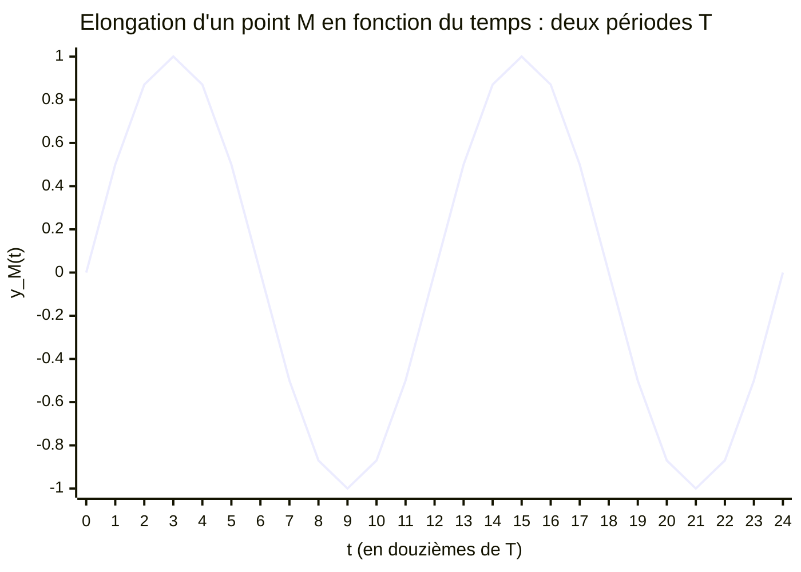
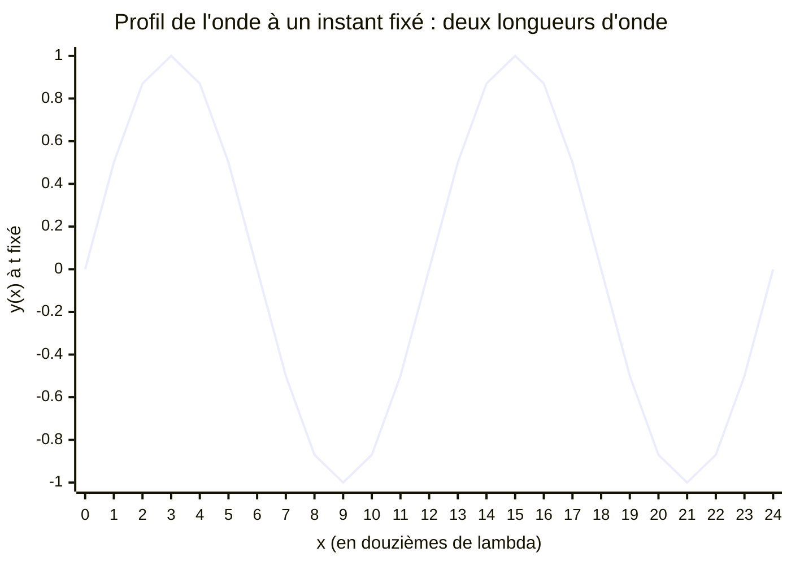

# 2. Les ondes mécaniques périodiques : la double périodicité

!!! abstract "Objectifs de cette section"
    - Définir une onde **périodique** et ses grandeurs : période $T$, fréquence $f$, longueur d'onde $\lambda$, amplitude.
    - Comprendre la **double périodicité** : temporelle **et** spatiale.
    - Reconnaître des points **en phase** et **en opposition de phase** et calculer le décalage associé.

## 2.1 Onde périodique

!!! info "Définition : onde périodique"
    Une onde est **périodique** lorsque la perturbation créée par la source se **répète identique à elle-même à intervalles de temps réguliers**. Une onde sinusoïdale est un cas particulier : la perturbation est une fonction sinusoïdale du temps.

Exemples : onde créée par une source qui oscille régulièrement (diapason, haut-parleur, vibreur sur une corde, pointe qui frappe la surface de l'eau à intervalles réguliers, ultrasons à 40 kHz).

## 2.2 a) Périodicité temporelle

On observe **un point fixe M** du milieu et on suit son mouvement au cours du temps.

!!! info "Définition : période temporelle et fréquence"
    La **période temporelle** $T$ (en s) est la **plus petite durée** au bout de laquelle le mouvement du point M se reproduit identique à lui-même. La **fréquence** $f$ (en Hz) est le nombre de périodes par seconde :
    $$f=\frac{1}{T}\qquad[\text{Hz}=\text{s}^{-1}].$$

Pour une onde périodique, $T$ est aussi la période de la **source**. Elle est **imposée par la source** et ne change pas quand l'onde change de milieu.

Graphe $y_M(t)$ de l'élongation d'un point M en fonction du temps (deux périodes ; abscisse en douzièmes de période) :

!!! tip "Méthode : mesurer une période à l'oscillogramme"
    Mesurer la durée de **$N$ périodes** (par exemple entre deux maxima éloignés) puis diviser par $N$ :
    $$T=\frac{\text{durée de }N\text{ périodes}}{N}.$$
    Mesurer plusieurs périodes **réduit l'incertitude relative** : l'erreur de lecture de $\pm0{,}5$ division est répartie sur $N$ périodes.

!!! failure "Erreur fréquente"
    Mesurer entre un maximum et un **minimum** : on obtient une **demi-période**. La période est l'écart entre deux maxima (ou deux minima, ou deux passages par zéro dans le même sens) **consécutifs**.

## 2.3 b) Périodicité spatiale

On « photographie » le milieu à un **instant fixe** $t$ et on observe la forme de la perturbation le long de la direction de propagation.

!!! info "Définition : longueur d'onde"
    La **longueur d'onde** $\lambda$ (en m) est la **plus petite distance** séparant deux points du milieu qui vibrent **en phase** (c'est-à-dire qui ont, à chaque instant, le même état vibratoire). C'est la **période spatiale** de l'onde : le profil de l'onde se reproduit identique à lui-même tous les $\lambda$.

!!! warning "Point d'attention : les deux courbes se ressemblent mais ne mesurent pas la même chose"
    Les deux graphes ont **la même allure** mais pas les mêmes axes :

    | | Périodicité temporelle | Périodicité spatiale |
    |---|---|---|
    | On observe | **un point** M au cours du temps | **tous les points** à un instant fixé |
    | Abscisse | temps $t$ (s) | position $x$ (m) |
    | Période | $T$ (s) | $\lambda$ (m) |
    | Grandeur associée | fréquence $f=1/T$ | nombre d'onde $1/\lambda$ |

!!! failure "Erreur fréquente"
    Lire une période sur un graphe $y(x)$ et en déduire $T$ en secondes, ou lire une longueur d'onde sur un oscillogramme. **Regardez toujours l'axe des abscisses avant de lire.**

## 2.4 Points en phase, points en opposition de phase

!!! info "Définition : points en phase / en opposition de phase"
    - Deux points sont **en phase** s'ils ont, à tout instant, le **même mouvement** (même élongation, même vitesse). Ils sont séparés par une distance $d=k\lambda$ avec $k\in\mathbb{N}$.
    - Deux points sont **en opposition de phase** si leurs mouvements sont **exactement opposés** à tout instant (l'un monte quand l'autre descend). Ils sont séparés par $d=\left(k+\tfrac12\right)\lambda$, $k\in\mathbb{N}$.

!!! success "Propriété : critère pratique"
    Soient deux points M et N distants de $d$ le long de la direction de propagation. Calculer $\dfrac{d}{\lambda}$ :

    | $\dfrac{d}{\lambda}$ | Situation |
    |---|---|
    | entier ($1;2;3\dots$) | **en phase** |
    | demi-entier ($0{,}5;1{,}5;2{,}5\dots$) | **en opposition de phase** |
    | autre (ex. $0{,}25$) | décalage de phase intermédiaire |

Le **retard** de N par rapport à M vaut $\tau=\dfrac{d}{v}$ ; il correspond à $\dfrac{\tau}{T}=\dfrac{d}{\lambda}$ période(s) de décalage.

??? abstract "Démonstration : $\tau/T=d/\lambda$"
    $\tau=\dfrac dv$ et $\lambda=vT$ (section suivante) donnent $\dfrac{\tau}{T}=\dfrac{d}{vT}=\dfrac{d}{\lambda}$. Le décalage en nombre de périodes est donc le même que la distance en nombre de longueurs d'onde. $\blacksquare$

!!! example "Exemple : en phase ou en opposition ?"
    Une onde de longueur d'onde $\lambda=4{,}0$ cm se propage le long d'une corde. Deux points M et N sont distants de $d=10$ cm. Comment vibrent-ils l'un par rapport à l'autre ?

    ??? success "Corrigé"
        $\dfrac d\lambda=\dfrac{10}{4{,}0}=2{,}5$ : demi-entier, donc M et N sont **en opposition de phase**.

!!! warning "Point d'attention : « en phase » ne veut pas dire « au même endroit de la perturbation »"
    Deux points en phase sont **à des distances multiples de $\lambda$**, mais l'onde est **décalée** d'un nombre entier de périodes : pour un observateur, ils ont l'**état identique** au même instant, ce qui n'est vrai de la phase qu'à $2\pi$ près.
