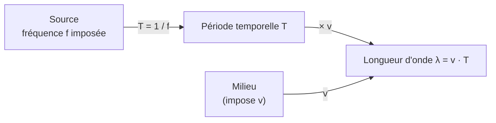

# 3. Lien entre la période spatiale $\lambda$ et la période temporelle $T$

!!! abstract "Objectifs de cette section"
    - Établir et utiliser la relation fondamentale $\lambda=vT=\dfrac vf$.
    - Savoir **mesurer** $\lambda$ et $T$ expérimentalement, et en déduire $v$.
    - Savoir ce qui change (et ne change pas) quand l'onde change de milieu.

## 3.1 La relation fondamentale

!!! success "Propriété : relation entre $\lambda$, $T$ et $v$"
    $$\boxed{\lambda=v\,T=\frac{v}{f}}\qquad\text{soit}\qquad v=\frac{\lambda}{T}=\lambda f.$$
    La longueur d'onde est la **distance parcourue par l'onde pendant une période**.

??? abstract "Démonstration"
    La source commence une oscillation à $t=0$. Après une période $T$, elle recommence exactement le même mouvement. Pendant cette durée $T$, la perturbation émise à $t=0$ s'est propagée à la célérité $v$ sur la distance $d=vT$. À l'instant $t=T$, le point situé à $d=vT$ de la source **reproduit l'état de la source à $t=0$** ; la source, elle, repart dans le même état. Ces deux points (la source et le point à $d=vT$) vibrent donc **en phase** et sont les plus proches à avoir cette propriété : leur distance est la longueur d'onde. Donc $\lambda=vT$. $\blacksquare$

    *Vérification dimensionnelle :* $[v\,T]=\text{m·s}^{-1}\cdot\text{s}=\text{m}$ ✓.

!!! info "Définition : double périodicité, résumé"
    - **Temps** (en un point fixe) : motif répété tous les $T$.
    - **Espace** (à un instant fixe) : motif répété tous les $\lambda$.
    - Les deux sont reliées par la célérité : $\lambda=vT$.

## 3.2 Ce qui change et ce qui ne change pas

!!! success "Propriété : changement de milieu"
    Lorsqu'une onde périodique passe d'un milieu 1 à un milieu 2 :

    - $T$ et $f$ **ne changent pas** (imposées par la source) ;
    - $v$ **change** (propriété du milieu) ;
    - donc $\lambda$ **change** dans le même rapport que $v$ : $\dfrac{\lambda_2}{\lambda_1}=\dfrac{v_2}{v_1}$.

!!! example "Exemple : son dans l'air et dans l'eau"
    Un son de fréquence $f=1{,}0$ kHz passe de l'air ($v_1=340$ m·s⁻¹) dans l'eau ($v_2=1\,500$ m·s⁻¹). Calculer $\lambda_1$ et $\lambda_2$.

    ??? success "Corrigé"
        $\lambda_1=\dfrac{v_1}{f}=\dfrac{340}{1{,}0\times10^{3}}=0{,}34$ m ; $\lambda_2=\dfrac{1\,500}{1{,}0\times10^{3}}=1{,}5$ m. La fréquence est la même ; $\lambda$ est plus grande dans l'eau, car $v$ y est plus grande.

!!! failure "Erreur fréquente"
    Écrire que « la fréquence augmente dans l'eau parce que le son va plus vite ». **Faux** : c'est la **longueur d'onde** qui augmente, la fréquence reste celle de la source.

## 3.3 Mesurer $T$, $\lambda$ et $v$

### Mesure de la période et de la fréquence

!!! tip "Méthode : $T$ à l'oscilloscope"
    1. Visualiser le signal reçu par un récepteur (microphone, capteur).
    2. Mesurer la durée de **plusieurs périodes** : $T=\dfrac{\Delta t_N}{N}$ avec $\Delta t_N=N_{div}\times\text{base de temps}$.
    3. $f=\dfrac1T$.

### Mesure de la longueur d'onde

!!! tip "Méthode : $\lambda$ avec un émetteur et deux récepteurs (ultrasons)"
    On visualise à l'oscilloscope le signal de l'émetteur (voie 1) et celui d'un récepteur mobile (voie 2).

    1. On place le récepteur à une position où les deux signaux sont **en phase** (courbes superposées).
    2. On **éloigne** le récepteur le long de l'axe, en comptant le nombre de fois où les signaux **redeviennent en phase**.
    3. Après $n$ coïncidences successives, le récepteur s'est déplacé de $d=n\lambda$ : $\lambda=\dfrac dn$.

!!! success "Propriété : pourquoi mesurer plusieurs $\lambda$ ?"
    Si la lecture de la position est connue à $\pm\delta x$, l'incertitude sur $\lambda$ vaut $\dfrac{\delta x}{n}$ : elle est **divisée par $n$**.

!!! failure "Erreur fréquente"
    Se tromper sur le **décompte**. Entre la première position (en phase) et la $n$-ième nouvelle position en phase, le déplacement vaut $n\lambda$ (et **non** $(n+1)\lambda$, ni $(n-1)\lambda$). Comptez les **intervalles**, pas les positions.

### Mesure de la célérité

!!! tip "Méthode : deux façons de déterminer $v$"
    - **Par le retard** : placer deux récepteurs à des distances différentes de l'émetteur, mesurer le décalage temporel $\tau$ entre les deux signaux, puis $v=\dfrac{d}{\tau}$ où $d$ est l'écart entre les deux récepteurs.
    - **Par $\lambda$ et $T$** : $v=\dfrac{\lambda}{T}=\lambda f$.

!!! example "Exemple : mesure sur une cuve à ondes"
    Un vibreur de fréquence $f=25$ Hz crée des vagues à la surface de l'eau. Sur une photographie à l'échelle, 5 crêtes consécutives sont espacées de $4\lambda=8{,}0$ cm. Calculer $\lambda$ et la célérité $v$.

    ??? success "Corrigé"
        5 crêtes consécutives délimitent **4 intervalles** : $4\lambda=8{,}0$ cm donc $\lambda=2{,}0$ cm $=2{,}0\times10^{-2}$ m. Puis $v=\lambda f=2{,}0\times10^{-2}\times25=0{,}50$ m·s⁻¹.

        !!! warning "Piège"
            Ne pas diviser par 5 : $n$ crêtes consécutives délimitent $n-1$ intervalles.

## 3.4 Cas du télémètre : retour sur $\lambda$

Le télémètre à 40 kHz : $T=\dfrac{1}{40\times10^{3}}=25\ \mu\text{s}$ et $\lambda=vT=340\times25\times10^{-6}=8{,}5$ mm. La salve est un **train d'ondes** de quelques dizaines de périodes ; chaque période a une longueur $\lambda=8{,}5$ mm dans l'air.

!!! note "Pour aller plus loin : milieu dispersif"
    Dans un milieu **dispersif**, la célérité dépend de la fréquence (ex. ondes à la surface de l'eau, lumière dans le verre). Pour les ondes sonores dans l'air et la plupart des situations de ce chapitre, on suppose un milieu **non dispersif**.
