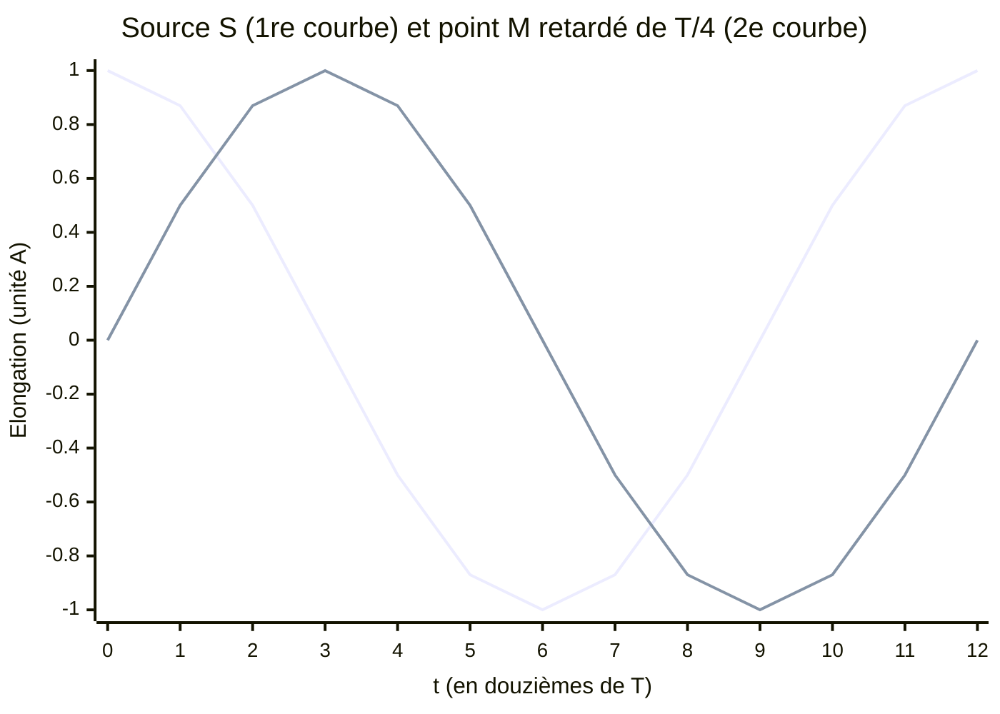
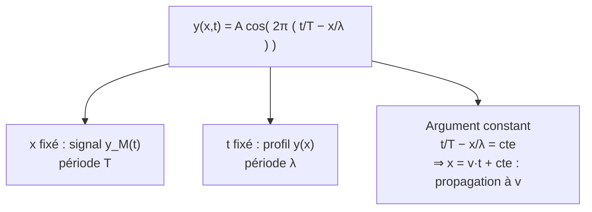

# 4. Modélisation mathématique d'un signal périodique

!!! abstract "Objectifs de cette section"
    - Écrire un signal sinusoïdal $s(t)=S_m\cos\!\left(\dfrac{2\pi t}{T}+\varphi\right)$ et en lire les paramètres sur un graphique.
    - Écrire la **loi de propagation** : le signal en M est celui de la source **retardé** de $\tau$.
    - Établir l'expression à **deux variables** $y(x,t)$ et **retrouver la double périodicité**.
    - Déduire un **déphasage** d'un retard ou d'une distance.

## 4.1 Le signal sinusoïdal

!!! info "Définition : signal sinusoïdal"
    Un signal est **sinusoïdal** s'il peut s'écrire
    $$\boxed{s(t)=S_m\cos\!\left(\frac{2\pi}{T}\,t+\varphi\right)}$$
    - $S_m>0$ : **amplitude** (valeur maximale de $s$, dans l'unité de la grandeur $s$) ;
    - $T$ : **période** (s) ; on pose souvent $\omega=\dfrac{2\pi}{T}=2\pi f$ (**pulsation**, en rad·s⁻¹) ;
    - $\varphi$ : **phase à l'origine** (rad), qui fixe la valeur du signal à $t=0$ : $s(0)=S_m\cos\varphi$.

!!! success "Propriété : $T$ est bien la période"
    $s(t+T)=S_m\cos\!\left(\frac{2\pi (t+T)}{T}+\varphi\right)=S_m\cos\!\left(\frac{2\pi t}{T}+\varphi+2\pi\right)=s(t)$, car le cosinus est $2\pi$-périodique. $\blacksquare$

!!! tip "Méthode : lire les paramètres sur un graphique ou un oscillogramme"
    - **Amplitude** $S_m$ : demi-écart entre le maximum et le minimum (tension crête à crête divisée par 2), à vérifier si la valeur moyenne est nulle.
    - **Période** $T$ : écart entre deux maxima consécutifs, sur plusieurs périodes.
    - **Phase à l'origine** : $\cos\varphi=\dfrac{s(0)}{S_m}$ (et le sens de variation à $t=0$ fixe le signe de $\varphi$).

!!! failure "Erreur fréquente"
    **Calculatrice en degrés** : les expressions $\frac{2\pi t}{T}+\varphi$ sont en **radians**. Vérifiez le mode RAD avant tout calcul numérique d'un cosinus.

## 4.2 Retard et propagation

!!! success "Propriété : loi de propagation sans atténuation"
    Soit une source S dont l'élongation est $y_S(t)$. Un point M situé à la distance $x$ de S reproduit le mouvement de S avec un **retard** $\tau=\dfrac{x}{v}$ :
    $$\boxed{y_M(t)=y_S(t-\tau)\quad\text{avec}\quad\tau=\frac{x}{v}}$$
    Autrement dit, à l'instant $t$, M se trouve dans l'état où S se trouvait à l'instant $t-\tau$.

Cas d'une source sinusoïdale $y_S(t)=A\cos\!\left(\dfrac{2\pi t}{T}+\varphi_0\right)$ :
$$y_M(t)=A\cos\!\left(\frac{2\pi (t-\tau)}{T}+\varphi_0\right)=A\cos\!\left(\frac{2\pi t}{T}+\varphi_0-\frac{2\pi\tau}{T}\right).$$

!!! info "Définition : déphasage dû à la propagation"
    Le **déphasage** de M par rapport à S (retard de phase) est
    $$\Delta\varphi=\frac{2\pi\tau}{T}=2\pi f\tau=\frac{2\pi x}{\lambda}.$$

??? abstract "Démonstration : $\Delta\varphi=2\pi x/\lambda$"
    $\Delta\varphi=\dfrac{2\pi\tau}{T}$ avec $\tau=\dfrac xv$ donne $\Delta\varphi=\dfrac{2\pi x}{vT}$ ; or $\lambda=vT$, donc $\Delta\varphi=\dfrac{2\pi x}{\lambda}$. $\blacksquare$

Visualisation : le signal de M est celui de S **décalé vers la droite** de $\tau$. Ici $\tau=T/4$ (déphasage $\Delta\varphi=\pi/2$) : $y_M(t)=A\cos\!\left(\frac{2\pi t}{T}-\frac\pi2\right)=A\sin\!\left(\frac{2\pi t}{T}\right)$.

!!! warning "Point d'attention : sens du décalage"
    Le signal de M est **retardé** (décalé vers la droite sur l'axe des temps) par rapport à celui de S : il atteint son maximum **plus tard**. Dans $\cos\!\left(\omega t+\varphi_0-\Delta\varphi\right)$, c'est bien un **signe moins** devant $\Delta\varphi$.

### Le retard n'est connu que modulo $T$

!!! warning "Point d'attention : ambiguïté d'une mesure de retard"
    À l'oscilloscope, on lit un décalage entre deux signaux **périodiques** ; on ne peut pas distinguer un retard $\tau$ d'un retard $\tau+T$, $\tau+2T$… (les courbes se superposent). Pour lever l'ambiguïté : rapprocher les récepteurs, ou mesurer une **salve** (début bien identifiable), ou connaître $v$ approximativement.

## 4.3 La fonction d'onde $y(x,t)$

En combinant propagation et sinusoïdalité (source en $x=0$, avec $\varphi_0=0$ pour simplifier), l'élongation du point d'abscisse $x$ à l'instant $t$ est :
$$y(x,t)=A\cos\!\left(2\pi\left(\frac{t}{T}-\frac{x}{\lambda}\right)\right).$$

??? abstract "Démonstration"
    $y(x,t)=y_S(t-x/v)=A\cos\!\left(\dfrac{2\pi(t-x/v)}{T}\right)=A\cos\!\left(2\pi\left(\dfrac tT-\dfrac{x}{vT}\right)\right)=A\cos\!\left(2\pi\left(\dfrac tT-\dfrac x\lambda\right)\right)$ car $vT=\lambda$. $\blacksquare$

!!! success "Propriété : la double périodicité se lit sur la formule"
    - À $x$ fixé : $y(x,t+T)=A\cos\!\left(2\pi\left(\frac{t+T}{T}-\frac x\lambda\right)\right)=y(x,t)$ → **périodique en $t$ de période $T$**.
    - À $t$ fixé : $y(x+\lambda,t)=A\cos\!\left(2\pi\left(\frac tT-\frac{x+\lambda}{\lambda}\right)\right)=y(x,t)$ → **périodique en $x$ de période $\lambda$**.

## 4.4 Signaux périodiques non sinusoïdaux

!!! info "Remarque : tous les signaux périodiques ne sont pas sinusoïdaux"
    Un signal en créneaux, en triangle ou en dents de scie est **périodique** (même $T$, même fréquence) mais n'est **pas** sinusoïdal : il ne se décrit pas par un seul cosinus. La notion de période, de fréquence, de retard et de longueur d'onde reste identique. Seuls les signaux **sinusoïdaux** (« sons purs ») ont une expression du type $A\cos(\omega t+\varphi)$.

## 4.5 Exemples corrigés

!!! example "Exemple 1 : écrire l'expression d'un signal"
    Un oscillogramme montre un signal sinusoïdal de tension crête à crête $U_{pp}=6{,}0$ V, de période $T=0{,}50$ ms, valant $+3{,}0$ V à $t=0$ (maximum). Écrire $u(t)$.

    ??? success "Corrigé"
        $U_m=\dfrac{U_{pp}}{2}=3{,}0$ V. Valeur max à $t=0$ : $\cos\varphi=1$, soit $\varphi=0$. Donc $u(t)=3{,}0\cos\!\left(\dfrac{2\pi t}{0{,}50\times10^{-3}}\right)=3{,}0\cos(1{,}3\times10^{4}\,t)$ (V, avec $t$ en s) : $\omega=\dfrac{2\pi}{T}=1{,}26\times10^4$ rad·s⁻¹.

!!! example "Exemple 2 : phase d'un point éloigné"
    Une source vibre selon $y_S(t)=2{,}0\cos(2\pi t/T)$ (mm), avec $T=20$ ms. L'onde se propage à $v=2{,}0$ m·s⁻¹. Écrire $y_N(t)$ pour un point N à $x=0{,}605$ m de la source.

    ??? success "Corrigé"
        $\lambda=vT=2{,}0\times0{,}020=0{,}040$ m. Retard $\tau=\dfrac{x}{v}=\dfrac{0{,}605}{2{,}0}=0{,}3025$ s. Déphasage $\Delta\varphi=\dfrac{2\pi x}{\lambda}=2\pi\times15{,}125=30{,}25\pi$.
        Comme le cosinus est $2\pi$-périodique, on retranche $15$ tours complets ($30\pi$) : $\Delta\varphi\equiv0{,}25\pi=\dfrac\pi4$.
        $$y_N(t)=2{,}0\cos\!\left(\frac{2\pi t}{T}-\frac\pi4\right)\ \text{(mm)}.$$

        !!! warning "Piège"
            Seule la **partie fractionnaire** de $x/\lambda$ compte pour la phase : $15{,}125$ longueurs d'onde équivalent à $0{,}125$. Le point est quasi en phase avec la source (décalage de $T/8$).

!!! failure "Erreur fréquente"
    - Écrire $y_M(t)=y_S(t+\tau)$ (avance au lieu de retard).
    - Mélanger $x$ en cm et $v$ en m·s⁻¹ dans $\tau=x/v$.
    - Écrire $\Delta\varphi=2\pi\lambda/x$ (inverse).
