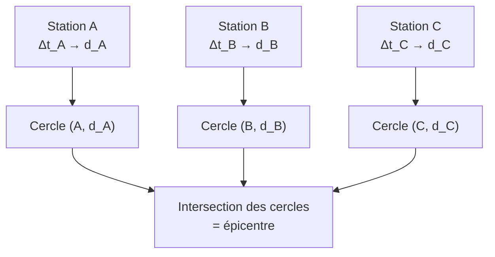

# 5. Les ondes sismiques : épicentre et triangulation

!!! abstract "Objectifs de cette section"
    - Connaître les **ondes sismiques** (P, S, ondes de surface) et leurs différences.
    - Établir la relation entre le **décalage S−P** et la **distance** à la source.
    - Déterminer l'**épicentre** par **triangulation**, par la **construction graphique** et par le **calcul**.
    - Identifier les **hypothèses** du modèle et ses limites.

## 5.1 Le séisme et ses ondes

!!! info "Définition : foyer et épicentre"
    - Le **foyer** (ou **hypocentre**) est le point, en profondeur, où la rupture des roches libère l'énergie.
    - L'**épicentre** est le point de la **surface** terrestre situé à la **verticale** du foyer.

Le séisme émet des ondes mécaniques qui se propagent dans le sol. Elles sont enregistrées par des **sismomètres** (stations sismiques), qui produisent des **sismogrammes** (élongation du sol en fonction du temps).

| Onde | Nature | Célérité (croûte, ordre de grandeur) | Propagation | Remarque |
|---|---|---|---|---|
| **P** (primaires) | **Longitudinale** (compression/dilatation) | $v_P\approx6$ km·s⁻¹ | Solides **et** liquides | Arrivent **en premier** |
| **S** (secondaires) | **Transversale** (cisaillement) | $v_S\approx3{,}5$ km·s⁻¹ | **Solides uniquement** | Arrivent après les P |
| **Ondes de surface** (Love, Rayleigh) | Surface du sol | $<v_S$ | Surface | Les plus lentes, **souvent les plus destructrices** |

!!! success "Propriété : $v_P>v_S$"
    Les ondes P sont toujours plus rapides que les ondes S ($v_P\approx1{,}7\,v_S$ dans la croûte). Elles arrivent donc **avant** les ondes S à une station donnée.

!!! warning "Point d'attention : les ondes S ne traversent pas les liquides"
    Un liquide ne transmet pas le cisaillement. Les ondes S ne traversent donc pas le **noyau externe liquide** de la Terre. C'est une **preuve** de l'état liquide du noyau externe : des stations situées à grande distance angulaire du séisme n'enregistrent **pas** d'ondes S directes (« zone d'ombre »).

## 5.2 Distance à partir du décalage S−P

À une station située à la **distance $d$** du foyer (trajets rectilignes à vitesses constantes) :

- l'onde P arrive à la date $t_P=t_0+\dfrac{d}{v_P}$ ;
- l'onde S arrive à la date $t_S=t_0+\dfrac{d}{v_S}$ ;

où $t_0$ est la date (inconnue) du séisme.

!!! success "Propriété : relation entre $d$ et $\Delta t=t_S-t_P$"
    $$\Delta t=t_S-t_P=d\left(\frac1{v_S}-\frac1{v_P}\right)\qquad\Longrightarrow\qquad\boxed{d=\Delta t\ \frac{v_Pv_S}{v_P-v_S}}$$

??? abstract "Démonstration"
    $\Delta t=\dfrac{d}{v_S}-\dfrac{d}{v_P}=d\,\dfrac{v_P-v_S}{v_Pv_S}$. On isole $d$ : $d=\Delta t\,\dfrac{v_Pv_S}{v_P-v_S}$. $\blacksquare$

!!! tip "Méthode : utiliser le décalage S−P"
    1. Sur le **sismogramme**, repérer le **début** de l'arrivée des ondes P, puis celui des ondes S. Lire $\Delta t=t_S-t_P$.
    2. Calculer $K=\dfrac{v_Pv_S}{v_P-v_S}$ (en km·s⁻¹).
    3. $d=K\,\Delta t$.
    4. (Option) la date du séisme : $t_0=t_P-\dfrac{d}{v_P}$.

!!! example "Exemple : distance d'un séisme"
    Avec $v_P=6{,}0$ km·s⁻¹ et $v_S=3{,}5$ km·s⁻¹, une station enregistre $\Delta t=10$ s. Calculer $d$.

    ??? success "Corrigé"
        $K=\dfrac{6{,}0\times3{,}5}{6{,}0-3{,}5}=\dfrac{21}{2{,}5}=8{,}4$ km·s⁻¹. $d=8{,}4\times10=84$ km. (Règle pratique : environ **8 km par seconde** de décalage S−P.)

!!! failure "Erreur fréquente"
    - Utiliser une seule vitesse : $d=v\Delta t$ n'a de sens que pour **une** onde qui parcourt $d$ ; ici $\Delta t$ est un **décalage entre deux ondes** de vitesses différentes.
    - Confondre $\Delta t=t_S-t_P$ avec la durée de propagation.
    - Utiliser $\dfrac{1}{v_P-v_S}$ ou $d=\Delta t(v_P-v_S)$ : **faux**.

!!! warning "Point d'attention : distance et profondeur"
    La relation donne la distance **entre le foyer et la station** (distance « hypocentrale »). Si le foyer est à une profondeur $h$, la distance **épicentrale** (sur la carte) est $d_{ep}=\sqrt{d^2-h^2}$. Pour un séisme superficiel ou des stations éloignées ($d\gg h$), on confond $d$ et $d_{ep}$.

## 5.3 La triangulation

Une station ne donne que la **distance** $d$ au séisme, pas sa **direction** : l'épicentre est quelque part sur un **cercle** de rayon $d$ centré sur la station.

!!! success "Propriété : combien de stations ?"
    - **1 station** : l'épicentre est sur un cercle (infinité de positions).
    - **2 stations** : deux cercles se coupent en **2 points** (ambiguïté).
    - **3 stations non alignées** : les trois cercles se coupent en **un seul point** : l'épicentre.

!!! tip "Méthode : triangulation graphique"
    1. Placer sur une carte à l'échelle les stations A, B, C.
    2. Calculer $d_A,d_B,d_C$ à partir des $\Delta t$.
    3. Avec un **compas**, tracer le cercle de centre A et de rayon $d_A$ (converti à l'échelle de la carte), puis ceux de B et C.
    4. L'**intersection commune** est l'épicentre. En pratique, les cercles forment un petit triangle d'incertitude.

### Triangulation par le calcul

Avec un repère cartésien $(x,y)$, stations de coordonnées $A(0\,;0)$, $B(x_B\,;0)$, $C(x_C\,;y_C)$.

!!! tip "Méthode : résolution analytique"
    1. Équations des cercles : $x^2+y^2=d_A^2$ et $(x-x_B)^2+y^2=d_B^2$.
    2. Par **soustraction** on élimine $y^2$ : $-2x_Bx+x_B^2=d_B^2-d_A^2$, d'où
    $$x=\frac{d_A^2-d_B^2+x_B^2}{2x_B}.$$
    3. On calcule $y=\pm\sqrt{d_A^2-x^2}$. Les **deux** signes correspondent aux deux points d'intersection de A et B.
    4. La **troisième station** C lève l'ambiguïté : on garde le signe pour lequel la distance à C est égale à $d_C$.

!!! example "Exemple corrigé complet"
    Stations $A(0\,;0)$, $B(100\,;0)$, $C(50\,;100)$ (en km). $v_P=6{,}0$ km·s⁻¹, $v_S=3{,}5$ km·s⁻¹. Les décalages S−P valent $\Delta t_A=6{,}0$ s, $\Delta t_B=8{,}0$ s, $\Delta t_C=8{,}4$ s. Déterminer l'épicentre.

    ??? success "Corrigé"
        $K=8{,}4$ km·s⁻¹. $d_A=50{,}4$ km ; $d_B=67{,}2$ km ; $d_C=70{,}6$ km.
        $x=\dfrac{50{,}4^2-67{,}2^2+100^2}{2\times100}=\dfrac{2540{,}2-4515{,}8+10\,000}{200}=40{,}1$ km.
        $y=\pm\sqrt{50{,}4^2-40{,}1^2}=\pm\sqrt{2540{,}2-1608{,}0}=\pm30{,}5$ km.
        Test avec C : pour $(40{,}1\,;30{,}5)$, $\sqrt{(50-40{,}1)^2+(100-30{,}5)^2}=\sqrt{98{,}0+4830{,}3}=70{,}2$ km $\approx d_C$ ✓. Pour $(40{,}1\,;-30{,}5)$ : $\sqrt{98+17\,030}=131$ km $\ne d_C$ ✗.
        **Épicentre : $\approx(40\,;30)$ km.**

## 5.4 Hypothèses et limites du modèle

!!! warning "Point d'attention : le modèle est une simplification"
    - Vitesses **constantes** et **trajet rectiligne** : en réalité, $v_P$ et $v_S$ augmentent avec la profondeur, les trajets sont courbes et les roches hétérogènes.
    - Sol **plat** : à grande distance, il faut tenir compte de la **courbure** de la Terre.
    - Lecture des **dates d'arrivée** (précision du pointé) : une erreur de 0,5 s sur $\Delta t$ donne ≈ 4 km sur $d$.
    - **Profondeur** du foyer ignorée (voir ci-dessus).

!!! note "Pourquoi les sismologues utilisent plus de trois stations ?"
    Avec de nombreuses stations, on **moyenne** les erreurs de pointé et de vitesse et on détermine aussi la **profondeur** du foyer et la date $t_0$. Avec les seules **ondes P** (sans S), il faut au moins **quatre stations** pour trouver ($x,y,z,t_0$).

!!! example "Question de réflexion"
    Pourquoi les ondes de surface, plus lentes, causent-elles souvent plus de dégâts que les ondes P ?

    ??? success "Corrigé"
        Elles sont de **grande amplitude** (l'énergie est concentrée à la surface), de **longue durée** et ont des périodes qui peuvent entrer en **résonance** avec celles des bâtiments.
