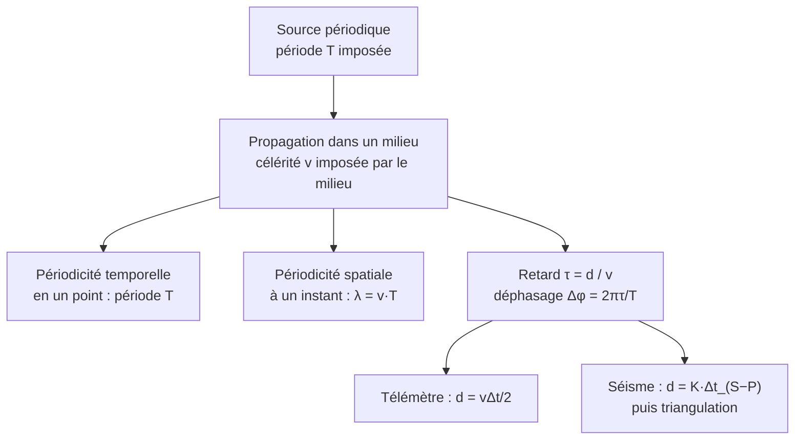

# 8. Synthèse et fiche de révision

!!! abstract "Mode d'emploi"
    Une feuille recto-verso. Cachez la colonne de droite, **récitez**, puis vérifiez. Tout ce qui figure ici peut tomber en contrôle.

## 8.1 Définitions et formules à connaître par cœur

| Notion | À savoir |
|---|---|
| Onde mécanique progressive | Propagation d'une perturbation dans un milieu matériel, **sans transport de matière**, avec **transport d'énergie** |
| Transversale / longitudinale | Perturbation **⟂** / **∥** à la direction de propagation (son et onde P : longitudinales ; corde et onde S : transversales) |
| Célérité, retard | $v=\dfrac{d}{\tau}$ ; $\tau=\dfrac{d}{v}$ ; $v$ ne dépend que du **milieu** |
| Ultrasons | $f>20$ kHz ; audible : $20$ Hz – $20$ kHz |
| Télémètre | $d=\dfrac{v\Delta t}{2}$ (aller-retour) ; $d_{max}=\dfrac{vT_{rep}}{2}$ |
| Période, fréquence | $f=\dfrac1T$ ; $T$ imposée par la **source** |
| Longueur d'onde | Plus petite distance entre deux points **en phase** ; $\lambda=vT=\dfrac vf$ |
| Points en phase / opposition | $d=k\lambda$ / $d=(k+\tfrac12)\lambda$ |
| Signal sinusoïdal | $s(t)=S_m\cos\!\left(\dfrac{2\pi t}{T}+\varphi\right)$, $\omega=\dfrac{2\pi}{T}$ |
| Propagation | $y_M(t)=y_S(t-\tau)$ avec $\tau=\dfrac xv$ |
| Déphasage | $\Delta\varphi=\dfrac{2\pi\tau}{T}=\dfrac{2\pi x}{\lambda}$ |
| Onde $y(x,t)$ | $A\cos\!\left(2\pi\left(\dfrac tT-\dfrac x\lambda\right)\right)$ |
| Décalage S−P | $d=\Delta t\ \dfrac{v_Pv_S}{v_P-v_S}$ ; $t_0=t_P-\dfrac{d}{v_P}$ |
| Triangulation | Intersection de $\ge3$ cercles (stations non alignées) |

## 8.2 Schéma de synthèse

## 8.3 Cas à connaître

| Situation | Que faire / que dire |
|---|---|
| Distance par écho | Diviser par 2 : $d=v\Delta t/2$ |
| Écho après la salve suivante | Ambiguïté : $d>d_{max}$ |
| Changement de milieu | $f$, $T$ inchangées ; $v$ et $\lambda$ changent dans le même rapport |
| Retard de $d/\lambda$ demi-entier | Opposition de phase |
| Phase d'un point lointain | On ne garde que la partie **fractionnaire** de $x/\lambda$ |
| Avant l'arrivée de l'onde | $y_M=0$ (milieu au repos) |
| Pas d'onde S enregistrée | Elle a traversé du liquide (noyau externe) |
| 2 stations seulement | 2 points d'intersection : ambiguïté |
| 3 stations alignées | Ambiguïté non levée |
| Température modifiée | $v$ change : corriger ($v\approx331+0{,}6\,\theta$) |

## 8.4 Check-list « réflexes de contrôle »

- [ ] Facteur 2 pour un aller-retour.
- [ ] Unités converties : ms → s, µs → s, kHz → Hz, km ↔ m, cm → m.
- [ ] Calculatrice en **radians** pour les cosinus.
- [ ] $T$ mesurée sur **plusieurs périodes**, jamais max → min.
- [ ] Axes vérifiés : $t$ (période) ou $x$ (longueur d'onde) ?
- [ ] Signe du retard : $t-\tau$, pas $t+\tau$.
- [ ] $\Delta t_{S-P}$ utilisé avec la formule à **deux** vitesses.
- [ ] Troisième station pour lever l'ambiguïté.
- [ ] Conclusion en phrase, avec unité.

## 8.5 Erreurs classiques (à ne plus jamais faire)

!!! failure "Erreurs fréquentes récapitulées"
    1. Oublier le facteur 2 dans le télémètre.
    2. Dire que l'onde « transporte la matière ».
    3. Écrire que $v$ dépend de $f$ (dans l'air, pour le son).
    4. Mesurer une demi-période.
    5. Confondre $T$ (s) et $\lambda$ (m) ou les lire sur le mauvais graphe.
    6. Compter $n+1$ au lieu de $n$ intervalles dans la mesure de $\lambda$.
    7. $y_M(t)=y_S(t+\tau)$.
    8. $d=v\Delta t$ pour l'écart S−P.
    9. Oublier que les ondes S ne traversent pas un liquide.
    10. Se contenter de deux stations.

## 8.6 Mini-quiz d'auto-évaluation

??? question "1. Un écho revient 12 ms après l'émission (v = 340 m·s⁻¹). Distance ?"
    $d=\dfrac{340\times12\times10^{-3}}{2}=2{,}0$ m.

??? question "2. Un son de 500 Hz se propage à 340 m·s⁻¹. Longueur d'onde ?"
    $\lambda=\dfrac{340}{500}=0{,}68$ m.

??? question "3. Le son de la question 2 passe dans l'eau (1 500 m·s⁻¹). Que valent $f$ et $\lambda$ ?"
    $f=500$ Hz (inchangée) ; $\lambda=\dfrac{1\,500}{500}=3{,}0$ m.

??? question "4. Deux points distants de 1,02 m sur l'onde de la question 2 : en phase ?"
    $\dfrac{1{,}02}{0{,}68}=1{,}5$ : demi-entier, **opposition de phase**.

??? question "5. $\Delta t_{S-P}=15$ s, $v_P=6{,}0$ km/s, $v_S=3{,}5$ km/s. Distance ?"
    $d=15\times8{,}4=126$ km.

??? question "6. Pourquoi ne peut-on pas localiser un séisme avec une seule station ?"
    Elle donne seulement la **distance** : l'épicentre est sur un cercle, sans direction.
