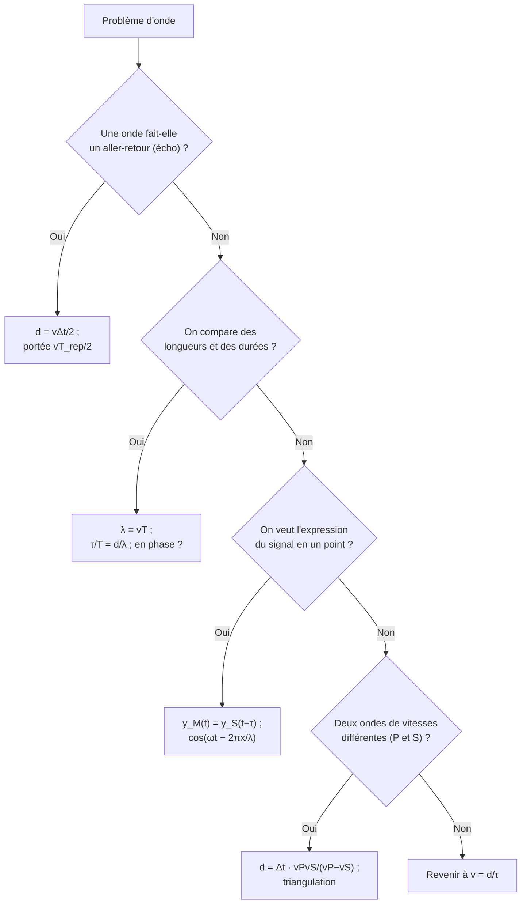

# 9. Comprendre pourquoi un résultat est vrai, savoir quand l'utiliser, savoir le démontrer

!!! abstract "Pourquoi cette section ?"
    Les questions les plus exigeantes demandent de **justifier**, de **choisir** le bon outil et de **démontrer**. Pour chaque résultat du chapitre, répondez à trois questions :

    1. **Pourquoi est-ce vrai ?** (mécanisme physique ou définition)
    2. **Quand l'utiliser ?** (et quand s'en méfier)
    3. **Comment le démontrer ?**

## 9.1 Tableau récapitulatif

| Résultat | Pourquoi vrai ? | Quand l'utiliser ? | Comment le démontrer ? |
|---|---|---|---|
| **$\tau=d/v$** | La perturbation se propage de proche en proche à vitesse finie $v$ | Retard entre deux points, entre émission et réception | Définition de la vitesse $v=d/\tau$ |
| **$d=v\Delta t/2$** (télémètre) | L'onde fait un aller-retour : elle parcourt $2d$ pendant $\Delta t$ | Toute mesure par écho (télémètre, sonar, radar, échographie) | $2d=v\Delta t$ |
| **$d_{max}=vT_{rep}/2$** | L'écho doit revenir avant la salve suivante | Limite d'un capteur à salves répétées | $\Delta t\le T_{rep}$ avec $\Delta t=2d/v$ |
| **$T$ imposée par la source, $v$ par le milieu** | La source impose son rythme d'oscillation ; la propagation dépend de l'élasticité et de l'inertie du milieu | Changement de milieu | Argument physique : chaque point du milieu est entraîné par le précédent à la fréquence de la source |
| **$\lambda=vT$** | En une période, la perturbation avance de $vT$, distance à laquelle l'état se reproduit | Passer de $T$ (ou $f$) à $\lambda$ | Distance parcourue en une période |
| **$\tau/T=d/\lambda$** | $\tau=d/v$ et $\lambda=vT$ | Savoir si deux points sont en phase | Division des deux relations |
| **$y_M(t)=y_S(t-\tau)$** | M reproduit S avec retard | Écrire le signal en un point éloigné | Modèle de propagation sans atténuation, sans déformation |
| **$\Delta\varphi=2\pi x/\lambda$** | $\Delta\varphi=2\pi\tau/T$ | Déphasage entre deux points | $\tau=x/v$, $\lambda=vT$ |
| **$d=\Delta t_{SP}\dfrac{v_Pv_S}{v_P-v_S}$** | Les deux ondes partent au même instant avec des vitesses différentes : l'écart d'arrivée croît avec $d$ | Distance d'un séisme sans connaître $t_0$ | $\Delta t=d(1/v_S-1/v_P)$ |
| **Triangulation** | Une distance fixe un cercle ; deux cercles se coupent en 2 points, trois (non alignés) en 1 seul | Localiser une source à partir de distances | Géométrie des cercles ; soustraction des équations pour éliminer $y^2$ |

## 9.2 Savoir démontrer : les quatre démonstrations clés

### Démonstration 1 : $\lambda=vT$

??? abstract "À reproduire"
    Pendant une période $T$, la perturbation avance de $d=vT$. À $t=T$, le point à la distance $vT$ de la source reproduit l'état de la source à $t=0$ : il vibre en phase avec la source. C'est le plus proche à le faire, donc $\lambda=vT$.

### Démonstration 2 : loi de propagation et déphasage

??? abstract "À reproduire"
    $y_M(t)=y_S(t-\tau)$ avec $\tau=x/v$. Pour $y_S(t)=A\cos(2\pi t/T)$ : $y_M(t)=A\cos\!\left(\dfrac{2\pi t}{T}-\dfrac{2\pi x}{vT}\right)=A\cos\!\left(\dfrac{2\pi t}{T}-\dfrac{2\pi x}{\lambda}\right)$.

### Démonstration 3 : double périodicité de $y(x,t)$

??? abstract "À reproduire"
    $y(x,t)=A\cos\!\left(2\pi\left(\dfrac tT-\dfrac x\lambda\right)\right)$. À $x$ fixé, remplacer $t$ par $t+T$ ajoute $2\pi$ à l'argument : $y$ inchangé. À $t$ fixé, remplacer $x$ par $x+\lambda$ retranche $2\pi$ : $y$ inchangé.

### Démonstration 4 : distance par l'écart S−P

??? abstract "À reproduire"
    $t_P=t_0+d/v_P$ ; $t_S=t_0+d/v_S$. On soustrait pour éliminer $t_0$ : $\Delta t=d\,\dfrac{v_P-v_S}{v_Pv_S}$, d'où $d=\Delta t\,\dfrac{v_Pv_S}{v_P-v_S}$.

## 9.3 Savoir quand utiliser quoi : arbre de décision

## 9.4 Pourquoi les modèles ont-ils des limites ?

!!! note "Comprendre les limites plutôt que les apprendre"
    | Hypothèse du modèle | Quand elle est violée | Effet |
    |---|---|---|
    | $v$ constante | Température, hétérogénéité du milieu, profondeur dans la Terre | Erreur sur $d$ (télémètre, séisme) |
    | Trajet rectiligne | Réfraction, réflexions multiples, courbure de la Terre | Distances faussées |
    | Pas d'atténuation | Absorption, étalement de l'onde | L'amplitude diminue avec la distance (portée réelle < portée « logicielle ») |
    | Milieu non dispersif | Dispersion (eau, verre) | $v$ dépend de $f$ : $\lambda=vT$ reste vrai mais avec $v(f)$ |
    | Onde sinusoïdale | Signaux en créneaux, impulsions | $s(t)$ n'est plus un seul cosinus |

!!! tip "Réflexe d'esprit critique"
    Devant un résultat numérique : *quelles hypothèses ai-je faites ? Quelle est l'incertitude ? L'ordre de grandeur est-il plausible ?* (un télémètre qui annonce 340 m est faux ; un séisme à 8 km pour $\Delta t=10$ s aussi.)

## 9.5 Auto-test final : saurez-vous justifier ?

??? question "Pourquoi une onde ne transporte-t-elle pas de matière ?"
    Chaque entité du milieu **oscille autour de sa position d'équilibre** et transmet la perturbation à sa voisine ; l'énergie avance, la matière reste en place. Exemple : un bouchon sur l'eau monte et descend.

??? question "Pourquoi la fréquence ne change-t-elle pas quand une onde change de milieu ?"
    Chaque période de la source produit une période de l'onde ; les périodes ne peuvent ni s'accumuler ni se perdre à l'interface (sinon l'onde ne serait plus « raccordée » à la source). Donc $f$ est conservée, alors que $v$ et $\lambda$ changent.

??? question "Pourquoi deux points distants de $\lambda/2$ sont-ils en opposition de phase ?"
    Retard $\tau=\dfrac{\lambda/2}{v}=\dfrac T2$ : le point retardé de $T/2$ est exactement à l'opposé du cycle ($\cos(\theta-\pi)=-\cos\theta$).

??? question "Pourquoi le télémètre mesure-t-il mal un obstacle incliné ?"
    L'onde se réfléchit **dans une autre direction** (loi de la réflexion) : l'écho peut ne pas revenir au récepteur, ou revenir très atténué.

??? question "Pourquoi trois stations suffisent-elles en 2D et que se passe-t-il en 3D ?"
    En 2D, chaque station donne un cercle ; deux cercles se coupent en deux points, un troisième cercle lève l'ambiguïté. En 3D (profondeur inconnue), chaque distance définit une **sphère** ; il faut au moins 3 sphères pour 2 points, et en pratique 4 pour lever l'ambiguïté et trouver aussi la date.

!!! success "Fin du chapitre « Ondes mécaniques périodiques »"
    Vous savez : *décrire* une onde mécanique, *exploiter* un écho, *relier* $\lambda$, $T$ et $v$, *modéliser* un signal périodique et son retard, *localiser* un séisme par triangulation, *critiquer* les hypothèses. Bon courage pour le contrôle !
