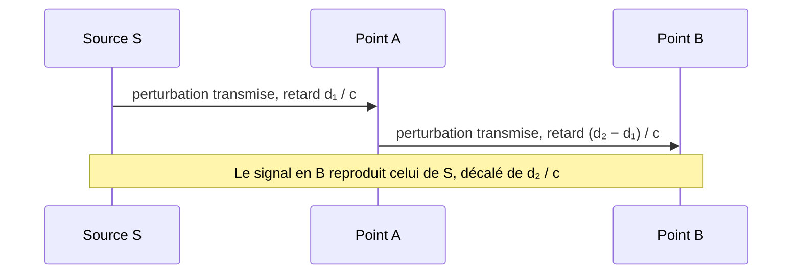

# Onde mécanique progressive

## 1. Observer avant de définir

Cinq situations très différentes en apparence :

| Situation | Ce qui est perturbé | Ce qui se propage |
|---|---|---|
| Corde tendue, secouée à une extrémité | La forme de la corde | Une « bosse » le long de la corde |
| Ressort comprimé puis relâché | L'espacement des spires | Une zone de compression |
| Caillou jeté dans l'eau | Le niveau de la surface | Des rides circulaires |
| Haut-parleur | La pression de l'air | Une alternance de surpressions et de dépressions |
| Séisme | La position des roches | Une secousse qui s'éloigne de l'épicentre |

Point commun : une **déformation locale** apparaît quelque part et **se déplace** dans le milieu, alors que le milieu lui-même ne voyage pas.

## 2. Définitions

!!! note "Définition : perturbation (ou signal)"
    Une **perturbation** est une modification locale et temporaire d'une propriété du milieu : position, pression, masse volumique, hauteur d'eau…

!!! note "Définition : onde mécanique progressive"
    Une **onde mécanique progressive** est le phénomène de **propagation d'une perturbation, de proche en proche, dans un milieu matériel**, **sans transport global de matière** mais **avec transport d'énergie**.

    - *mécanique* : la propagation fait intervenir la matière du milieu (ses constituants interagissent) ;
    - *progressive* : la perturbation se déplace dans une direction donnée, en s'éloignant de la source.

!!! note "Définition : source, milieu de propagation, récepteur"
    - La **source** est l'endroit où la perturbation est créée (main, haut-parleur, faille sismique).
    - Le **milieu de propagation** est le matériau déformé au passage de la perturbation (corde, air, eau, roche).
    - Le **récepteur** (capteur, oreille, sismomètre) détecte la perturbation.

### Dimension de la propagation

| Dimension | Exemple | Remarque |
|---|---|---|
| 1D | Corde, ressort | La perturbation reste sur une ligne |
| 2D | Surface de l'eau | Les rides s'étalent en cercles |
| 3D | Son dans l'air, séisme dans le sol | La perturbation s'étale sur des sphères |

## 3. Propriétés fondamentales

!!! tip "Propriété 1 : un milieu matériel est nécessaire"
    Une onde mécanique **ne se propage pas dans le vide**. Le son ne se propage pas dans l'espace, contrairement à la lumière (qui n'est pas une onde mécanique).

!!! tip "Propriété 2 : transport d'énergie, pas de matière"
    Une onde mécanique transporte de l'**énergie** (une vitre peut vibrer sous l'effet d'un son intense) mais **ne déplace pas la matière** d'un bout à l'autre du milieu : chaque élément du milieu oscille autour de sa position d'équilibre puis y revient.

!!! tip "Propriété 3 : propagation de proche en proche"
    Chaque point du milieu **reproduit le mouvement de la source avec un retard** : il est mis en mouvement par son voisin immédiat, qui a lui-même été mis en mouvement par le sien.

!!! tip "Propriété 4 : le milieu retrouve son état initial"
    Après le passage de la perturbation, le milieu revient à son état d'équilibre (milieu élastique).

!!! warning "Attention : modèle idéal"
    Dans la réalité, l'onde s'amortit (frottements) et, en dimensions 2 et 3, son énergie s'étale sur un front de plus en plus grand, donc l'amplitude diminue. Dans ce chapitre on **néglige** ces effets : la perturbation se propage **sans déformation ni atténuation**. Cette hypothèse sera toujours précisée dans les énoncés.

## 4. Le retard

!!! note "Définition : retard"
    Le **retard** $\tau$ d'un point $M$ par rapport à la source $S$ est la durée que met la perturbation pour aller de $S$ à $M$.

!!! tip "Propriété : retard et célérité"
    Si la perturbation se propage à la célérité $c$ (voir [fichier 4](04-celerite.md)) sur une distance $d$ :

    $$\tau = \frac{d}{c}$$

    et le point $M$ reproduit le mouvement de $S$ avec ce retard :

    $$y_M(t) = y_S(t - \tau)$$

    avec $\tau$ en s, $d$ en m, $c$ en $\mathrm{m\cdot s^{-1}}$.

!!! quote "Démonstration"
    La perturbation quitte $S$ à l'instant $t_0$. Elle se propage à célérité constante $c$ : elle parcourt la distance $d$ en une durée $\tau = d/c$, donc arrive en $M$ à l'instant $t_0 + \tau$.

    Ce que fait $M$ à l'instant $t$ est donc ce que $S$ faisait à l'instant $t - \tau$ : $y_M(t) = y_S(t - \tau)$. $\blacksquare$

!!! warning "Attention : le retard n'existe qu'après l'arrivée de l'onde"
    La relation $y_M(t) = y_S(t-\tau)$ n'est valable que pour $t \geq \tau$. Avant l'arrivée de la perturbation, $M$ est **au repos**.

## 5. Une onde ne transporte pas la matière

!!! example "Exemple : le bouchon sur l'eau"
    Un bouchon posé sur l'eau monte et descend au passage d'une vague, puis reste (à peu près) au même endroit. L'énergie de la vague a traversé le bouchon, pas la matière.

!!! example "Exemple : la « ola » dans un stade"
    La vague fait le tour du stade en quelques secondes. Chaque spectateur se lève puis se rassoit **sur place**. Ce qui voyage, c'est l'*information* « lève-toi », transmise de proche en proche avec un retard.

## 6. Erreurs fréquentes

!!! failure "Erreur fréquente : « l'onde transporte de la matière »"
    Faux. Elle transporte de l'énergie et de l'information. Les éléments du milieu oscillent autour d'une position d'équilibre.

!!! failure "Erreur fréquente : « le son a besoin d'air »"
    Imprécis. Il a besoin d'un **milieu matériel** quelconque : air, eau, métal… mais pas du vide.

!!! failure "Erreur fréquente : « onde mécanique = onde sonore »"
    Faux. Le son est **un** exemple d'onde mécanique. Une onde sur une corde, une onde sismique, la houle en sont d'autres.

!!! failure "Erreur fréquente : confondre « progressive » et « périodique »"
    Une impulsion unique sur une corde est une onde progressive **non périodique**. La périodicité est une propriété supplémentaire (voir [fichier 5](05-onde-periodique.md)).

## 7. Vérifie-toi

!!! question "Énoncé"
    1. Pourquoi un astronaute ne peut-il pas entendre l'explosion d'un vaisseau situé à quelques mètres de lui dans le vide ?
    2. Dans la « ola », qu'est-ce qui joue le rôle de la perturbation, du milieu, de la célérité ?
    3. À quelle condition peut-on écrire $y_M(t) = y_S(t - \tau)$ ?

??? info "Corrigé"
    1. Le son est une onde mécanique : sans milieu matériel entre l'explosion et l'astronaute, rien ne peut transmettre la perturbation de proche en proche.
    2. Perturbation : « debout puis assis » d'un spectateur ; milieu : l'ensemble des spectateurs ; célérité : le nombre de spectateurs (ou de mètres de gradin) atteints par seconde.
    3. La propagation doit se faire sans déformation ni atténuation, à célérité constante, et on doit avoir $t \geq \tau$.
