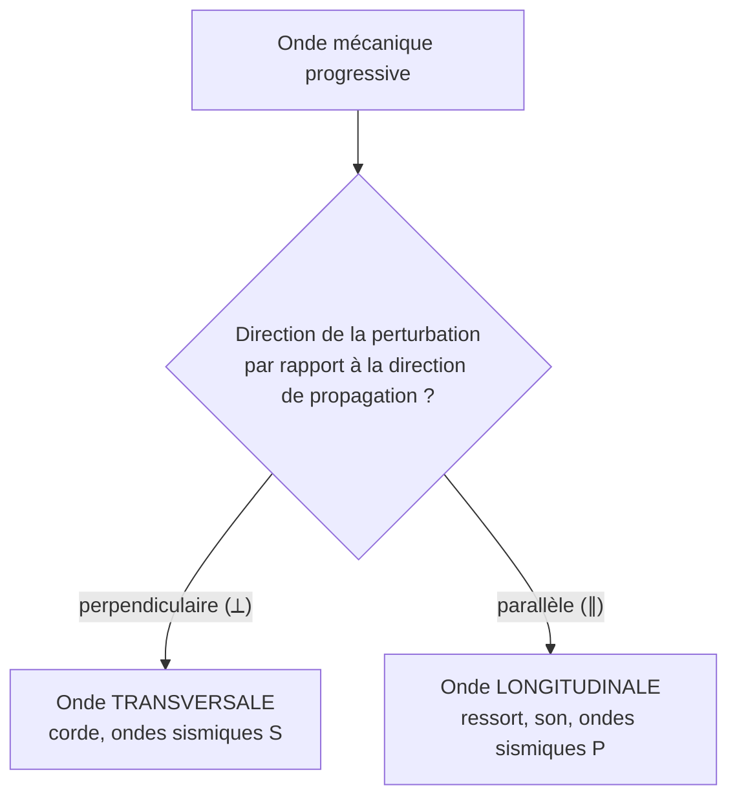

# Ondes transversales et ondes longitudinales

## 1. Deux directions à ne pas confondre

Pour classer une onde, on compare deux directions :

- la **direction de propagation** : celle dans laquelle la perturbation s'éloigne de la source ;
- la **direction de la perturbation** : celle dans laquelle les éléments du milieu se déplacent localement (autour de leur position d'équilibre).

!!! note "Définition : onde transversale"
    Une onde est **transversale** si la direction de la perturbation est **perpendiculaire** à la direction de propagation.

!!! note "Définition : onde longitudinale"
    Une onde est **longitudinale** si la direction de la perturbation est **parallèle** à la direction de propagation.

## 2. Ondes transversales

- **Corde tendue** : on secoue l'extrémité verticalement ; la bosse avance horizontalement, mais chaque point de la corde monte et descend. Perturbation verticale, propagation horizontale : $\perp$.
- **Ondes sismiques S** (secondaires) : le sol est cisaillé perpendiculairement à la direction de propagation.

## 3. Ondes longitudinales

- **Ressort** : on comprime quelques spires. La zone comprimée avance le long du ressort, et chaque spire oscille d'avant en arrière **le long de l'axe du ressort** : $\parallel$.
- **Son dans l'air** : un haut-parleur comprime puis dilate l'air devant lui. Il se forme des zones de **surpression** (compression) et de **dépression** (dilatation) qui avancent ; chaque molécule oscille d'avant en arrière autour de sa position moyenne, **dans la direction de propagation**.
- **Ondes sismiques P** (primaires) : compression-dilatation des roches.

!!! tip "Propriété : quels milieux transmettent quelles ondes ?"
    - Un **solide** résiste au cisaillement : il peut transmettre des ondes **transversales et longitudinales**.
    - Un **fluide** (liquide, gaz) ne résiste pas au cisaillement : il ne transmet que des ondes **longitudinales** (de volume). C'est pourquoi le son est longitudinal dans l'air et dans l'eau.

## 4. Cas intermédiaire : la surface de l'eau

!!! warning "Attention : la houle n'est ni purement transversale, ni purement longitudinale"
    À la surface de l'eau, les particules décrivent en réalité des trajectoires **circulaires ou elliptiques**, avec une composante verticale **et** une composante horizontale. Au niveau de la Première, on modélise l'onde par la seule variation de hauteur de la surface, perpendiculaire à la propagation, et on la qualifie d'onde **transversale**. C'est une approximation : si un énoncé demande une justification, parle du « mouvement vertical du bouchon ».

## 5. Application : ondes sismiques

| Onde | Nom | Type | Célérité typique (croûte) | Traverse un liquide ? |
|---|---|---|---|---|
| **P** | Primaire | Longitudinale | environ $6\ \mathrm{km\cdot s^{-1}}$ | Oui |
| **S** | Secondaire | Transversale | environ $3{,}5\ \mathrm{km\cdot s^{-1}}$ | **Non** |

Les ondes P arrivent **en premier** (plus rapides). Les ondes S ne traversent pas le noyau externe de la Terre, qui est liquide : leur disparition derrière le noyau a prouvé qu'il est liquide.

## 6. Méthode d'identification

!!! success "Méthode : classer une onde"
    1. Représenter ou identifier la direction de **propagation** (flèche partant de la source).
    2. Identifier la direction du **mouvement local** d'un élément du milieu.
    3. Comparer : perpendiculaire $\Rightarrow$ transversale ; parallèle $\Rightarrow$ longitudinale.
    4. Si le milieu est un fluide, vérifier la cohérence : onde de volume $\Rightarrow$ longitudinale.

## 7. Erreurs fréquentes

!!! failure "Erreur fréquente : confondre la direction de propagation et celle de la perturbation"
    Une bosse qui avance vers la droite sur une corde n'est **pas** une onde « horizontale » donc longitudinale. Ce qui compte, c'est le mouvement des **points de la corde** : vertical.

!!! failure "Erreur fréquente : « le son est une onde transversale car on le représente par une sinusoïde »"
    La courbe sinusoïdale d'un oscillogramme représente la **pression en fonction du temps**, pas la forme du milieu. Elle ne dit rien du caractère transversal ou longitudinal.

!!! failure "Erreur fréquente : « les molécules d'air voyagent du haut-parleur à l'oreille »"
    Faux. Elles oscillent localement. Si elles voyageaient, un orchestre à 50 m dégagerait un vent perceptible.

## 8. Vérifie-toi

!!! question "Énoncé"
    1. Classer : onde sur une corde de guitare, son d'une flûte, onde S, secousse d'un ressort étiré le long de son axe.
    2. Pourquoi un sismographe situé à l'opposé de la Terre par rapport à l'épicentre ne détecte-t-il pas d'onde S directe ?
    3. Un élève dit : « dans l'eau, le son est transversal car l'eau monte et descend ». Que répondre ?

??? info "Corrigé"
    1. Corde : transversale ; flûte (son) : longitudinale ; onde S : transversale ; ressort étiré puis comprimé le long de l'axe : longitudinale.
    2. Les ondes S ne se propagent pas dans les liquides ; elles ne peuvent traverser le noyau externe.
    3. Il confond avec la houle. Le **son** dans l'eau est une onde de pression : les molécules oscillent dans la direction de propagation, donc longitudinale.
