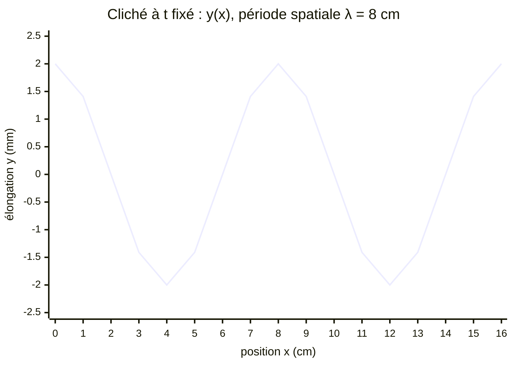
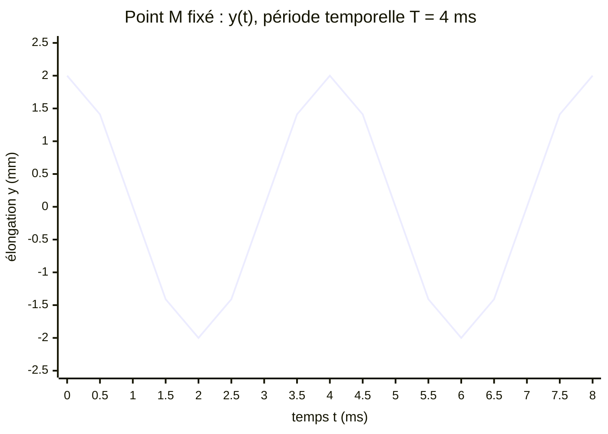

# Onde progressive périodique et double périodicité

## 1. Onde progressive périodique

!!! note "Définition : onde progressive périodique"
    Une **onde progressive périodique** est une onde créée par une source qui répète **la même perturbation à intervalles de temps égaux**.

!!! note "Définition : période et fréquence"
    - La **période** $T$ (en s) est la plus petite durée au bout de laquelle la perturbation se reproduit identique à elle-même.
    - La **fréquence** $f$ (en Hz) est le nombre de périodes par seconde :

    $$f = \frac{1}{T}$$

!!! tip "Propriété : la source impose $T$ et $f$"
    La période et la fréquence de l'onde sont celles de **la source**. Chaque point du milieu vibre ensuite avec cette même période.

Exemples : diapason, haut-parleur alimenté par un GBF, vibreur au bout d'une corde, cuve à ondes à pointe vibrante.

## 2. La double périodicité

Une onde progressive périodique est **périodique de deux façons différentes**.

!!! note "Définition : périodicité temporelle"
    **En un point fixé $M$** du milieu, l'élongation $y_M(t)$ (écart par rapport à la position d'équilibre) est une fonction **périodique du temps**, de période $T$.

!!! note "Définition : périodicité spatiale et longueur d'onde"
    **À un instant fixé**, l'aspect du milieu (la forme de la corde, la répartition des pressions…) est périodique **dans l'espace**. Sa période spatiale est la **longueur d'onde** $\lambda$ (en m) :

    $\lambda$ est la **plus petite distance séparant deux points du milieu vibrant exactement de la même façon à chaque instant** (deux points en phase).

Pour une onde de forme sinusoïdale, $\lambda$ est la distance entre deux crêtes consécutives (ou deux creux consécutifs).

### Deux graphiques, deux périodes

**Graphe spatial** : photographie du milieu à un instant fixé, élongation en fonction de la position $x$. On lit $\lambda$.

**Graphe temporel** : enregistrement du mouvement d'un point fixe, élongation en fonction du temps $t$. On lit $T$.

!!! failure "Erreur fréquente : lire $\lambda$ sur un graphe temporel (ou $T$ sur un graphe spatial)"
    Les deux courbes ont **la même allure**, seul l'axe horizontal change. Avant toute lecture, **regarde ce que représente l'axe des abscisses** : une longueur $\Rightarrow$ $\lambda$ ; une durée $\Rightarrow$ $T$.

## 3. Pourquoi cette double périodicité ? Démonstration

!!! quote "Démonstration"
    La source $S$ (en $x = 0$) a pour élongation $y_S(t)$, périodique de période $T$. D'après la propriété du retard, un point $M$ d'abscisse $x$ a pour élongation :

    $$y(x,t) = y_S\!\left(t - \frac{x}{c}\right)$$

    - **$x$ fixé** : $y(x, t+T) = y_S\!\left(t + T - \dfrac{x}{c}\right) = y_S\!\left(t - \dfrac{x}{c}\right) = y(x,t)$ car $y_S$ est $T$-périodique. Périodicité **temporelle**, de période $T$.
    - **$t$ fixé** : décalons $x$ de $cT$ :
      $y(x + cT, t) = y_S\!\left(t - \dfrac{x}{c} - T\right) = y_S\!\left(t - \dfrac{x}{c}\right) = y(x,t)$.
      Périodicité **spatiale**, de période $\lambda = cT$. $\blacksquare$

La double périodicité n'est donc pas un postulat : elle est une **conséquence** de la périodicité de la source et de la propagation à célérité constante.

## 4. Points en phase, points en opposition de phase

!!! note "Définition : points en phase / en opposition de phase"
    - Deux points sont **en phase** s'ils ont, à chaque instant, la même élongation et vont dans le même sens.
    - Deux points sont **en opposition de phase** si, à chaque instant, leurs élongations sont opposées (cas d'une onde sinusoïdale).

!!! tip "Propriété : critère sur la distance"
    Soient deux points $M_1$ et $M_2$ situés sur la ligne de propagation, distants de $d$.

    - **En phase** si $d = k\,\lambda$ avec $k \in \mathbb{N}$ (distance multiple **entier** de $\lambda$).
    - **En opposition de phase** si $d = \left(k + \tfrac{1}{2}\right)\lambda$ avec $k \in \mathbb{N}$ (multiple **demi-entier**).

!!! quote "Démonstration"
    $M_2$ reproduit le mouvement de $M_1$ avec le retard $\tau = d/c$.

    - Si $d = k\lambda$, alors $\tau = \dfrac{k\lambda}{c} = kT$, et $y_{M_2}(t) = y_{M_1}(t - kT) = y_{M_1}(t)$ par $T$-périodicité : en phase.
    - Si $d = (k+\tfrac12)\lambda$, alors $\tau = (k + \tfrac12)T$ et, pour un signal **sinusoïdal**, $y_{M_2}(t) = y_{M_1}\!\left(t - \tfrac{T}{2}\right) = -y_{M_1}(t)$ : opposition de phase. $\blacksquare$

!!! warning "Attention : opposition de phase = signal sinusoïdal (ou symétrique)"
    La relation $y(t - T/2) = -y(t)$ est vraie pour une sinusoïde. Elle est **fausse** pour une impulsion ou un signal non symétrique : pour de tels signaux, on ne parle pas d'opposition de phase.

!!! failure "Erreur fréquente : compter les crêtes au lieu des intervalles"
    Entre la première et la quatrième crête, il y a **trois** longueurs d'onde, pas quatre : $n$ crêtes consécutives délimitent $(n-1)\,\lambda$.

## 5. Vérifie-toi

!!! question "Énoncé"
    1. Un graphe a pour abscisse le temps. Peut-on y lire $\lambda$ ?
    2. $S$ émet à $f = 50\ \mathrm{Hz}$. Quelle est la fréquence d'un point $M$ situé à $10\ \mathrm{m}$ ?
    3. Deux points sont distants de $2{,}5\,\lambda$. Phase ou opposition ?

??? info "Corrigé"
    1. Non, seulement $T$ (et $f$). Pour $\lambda$, il faut un graphe spatial, ou calculer $\lambda = cT$.
    2. $50\ \mathrm{Hz}$ : tout point du milieu vibre à la fréquence de la source.
    3. $2{,}5 = 2 + \tfrac12$ : opposition de phase.
