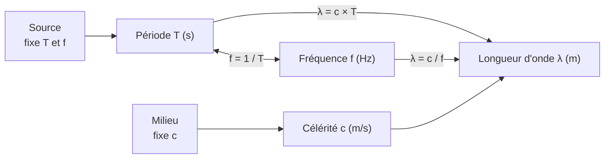

# Lien entre la longueur d'onde $\lambda$ et la période $T$

## 1. Le résultat

!!! tip "Propriété : relation fondamentale"
    $$\lambda = c\,T = \frac{c}{f}$$

    avec $\lambda$ en m, $c$ en $\mathrm{m\cdot s^{-1}}$, $T$ en s, $f$ en Hz.

!!! note "Interprétation"
    La longueur d'onde est la **distance parcourue par l'onde pendant une période**.

## 2. Deux démonstrations

!!! quote "Démonstration 1 : par la distance parcourue"
    Au temps $t_0$, la source émet une perturbation. Une période plus tard, à $t_0 + T$, elle émet la même perturbation. Pendant ce temps, la première perturbation a parcouru $d = c\,T$.

    À l'instant $t_0 + T$, la première perturbation et la nouvelle sont donc **identiques** et séparées de $cT$ : ce sont deux points du milieu en phase, **consécutifs**. Leur distance est, par définition, $\lambda$. Donc $\lambda = cT$. $\blacksquare$

!!! quote "Démonstration 2 : par le retard"
    Un point $M$ à la distance $d$ de $S$ vibre en phase avec $S$ lorsque son retard est une période : $\tau = T$. Or $\tau = d/c$, donc $d = cT$. La plus petite distance donnant une vibration en phase est $\lambda$. Donc $\lambda = cT$. $\blacksquare$

## 3. Conséquences

!!! tip "Propriété : qui fixe quoi ?"
    - La **source** fixe $T$ et $f$.
    - Le **milieu** fixe $c$.
    - **Les deux ensemble** fixent $\lambda = cT$.

| On modifie… | $T$ et $f$ | $c$ | $\lambda$ |
|---|---|---|---|
| La fréquence de la source (même milieu) | $f \nearrow \Rightarrow T \searrow$ | constante | $\lambda \searrow$ (inversement proportionnelle à $f$) |
| Le milieu (même source) | **inchangées** | change | change, proportionnelle à $c$ |
| L'amplitude | inchangées | constante | inchangée |

!!! quote "Pourquoi la fréquence ne change-t-elle pas quand l'onde change de milieu ?"
    À l'interface entre deux milieux, chaque point de l'interface est entraîné par le milieu 1 et entraîne à son tour le milieu 2 : il oscille à la fréquence $f$ imposée par la source. Si le milieu 2 recevait ou émettait moins de perturbations par seconde que le milieu 1, des crêtes s'accumuleraient (ou disparaîtraient) à l'interface, ce qui est impossible.

!!! example "Exemple : la note la à 440 Hz"
    - Dans l'air ($c = 343\ \mathrm{m\cdot s^{-1}}$) : $\lambda = \dfrac{343}{440} = 0{,}780\ \mathrm{m}$.
    - Dans l'eau ($c = 1{,}48 \times 10^3\ \mathrm{m\cdot s^{-1}}$) : $\lambda = \dfrac{1480}{440} = 3{,}36\ \mathrm{m}$.
    - $f = 440\ \mathrm{Hz}$ dans les deux cas.

!!! example "Ordres de grandeur : le son audible"
    Pour $f$ de $20\ \mathrm{Hz}$ à $20\ \mathrm{kHz}$ dans l'air : $\lambda$ varie de $\dfrac{343}{20} \approx 17\ \mathrm{m}$ à $\dfrac{343}{20\,000} \approx 1{,}7\ \mathrm{cm}$.

## 4. Mesurer $\lambda$ et $T$ avec précision

!!! success "Méthode : mesurer sur plusieurs périodes"
    Pour réduire l'incertitude relative, on mesure la distance occupée par $N$ longueurs d'onde (ou la durée de $N$ périodes), puis on divise par $N$.

    Exemple : $5$ longueurs d'onde occupent $1{,}720\ \mathrm{m}$, donc $\lambda = \dfrac{1{,}720}{5} = 0{,}344\ \mathrm{m}$.

!!! success "Méthode : contrôler l'homogénéité"
    $[c\,T] = \mathrm{m\cdot s^{-1}} \times \mathrm{s} = \mathrm{m}$ ✓ : le résultat est bien une longueur.

## 5. Erreurs fréquentes et cas particuliers

!!! failure "Erreur fréquente : « si $f$ double, $c$ double »"
    Faux. À milieu fixé, $c$ est constante : c'est **$\lambda$ qui est divisée par deux**.

!!! failure "Erreur fréquente : oublier les conversions"
    $f = 25\ \mathrm{kHz} = 2{,}5 \times 10^4\ \mathrm{Hz}$ ; $T = 4{,}0\ \mathrm{ms} = 4{,}0 \times 10^{-3}\ \mathrm{s}$. Une erreur d'unité donne un résultat faux d'un facteur $10^3$.

!!! warning "Attention : la relation $\lambda = cT$ suppose une célérité constante"
    Si l'onde traverse plusieurs milieux, il y a **une longueur d'onde par milieu**, avec la **même** fréquence. Pour une distance totale parcourue, on **additionne** les nombres de longueurs d'onde de chaque milieu et on n'utilise pas une longueur d'onde unique (voir exercice 7, fichier 10).

## 6. Vérifie-toi

!!! question "Énoncé"
    1. $c = 340\ \mathrm{m\cdot s^{-1}}$, $T = 2{,}0\ \mathrm{ms}$. Calculer $\lambda$.
    2. Une onde de fréquence $500\ \mathrm{Hz}$ passe de l'air à l'eau. Quelles grandeurs changent ?
    3. Pourquoi mesure-t-on $\lambda$ sur plusieurs longueurs d'onde ?

??? info "Corrigé"
    1. $\lambda = cT = 340 \times 2{,}0 \times 10^{-3} = 0{,}68\ \mathrm{m}$.
    2. $c$ et $\lambda$ changent ; $f$ et $T$ sont inchangées.
    3. L'incertitude absolue de lecture est la même, mais l'incertitude **relative** sur $\lambda$ est divisée par $N$.
