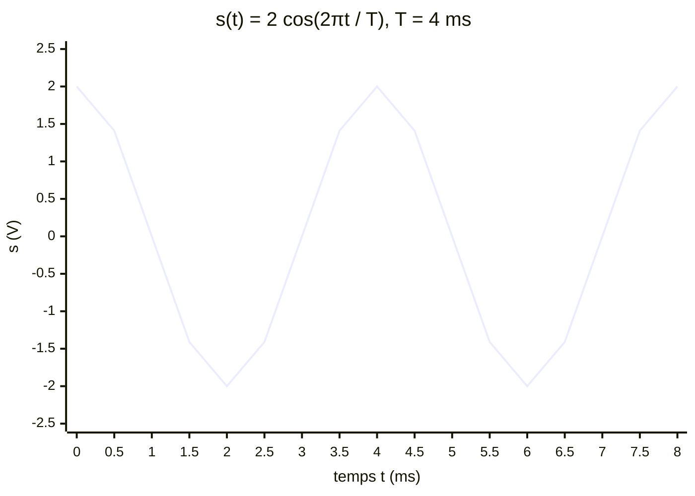
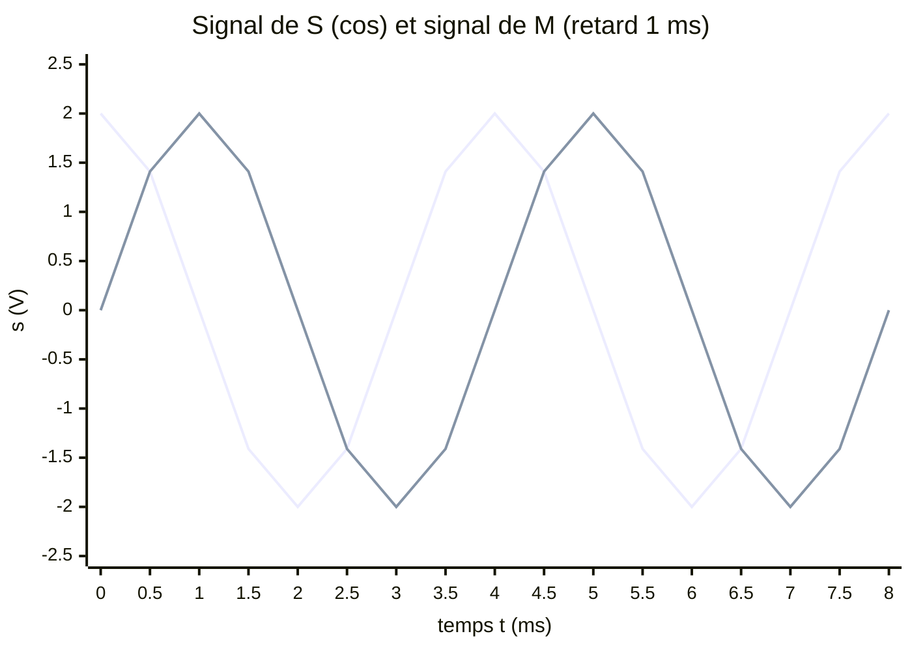

# Modélisation d'une onde périodique par un signal sinusoïdal

## 1. Pourquoi une sinusoïde ?

La sinusoïde est la plus simple des fonctions périodiques. Elle décrit :

- le mouvement d'un oscillateur (diapason, pendule aux petits angles, masse au bout d'un ressort) ;
- le signal émis par un haut-parleur alimenté par un GBF réglé en mode sinus.

Un son musical réel est plus compliqué, mais on admet (hors programme) que toute onde périodique est une **somme de sinusoïdes** : comprendre la sinusoïde permet de comprendre tout signal périodique.

## 2. Signal sinusoïdal

!!! note "Définition : signal sinusoïdal"
    Un signal est **sinusoïdal** s'il s'écrit :

    $$s(t) = S_m \cos\!\left(\frac{2\pi}{T}\,t + \varphi\right) = S_m\cos\left(2\pi f\,t + \varphi\right)$$

    | Grandeur | Nom | Unité |
    |---|---|---|
    | $S_m$ | **Amplitude** ($S_m > 0$) | unité de $s$ |
    | $T$ | Période | s |
    | $f = 1/T$ | Fréquence | Hz |
    | $\varphi$ | **Phase à l'origine** | rad |
    | $\dfrac{2\pi}{T}t + \varphi$ | Phase à l'instant $t$ | rad |

!!! tip "Propriétés du signal sinusoïdal"
    - Il est **borné** : $-S_m \leq s(t) \leq S_m$.
    - Il est **périodique** de période $T$.
    - Sa **valeur crête à crête** vaut $2S_m$ et sa valeur moyenne est nulle.

!!! quote "Démonstration de la périodicité"
    $s(t+T) = S_m\cos\!\left(\dfrac{2\pi(t+T)}{T} + \varphi\right) = S_m\cos\!\left(\dfrac{2\pi t}{T} + \varphi + 2\pi\right) = s(t)$ car $\cos$ est $2\pi$-périodique. $\blacksquare$

!!! note "Remarque : pulsation"
    On note parfois $\omega = \dfrac{2\pi}{T} = 2\pi f$ (en $\mathrm{rad\cdot s^{-1}}$) et $s(t) = S_m\cos(\omega t + \varphi)$. C'est la même chose écrite plus court.

### Un exemple : $T = 4\ \mathrm{ms}$, $S_m = 2\ \mathrm{V}$, $\varphi = 0$

## 3. Lire un graphe : amplitude, période, phase

!!! success "Méthode : déterminer $S_m$, $T$, $\varphi$ sur un graphe"
    1. **Amplitude** : $S_m = \dfrac{s_{\max} - s_{\min}}{2}$.
    2. **Période** : durée entre deux points identiques consécutifs (deux maxima, deux passages à zéro **dans le même sens**). Pour plus de précision, mesurer $N$ périodes et diviser par $N$.
    3. **Phase à l'origine** : on regarde $s(0)$ et si le signal croît ou décroît en $t=0$ ; voir le tableau.

| Situation à $t = 0$ | $\varphi$ | Expression |
|---|---|---|
| Maximum | $0$ | $S_m\cos\dfrac{2\pi t}{T}$ |
| Zéro, puis **croissant** | $-\dfrac{\pi}{2}$ | $S_m\sin\dfrac{2\pi t}{T}$ |
| Minimum | $\pi$ (ou $-\pi$) | $-S_m\cos\dfrac{2\pi t}{T}$ |
| Zéro, puis **décroissant** | $+\dfrac{\pi}{2}$ | $-S_m\sin\dfrac{2\pi t}{T}$ |

Vérification : $\cos\left(x - \tfrac{\pi}{2}\right) = \sin x$ et $\cos\left(x + \tfrac{\pi}{2}\right) = -\sin x$.

!!! warning "Attention : plusieurs valeurs de $\varphi$ pour un même signal"
    $\varphi$ est défini **à $2\pi$ près** : $\varphi = \pi$ et $\varphi = -\pi$ décrivent le même signal. On choisit conventionnellement $\varphi \in \left]-\pi, \pi\right]$.

## 4. Le signal reçu en un point $M$

Si $s_S(t) = S_m\cos\left(\dfrac{2\pi t}{T} + \varphi\right)$ est le signal émis, le signal reçu à la distance $d$ est (pour $t \geq \tau$) :

$$s_M(t) = s_S(t - \tau) = S_m\cos\!\left(\frac{2\pi (t-\tau)}{T} + \varphi\right) = S_m\cos\!\left(\frac{2\pi t}{T} + \varphi - \frac{2\pi\tau}{T}\right)$$

!!! tip "Propriété : déphasage dû à la propagation"
    Le déphasage du signal en $M$ par rapport à celui de la source est :

    $$\Delta\varphi = \varphi_M - \varphi_S = -\frac{2\pi\tau}{T} = -\frac{2\pi d}{\lambda}$$

    Le signe négatif traduit le **retard**. L'amplitude et la période sont inchangées.

!!! quote "Démonstration de la dernière égalité"
    $\tau = d/c$ et $T = \lambda/c$, donc $\dfrac{\tau}{T} = \dfrac{d/c}{\lambda/c} = \dfrac{d}{\lambda}$. $\blacksquare$

| Distance $d$ | Retard $\tau$ | Déphasage | Relation |
|---|---|---|---|
| $\lambda/4$ | $T/4$ | $-\pi/2$ | en quadrature |
| $\lambda/2$ | $T/2$ | $-\pi$ | opposition de phase |
| $\lambda$ | $T$ | $-2\pi \equiv 0$ | en phase |

### Illustration : retard $\tau = T/4$ ($T = 4\ \mathrm{ms}$, donc $\tau = 1\ \mathrm{ms}$)

Le maximum de $M$ (à $t = 1\ \mathrm{ms}$) a lieu $1\ \mathrm{ms}$ **après** celui de $S$ (à $t = 0$). Le signal le plus « en avance » est celui de la source. (Pour $t < \tau$, la courbe de $M$ devrait rester nulle : le tracé donne l'allure en régime établi.)

!!! failure "Erreur fréquente : mauvais sens du décalage"
    Le signal en $M$ est celui de $S$ **retardé** : on remplace $t$ par $t - \tau$, pas par $t + \tau$.

## 5. Expression complète de l'onde (hors programme)

!!! quote "Élongation en tout point et à tout instant"
    En remplaçant $\tau$ par $x/c$ avec $\lambda = cT$ :

    $$s(x,t) = S_m\cos\!\left[2\pi\left(\frac{t}{T} - \frac{x}{\lambda}\right) + \varphi\right]$$

    La **double périodicité** est visible : $T$-périodique en $t$, $\lambda$-périodique en $x$.

## 6. Lire un oscillogramme

!!! success "Méthode : utiliser les sensibilités"
    - **Période** : $T = n_{\text{div}} \times (\text{sensibilité horizontale})$, par exemple $4{,}0$ div $\times\ 0{,}5\ \mathrm{ms/div} = 2{,}0\ \mathrm{ms}$.
    - **Amplitude** : $S_m = n_{\text{div}} \times (\text{sensibilité verticale})$, mesurée du zéro au maximum.
    - Tension crête à crête : $U_{pp} = 2S_m$.

## 7. Erreurs fréquentes

!!! failure "Erreur fréquente : calculatrice en degrés"
    Les calculs de $\cos$ et $\sin$ avec des arguments en radians exigent le mode `RAD`.

!!! failure "Erreur fréquente : confondre amplitude et valeur crête à crête"
    Si le signal oscille entre $-5\ \mathrm{V}$ et $+5\ \mathrm{V}$, $S_m = 5\ \mathrm{V}$ et $U_{pp} = 10\ \mathrm{V}$.

!!! failure "Erreur fréquente : mélanger unités de temps"
    Dans $\dfrac{2\pi t}{T}$, $t$ et $T$ doivent avoir **la même unité**.

## 8. Vérifie-toi

!!! question "Énoncé"
    1. Un signal vaut $s(t) = 3{,}0\cos\!\left(\dfrac{2\pi t}{0{,}020} + \dfrac{\pi}{3}\right)$ (SI). Donner $S_m$, $T$, $f$, $\varphi$ et $s(0)$.
    2. Le signal de $S$ est $s_S(t) = 5\cos(100\pi t)$. Quelle est la période ?
    3. Écrire le signal d'un point $M$ en retard de $T/3$.

??? info "Corrigé"
    1. $S_m = 3{,}0\ \mathrm{V}$ (ou unité du signal), $T = 0{,}020\ \mathrm{s}$, $f = 50\ \mathrm{Hz}$, $\varphi = \pi/3$ ; $s(0) = 3{,}0\cos\frac{\pi}{3} = 1{,}5$.
    2. $\dfrac{2\pi}{T} = 100\pi$ donc $T = 0{,}020\ \mathrm{s}$.
    3. $s_M(t) = 5\cos\!\left(100\pi\left(t - \dfrac{T}{3}\right)\right) = 5\cos\!\left(100\pi t - \dfrac{2\pi}{3}\right)$, pour $t \geq T/3$.
