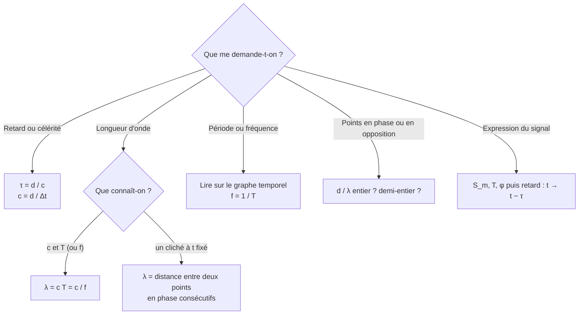

# Méthodes à maîtriser

!!! success "M1 : classer une onde (transversale ou longitudinale)"
    1. Direction de propagation.
    2. Direction du mouvement local d'un élément du milieu.
    3. $\perp$ : transversale ; $\parallel$ : longitudinale.

!!! success "M2 : déterminer une célérité à partir d'un enregistrement"
    1. Lire la distance $d$ entre capteurs ou entre deux positions du signal.
    2. Lire le retard $\Delta t$ sur le même repère des deux courbes.
    3. Convertir : $d$ en m, $\Delta t$ en s.
    4. $c = d/\Delta t$, unité $\mathrm{m\cdot s^{-1}}$, 2 ou 3 chiffres significatifs.

!!! success "M3 : lire $T$, $f$, $\lambda$"
    1. Regarder la **grandeur portée par l'axe horizontal**.
    2. Durée $\Rightarrow$ période $T$ ; distance $\Rightarrow$ $\lambda$.
    3. Mesurer sur $N$ périodes : $N$ crêtes $\Rightarrow$ $N-1$ intervalles.
    4. $f = 1/T$.

!!! success "M4 : relier $\lambda$, $c$, $T$"
    1. Écrire $\lambda = cT = c/f$.
    2. Vérifier que $c$ correspond au bon milieu et que $T$ (ou $f$) est la même dans tous les milieux.
    3. Convertir kHz, ms, mm avant le calcul.
    4. Vérifier l'ordre de grandeur (un son audible a un $\lambda$ de quelques cm à quelques m).

!!! success "M5 : décider si deux points sont en phase"
    1. Calculer le rapport $\dfrac{d}{\lambda}$ (ou $\dfrac{\tau}{T}$).
    2. Entier $\Rightarrow$ en phase. Demi-entier $\Rightarrow$ opposition de phase. Autre $\Rightarrow$ ni l'un ni l'autre.
    3. Si plusieurs milieux : additionner les rapports $d_i/\lambda_i$.

!!! success "M6 : écrire le signal sinusoïdal d'un graphe"
    1. $S_m$ : demi-écart entre maximum et minimum.
    2. $T$ : période lue.
    3. $\varphi$ : d'après la valeur et le sens de variation à $t=0$.
    4. Pour un point retardé : remplacer $t$ par $t-\tau$ et préciser « pour $t \geq \tau$ ».

!!! success "M7 : rédiger une application numérique"
    1. Relation **littérale**.
    2. Remplacement avec **unités SI**.
    3. Résultat avec **unité** et **bon nombre de chiffres significatifs** (celui de la donnée la moins précise).
    4. Phrase de **conclusion** répondant à la question.

!!! success "M8 : contrôler son résultat"
    - Homogénéité : $[cT] = \mathrm{m}$, $[d/c] = \mathrm{s}$.
    - Ordre de grandeur : $343\ \mathrm{m\cdot s^{-1}}$ dans l'air, $1{,}5\ \mathrm{km\cdot s^{-1}}$ dans l'eau.
    - Sens physique : plus la fréquence est grande, plus $\lambda$ est petite.
