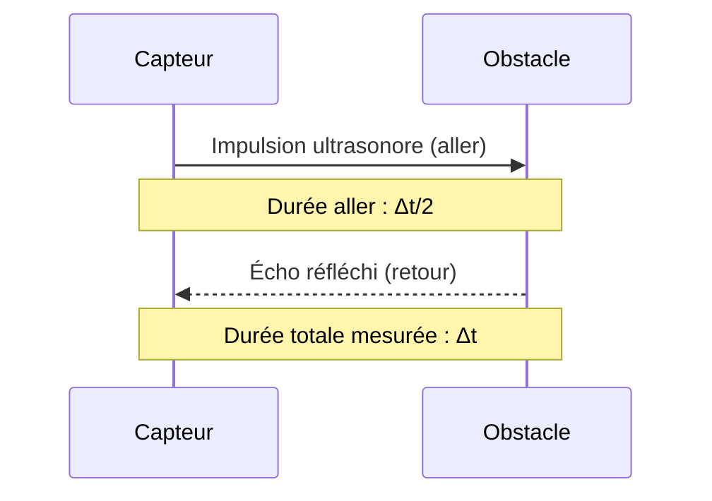

# 1. La physique du télémètre ultrasonore

## Objectifs

Expliquer le principe de l'écho, déterminer une distance et calculer une portée maximale à partir du temps d'écoute.

## Définitions

!!! definition "Ultrason"
    Un ultrason est une onde sonore dont la fréquence est supérieure à environ $20\,\text{kHz}$, limite supérieure usuelle de l'audition humaine.

!!! definition "Écho"
    Un écho est une onde réfléchie par un obstacle et reçue après propagation depuis la source jusqu'à l'obstacle puis retour vers le récepteur.

!!! propriete "Temps de vol aller-retour"
    Si l'obstacle est à la distance $d$, si la célérité de l'onde est $v$ et si la durée mesurée entre émission et réception est $\Delta t$, alors :
    $$
    \boxed{d=\frac{v\Delta t}{2}}
    $$

## Cours détaillé

Le capteur émet une impulsion ultrasonore. L'onde se propage dans l'air, rencontre un obstacle, puis une partie de l'énergie est réfléchie vers le capteur. L'appareil mesure le délai entre l'émission et la réception de l'écho.

La distance parcourue par l'onde pendant la durée $\Delta t$ est $2d$, car elle effectue un aller-retour :
$$
2d=v\Delta t
$$
D'où :
$$
d=\frac{v\Delta t}{2}
$$

Dans l'air, à température ambiante, on peut utiliser approximativement $v=340\,\text{m}/\text{s}$, sauf valeur différente imposée par l'énoncé.

## Détermination de la portée maximale

Si le capteur attend au plus une durée $\Delta t_{\max}$ avant de considérer qu'aucun écho n'est reçu, la portée maximale théorique liée à cette fenêtre temporelle est :
$$
\boxed{d_{\max}=\frac{v\Delta t_{\max}}{2}}
$$

Cette limite temporelle ne garantit pas la détection réelle : l'écho peut être trop faible, l'obstacle mal orienté ou la réflexion insuffisante.

## Exemple corrigé

Un capteur reçoit un écho $14{,}0\,\text{ms}$ après l'émission. On prend $v=343\,\text{m}/\text{s}$.

Conversion :
$$
\Delta t=14{,}0\times10^{-3}\,\text{s}
$$
Calcul :
$$
d=\frac{343\times14{,}0\times10^{-3}}{2}
=2{,}401\,\text{m}
$$
Compte tenu des données, on donne :
$$
\boxed{d\approx2{,}40\,\text{m}}
$$

## Méthode à maîtriser

1. Identifier si le temps fourni correspond à l'aller simple ou à l'aller-retour.
2. Convertir les millisecondes en secondes.
3. Écrire $2d=v\Delta t$.
4. Isoler $d$.
5. Calculer avec les unités.
6. Interpréter le résultat.

!!! attention "Erreur majeure"
    Oublier le facteur 2 conduit à une distance deux fois trop grande. Le capteur mesure le temps d'aller-retour.

## Limites physiques et pratiques

La portée réelle dépend notamment de l'atténuation dans l'air, de la puissance émise, de la sensibilité du récepteur, de la taille et de l'orientation de l'obstacle, des réflexions parasites et de la température (qui influence la célérité du son).
