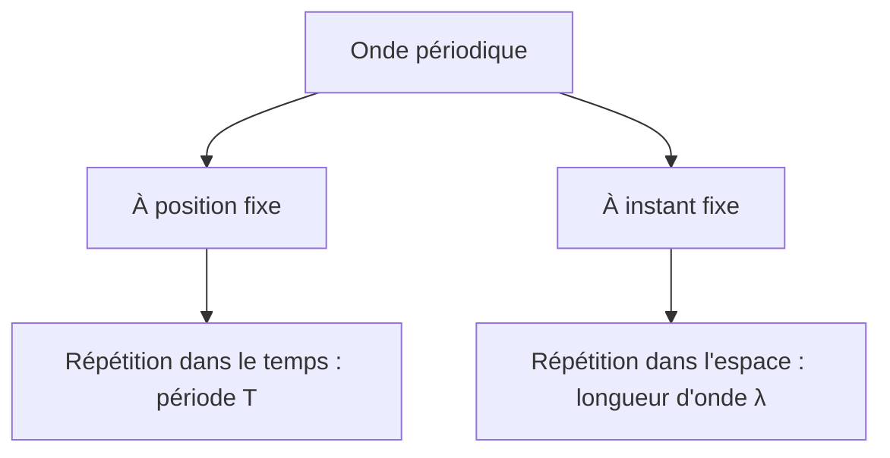

# 2. Les ondes mécaniques périodiques

## Objectifs

Définir une onde mécanique, caractériser ses périodicités temporelle et spatiale, relier $v$, $f$, $T$ et $\\lambda$, puis exploiter un signal périodique.

## Définitions

!!! definition "Onde mécanique"
    Une onde mécanique est la propagation d'une perturbation dans un milieu matériel, sans transport global de matière, mais avec transport d'énergie.

!!! definition "Onde périodique"
    Une onde est périodique lorsque la perturbation se reproduit identiquement à intervalles réguliers dans le temps et/ou dans l'espace.

!!! definition "Période temporelle"
    La période temporelle $T$ est la plus petite durée au bout de laquelle, en un point donné, le signal se répète. Elle s'exprime en secondes.

!!! definition "Longueur d'onde"
    La longueur d'onde $\\lambda$ est la plus petite distance séparant deux points consécutifs en phase, à un instant donné. Elle s'exprime en mètres.

!!! definition "Fréquence"
    La fréquence $f$ est le nombre de périodes par seconde :
    $$
    f=\\frac{1}{T}
    $$
    Elle s'exprime en hertz (Hz).

## A. Double périodicité

### Périodicité temporelle

En un point fixe du milieu, on observe une répétition du mouvement au bout d'une durée $T$.

### Périodicité spatiale

À un instant donné, le profil spatial se répète tous les $\\lambda$. Deux crêtes successives d'une onde sinusoïdale progressive sont séparées par une longueur d'onde.

## B. Relation entre longueur d'onde, période et célérité

Pendant une durée égale à une période $T$, une onde progressive parcourt une longueur d'onde $\\lambda$. La célérité est donc :
$$
v=\\frac{\\lambda}{T}
$$
Or $f=1/T$, donc :
$$
\\boxed{v=\\lambda f}
$$

Unités :
- $v$ en $\\text{m}\\,\\text{s}^{-1}$ ;
- $\\lambda$ en m ;
- $f$ en Hz, soit $\\text{s}^{-1}$ ;
- $T$ en s.

## C. Modélisation d'un signal périodique

Un signal sinusoïdal peut être décrit par :
$$
s(t)=s_0+A\\cos\\left(\\frac{2\\pi}{T}t+\\varphi\\right)
$$
où :
- $s_0$ est la valeur moyenne ;
- $A$ est l'amplitude ;
- $T$ est la période ;
- $\\varphi$ est la phase initiale en radians.

Comme $f=1/T$ :
$$
s(t)=s_0+A\\cos(2\\pi ft+\\varphi)
$$

La fonction cosinus se répète lorsque son argument augmente de $2\\pi$. Le signal se répète donc lorsque le temps augmente de $T$.

!!! attention "Tous les signaux périodiques ne sont pas sinusoïdaux"
    Un signal carré, triangulaire ou complexe peut être périodique sans être décrit par une seule fonction sinus ou cosinus.

## Exemple corrigé 1 — Longueur d'onde

Une onde se propage à $v=18\\,\\text{m}\\,\\text{s}^{-1}$ avec une fréquence $f=6{,}0\\,\\text{Hz}$.

$$
\\lambda=\\frac{v}{f}=\\frac{18}{6{,}0}=3{,}0\\,\\text{m}
$$

## Exemple corrigé 2 — Signal mathématique

Un signal est décrit par :
$$
s(t)=2{,}5\\cos(80\\pi t+\\pi/3)
$$
En comparant avec $s(t)=A\\cos(2\\pi ft+\\varphi)$ :
$$
2\\pi f=80\\pi
$$
$$
f=40\\,\\text{Hz}
$$
Puis :
$$
T=\\frac{1}{40}=2{,}5\\times10^{-2}\\,\\text{s}
$$
L'amplitude vaut $2{,}5$ unités de la grandeur mesurée et la phase initiale vaut $\\pi/3$ rad.

## Méthodes à maîtriser

### Lire une période sur un graphique temporel

Mesurer l'écart de temps entre deux maxima consécutifs, deux minima consécutifs ou deux passages identiques dans le même sens.

### Lire une longueur d'onde sur un profil spatial

Mesurer la distance entre deux points consécutifs en phase, par exemple deux crêtes.

### Choisir la bonne relation

- Si $T$ est connu : $f=1/T$.
- Si $v$ et $f$ sont connus : $\\lambda=v/f$.
- Si $\\lambda$ et $T$ sont connus : $v=\\lambda/T$.

!!! attention "Conversions"
    Convertir systématiquement les millisecondes en secondes et les centimètres en mètres avant d'utiliser les relations SI.
