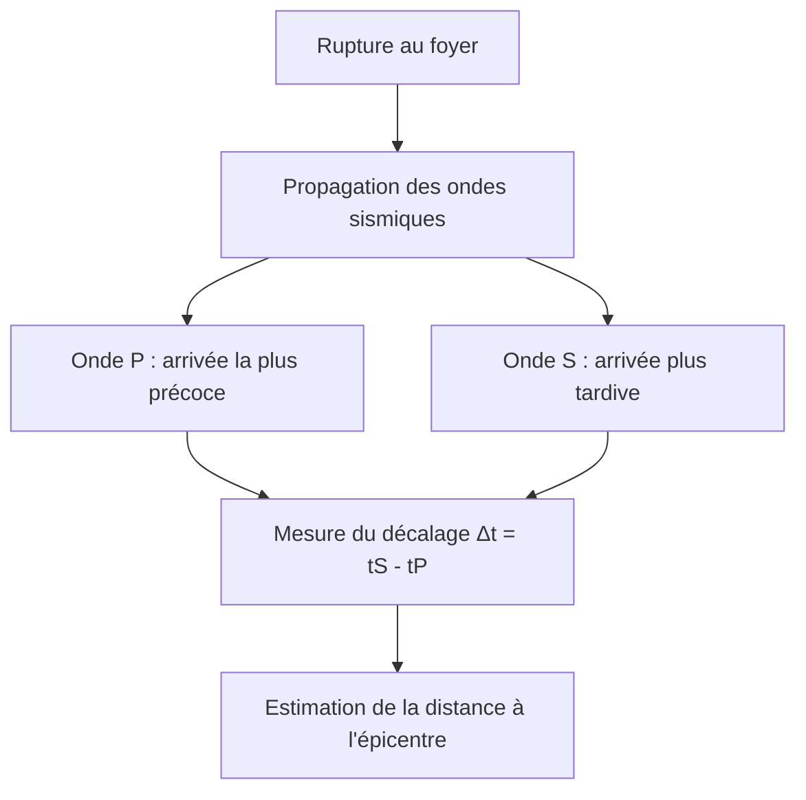
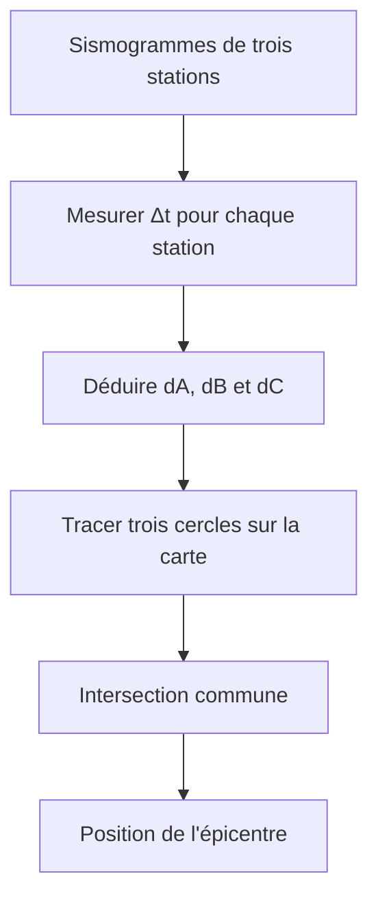

# 3. Ondes sismiques et localisation de l'épicentre

## Objectifs

Distinguer foyer et épicentre, identifier les ondes P et S, exploiter leur décalage temporel et expliquer la triangulation.

## Définitions

!!! definition "Foyer ou hypocentre"
    Point en profondeur où débute la rupture à l'origine du séisme.

!!! definition "Épicentre"
    Point de la surface terrestre situé à la verticale du foyer.

!!! definition "Sismogramme"
    Enregistrement, en fonction du temps, des mouvements du sol mesurés par une station sismique.

!!! definition "Station sismique"
    Site équipé d'instruments enregistrant les mouvements du sol.

## A. Les ondes P et S

Les ondes sismiques transportent l'énergie libérée par la rupture.

- Les ondes P (primaires) sont généralement les plus rapides. Ce sont des ondes de compression-dilatation ; elles se propagent dans les solides et les fluides.
- Les ondes S (secondaires) sont plus lentes. Ce sont des ondes de cisaillement ; elles ne se propagent pas dans les fluides.

Les ondes P arrivent donc avant les ondes S à une station située à distance du séisme.

## B. Déterminer la distance à partir du décalage P-S

On mesure :
$$
\Delta t=t_S-t_P
$$

Dans un modèle simplifié où les deux ondes parcourent la même distance $d$ à des célérités constantes :
$$
t_P=\frac{d}{v_P}
\qquad
t_S=\frac{d}{v_S}
$$
En soustrayant :
$$
\Delta t=d\left(\frac{1}{v_S}-\frac{1}{v_P}\right)
$$
D'où :
$$
\boxed{d=\frac{\Delta t}{\frac{1}{v_S}-\frac{1}{v_P}}}
$$

En pratique, les vitesses varient avec les matériaux et la profondeur. On utilise donc souvent des courbes de temps de parcours fournies dans les exercices.

## Exemple corrigé

Une station mesure $t_S-t_P=35\,\text{s}$. On suppose $v_P=6{,}0\,\text{km}\,\text{s}^{-1}$ et $v_S=3{,}5\,\text{km}\,\text{s}^{-1}$ constantes.

$$
d=\frac{35}{1/3{,}5-1/6{,}0}
$$
$$
d\approx294\,\text{km}
$$

La distance estimée est d'environ $294\,\text{km}$ dans ce modèle simplifié.

## C. Triangulation

Une seule station fournit une distance : l'épicentre peut se trouver n'importe où sur un cercle centré sur cette station.

Avec trois stations :
1. déterminer la distance de chaque station à l'épicentre ;
2. placer les stations sur une carte ;
3. tracer autour de chaque station un cercle de rayon égal à la distance déterminée ;
4. repérer l'intersection commune des cercles.

!!! attention "Foyer et épicentre"
    Le foyer est en profondeur. L'épicentre est le point de surface situé à la verticale du foyer. Ne les intervertis jamais.

!!! attention "Triangulation et précision"
    En pratique, les cercles ne se coupent pas toujours exactement en un point à cause des incertitudes et des modèles de propagation. On retient une zone d'intersection ou une solution optimale.

## Méthode de rédaction

« Le décalage entre les arrivées des ondes S et P permet d'estimer la distance entre la station et la source. On répète cette détermination pour plusieurs stations. Les cercles centrés sur les stations et de rayons correspondants se recoupent au voisinage de l'épicentre. »
