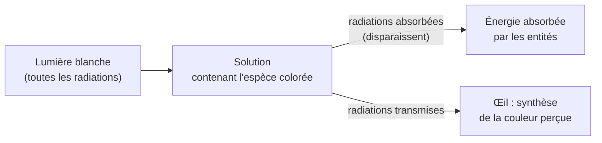
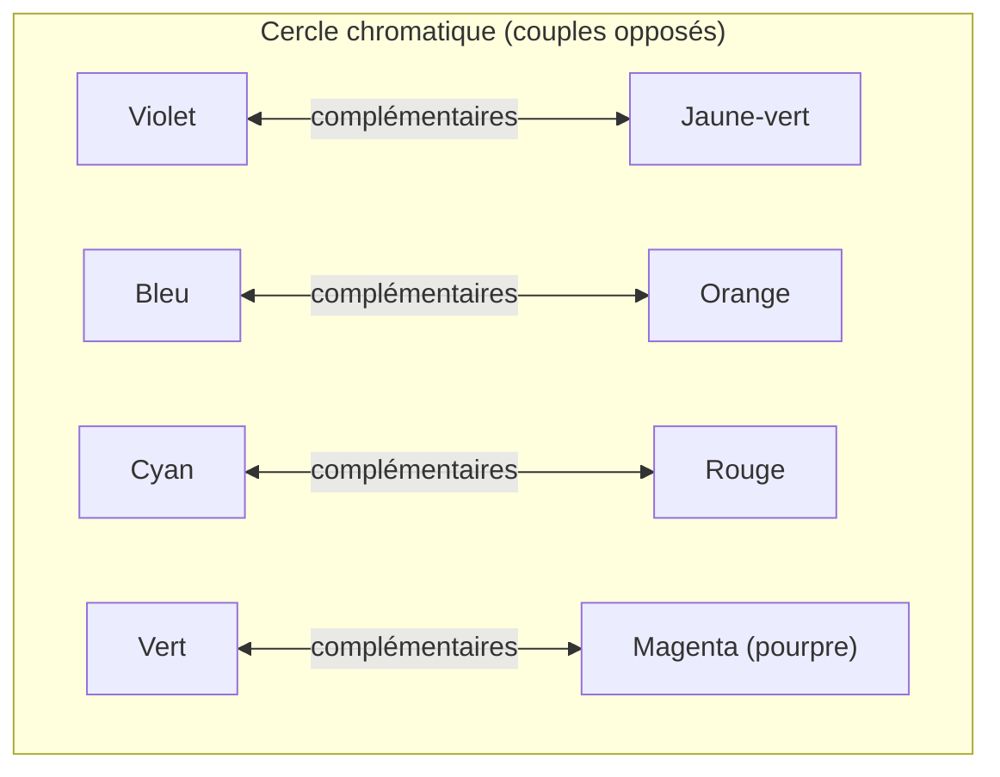

# 1. D'où vient la couleur d'une solution ?

!!! abstract "Objectifs de cette section"
    - Savoir qu'une couleur perçue résulte d'une **absorption sélective** de la lumière blanche.
    - Utiliser le **cercle chromatique** pour passer de la radiation absorbée à la couleur perçue (et inversement).
    - Relier absorption et **énergie des photons**.

## 1.1 Rappels : la lumière visible

La lumière blanche est une **lumière polychromatique** : elle contient toutes les radiations du domaine visible. Chaque radiation **monochromatique** est caractérisée par sa **longueur d'onde dans le vide** $\lambda$ (en nm).

!!! info "Définition : domaine visible"
    Le domaine visible correspond approximativement aux longueurs d'onde
    $$400\ \text{nm} \lesssim \lambda \lesssim 800\ \text{nm}.$$
    Au-delà du rouge : infrarouge (IR). En deçà du violet : ultraviolet (UV).

| Domaine de $\lambda$ (nm) | Couleur de la radiation (approx.) |
|---|---|
| 400 – 450 | violet |
| 450 – 495 | bleu |
| 495 – 570 | vert |
| 570 – 590 | jaune |
| 590 – 620 | orange |
| 620 – 800 | rouge |

## 1.2 Une solution colorée absorbe de la lumière

Éclairons une solution par de la lumière blanche. Trois choses peuvent arriver à une radiation de longueur d'onde $\lambda$ : elle est **transmise**, **absorbée**, ou (cas moins fréquent) **diffusée**.

!!! info "Définition : solution colorée"
    Une solution est **colorée** si elle **absorbe de façon sélective** certaines radiations du domaine visible. La **couleur perçue** est celle de la lumière **transmise** : c'est la lumière blanche **privée** des radiations absorbées (synthèse soustractive).

!!! failure "Erreur fréquente"
    « Une solution rouge absorbe le rouge. » **Faux.** Une solution qui apparaît rouge **transmet** le rouge et absorbe (principalement) les radiations **complémentaires** : le vert-bleu. La couleur perçue n'est **pas** la couleur absorbée.

## 1.3 Couleurs complémentaires

!!! info "Définition : couleurs complémentaires"
    Deux couleurs sont **complémentaires** lorsque leur superposition (synthèse additive) donne du blanc. Sur le **cercle chromatique**, elles sont **diamétralement opposées**.

!!! success "Propriété : lien entre radiation absorbée et couleur perçue"
    Si une solution absorbe **principalement** autour d'une longueur d'onde $\lambda_{abs}$, sa couleur perçue est la **complémentaire** de la couleur de cette radiation.

| Radiation absorbée | $\lambda$ approx. (nm) | Couleur perçue de la solution |
|---|---|---|
| violet | 400 – 430 | jaune-vert |
| bleu | 450 – 480 | jaune-orange |
| bleu-vert | 480 – 500 | orange-rouge |
| vert | 500 – 560 | pourpre (magenta) |
| jaune | 570 – 590 | bleu / violet |
| orange | 590 – 620 | bleu-vert |
| rouge | 620 – 750 | cyan (vert-bleu) |

!!! example "Exemple : le permanganate de potassium"
    Une solution de permanganate de potassium ($\text{K}^+ + \text{MnO}_4^-$) est **violette**. Elle absorbe fortement vers $\lambda \approx 525$ nm (**vert**). Le vert est retiré de la lumière blanche : il reste du rouge et du bleu-violet, perçus ensemble comme violet-pourpre.

## 1.4 Cas particuliers à connaître

!!! warning "Point d'attention : tous les cas de figure"
    - **Solution incolore** : elle n'absorbe **aucune** radiation visible. Elle peut très bien absorber dans l'UV ou l'IR (l'eau, l'éthanol, la plupart des solutions de sels).
    - **Solution noire** : elle absorbe **toutes** les radiations visibles.
    - **Solution à deux bandes d'absorption** (ex. extrait de chlorophylle : absorption dans le bleu-violet vers 430-450 nm **et** dans le rouge vers 660-680 nm) : la couleur perçue (vert) vient de ce qui **reste**.
    - **Solution trouble ou laiteuse** : l'aspect blanc vient de la **diffusion**, pas de l'absorption (lait). On ne peut pas appliquer les raisonnements de ce chapitre.
    - **Plusieurs espèces colorées** : les absorptions se **superposent** (voir loi d'additivité, section 5).

## 1.5 Origine microscopique de l'absorption

Les entités chimiques possèdent des **niveaux d'énergie quantifiés**. Un photon n'est absorbé que si son énergie correspond **exactement** à l'écart entre deux niveaux.

!!! success "Propriété : absorption d'un photon"
    Une entité passe d'un niveau d'énergie $E_1$ à un niveau $E_2 > E_1$ en absorbant un photon de longueur d'onde $\lambda$ si
    $$E_2 - E_1 = h\nu = \frac{hc}{\lambda}$$
    avec $h = 6{,}63\times10^{-34}$ J·s, $c = 3{,}00\times10^{8}$ m·s⁻¹ ; $\lambda$ en **mètres**, $E$ en **joules** (1 eV $= 1{,}60\times10^{-19}$ J).

!!! example "Exemple : énergie d'un photon vert"
    Pour $\lambda = 525$ nm :
    $$E = \frac{6{,}63\times10^{-34}\times 3{,}00\times10^{8}}{525\times10^{-9}} = 3{,}79\times10^{-19}\ \text{J} = 2{,}37\ \text{eV}.$$
    Les entités colorées du permanganate possèdent donc deux niveaux d'énergie séparés d'environ $2{,}4$ eV.

!!! tip "Pour aller plus loin (hors programme strict)"
    Les molécules organiques **colorées** présentent en général un grand nombre de **liaisons doubles conjuguées** (alternance double/simple liaison) : plus la conjugaison est étendue, plus l'écart d'énergie diminue, et plus l'absorption se décale vers le visible. Les ions de **métaux de transition** (Cu²⁺, Fe³⁺, MnO₄⁻…) sont souvent colorés pour d'autres raisons (niveaux d'énergie des électrons des couches $d$ ou transferts de charge).

## 1.6 Exemples corrigés

!!! example "Exemple 1 : de la couleur perçue à la radiation absorbée"
    Une solution de sulfate de cuivre(II) est **bleue**. Quelle radiation absorbe-t-elle principalement ?

    ??? success "Corrigé"
        Le bleu a pour complémentaire l'**orange** (et le rouge). La solution absorbe donc principalement dans l'orange-rouge, avec un maximum d'absorption vers 800 nm (limite rouge/proche IR). La lumière transmise, riche en bleu-vert, apparaît bleue.

!!! example "Exemple 2 : de la radiation absorbée à la couleur perçue"
    Un sirop absorbe de façon importante vers 440 nm et vers 650 nm. Quelle est sa couleur ?

    ??? success "Corrigé"
        Il absorbe le **bleu-violet** (440 nm) et le **rouge** (650 nm). Il transmet le vert (et un peu de jaune) : le sirop est **vert**. On vérifie la cohérence : chlorophylle, colorant « vert menthe ».
