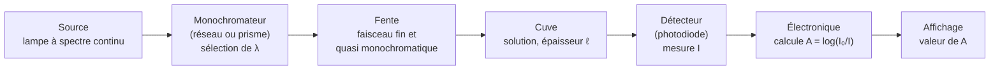

# 3. Comment fonctionne un spectrophotomètre ?

!!! abstract "Objectifs de cette section"
    - Décrire les **organes** d'un spectrophotomètre et leur rôle.
    - Expliquer **pourquoi** on réalise un « blanc » et **quand** le refaire.
    - Maîtriser le **protocole** de mesure et les précautions.

## 3.1 Principe

!!! info "Définition : spectrophotomètre"
    Un **spectrophotomètre** est un appareil qui **mesure l'absorbance** $A(\lambda)$ d'une solution, à une longueur d'onde $\lambda$ choisie par l'opérateur, en comparant l'intensité lumineuse transmise par la solution à celle transmise par le solvant seul.

| Organe | Rôle |
|---|---|
| **Source** | Émet une lumière **polychromatique** couvrant tout le domaine visible (lampe halogène/tungstène ; lampe au deutérium pour l'UV). |
| **Monochromateur** | **Disperse** la lumière (réseau, prisme) et ne laisse passer qu'un domaine très étroit autour de la longueur d'onde réglée $\lambda$. |
| **Cuve** | Récipient de **largeur $\ell$** (usuellement $\ell = 1{,}0$ cm), à faces parallèles transparentes. |
| **Détecteur** | Convertit l'intensité lumineuse reçue en **signal électrique**. |
| **Électronique** | Compare $I$ à $I_0$ mémorisée et calcule $A$. |

!!! note "Mono-faisceau ou double faisceau"
    Dans un appareil **mono-faisceau** (typique du lycée), $I_0$ est mesurée une fois pour toutes (le « blanc ») puis mémorisée. Dans un **double faisceau**, la lumière est séparée en deux : un trajet traverse le solvant et l'autre la solution, simultanément.

## 3.2 Le « blanc » (réglage du zéro)

!!! success "Propriété : rôle du blanc"
    On remplit une cuve avec le **solvant pur** (souvent de l'eau distillée) et on règle l'appareil pour $A = 0$ à la longueur d'onde choisie. On définit ainsi $I_0(\lambda)$. L'appareil **soustrait** alors automatiquement : l'absorption du solvant, celle de la cuve et les réflexions parasites aux interfaces.

!!! warning "Point d'attention : quand refaire le blanc ?"
    $I_0$ dépend de $\lambda$ (la lampe n'émet pas la même intensité à toutes les longueurs d'onde). **À chaque changement de longueur d'onde, le blanc doit être refait.** Pour tracer un spectre par points, il faut donc refaire le blanc **à chaque $\lambda$**.

    Lorsque la solution à étudier est préparée dans un solvant particulier, ou avec un réactif colorant (ex. réactif de complexation), le blanc doit contenir **tous les constituants sauf l'espèce dosée**.

## 3.3 Protocole de mesure

!!! tip "Méthode : mesurer une absorbance"
    1. **Allumer** l'appareil et attendre sa stabilisation (quelques minutes).
    2. **Choisir** la longueur d'onde $\lambda$.
    3. **Rincer** la cuve avec un peu de solvant, puis la remplir de **solvant pur** aux 3/4. Essuyer les faces **transparentes** (papier non pelucheux), tenir la cuve par les faces dépolies.
    4. Placer la cuve dans le logement (repère orienté dans le bon sens) et **faire le blanc** : $A = 0{,}000$.
    5. **Rincer** la cuve avec un peu de la solution à analyser, la remplir, essuyer, replacer.
    6. **Lire** $A$ une fois la valeur stabilisée.
    7. Pour la solution suivante : rincer à la solution suivante (ou la plus diluée en premier, pour limiter les contaminations), **sans refaire le blanc** si $\lambda$ est inchangée.

!!! warning "Point d'attention : précautions"
    - Aucune **bulle** dans le faisceau, aucune **trace de doigt** sur les faces optiques.
    - Remplir la cuve **à la même hauteur**, même sens, même cuve (ou cuves appariées).
    - Mesurer des solutions **limpides** : une solution trouble diffuse la lumière et fausse $I$.
    - Utiliser des cuves en **plastique** ou verre pour le visible, en **quartz** pour l'UV.
    - Garder des **conditions identiques** (température, solvant, $\ell$) pour toutes les mesures d'une série.

!!! failure "Erreur fréquente"
    - Oublier le blanc (ou le faire avec une cuve d'air) : toutes les absorbances sont décalées d'une constante ; la droite d'étalonnage **ne passe plus par l'origine**.
    - Changer de $\lambda$ sans refaire le blanc.
    - Rincer la cuve avec de l'eau et la remplir de solution **sans** la rincer à la solution : la solution est diluée par l'eau résiduelle.

## 3.4 Limites de l'appareil

- Le monochromateur sélectionne un domaine de **largeur non nulle** (quelques nm, la « bande passante ») : la lumière n'est pas strictement monochromatique, ce qui introduit un écart à la loi de Beer-Lambert pour des bandes d'absorption très étroites.
- La **lumière parasite** (qui atteint le détecteur sans avoir traversé correctement la solution) fausse les mesures aux fortes absorbances.
- Le détecteur a un **bruit** : incertitude de mesure de l'ordre de $\pm 0{,}005$ à $\pm 0{,}01$ sur $A$.

!!! example "Exemple : choisir la bonne cuve"
    On veut mesurer l'absorbance d'une solution de nitrate vers 300 nm (UV). Peut-on utiliser une cuve en plastique usuelle ?

    ??? success "Corrigé"
        Non : le plastique **absorbe** dans l'UV vers 300 nm, il fausserait la mesure (même avec le blanc, le signal serait trop faible). Il faut une cuve en **quartz**, transparente dans l'UV.
