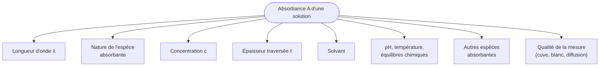

# 4. Quels sont les facteurs influençant l'absorbance ?

!!! abstract "Objectifs de cette section"
    - Lister les facteurs qui font varier $A$ et préciser **comment** ils agissent.
    - Savoir **isoler** un facteur par la démarche « toutes choses égales par ailleurs ».
    - Anticiper la forme de la loi de Beer-Lambert à partir d'**observations**.

## 4.1 Vue d'ensemble

## 4.2 Les facteurs un par un

| Facteur | Effet sur $A$ | Commentaire |
|---|---|---|
| **Longueur d'onde $\lambda$** | $A$ varie **fortement** avec $\lambda$ | La solution n'absorbe pas toutes les radiations pareillement : c'est le **spectre d'absorption**. |
| **Nature de l'espèce** | Chaque espèce a son **propre** $\varepsilon(\lambda)$ | Deux espèces à même concentration n'ont pas la même absorbance. |
| **Concentration $c$** | $A$ **augmente** avec $c$ (proportionnellement, dans le domaine de validité) | Plus d'entités absorbantes sur le trajet de la lumière. |
| **Épaisseur $\ell$** | $A$ **augmente** avec $\ell$ (proportionnellement) | Plus de matière traversée. |
| **Solvant** | Peut modifier $\varepsilon$ et $\lambda_{max}$ ; peut lui-même absorber | Le blanc compense l'absorption propre du solvant, pas la modification de $\varepsilon$. |
| **pH** | Peut changer la **forme chimique** de l'espèce, donc sa couleur | Indicateurs colorés : le bleu de bromothymol est jaune en milieu acide, bleu en milieu basique. |
| **Température** | Effet faible en général | Peut déplacer un équilibre chimique ; dilate la solution ($c$ varie légèrement). |
| **Autres espèces absorbantes** | $A_{totale}=\sum_i A_i$ | Additivité : on doit choisir $\lambda$ où une seule espèce absorbe, ou corriger. |
| **Diffusion, turbidité, bulles** | $A$ **apparente** plus élevée | La lumière diffusée n'atteint pas le détecteur et est comptée comme « absorbée ». |
| **Cuve, blanc, lumière parasite** | Décalage ou erreur | Voir section 3. |

## 4.3 Isoler l'influence d'un facteur

!!! tip "Méthode : « toutes choses égales par ailleurs »"
    Pour étudier l'effet d'**un** facteur, on fait varier **ce facteur uniquement** et on maintient tous les autres **constants**.

    - Étude de l'effet de $c$ : même espèce, même solvant, même $\lambda$, même cuve ($\ell$ fixe) → on prépare plusieurs $c$.
    - Étude de l'effet de $\ell$ : même solution, même $\lambda$ → cuves de largeurs différentes.
    - Étude de l'effet de $\lambda$ : même solution, même cuve → on fait varier $\lambda$ (blanc refait à chaque fois).

!!! example "Exemple : deviner une loi à partir de mesures"
    On mesure, à $\lambda = 525$ nm, une solution de permanganate de concentration $c$ dans une cuve de largeur $\ell$.

    | $c$ (mol·L⁻¹) | $\ell$ (cm) | $A$ |
    |---|---|---|
    | $1{,}0\times10^{-4}$ | 1,0 | 0,24 |
    | $2{,}0\times10^{-4}$ | 1,0 | 0,48 |
    | $4{,}0\times10^{-4}$ | 1,0 | 0,96 |
    | $2{,}0\times10^{-4}$ | 2,0 | 0,96 |
    | $2{,}0\times10^{-4}$ | 0,5 | 0,24 |

    Quelle conjecture peut-on formuler ?

    ??? success "Corrigé"
        - Quand $c$ est multipliée par 2 (lignes 1 → 2) ou par 4 (1 → 3), $A$ est multipliée par 2 puis par 4 : **$A \propto c$** à $\ell$ fixé.
        - Quand $\ell$ est multipliée par 2 (lignes 2 → 4), $A$ est multipliée par 2 ; divisée par 2 quand $\ell$ est divisée par 2 (lignes 2 → 5) : **$A \propto \ell$** à $c$ fixée.
        - On conjecture donc $A = k'\,\ell\,c$ avec $k'$ constante dépendant de $\lambda$ et de l'espèce. Ici $k' = \dfrac{0{,}24}{1{,}0\times10^{-4}\times1{,}0} = 2{,}4\times10^{3}$ L·mol⁻¹·cm⁻¹. C'est précisément la loi de Beer-Lambert (section suivante).

!!! warning "Point d'attention : le pH et la température ne sont pas « anodins »"
    Lors d'un dosage, tous les étalons **et** l'échantillon doivent être dans les **mêmes conditions** de pH et de température, sinon l'espèce absorbante n'est pas la même (ou pas dans les mêmes proportions) et la comparaison n'a plus de sens.

!!! failure "Erreur fréquente"
    Penser que l'absorbance ne dépend que de la concentration. Elle dépend **aussi** de $\lambda$, de $\ell$, de l'espèce, du solvant. C'est justement parce qu'on **fixe** tous les autres facteurs qu'on peut écrire $A = k\,c$ dans un dosage.
