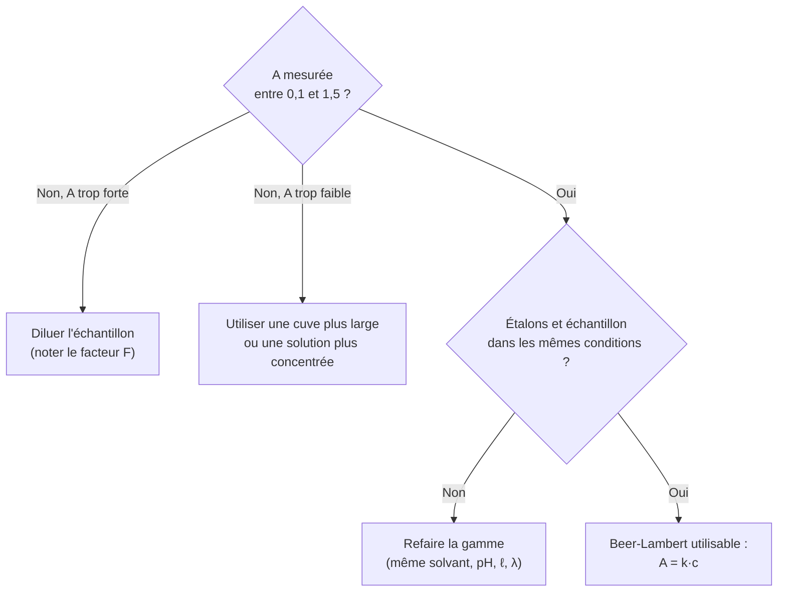

# 5. Qu'est-ce que la loi de Beer-Lambert ?

!!! abstract "Objectifs de cette section"
    - Énoncer la loi, ses grandeurs, ses unités.
    - **Démontrer** la proportionnalité de $A$ à $c$ et à $\ell$.
    - Connaître **précisément** les conditions de validité et reconnaître un écart à la loi.

## 5.1 Énoncé

!!! info "Définition : loi de Beer-Lambert"
    Pour une solution **diluée**, contenant **une seule espèce absorbante**, traversée par une radiation **monochromatique** de longueur d'onde $\lambda$, l'absorbance est **proportionnelle** à la concentration $c$ de l'espèce et à l'épaisseur $\ell$ de solution traversée :
    $$\boxed{A(\lambda) = \varepsilon(\lambda)\,\ell\,c}$$

| Grandeur | Nom | Unité usuelle |
|---|---|---|
| $A(\lambda)$ | absorbance | sans unité |
| $\varepsilon(\lambda)$ | **coefficient d'absorption molaire** (ou coefficient d'extinction molaire) | L·mol⁻¹·cm⁻¹ |
| $\ell$ | largeur de cuve traversée | cm |
| $c$ | concentration molaire de l'espèce absorbante | mol·L⁻¹ |

!!! success "Propriété : forme utilisée en dosage"
    À $\lambda$, solvant, température et cuve **fixés**, $\varepsilon\,\ell$ est une constante $k$ :
    $$A = k\,c, \qquad k = \varepsilon\,\ell \ \ (\text{en L·mol}^{-1}).$$
    La courbe $A = f(c)$ est une **droite passant par l'origine** de coefficient directeur $k$.
    On peut aussi exprimer la loi avec la concentration massique $t$ : $A = k'\,t$ avec $k' = k/M$ (en L·g⁻¹).

!!! warning "Point d'attention : cohérence des unités"
    Si $\varepsilon$ est en L·mol⁻¹·cm⁻¹, alors $\ell$ doit être en **cm** et $c$ en **mol·L⁻¹**. Vérification dimensionnelle : (L·mol⁻¹·cm⁻¹)·(cm)·(mol·L⁻¹) = 1 : **sans unité**, comme $A$.

## 5.2 Démonstration (deux arguments complémentaires)

### a) Proportionnalité à l'épaisseur $\ell$ (argument d'additivité)

??? abstract "Démonstration : $A$ proportionnelle à $\ell$"
    On suppose une solution homogène. Découpons l'épaisseur $\ell$ en deux couches identiques d'épaisseur $\ell/2$. Chaque couche est traversée dans des **conditions identiques** (même solution) : elle a la **même absorbance** $A_{1/2}$. D'après l'additivité des absorbances (section 2) :
    $$A(\ell) = A_{1/2} + A_{1/2} = 2A_{1/2}.$$
    Plus généralement, une épaisseur $n\times\ell_0$ se découpe en $n$ couches identiques et $A(n\ell_0) = n\,A(\ell_0)$. Par continuité, $A$ est **proportionnelle à $\ell$**. $\blacksquare$

### b) Proportionnalité à la concentration $c$

??? abstract "Démonstration : $A$ proportionnelle à $c$ (modèle par tranches)"
    **Hypothèse physique.** Dans une tranche très mince d'épaisseur $\mathrm{d}x$, la fraction de lumière absorbée est proportionnelle au **nombre d'entités absorbantes rencontrées**, donc à $c\,\mathrm{d}x$ (solution diluée : les entités n'interagissent pas, ne se « font pas d'ombre »).

    Divisons l'épaisseur $\ell$ en $N$ tranches d'épaisseur $\ell/N$. Chaque tranche **transmet** la fraction $\left(1-\alpha\,c\,\dfrac{\ell}{N}\right)$ de la lumière qu'elle reçoit, où $\alpha>0$ dépend de l'espèce et de $\lambda$.

    Après les $N$ tranches :
    $$I = I_0\left(1-\frac{\alpha c\ell}{N}\right)^{N}.$$
    Quand $N$ devient très grand, $\left(1-\dfrac{x}{N}\right)^N \to e^{-x}$ (limite classique associée à la fonction exponentielle), donc
    $$I = I_0\,e^{-\alpha c\ell}.$$
    On en déduit l'absorbance :
    $$A = \log\frac{I_0}{I} = \log\!\left(e^{\alpha c\ell}\right) = \alpha c\ell\,\log e = \frac{\alpha}{\ln 10}\,c\,\ell .$$
    En posant $\varepsilon = \dfrac{\alpha}{\ln 10} \approx 0{,}434\,\alpha$ : $A = \varepsilon\,\ell\,c$. $\blacksquare$

    **Remarque.** Ce raisonnement montre aussi pourquoi la **transmittance** décroît **exponentiellement** : $T = 10^{-\varepsilon\ell c}$. C'est $A=\log(1/T)$, et non $T$, qui est linéaire en $c$.

## 5.3 Conséquences immédiates

!!! success "Propriété : conséquences de la loi"
    1. **Dilution** par un facteur $F$ : $c \to c/F$, donc $A \to A/F$ (si $\ell$ fixe).
    2. **Épaisseur** multipliée par $n$ : $A \to nA$.
    3. **Additivité** pour un mélange d'espèces $i$ n'interagissant pas : $A(\lambda) = \ell\sum_i \varepsilon_i(\lambda)\,c_i$.
    4. **Transmittance** : $T = 10^{-\varepsilon\ell c}$ ; si on **double** $c$, $T$ est **élevée au carré**.

## 5.4 Domaine de validité

!!! warning "Point d'attention : la loi n'est pas universelle"
    La loi de Beer-Lambert n'est valable que si :

    - la solution est **diluée** (typiquement $c \lesssim 10^{-2}$ mol·L⁻¹ et surtout $A \lesssim 1{,}5$ à $2$) ;
    - la lumière est **monochromatique** ;
    - **une seule espèce** absorbe à la longueur d'onde utilisée (ou on tient compte de l'additivité) ;
    - la solution est **limpide et homogène** (pas de diffusion) ;
    - la nature chimique de l'espèce **ne change pas** avec $c$ (pas de dimérisation, d'équilibre acido-basique dépendant de $c$, de réaction photochimique).

Lorsque $c$ augmente, la courbe $A=f(c)$ **s'infléchit** (« plafonne ») sous la droite.

## 5.5 Exemples corrigés

!!! example "Exemple 1 : calcul de $\varepsilon$"
    Une solution de concentration $c = 2{,}0\times10^{-4}$ mol·L⁻¹, dans une cuve de $\ell=1{,}0$ cm, a une absorbance $A=0{,}48$ à 525 nm. Calculer $\varepsilon(525\text{ nm})$.

    ??? success "Corrigé"
        $\varepsilon = \dfrac{A}{\ell\,c} = \dfrac{0{,}48}{1{,}0\times 2{,}0\times10^{-4}} = 2{,}4\times10^{3}\ \text{L·mol}^{-1}\text{·cm}^{-1}$.

!!! example "Exemple 2 : changement de conditions"
    Même solution, mais on utilise une cuve de $\ell' = 2{,}5$ cm, après dilution au quart. Quelle est la nouvelle absorbance ?

    ??? success "Corrigé"
        $c' = c/4$ et $\ell' = 2{,}5\,\ell$. Donc $A' = \varepsilon\,\ell'\,c' = A\times 2{,}5\times\dfrac14 = 0{,}48\times0{,}625 = 0{,}30$.

!!! example "Exemple 3 : détecter un écart à la loi"
    On mesure $A = 0{,}24$ pour $c=1{,}0\times10^{-4}$ mol·L⁻¹ et $A=2{,}2$ pour $c = 2{,}0\times10^{-3}$ mol·L⁻¹ ($\ell = 1{,}0$ cm). La loi est-elle respectée ?

    ??? success "Corrigé"
        Si la loi était valable avec $\varepsilon = 2{,}4\times10^3$, on attendrait $A = 2{,}4\times10^3\times 2{,}0\times10^{-3} = 4{,}8$. On mesure $2{,}2$ : **écart énorme**. La loi n'est pas valable à cette concentration (solution trop concentrée, $A$ trop grande, lumière parasite).

!!! failure "Erreur fréquente"
    - Écrire $A = \varepsilon c$ en oubliant $\ell$ (acceptable seulement si $\ell$ est fixé, auquel cas $\varepsilon\ell=k$).
    - Mettre $\ell$ en mm ou en m avec un $\varepsilon$ en L·mol⁻¹·cm⁻¹.
    - Penser que $A$ est proportionnelle à $c$ **quelles que soient** les conditions.
    - Confondre $\varepsilon$ (propriété de l'espèce, à $\lambda$ donné) et $k=\varepsilon\ell$ (dépend de la cuve utilisée).
