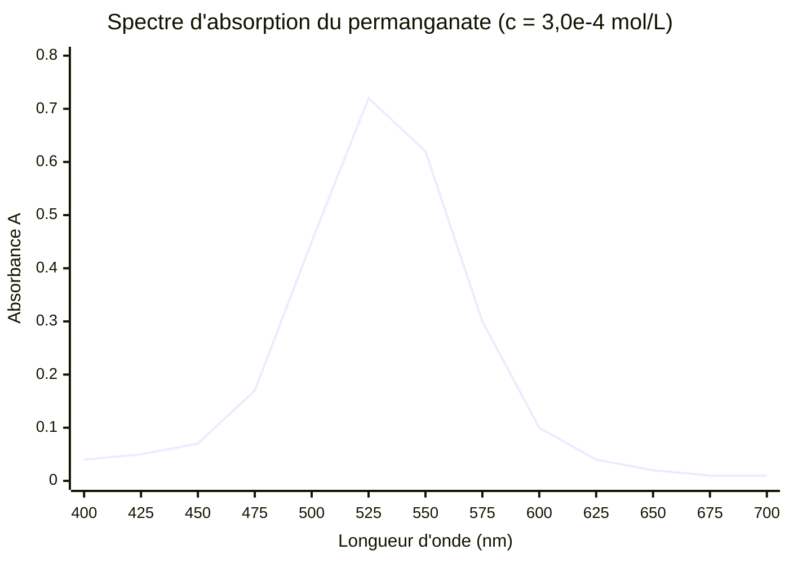
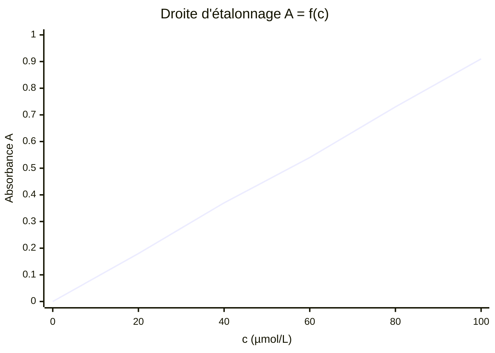
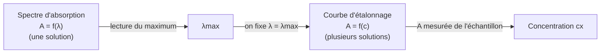

# 6. Les deux courbes obtenues avec un spectrophotomètre

!!! abstract "Objectifs de cette section"
    - Distinguer **spectre d'absorption** $A=f(\lambda)$ et **courbe d'étalonnage** $A=f(c)$.
    - Savoir ce que chacune **permet de déterminer**, comment on la **construit** et ce que l'on **fixe** dans chaque cas.

## 6.1 Vue d'ensemble

| | **a) Spectre d'absorption** | **b) Courbe d'étalonnage** |
|---|---|---|
| Grandeur en abscisse | longueur d'onde $\lambda$ (nm) | concentration $c$ (mol·L⁻¹) |
| Grandeur en ordonnée | $A(\lambda)$ | $A$ |
| Ce qu'on **fixe** | une solution (concentration $c$ fixée), même cuve | $\lambda$ (= $\lambda_{max}$), cuve, solvant |
| Ce qu'on **fait varier** | $\lambda$ | $c$ (gamme de solutions étalons) |
| Allure | courbe avec un ou plusieurs **maxima** | **droite** passant par l'origine (si Beer-Lambert) |
| Permet de | trouver $\lambda_{max}$ ; prévoir la couleur | déterminer une concentration inconnue |
| Blanc | refait à **chaque $\lambda$** | fait **une fois** (même $\lambda$) |

## 6.2 a) Le spectre d'absorption

!!! info "Définition : spectre d'absorption"
    Le **spectre d'absorption** d'une espèce chimique (ou d'une solution) est la courbe représentant l'absorbance $A$ en fonction de la longueur d'onde $\lambda$, pour une concentration et une épaisseur données.

!!! info "Définition : longueur d'onde du maximum d'absorption"
    $\lambda_{max}$ est la longueur d'onde pour laquelle l'absorbance est **maximale**. C'est la signature spectrale de l'espèce.

Spectre d'une solution de permanganate de potassium ($c = 3{,}0\times10^{-4}$ mol·L⁻¹, $\ell=1{,}0$ cm) :

!!! note "Si le graphique ne s'affiche pas"
    Voir le tableau : $\lambda$ (nm) : 400, 425, 450, 475, 500, 525, 550, 575, 600, 625, 650, 675, 700 ; $A$ : 0,04 ; 0,05 ; 0,07 ; 0,17 ; 0,45 ; **0,72** ; 0,62 ; 0,30 ; 0,10 ; 0,04 ; 0,02 ; 0,01 ; 0,01.

!!! tip "Méthode : exploiter un spectre"
    1. **Repérer** le(s) maximum(s) d'absorption : $\lambda_{max}$.
    2. **En déduire la couleur absorbée** (tableau du §1.1), puis la **couleur perçue** (complémentaire).
    3. Éventuellement calculer $\varepsilon_{max} = \dfrac{A_{max}}{\ell\,c}$.

    Ici $\lambda_{max}\approx525$ nm (vert) : solution perçue **pourpre/violette** ; $\varepsilon_{max} = \dfrac{0{,}72}{1{,}0\times3{,}0\times10^{-4}} = 2{,}4\times10^3$ L·mol⁻¹·cm⁻¹.

!!! success "Propriété : le spectre est intrinsèque à l'espèce"
    Le **profil** du spectre (position de $\lambda_{max}$, rapport entre les hauteurs des pics) ne dépend pas de $c$. Seule la **hauteur** globale est multipliée par un facteur proportionnel à $c$ : si $c$ double, $A(\lambda)$ double **à toutes les longueurs d'onde**.

**Construire un spectre.** À partir du spectrophotomètre mono-faisceau : choisir une solution de concentration moyenne ($A_{max}\approx 1$) ; pour chaque $\lambda$ (par pas de 20 à 25 nm, puis plus fin près du maximum) : **refaire le blanc**, puis mesurer $A$. Certains appareils enregistrent automatiquement un spectre complet.

## 6.3 b) La courbe d'étalonnage

!!! info "Définition : courbe d'étalonnage"
    La **courbe d'étalonnage** est la représentation graphique de l'absorbance $A$, mesurée à une longueur d'onde **fixée** (en général $\lambda_{max}$), en fonction de la concentration $c$ de **solutions étalons** de l'espèce étudiée.

Droite d'étalonnage pour le même colorant (mesures à 525 nm, $\ell=1{,}0$ cm) :

!!! success "Propriété : forme de la courbe d'étalonnage"
    D'après Beer-Lambert, c'est une **droite passant par l'origine** : $A = k\,c$, de coefficient directeur $k=\varepsilon\,\ell$. Le coefficient directeur est le **seul** paramètre à déterminer.

!!! warning "Point d'attention : trois pièges de lecture"
    - Ne **jamais** confondre les axes : sur un spectre l'abscisse est $\lambda$, sur une courbe d'étalonnage c'est $c$.
    - Dans une droite d'étalonnage, on **ne relie pas** les points « en ligne brisée » : on **modélise** par la droite qui passe au plus près de tous (ici passant aussi par l'origine).
    - Un spectre n'est **pas** une droite : si on trace $A = f(\lambda)$ avec le même $c$, on ne peut pas en tirer de concentration.

## 6.4 Comment les deux courbes se complètent

!!! example "Exemple : quelle courbe pour quelle question ?"
    1. « Quelle est la couleur de la solution ? » 2. « Quelle est la concentration de cette solution ? » 3. « À quelle longueur d'onde dois-je régler l'appareil pour doser ? »

    ??? success "Corrigé"
        1. **Spectre** (couleur absorbée au maximum, puis complémentaire). 2. **Courbe d'étalonnage**. 3. **Spectre** (on y lit $\lambda_{max}$).
