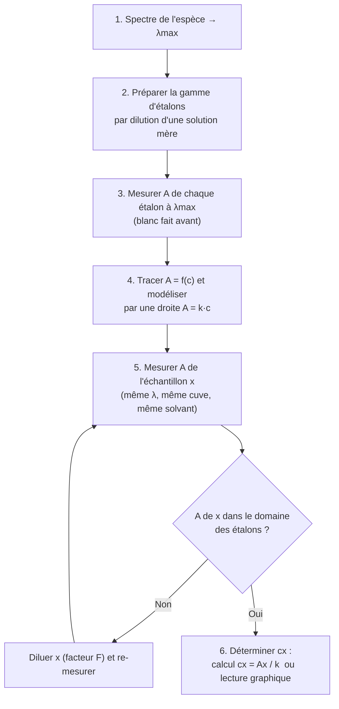

# 7. Comment réaliser un dosage par spectrophotométrie ?

!!! abstract "Objectifs de cette section"
    - Justifier le choix de $\lambda_{max}$.
    - Réaliser **les trois étapes** de l'étalonnage : gamme par dilution, mesures, droite $A=f(c)$.
    - Déterminer une concentration inconnue **par le calcul** et **par lecture graphique**, en gérant une éventuelle dilution.

!!! info "Définition : dosage par étalonnage"
    Un **dosage par étalonnage** détermine la concentration d'une espèce dans une solution en **comparant** une grandeur mesurée (ici l'absorbance) à celle de **solutions étalons** de concentrations connues, **sans réaction chimique de dosage**.

## 7.1 a) Choix de la longueur d'onde de travail : $\lambda_{max}$

!!! tip "Méthode : choisir $\lambda$"
    On trace (ou on utilise) le **spectre d'absorption** d'une solution de concentration intermédiaire, et on choisit **$\lambda_{max}$**.

!!! success "Propriété : pourquoi $\lambda_{max}$ ?"
    1. **Sensibilité maximale** : le coefficient directeur $k=\varepsilon(\lambda)\,\ell$ est le plus grand. Une même variation de concentration $\Delta c$ provoque la **plus grande variation** d'absorbance $\Delta A = k\,\Delta c$ : on détecte mieux de petites différences.
    2. **Précision accrue** : à $\lambda_{max}$, $A$ est grande, donc l'incertitude **relative** sur $A$ (bruit de l'appareil constant) est plus faible.
    3. **Robustesse** : au sommet du pic, la courbe est **plate** ($\mathrm{d}A/\mathrm{d}\lambda \approx 0$). Une petite erreur de réglage de $\lambda$ (ou la largeur de bande passante du monochromateur) modifie très peu $A$. Sur les flancs du pic, la même erreur de quelques nm donne un grand écart.
    4. **Meilleur respect de la loi** : on peut travailler avec des solutions plus **diluées** tout en gardant une absorbance mesurable.

!!! warning "Point d'attention : cas des mélanges"
    Si l'échantillon contient une **autre espèce** qui absorbe aussi à $\lambda_{max}$, il vaut mieux choisir une longueur d'onde où **seule** l'espèce dosée absorbe, quitte à perdre un peu de sensibilité.

## 7.2 b) Les trois étapes de la construction de la droite d'étalonnage

### Étape 1 : préparer une gamme de solutions étalons par dilution

!!! info "Définition : facteur de dilution"
    Lorsqu'on dilue une solution mère de concentration $c_0$ en une solution fille de concentration $c_1$ :
    $$F = \frac{c_0}{c_1} = \frac{V_1}{V_0}\qquad (F>1).$$

??? abstract "Démonstration : $c_0V_0 = c_1V_1$"
    Lors d'une dilution, on ajoute du **solvant** sans ajouter de soluté : la quantité de matière de soluté prélevée dans la solution mère se retrouve entièrement dans la solution fille. Prélèvement : $n = c_0V_0$ ; solution fille : $n = c_1V_1$. Donc $c_0V_0 = c_1V_1$, d'où $V_0 = V_1\,\dfrac{c_1}{c_0} = \dfrac{V_1}{F}$. $\blacksquare$

!!! tip "Méthode : dilution rigoureuse"
    1. Calculer $V_0 = \dfrac{c_1V_1}{c_0}$.
    2. Prélever $V_0$ de solution mère avec une **pipette jaugée** (munie d'une propipette), après rinçage à la solution mère.
    3. Verser dans une **fiole jaugée** de volume $V_1$ contenant déjà un peu de solvant (environ la moitié).
    4. **Compléter** avec le solvant jusqu'aux **trois quarts**, agiter, puis compléter **exactement** jusqu'au trait de jauge (dernières gouttes à la pissette ou au compte-gouttes).
    5. **Boucher et homogénéiser** (retournements).

!!! failure "Erreur fréquente"
    - Prélever avec une **éprouvette** ou un bécher gradué : l'incertitude est beaucoup trop grande pour un étalonnage. Utiliser pipette jaugée (ou burette) et fiole jaugée.
    - Croire que les volumes sont additifs : ajouter 40 mL d'eau à 10 mL de solution **ne donne pas exactement** 50 mL. On ne compte pas « $V_0 + V_{eau}$ » : on remplit **jusqu'au trait de jauge**.

### Étape 2 : mesurer l'absorbance de chaque étalon

On règle $\lambda=\lambda_{max}$, on fait **le blanc** avec le solvant, puis on mesure $A$ de **chaque** étalon, en commençant par le plus dilué (limite la contamination), avec la **même cuve** et en notant chaque valeur avec le bon nombre de chiffres significatifs.

!!! warning "Point d'attention : la gamme doit encadrer l'inconnue"
    Idéalement, tous les étalons ont $0{,}1 \lesssim A \lesssim 1{,}5$ et la valeur de $A_x$ de l'échantillon se trouve **à l'intérieur** de la gamme (interpolation). Une extrapolation hors des étalons n'est pas fiable.

### Étape 3 : tracer la droite d'étalonnage $A=f(c)$

1. Porter $c$ en abscisse, $A$ en ordonnée, avec des **échelles adaptées** et des **axes légendés avec unités**.
2. Placer les points.
3. Tracer la droite **modèle** passant par l'origine et au plus près de l'ensemble des points : certains points sont **au-dessus**, d'autres **en dessous**, aucun n'est « forcé ».
4. Déterminer le **coefficient directeur** $k$ (en L·mol⁻¹), par la calculatrice/tableur (régression linéaire, modèle $y=ax$) ou graphiquement avec deux points **éloignés** de la droite.

!!! success "Propriété : modèle linéaire par l'origine"
    Pour des points $(c_i, A_i)$, le coefficient directeur du modèle $A=kc$ (par l'origine, moindres carrés) est
    $$k = \frac{\sum_i c_i A_i}{\sum_i c_i^2}.$$

## 7.3 c) Détermination de la concentration inconnue

On mesure l'absorbance $A_x$ de l'échantillon dans les **mêmes conditions** ($\lambda_{max}$, cuve, solvant, blanc).

### Résolution analytique (par le calcul)

!!! tip "Méthode : calcul"
    $$A_x = k\,c_x \quad\Longrightarrow\quad c_x = \frac{A_x}{k}.$$
    Si l'échantillon a été **dilué** d'un facteur $F$ avant la mesure, alors $A_x$ donne la concentration de la solution **diluée** $c_{dil}$ ; la concentration de l'échantillon d'origine est
    $$c_x = F\times c_{dil}.$$

### Résolution graphique (par lecture)

!!! tip "Méthode : lecture graphique"
    1. Sur l'axe des ordonnées, repérer $A_x$.
    2. Tracer l'**horizontale** passant par $A_x$ jusqu'à la **droite d'étalonnage**.
    3. Descendre à la **verticale** vers l'axe des abscisses : lire $c_x$.
    4. **Laisser apparents** les traits de construction sur le graphique.

!!! failure "Erreur fréquente"
    Oublier le facteur de dilution, ou le diviser au lieu de le multiplier. On calcule d'abord $c_{dil}=A_x/k$ (concentration de la solution **mesurée**), puis on multiplie **la concentration** par $F$ : $c_x=F\times c_{dil}$.

### Retour sur la validité du résultat

!!! note "Valider un résultat"
    - $A_x$ est-elle **dans** l'intervalle des étalons ? Si non, diluer.
    - L'ordre de grandeur est-il **plausible** (comparaison avec une valeur indiquée par un fabricant) ?
    - On peut calculer l'**écart relatif** : $\dfrac{|c_{mesurée}-c_{réf}|}{c_{réf}}$ et discuter des **sources d'erreur** (verrerie, bruit de l'appareil, modèle linéaire).

## 7.4 Exemple corrigé complet

!!! example "Dosage d'un colorant bleu dans une solution"
    On prépare une solution mère $S_0$ de colorant, de concentration $c_0 = 2{,}00\times10^{-4}$ mol·L⁻¹. On en prépare cinq étalons de 50,0 mL, puis on mesure $A$ à $\lambda_{max}$ avec une cuve de 1,0 cm.

    | Étalon | $c$ (µmol·L⁻¹) | $A$ |
    |---|---|---|
    | $S_1$ | 20 | 0,18 |
    | $S_2$ | 40 | 0,37 |
    | $S_3$ | 60 | 0,54 |
    | $S_4$ | 80 | 0,73 |
    | $S_5$ | 100 | 0,91 |

    La solution inconnue donne $A_x = 0{,}64$.

    **Q1.** Calculer les volumes de $S_0$ à prélever. **Q2.** Déterminer $k$. **Q3.** Déterminer $c_x$ par le calcul puis par lecture graphique.

    ??? success "Corrigé"
        **Q1.** $V_0 = \dfrac{c_1V_1}{c_0}$ avec $V_1=50{,}0$ mL et $c_0=200$ µmol·L⁻¹ :
        $V_0 = \dfrac{c_1\times 50{,}0}{200}$ donc : 20 → **5,0 mL** ; 40 → **10,0 mL** ; 60 → **15,0 mL** ; 80 → **20,0 mL** ; 100 → **25,0 mL**. Pipette jaugée et fiole jaugée de 50,0 mL.

        **Q2.** Modèle $A=kc$ par l'origine :
        $\sum c_iA_i = 20(0{,}18)+40(0{,}37)+60(0{,}54)+80(0{,}73)+100(0{,}91)=200{,}2$ ; $\sum c_i^2 = 22\,000$.
        $k = \dfrac{200{,}2}{22\,000} = 9{,}1\times10^{-3}$ L·µmol⁻¹ $= 9{,}1\times10^{3}$ L·mol⁻¹.
        (Avec $\ell=1{,}0$ cm : $\varepsilon = 9{,}1\times10^3$ L·mol⁻¹·cm⁻¹.)

        **Q3.** *Calcul :* $c_x = \dfrac{0{,}64}{9{,}1\times10^{3}} = 7{,}0\times10^{-5}$ mol·L⁻¹ $=70$ µmol·L⁻¹.
        *Graphique :* l'horizontale $A=0{,}64$ coupe la droite en $c\approx 70$ µmol·L⁻¹. Les deux résultats concordent. $A_x=0{,}64$ est bien entre 0,54 et 0,73 : on est en **interpolation**.

        **Si l'échantillon avait été dilué 10 fois avant mesure :** $c_x = 10\times 7{,}0\times10^{-5} = 7{,}0\times10^{-4}$ mol·L⁻¹.
