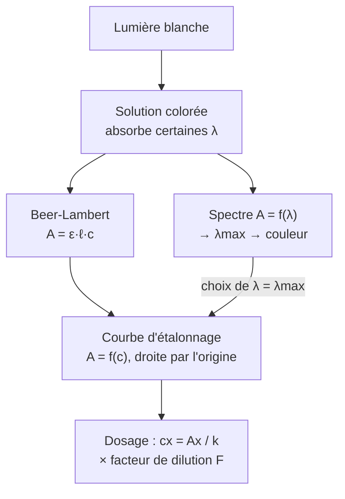

# 10. Synthèse et fiche de révision

!!! abstract "Mode d'emploi"
    Cette page tient en **une feuille recto-verso**. Cachez la colonne de droite, **récitez**, puis vérifiez. Tout ce qui est ici peut tomber en contrôle.

## 10.1 Les définitions et formules à connaître par cœur

| Notion | À savoir |
|---|---|
| Domaine visible | $400\ \text{nm}\lesssim\lambda\lesssim800\ \text{nm}$ |
| Solution colorée | Absorbe sélectivement des radiations ; couleur perçue = **complémentaire** de la couleur absorbée |
| Énergie d'un photon | $E=h\nu=\dfrac{hc}{\lambda}$ ($\lambda$ en m) |
| Transmittance | $T=\dfrac{I}{I_0}$, $0\le T\le1$ |
| Absorbance | $A=\log\dfrac{I_0}{I}=-\log T$, sans unité ; $T=10^{-A}$ |
| Loi de Beer-Lambert | $A=\varepsilon\,\ell\,c$ ($\varepsilon$ en L·mol⁻¹·cm⁻¹, $\ell$ en cm, $c$ en mol·L⁻¹) |
| Forme du dosage | $A=k\,c$ avec $k=\varepsilon\,\ell$ (L·mol⁻¹) |
| Additivité | $A_{tot}=\sum_i\varepsilon_i\,\ell\,c_i$ |
| Dilution | $c_0V_0=c_1V_1$ ; $F=\dfrac{c_0}{c_1}=\dfrac{V_1}{V_0}$ |
| Concentration massique | $t=c\times M$ |
| Écart relatif | $\dfrac{|\text{mesure}-\text{référence}|}{\text{référence}}$ |

## 10.2 Schéma de synthèse

## 10.3 Cas à connaître

| Situation | Que faire / que dire |
|---|---|
| $A>1{,}5$ ou $2$ | **Diluer**, noter $F$, multiplier la concentration finale par $F$ |
| $A$ trop faible ($<0{,}05$) | Cuve plus large ou solution plus concentrée |
| Droite d'étalonnage ne passe pas par 0 | Blanc mal fait / absorption du solvant : refaire le blanc |
| Points qui plafonnent à forte $c$ | Limite de Beer-Lambert : restreindre la gamme |
| Espèce interférente | Choisir $\lambda$ où une seule espèce absorbe |
| Changement de $\lambda$ | **Refaire le blanc** |
| Solution incolore | Peut absorber dans l'UV/IR |
| Solution trouble | Diffusion : loi inapplicable |

## 10.4 Check-list « réflexes de contrôle »

- [ ] J'ai converti $\lambda$ en **mètres** pour $E=hc/\lambda$.
- [ ] $\ell$ est en **cm** si $\varepsilon$ est en L·mol⁻¹·cm⁻¹.
- [ ] J'ai utilisé $\log$ (décimal), pas $\ln$.
- [ ] J'ai pensé au **facteur de dilution**.
- [ ] $A_x$ est **dans** la gamme des étalons.
- [ ] J'ai tracé la **droite modèle** (pas de segments).
- [ ] J'ai laissé les **traits de construction** sur le graphique.
- [ ] Mes chiffres significatifs sont cohérents avec les données.
- [ ] J'ai conclu par une **phrase** avec unité.

## 10.5 Les erreurs classiques (à ne plus jamais faire)

!!! failure "Erreurs fréquentes récapitulées"
    1. « La solution rouge absorbe le rouge. » → Elle absorbe la **complémentaire** (cyan).
    2. « $A=0{,}30$ signifie 30 % absorbé. » → 50 % absorbé ($T=0{,}50$).
    3. Oublier le **blanc** ou le **refaire** au changement de $\lambda$.
    4. Mesurer à une longueur d'onde quelconque au lieu de $\lambda_{max}$.
    5. Prélever avec une éprouvette pour construire la gamme.
    6. Relier les points d'étalonnage par des segments.
    7. **Extrapoler** hors de la gamme sans commentaire.
    8. Oublier de multiplier par $F$ ; ou mettre $F$ du mauvais côté.
    9. Appliquer Beer-Lambert à une solution trop concentrée ou trouble.
    10. Confondre $\varepsilon$ (propriété de l'espèce) et $k$ (dépend de la cuve).

## 10.6 Mini-quiz d'auto-évaluation

??? question "1. Pourquoi une solution jaune est-elle jaune ?"
    Elle absorbe le **bleu-violet** (autour de 440-470 nm) et transmet le reste, dont le jaune.

??? question "2. $A=1{,}00$ : que valent $T$ et le pourcentage de lumière absorbée ?"
    $T=10^{-1}=10\,\%$ ; **90 %** de la lumière absorbée.

??? question "3. Une solution a $A=0{,}60$ ; on la dilue 3 fois. Que devient $A$ (même cuve) ?"
    $A=0{,}60/3=0{,}20$.

??? question "4. Pourquoi mesurer à $\lambda_{max}$ ?"
    Sensibilité maximale (plus grand $k$), meilleure précision relative, faible influence des erreurs de réglage de $\lambda$.

??? question "5. Un étalonnage donne $A=0{,}0120\times c$ ($c$ en µmol·L⁻¹) ; un échantillon dilué 10 fois donne $A=0{,}480$. Quelle est sa concentration ?"
    $c_{dil}=\dfrac{0{,}480}{0{,}0120}=40$ µmol·L⁻¹ ; $c_x=10\times40=400$ µmol·L⁻¹ $=4{,}0\times10^{-4}$ mol·L⁻¹.

??? question "6. Quelle verrerie pour préparer 100,0 mL à partir d'un prélèvement de 20,0 mL ?"
    Pipette jaugée de 20,0 mL et fiole jaugée de 100,0 mL ; $F=5$.
