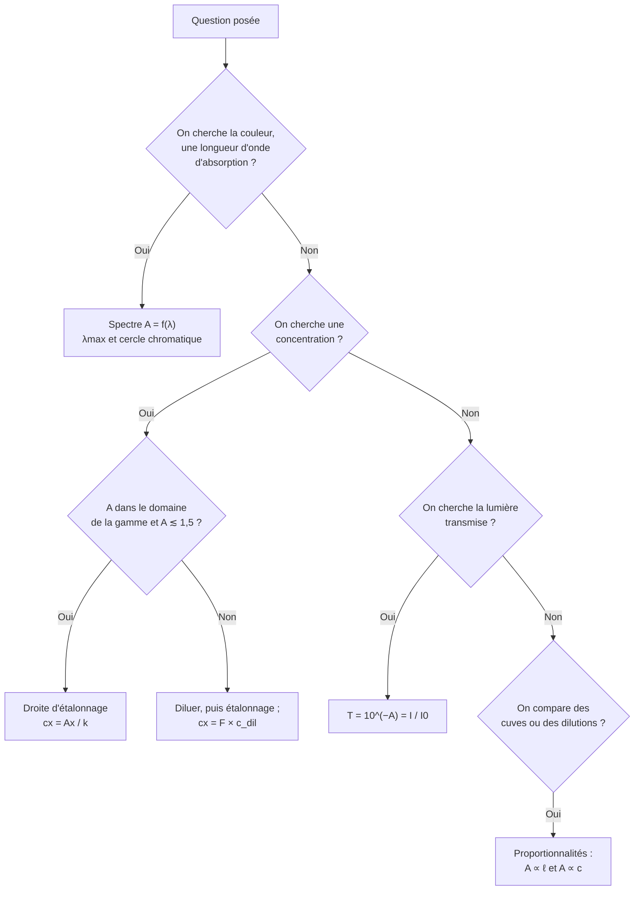

# 11. Comprendre pourquoi un résultat est vrai, savoir quand l'utiliser, savoir le démontrer

!!! abstract "Pourquoi cette section ?"
    En contrôle, les questions les plus exigeantes ne demandent pas de réciter, mais de **justifier**, de **choisir** le bon outil et de **démontrer**. Pour chaque résultat du chapitre, apprenez à répondre à trois questions :

    1. **Pourquoi est-ce vrai ?** (le mécanisme physique ou la définition)
    2. **Quand l'utiliser ?** (et quand s'en méfier)
    3. **Comment le démontrer ?** (les étapes de la preuve)

## 11.1 Tableau récapitulatif

| Résultat | Pourquoi vrai ? | Quand l'utiliser ? | Comment le démontrer ? |
|---|---|---|---|
| **Couleur perçue = complémentaire de la couleur absorbée** | La lumière blanche privée d'une radiation : synthèse soustractive ; la superposition de deux couleurs complémentaires redonne du blanc | Passer du spectre à la couleur d'une solution (et inversement) | Raisonnement qualitatif : lumière blanche − radiation absorbée = lumière transmise |
| **$E=hc/\lambda$** et absorption si $\Delta E=h\nu$ | Les niveaux d'énergie sont quantifiés ; un photon n'est absorbé que s'il apporte exactement l'écart d'énergie | Relier $\lambda_{max}$ à l'écart de niveaux | Relation $c=\lambda\nu$ combinée à $E=h\nu$ |
| **$A=\log(I_0/I)$** | Choix de définition : le logarithme rend les absorbances **additives** | Toujours (définition) | Additivité : $\log\frac{I_0}{I_1}+\log\frac{I_1}{I}=\log\frac{I_0}{I}$ |
| **$A\propto\ell$** | Épaisseurs identiques = couches identiques = absorbances égales qui s'additionnent | Changement de cuve | Découpage en couches + additivité de $A$ |
| **$A\propto c$** | Chaque entité absorbe indépendamment ; fraction absorbée ∝ nombre d'entités rencontrées | Dosage par étalonnage | Modèle par tranches : $(1-x/N)^N\to e^{-x}$, puis $A=\frac{\alpha}{\ln10}c\ell$ |
| **$T=10^{-\varepsilon\ell c}$** | Conséquence de $A=-\log T$ | Calcul de la lumière transmise | Inversion du logarithme |
| **Mesurer à $\lambda_{max}$** | Là, $\varepsilon$ est maximal (sensibilité) et la dérivée de $A$ par rapport à $\lambda$ est nulle (robustesse) | Choix de la longueur d'onde de dosage | Comparaison des pentes de la droite d'étalonnage et de l'effet d'une erreur de $\lambda$ |
| **$c_0V_0=c_1V_1$** | Conservation de la quantité de matière de soluté lors d'une dilution | Préparation de la gamme étalon | $n=c_0V_0=c_1V_1$ |
| **$c_x=A_x/k$** | Inverse de la loi $A=kc$ dans le domaine de validité | Résolution analytique du dosage | Division des deux membres par $k$ |
| **Droite par l'origine** | Pas d'espèce → pas d'absorption (après blanc) : $A(c=0)=0$ | Modéliser l'étalonnage | $A=\varepsilon\ell c$ s'annule pour $c=0$ |

## 11.2 Savoir démontrer : les quatre démonstrations clés à reproduire de mémoire

### Démonstration 1 : additivité de l'absorbance

??? abstract "À reproduire (3 lignes)"
    Deux couches successives : $A_1=\log\frac{I_0}{I_1}$ et $A_2=\log\frac{I_1}{I}$.
    $A_1+A_2=\log\left(\frac{I_0}{I_1}\cdot\frac{I_1}{I}\right)=\log\frac{I_0}{I}=A_{tot}$.

### Démonstration 2 : proportionnalité à $c$ et à $\ell$

??? abstract "À reproduire"
    $N$ tranches, chacune transmet la fraction $1-\alpha c\ell/N$. Alors $I=I_0(1-\alpha c\ell/N)^N\to I_0e^{-\alpha c\ell}$. Donc $A=\log(I_0/I)=\alpha c\ell\log e=\dfrac{\alpha}{\ln10}c\ell=\varepsilon\ell c$.

### Démonstration 3 : formule de dilution

??? abstract "À reproduire"
    La quantité de soluté prélevée $n=c_0V_0$ se retrouve intégralement dans la solution fille : $n=c_1V_1$. D'où $c_0V_0=c_1V_1$ et $F=\dfrac{V_1}{V_0}=\dfrac{c_0}{c_1}$.

### Démonstration 4 : $T(2c)=T(c)^2$

??? abstract "À reproduire"
    $T=10^{-\varepsilon\ell c}$ donc $T(2c)=10^{-2\varepsilon\ell c}=\left(10^{-\varepsilon\ell c}\right)^2=T(c)^2$.

## 11.3 Savoir quand utiliser quoi : arbre de décision

## 11.4 Pourquoi la loi s'écarte-t-elle de la linéarité ?

!!! note "Comprendre les limites plutôt que les apprendre"
    La démonstration repose sur **trois hypothèses** ; une limite correspond à la **violation d'une hypothèse** :

    | Hypothèse du modèle | Quand elle est violée | Effet observé |
    |---|---|---|
    | Les entités absorbent **indépendamment** | Forte concentration : agrégats, interactions | Pente qui change : $\varepsilon$ dépend de $c$ |
    | Lumière **monochromatique** | Bande passante large sur un pic étroit | Courbe qui s'incurve à forte $A$ |
    | Seule la lumière **absorbée** disparaît | Diffusion, lumière parasite | $A$ apparente plus forte (ou plafond du signal) |
    | La nature de l'espèce **ne change pas** | Équilibre dépendant de $c$ ou du pH | Pas de proportionnalité |

!!! tip "Réflexe d'esprit critique"
    Devant un résultat, demandez-vous : *quelles hypothèses ai-je faites ? Sont-elles vérifiées ici ?* Une loi physique est un **modèle valable dans un domaine**.

## 11.5 Auto-test final : saurez-vous justifier ?

??? question "Pourquoi l'absorbance d'un mélange de deux espèces est-elle la somme des absorbances ?"
    Les entités absorbent **indépendamment** ; pour traverser le mélange, la lumière traverse successivement des « couches équivalentes » de chaque espèce ; les transmittances se **multiplient**, donc les absorbances (logarithmes) s'**ajoutent**.

??? question "Pourquoi la droite d'étalonnage passe-t-elle par l'origine ? Que signifie une ordonnée à l'origine non nulle ?"
    $c=0$ : plus d'espèce absorbante ; après le blanc, $A=0$. Une ordonnée $\neq0$ trahit un **décalage systématique** (blanc mal fait, solvant absorbant, cuve sale) : il faut en trouver la cause.

??? question "Pourquoi diluer plutôt qu'extrapoler ?"
    Hors gamme, rien ne prouve que la loi est encore linéaire (et à $A$ élevé elle ne l'est plus). En diluant, on revient **dans le domaine validé par les étalons**, au prix d'un facteur $F$ connu.

??? question "Pourquoi le choix de $\lambda_{max}$ améliore-t-il la précision ?"
    $k=\varepsilon(\lambda)\ell$ est maximal : pour une même incertitude $\delta A$ du détecteur, l'incertitude sur $c$ est $\delta c=\delta A/k$, donc **minimale**. De plus, au sommet d'un pic, $\mathrm{d}A/\mathrm{d}\lambda\approx0$ : l'erreur de réglage de $\lambda$ n'a quasiment pas d'effet.

!!! success "Fin du chapitre « Solutions colorées et dosage par étalonnage »"
    Vous savez : *expliquer* une couleur, *définir et calculer* $A$ et $T$, *utiliser et démontrer* Beer-Lambert, *construire* et *exploiter* une droite d'étalonnage, *critiquer* un protocole. Passez maintenant au chapitre suivant : **Ondes mécaniques périodiques**.
