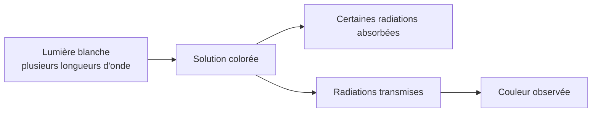

# 1. D'où vient la couleur d'une solution ?

## Objectifs et compétences

Expliquer pourquoi une solution absorbe certaines radiations visibles et relier la lumière transmise à la couleur observée.

## Prérequis

Savoir qu'une lumière peut être décomposée en radiations de longueurs d'onde différentes ; connaître les notions de mélange homogène, soluté et solvant.

## Définitions

!!! definition "Solution"
    Une solution est un mélange homogène constitué d'un solvant et d'une ou plusieurs espèces chimiques dissoutes, appelées solutés.

!!! definition "Radiation monochromatique"
    Une radiation monochromatique est une radiation caractérisée par une seule longueur d'onde.

!!! definition "Absorption lumineuse"
    L'absorption est un phénomène par lequel une espèce chimique prélève de l'énergie à une radiation lumineuse.

## Cours détaillé

La lumière blanche est composée de radiations de différentes longueurs d'onde. Le domaine visible est approximativement compris entre $400$ et $800\\,\\text{nm}$ (les limites exactes dépendent des conventions et de la sensibilité de l'œil).

Lorsqu'une lumière traverse une solution, une partie des radiations peut être absorbée par les espèces chimiques dissoutes. Les radiations qui ne sont pas absorbées sont transmises. La combinaison de ces radiations transmises détermine la couleur perçue.

Une solution colorée absorbe donc sélectivement certaines radiations du visible. Une solution est dite incolore si elle n'absorbe pratiquement pas dans le domaine visible ; elle peut néanmoins absorber dans l'ultraviolet ou l'infrarouge.

### Schéma de principe

!!! attention "Couleur absorbée ≠ couleur observée"
    La couleur observée correspond à la lumière qui arrive à l'œil après traversée de la solution. Elle n'est généralement pas la couleur principalement absorbée. Il faut raisonner sur l'ensemble des radiations transmises, et non appliquer mécaniquement une simple couleur complémentaire dans tous les cas.

## Démonstration et explication

La couleur perçue résulte d'une sélection spectrale : si une partie du spectre incident est retirée par absorption, le spectre transmis est modifié. L'œil interprète ce spectre transmis comme une couleur.

La couleur dépend notamment de la nature chimique de l'espèce absorbante, de son état chimique et des conditions expérimentales. Une variation de concentration peut également modifier l'intensité de la couleur.

## Méthode à maîtriser

Pour expliquer la couleur d'une solution :

1. identifier la lumière incidente (souvent blanche) ;
2. indiquer que l'espèce dissoute absorbe certaines longueurs d'onde ;
3. préciser que les autres radiations sont transmises ;
4. conclure que leur composition spectrale détermine la couleur observée.

## Exemple corrigé

Une solution absorbe fortement dans une zone du spectre correspondant au rouge et transmet davantage les radiations situées dans le bleu et le vert.

**Question :** pourquoi la solution n'apparaît-elle pas rouge ?

**Réponse attendue :** parce que le rouge est principalement absorbé. La couleur perçue provient des radiations transmises, ici principalement bleues et vertes. La solution peut donc apparaître dans une teinte cyan ou bleu-vert.

## À retenir

- La couleur d'une solution vient de l'absorption sélective de la lumière.
- La couleur observée est liée aux radiations transmises.
- Une espèce incolore dans le visible peut absorber dans un autre domaine spectral.
