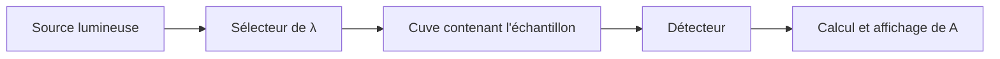

# 3. Fonctionnement du spectrophotomètre

## Objectifs

Décrire la chaîne de mesure, expliquer le rôle du blanc et identifier les étapes d'une mesure fiable.

## Prérequis

Connaître les notions de lumière incidente, lumière transmise et absorbance.

## Définitions

!!! definition "Spectrophotomètre"
    Appareil qui mesure l'absorbance d'un échantillon en fonction de la longueur d'onde, ou à une longueur d'onde choisie.

!!! definition "Blanc"
    Mesure de référence réalisée avec une cuve contenant le solvant et les réactifs appropriés, mais sans l'espèce chimique à doser.

## Cours détaillé

Un spectrophotomètre comporte généralement :
- une source lumineuse ;
- un système de sélection de longueur d'onde (monochromateur ou filtre) ;
- un compartiment pour la cuve ;
- un détecteur ;
- une électronique de traitement et un affichage.

Le sélecteur permet d'étudier une radiation donnée. Le détecteur mesure la lumière transmise. L'appareil compare cette mesure à une référence pour déterminer l'absorbance.

### Réaliser le blanc

Le blanc permet de prendre en compte l'absorption et les effets optiques associés au solvant, aux réactifs et à la cuve. Il doit avoir une composition aussi proche que possible de celle des solutions mesurées, à l'exception de l'espèce dont on cherche la concentration.

## Méthode expérimentale

1. Mettre l'appareil sous tension et choisir le mode absorbance.
2. Sélectionner la longueur d'onde de travail.
3. Rincer la cuve avec un peu de blanc, puis la remplir correctement.
4. Essuyer les faces optiques et éviter les traces de doigts ou les bulles.
5. Placer le blanc dans le bon sens et régler la référence (zéro d'absorbance, selon l'appareil).
6. Mesurer les solutions étalons puis la solution inconnue dans les mêmes conditions.

!!! attention "Sources d'erreurs expérimentales"
    Une cuve sale, des bulles, une orientation différente, un volume insuffisant, une longueur d'onde mal réglée ou un blanc inadapté peuvent fausser les mesures.

## Exemple corrigé

**Question :** pourquoi ne peut-on pas utiliser de l'eau pure comme blanc si les solutions étalons contiennent aussi un réactif complexant qui absorbe légèrement ?

**Correction :** le blanc doit contenir le même solvant et les mêmes réactifs que les étalons, sauf l'espèce colorée à doser. L'eau seule ne compenserait pas l'absorption du réactif complexant ; la référence serait donc incorrecte.

## Synthèse

Le spectrophotomètre sélectionne une longueur d'onde, mesure la lumière transmise et en déduit l'absorbance. La qualité du blanc et la propreté des cuves conditionnent la fiabilité des résultats.
