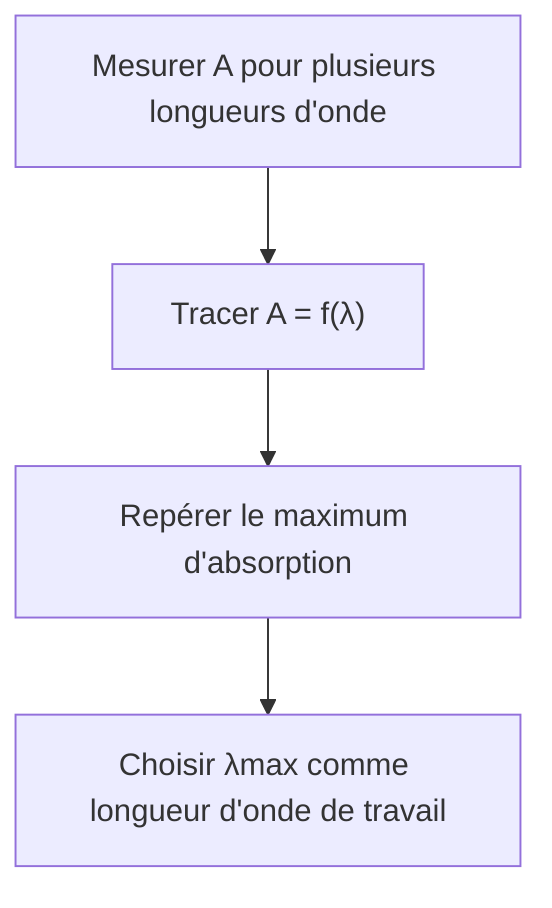

# 6. Spectre d'absorption et courbe d'étalonnage

## Objectifs

Distinguer deux représentations expérimentales, interpréter leurs axes et exploiter leur information.

## A. Spectre d'absorption

!!! definition "Spectre d'absorption"
    Le spectre d'absorption représente l'absorbance $A$ en fonction de la longueur d'onde $\\lambda$, à concentration et conditions expérimentales fixées :
    $$
    A=f(\\lambda)
    $$

Le spectre permet de repérer les zones où l'espèce absorbe le plus. Le maximum d'absorption est repéré par $\\lambda_{\\max}$.

## B. Courbe d'étalonnage

!!! definition "Courbe d'étalonnage"
    Une courbe d'étalonnage représente l'absorbance mesurée pour des solutions étalons en fonction de leur concentration connue :
    $$
    A=f(C)
    $$

Si Beer-Lambert est vérifiée, les points expérimentaux sont approximativement alignés. La droite d'ajustement peut être modélisée par $A=aC+b$. Dans le modèle idéal, $b=0$.

## Comparaison

| Représentation | Abscisse | Ordonnée | Utilité |
|---|---|---|---|
| Spectre d'absorption | $\\lambda$ (nm) | $A$ | Choisir la longueur d'onde |
| Courbe d'étalonnage | $C$ | $A$ | Déterminer une concentration inconnue |

## Exemple corrigé

Un spectre présente un maximum à $\\lambda=525\\,\\text{nm}$. Une série d'étalons mesurés à cette longueur d'onde donne une droite $A=2{,}4\\times10^4 C$.

**Question :** quelle longueur d'onde utiliser pour doser une solution inconnue de la même espèce ?

**Correction :** utiliser $525\\,\\text{nm}$, correspondant au maximum d'absorption du spectre, puis établir ou exploiter la droite d'étalonnage mesurée à cette même longueur d'onde.

!!! attention "Cohérence de la longueur d'onde"
    Les étalons et la solution inconnue doivent être mesurés à la même longueur d'onde. La pente de la droite dépend de la longueur d'onde.

## Méthode de lecture graphique

Pour obtenir $C$ à partir de $A$ :
1. partir de la valeur de $A$ sur l'axe vertical ;
2. tracer une horizontale jusqu'à la droite ;
3. projeter verticalement le point d'intersection sur l'axe des concentrations ;
4. lire $C$ en tenant compte de l'échelle et des unités.
