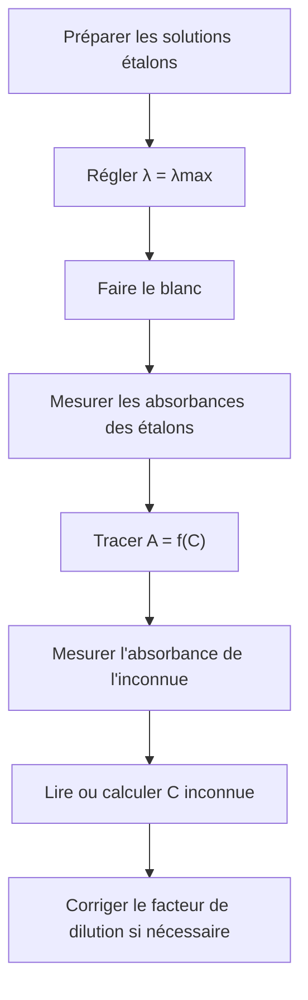

# 7. Dosage par spectrophotométrie

## Objectifs

Construire une gamme étalon, tracer une droite d'étalonnage, déterminer une concentration inconnue par calcul et graphiquement, puis corriger une éventuelle dilution.

## Définitions

!!! definition "Dosage par étalonnage"
    Méthode qui consiste à comparer une grandeur mesurée pour une solution inconnue à celles de solutions étalons de concentrations connues, afin de déterminer la concentration inconnue.

!!! propriete "Choix de la longueur d'onde"
    On choisit généralement $\\lambda_{\\max}$, longueur d'onde au maximum d'absorption. La mesure est alors sensible à la concentration et, près d'un maximum suffisamment large, peu sensible à une petite erreur de réglage de longueur d'onde.

## Protocole complet

### Étape 1 — Choisir $\\lambda_{\\max}$

Enregistrer le spectre d'absorption ou utiliser le spectre fourni. Identifier le maximum et régler le spectrophotomètre à cette longueur d'onde.

### Étape 2 — Préparer les étalons

Préparer plusieurs solutions de concentrations connues, couvrant une gamme adaptée. Les solutions doivent contenir la même espèce chimique dans des conditions comparables.

### Étape 3 — Mesurer et tracer

Réaliser le blanc, mesurer les absorbances des étalons, puis tracer $A=f(C)$. Ajuster une droite si les points sont compatibles avec une relation affine.

## Détermination analytique

Si l'équation expérimentale est :
$$
A=aC+b
$$
alors :
$$
\\boxed{C=\\frac{A-b}{a}}
$$

Si l'ajustement passe par l'origine :
$$
\\boxed{C=\\frac{A}{a}}
$$

## Détermination graphique

On reporte l'absorbance inconnue sur l'axe vertical, on rejoint la droite horizontalement, puis on lit la concentration sur l'axe horizontal.

## Dilution

Si un prélèvement de volume $V_m$ est dilué dans une fiole jaugée de volume final $V_f$, la conservation de la quantité de matière de soluté lors de la dilution conduit à :
$$
C_iV_m=C_fV_f
$$
Le facteur de dilution est :
$$
F=\\frac{V_f}{V_m}
$$
et :
$$
C_i=F C_f
$$
où $C_i$ est la concentration avant dilution et $C_f$ celle de la solution diluée.

!!! attention "Ne pas oublier le facteur de dilution"
    La concentration obtenue avec la droite d'étalonnage est celle de la solution effectivement placée dans la cuve. Si elle a été diluée, il faut retrouver la concentration de la solution initiale.

## Exemple complet corrigé

Une gamme étalon mesurée à $\\lambda_{\\max}$ conduit à :
$$
A=(1{,}65\\times10^4)C+0{,}012
$$
avec $C$ en $\\text{mol}\\,\\text{L}^{-1}$. Une solution inconnue est diluée 5 fois avant mesure. Son absorbance vaut $0{,}342$.

La concentration de la solution diluée vaut :
$$
C_d=\\frac{0{,}342-0{,}012}{1{,}65\\times10^4}
=2{,}00\\times10^{-5}\\,\\text{mol}\\,\\text{L}^{-1}
$$
La solution initiale avait une concentration :
$$
C_i=5C_d
$$
$$
\\boxed{C_i=1{,}00\\times10^{-4}\\,\\text{mol}\\,\\text{L}^{-1}}
$$

## Validation

Avant de conclure, vérifier :
- que l'absorbance inconnue est comprise dans la gamme des absorbances étalons ;
- que les conditions de mesure sont identiques ;
- que le blanc est adapté ;
- que le facteur de dilution est correctement appliqué ;
- que le résultat possède une unité et un nombre de chiffres significatifs cohérent.
