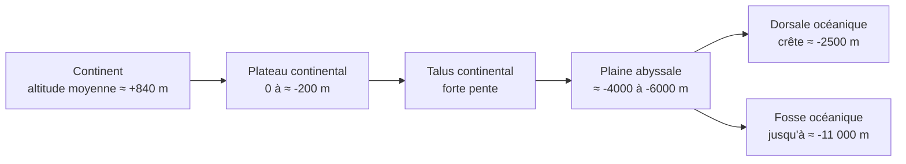

# A. Bimodalité des altitudes

## 1. Organisation des reliefs continentaux et océaniques

### 1.1 Vocabulaire indispensable

!!! info "Définitions"
    - **Altitude** : hauteur d'un point par rapport au niveau de la mer (positive sur les continents, négative sous la mer). Sous la mer, on parle aussi de **profondeur** (bathymétrie).
    - **Relief** : ensemble des irrégularités de la surface du globe, qu'elles soient émergées ou immergées.
    - **Hypsométrie** : mesure des altitudes de la surface terrestre. Une **courbe hypsométrique** représente le pourcentage de la surface du globe situé au-dessus (ou au-dessous) d'une altitude donnée.
    - **Histogramme des altitudes** : diagramme en barres donnant le **pourcentage de la surface du globe** pour chaque **classe d'altitude** (de même largeur).
    - **Mode** : classe la plus fréquente d'une série statistique. Une distribution à **deux modes** est dite **bimodale**.

### 1.2 Les reliefs continentaux

Les continents occupent environ **29 %** de la surface du globe. Leur altitude moyenne est d'environ **+840 m**. On y distingue :

- des **plaines** et **bas plateaux** (altitudes faibles, de 0 à quelques centaines de mètres), qui dominent en surface ;
- des **plateaux élevés** (Tibet, Altiplano), vers $4000$ à $5000\ \text{m}$ ;
- des **chaînes de montagnes** (Alpes, Himalaya, Andes), très étroites en surface mais très hautes (Everest : environ $+8849\ \text{m}$).

### 1.3 Les reliefs océaniques

Les océans occupent environ **71 %** de la surface du globe. La profondeur moyenne est d'environ **−3800 m**. D'un continent vers le large, on rencontre :

- le **plateau continental** : prolongement immergé du continent, pente très faible, jusqu'à environ $-200\ \text{m}$ ;
- le **talus continental** : rupture de pente, descente rapide vers $-3000\ \text{m}$ environ ;
- les **plaines abyssales** : vastes surfaces presque planes, entre $-4000$ et $-6000\ \text{m}$ ;
- les **dorsales océaniques** : chaînes de montagnes sous-marines de plusieurs milliers de kilomètres de long, dont la crête est vers $-2500\ \text{m}$ ;
- les **fosses océaniques** : dépressions étroites et profondes, jusqu'à environ $-11\,000\ \text{m}$ (fosse des Mariannes).

!!! warning "Point d'attention"
    Le schéma est un **profil type**, pas un ordre obligatoire : dorsales et fosses n'existent pas à chaque bord d'océan. Retiens surtout que **le plateau continental fait partie du continent** (croûte continentale), même s'il est sous l'eau. La limite continent/océan au sens géologique n'est donc **pas** la ligne de côte.

## 2. Distribution de la bimodalité des altitudes

### 2.1 Observation

Si l'on construit l'histogramme des altitudes de toute la surface du globe, on obtient **non pas une courbe en cloche unique**, mais **deux pics distincts** séparés par un creux.

!!! abstract "Résultat : la bimodalité des altitudes"
    La distribution des altitudes à la surface de la Terre est **bimodale** :

    - un **premier mode** pour les altitudes **continentales** : de $0$ à environ $+1000\ \text{m}$ ;
    - un **second mode** pour les altitudes **océaniques** : de $-4000$ à $-5000\ \text{m}$ ;
    - entre les deux, des classes **peu représentées** : les altitudes intermédiaires (talus continental) occupent une faible part de la surface.

### 2.2 Ce que signifie la bimodalité

!!! info "Interprétation"
    Une distribution à deux modes suggère **deux populations distinctes**. Si la surface terrestre était seulement un « relief aléatoire » autour d'une altitude moyenne, on aurait un seul pic. La bimodalité indique donc qu'il existe **deux grands ensembles de surface**, de nature différente : les **continents** et les **fonds océaniques**.

### 2.3 Méthode : lire et exploiter un histogramme des altitudes

!!! tip "Méthode"
    1. **Lire les axes** : en abscisse les classes d'altitude, en ordonnée le pourcentage de surface du globe.
    2. **Vérifier la largeur des classes** : on ne compare des hauteurs de barres que si les classes ont la **même largeur**. Une classe ouverte (« plus de $+2000\ \text{m}$ ») ne se compare pas directement.
    3. **Repérer les modes** : les classes les plus hautes, en précisant leur intervalle.
    4. **Repérer le creux** entre les deux modes.
    5. **Conclure** sur le nombre de populations et leur nature.
    6. **Citer des valeurs** chiffrées du document (« $23\ \%$ de la surface entre $-4000$ et $-5000\ \text{m}$ »).

## 3. Exemple corrigé

!!! example "Exemple : exploiter des données simplifiées"
    On donne la répartition (valeurs **simplifiées** pour l'exercice) de la surface du globe par classe d'altitude.

    | Classe d'altitude (m) | $>+2000$ | $+1000$ à $+2000$ | $0$ à $+1000$ | $0$ à $-1000$ | $-1000$ à $-2000$ | $-2000$ à $-3000$ | $-3000$ à $-4000$ | $-4000$ à $-5000$ | $-5000$ à $-6000$ | $<-6000$ |
    |---|---|---|---|---|---|---|---|---|---|---|
    | % de la surface | 3 | 4 | 22 | 5 | 3 | 6 | 14 | 23 | 18 | 2 |

    **Questions** : (1) vérifier la cohérence des données ; (2) déterminer la part des surfaces émergées ; (3) identifier les modes ; (4) conclure.

??? success "Corrigé"
    **(1)** Somme : $3+4+22+5+3+6+14+23+18+2 = 100$. Les données sont cohérentes (total de $100\ \%$).

    **(2)** Surfaces émergées : $3+4+22 = 29\ \%$ de la surface du globe, ce qui correspond aux continents. Les surfaces immergées représentent $5+3+6+14+23+18+2 = 71\ \%$.

    **(3)** Les deux classes les plus représentées (les classes de même largeur $1000\ \text{m}$ sont comparables) sont :

    - $0$ à $+1000\ \text{m}$ : $22\ \%$ (mode continental) ;
    - $-4000$ à $-5000\ \text{m}$ : $23\ \%$ (mode océanique).

    Entre les deux, les classes $-1000$ à $-2000\ \text{m}$ ($3\ \%$) et $-2000$ à $-3000\ \text{m}$ ($6\ \%$) sont très peu représentées : c'est le **creux**.

    **(4)** La distribution présente deux modes séparés par un creux : elle est **bimodale**. La surface du globe est donc formée de **deux grands ensembles** d'altitudes différentes : les continents (autour de $0$ à $+1000\ \text{m}$) et les fonds océaniques (autour de $-4000\ \text{m}$ à $-5000\ \text{m}$).

    !!! warning "Piège évité"
        Les classes $>+2000$ et $<-6000$ sont **ouvertes** : on ne les compare pas aux autres. De même, le mode **n'est pas** « la moyenne » : la moyenne globale (entre $-2000$ et $-3000\ \text{m}$ environ) tombe justement dans le **creux** de la distribution, là où il y a **peu** de surface.

## 4. Points d'attention de cette section

!!! warning "Erreurs fréquentes"
    - Confondre **mode** (valeur la plus fréquente) et **moyenne**.
    - Écrire que « les continents sont à $0\ \text{m}$ » : le mode continental est entre $0$ et $+1000\ \text{m}$, et l'altitude moyenne est d'environ $+840\ \text{m}$.
    - Dire que la bimodalité « vient de la mer » ou du niveau de l'eau : elle existerait aussi avec le niveau de la mer à une autre hauteur, car elle traduit une différence de **nature des croûtes** (voir la partie C).
    - Oublier que le plateau continental est **sous l'eau** mais **continental**.
    - Interpréter un histogramme sans citer de **valeurs chiffrées** : c'est sanctionné en contrôle.
